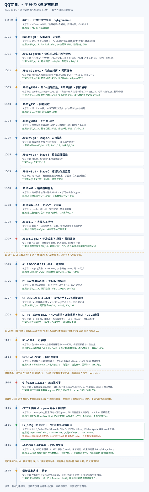

# qqt-RL

新机器继续 DUEL / SP：见[正式迁移与续训说明](docs/continue_training_on_new_machine.md)（Release 权重与必要数据、安装/校验/开训命令；当前仍停训，恢复需重新授权；仅 DUEL 本机 CPU 加载检查通过，SP 与干净目录未验证）。

纯 Bun（抢包子）强化学习仓库，覆盖 JAX 环境仿真、PPO/GAE 训练、独立 Critic/Target Critic、模型评估与浏览器真人测试。

早期 safe-aggression r6 与 cycle 9 的 runner 保留用于历史复现；现行 R1–R4 主线、网页规则和实验边界见本页现行索引。历史训练命令不表示旧队列获准恢复。

训练实验的权威索引见[实验总账](docs/training_experiment_ledger.md)；CX-01 至 CX-30 可检索的负结果、诊断和复现限制见[CX 实验经验](docs/cx_experiment_lessons.md)。本轮 CX-01 至 CX-29 的精炼复现经验与 trap16 长训门控见[CX-01 至 CX-29 经验索引](docs/cx01_29_reproduction_lessons_20261003.md)，详细实验实现、逐轮报告和审计工具保留在 `agent/cx-eval-bot-8gpu-opt` 分支。CX-35 至 CX-45 的主动击杀阶段结论见[主动击杀研究结论](docs/active_kill_experiment_conclusions_20261004.md)，详细实验代码和逐局证据保留在 `agent/cx-active-kill-v2-20261003` 分支。

JE10 v38 的击杀信用、搬包路线方法、逐轮固定评估与当前能力边界见[长期训练总结](docs/je10_control_route_training_summary.md)及[20261019 固定评估报告](reports/je10_training_20261019.md)。r19 已在 g58 按用户指令安全暂停；[线上结果页](https://allwellll.github.io/qqt-RL/training.html)保留全部 61 个完成固定点。

## 当前网页与训练状态（2026-11-07）

[在线游戏](https://allwellll.github.io/qqt-RL/) · [当前使用与代码入口](docs/current_web_and_training_status_20261107.md) · [报告索引](reports/README.md)

网页物理为 **`bun-native-v4-facing`**，继承 v3 的道具供给与全图死亡掉落。面朝同一行/列、前方最多 3 格且无遮挡的首个泡即可原地起计，不需要按键或碰撞；圆环与真实放泡权限共用原生判定。旧 Review 按记录版本与 SHA 使用冻结物理，不套用新规则。

|模型菜单|适合尝试的长处|明确短板与证据范围|
|---|---|---|
|**G_frozen τ0.3 · 均衡**|保留完整局参照|专项不代表全面领先|
|**DUEL u019902 τ0.3 · 近身击杀**|v3 人工近身 dev/holdout 因果杀 8/7（各16局），同批 G 为1/0；网页40局40胜|v3 网页自死9次，同批G为4；完整局可行动静止23.94%，G为18.83%|
|**SP u023302 τ0.3 · 猎手对抗与喷泉**|v3 网页40局39胜0负1平、自死1次；困难猎手8局因果杀7、交付10|完整局可行动静止34.08%；近身优势未建立，喷泉串弱于同点argmax|

原生产 JS 选模总计 **856 局**，网页每对手每方式 **8 局**；表中是 v3 证据。当前 v4 另做每模型8局的针对快筛与桌面/手机加载复核，未见所标长处明显反转；不把 v3 数字称作 v4 成绩，不宣称全面胜出。[模型交付与 SHA](reports/cx_web_specialists_items_v3_20261107.md)

手机左侧下方提供**浮动方向区**（约屏宽45%、屏高60%）：按住滑动移动，约10px死区、15°滞回，松手250ms内短按沿用上次方向。右侧放泡圆键88–104px，命中区为直径的1.25倍；下方横排三个48–64px道具键 **1/2/3**，直接放置对应槽位，显示图标与数量，库存4–7槽保留换页。局部禁选中/callout/菜单，不影响昵称编辑；多指、取消、失焦清理保留。[触控容错验收](reports/cx_mobile_touch_tolerance_20261108.md) 使用真实 Chromium 触摸事件，未做真机 iOS Safari 测试。

开局遮罩会显示模型下载量、百分比、备用线路与校验/初始化阶段，失败可直接重试。[加载进度说明](reports/cx_web_loading_progress_20261108.md)。真人对局死亡后只预告**自己的**复活点；危险或占用时重选，实际复活位置与预告一致。对方、观战及旧 Review 不显示预告。[复活预览说明](reports/cx_web_self_respawn_preview_20261108.md)

主对局侧栏仅保留功能控件及必要状态/错误提示，已去掉规则Bot、观战、队伍模式、旧物理和空场地图选项。香蕉边界辅助保持原默认开启并隐藏开关；旧录像目录后台加载，不阻塞首帧。[开局耗时与精简报告](reports/cx_web_startup_sidebar_cleanup_20261108.md)。

|操作|键位|
|---|---|
|移动|方向键；小键盘 **5上、1左、2下、3右**（NumLock开关均支持）|
|放泡|Space / W；手机“放泡”|
|道具|主键盘1–7直接对应槽位；E / Shift为首槽；手机当前页三个槽位按钮|
|重开|R（输入框内不劫持）|

小键盘移动不触发道具。模型按需下载，**Pages 同源 Release 镜像 → GitHub Release 直链** 回退，所有资产先校验大小和 SHA256；浏览器已停用 OSS 下载，历史资产保留，凭据不进入仓库或前端。[当前模型交付规范](docs/github_pages_model_delivery.md)

**训练已按用户指令立即暂停，所有自动后继及续跑授权撤销；保留已有 COMMITTED，不再等待固定预算终点。** 训练owner已核实训练worker为0、八卡计算进程为空且锁释放，七臂最后COMMITTED的state/policy SHA已核对；[停训报告](reports/cx_training_stopped_20261107.md)。可版本管理的 `training_launch_policy.json` 默认关闭训练，即使缺少私有状态也阻止通用训练/GPU入口；[训练代码与封存索引](docs/training_code_map_20261107.md)。main 的文档、历史命令或代码合入均不是恢复授权。只能读取已完成 checkpoint/READY 做不触发训练的评估，未来恢复必须重新获得用户明确授权。历史 runs、checkpoint、旧录像与秘密文件全部保留。

网页模型菜单现仅保留 SP u023302（默认）、G_frozen、DUEL u019902 和风险线 u9969；默认变更依据用户最新明确授权，未新增评测。下架模型资产保留，历史身份见 `web/retired-models-20261107.json`。

## 训练路线与历史证据

R1 道具/进攻 → R2 原生搬包 → R3 事件奖励/可见观测 → R4 对拼课程 → G 多区域联赛 → 联赛v2。旧规则下 L2_S05g u019302 argmax 新seed双座复测95胜/44负/37平（176局）；这是历史训练参照，不能替代当前 v3/v4 选模。



[HTML详细版](https://allwellll.github.io/qqt-RL/reports/mainline_timeline_20261106.html) · [数字来源与SHA](reports/mainline_timeline_evidence_20261106.json) · [历史训练代码闭包](docs/combat_league_v2_training_path_20261106.md)

图保留截至11月6日的快照；当前模型、规则与停训状态以上方11月7日说明为准。历史 run、完整状态及大模型不入 Git，旧队列不恢复。

## 快速开始

网页预览只需Node依赖，不会启动训练：

```bash
npm ci
npm run serve
```

需要Python源码检查或CPU评估时再安装Python环境：

```bash
cd /path/to/qqt-RL
python3 -m venv .venv
source .venv/bin/activate
python -m pip install -U pip
python -m pip install -e '.[test]'
```

GPU 环境请按机器 CUDA/JAX 版本安装匹配的 JAX wheel；仓库不固定设备专属 wheel。正式训练默认拒绝静默回退到 CPU。

## 海光 DCU 训练（`dcu` 分支）

`dcu` 分支用于从 H200/CUDA 迁移至海光 DCU/ROCm，复用容器预装的海光 JAX，
通过项目 `.venv` 补充依赖。当前验证环境为 DTK 26.04、Python 3.11.9、
JAX/JAXlib `0.6.0+das.opt1.dtk2604`；不替换驱动或系统训练依赖。

| 文档 | 内容 |
|---|---|
| [DCU 迁移与训练方法](docs/dcu_migration.md) | 环境安装、模型数据下载与校验、单卡检查、正式训练入口和编译缓存 |
| [单卡验证记录](reports/dcu_validation_20261108.json) | DUEL 真实采样、GAE、PPO/Adam 更新结果，以及 SP 前向验证范围 |
| [模型迁移与续训语义](docs/continue_training_on_new_machine.md) | Release 权重来源、Actor 热启动、Critic/Adam 重建及模型保存边界 |
| [后续8卡训练](docs/dcu_migration.md#后续8卡机器) | 8卡机器就绪后的数据并行、梯度聚合和卡间通信验证计划 |

按迁移文档配置环境和下载数据后，在分配给自己的空闲 DCU 上验证：

```bash
source scripts/dcu_env.sh
python -u -m scripts.dcu_smoke --line DUEL --device 0 --update
```

已通过单卡 DUEL 的4 env × 2 tick、minibatch 8 完整更新，SP 已通过前向检查。
首次 DUEL 采样图编译约12分钟，缓存位于项目 `.jax_cache/dcu/`。
正式单卡入口为 `python -m scripts.dcu_training`，用法见迁移文档；当前保留停训设置，
本机不启动长训。8卡适配与验收将在新机器就绪后进行，当前单卡结果不代表8卡已验证。

## 目录

- `jax_bomb/`：Bun 环境、网络、PPO/GAE、安全动作分析、规则 Bot 与 Critic 核心。
- `qqt_rl/training/`：配置、seed、持久 JAX cache、常驻 worker、进程日志和原子 checkpoint 发布辅助层。
- `qqt_rl/bots/`：Python/浏览器共享语义的 Bot schema、生命周期和显式注册表。
- `scripts/`：数据生成、Critic/Actor 训练、评估、单 candidate runner 与四卡 supervisor。
- `tests/`：环境、奖励归因、安全性、Critic、seed namespace 和模块化回归测试。
- `web/`：只含 Bun06 真人测试、规则 Bot、HTTP server 与 Node 测试。
- `runs/`、`data/`、`checkpoints/`：默认运行产物，全部被 `.gitignore` 排除。

## 验证与 Smoke

```bash
python -m compileall -q jax_bomb qqt_rl scripts tests
pytest -q
npm test
```

以上为静态检查和测试，不包含训练。下方训练命令是历史复现资料，在用户重新授权前不执行，包括 CPU training smoke。

## 历史 1..360 Cycle 训练（已暂停，仅供代码追溯）

训练 bootstrap 不进入 Git。将以下文件放到任意外部目录，例如 `/path/to/bootstrap`：

```text
base_actor.pt
base_critic.pkl
base_target_critic.pkl
reference_actor.pt
bc_v2_escape_selective_bc.npz
generic_critic_replay_aux.npz
weak_actor.pt
old_actor.pt
```

准备单 cycle smoke：

```bash
python scripts/prepare_bun_safe_aggression_v7.py \
  --bootstrap-dir /path/to/bootstrap \
  --run-name smoke-1cycle \
  --cycles 1 \
  --segment-size 1 \
  --gpus 0,1,2,3
```

准备正式 360-cycle 运行：

```bash
python scripts/prepare_bun_safe_aggression_v7.py \
  --bootstrap-dir /path/to/bootstrap \
  --run-name safe-aggression-360 \
  --cycles 360 \
  --segment-size 90 \
  --gpus 0,1,2,3

python scripts/launch_bun_safe_aggression_v7.py \
  --manifest runs/safe-aggression-360/manifest.json
```

新 run 默认使用固定 shape 的 `--counterfactual-state-batch-size 4`、Critic batch `64`、每阶段常驻 worker，以及 candidate 级稳定 JAX 编译缓存。可用 `--jax-cache-dir /shared/path` 指定显式共享根目录；缓存目录始终不提交 Git。

runner 保留全局 cycle `1..360`、90-cycle 可恢复分段、固定 milestone 评估、strict train/validation/test seed 泄漏检查，以及 Actor/Critic/Target Critic 的有限值与哈希校验。checkpoint 使用同目录临时文件后 `os.replace` 原子发布。

## 模型评估

```bash
python scripts/eval_bun_tactical_opponent.py checkpoints/model.pt \
  --games 64 \
  --seed 202609280000 \
  --max-steps 300 \
  --json-out runs/eval/model-vs-tactical.json
```

评估结果写入 `runs/`。加 `--per-episode` 会额外保存逐局结果与出生格（用于配对比较）；`--host-workers N` 把规则 Bot 决策与漏斗标签分到 N 个进程，结果与串行逐位一致。如需导出浏览器模型，应将生成文件放入被忽略的 `web/models/`；本仓库不提交大模型权重。

## Transformer checkpoint 对战能力评估

目的：沿训练进程扫描 checkpoint，看战斗能力（安全击杀、自炸、被杀、危险处理）是在提升还是回退。这是 danger_arena 近身战斗探针，**不代表完整抢包子能力**（不含偷包/运包/回家）。

固定协议（与历史 `runs/eval_v2/*.json` 同口径，schema `bun_tactical_opponent_eval_v1`）：

- 课程 `danger_arena=1`，清空可破坏砖块，HP=1，最长 300 tick。
- Actor 固定为玩家 0、argmax 动作、无安全屏蔽；对手固定为玩家 1 的冻结 `bun.tactical_v2`（哈希校验）。
- 出生点由 seed 决定，环境内部随机交换两侧出生位置；同一 seed 下所有 checkpoint 的出生格完全相同（`spawns_identical_across_checkpoints` 核验），因此可做逐局配对比较。

```bash
# 64 局探索性全曲线（phase1 + 全部 phase2_itN + phase2.pt）
python scripts/eval_transformer_checkpoint_sweep.py \
  --run-dir runs/overnight_tf_v2 \
  --out-dir runs/transformer_sweep/overnight_tf_v2/seed20260930_g64 \
  --seed 20260930 --games 64 --device 0 \
  --teacher-json runs/eval_v2/rulebot_baseline.json

# 大样本确认：换 seed，只挑关键点
python scripts/eval_transformer_checkpoint_sweep.py \
  --run-dir runs/overnight_tf_v2 \
  --out-dir runs/transformer_sweep/overnight_tf_v2/confirm_seed20261001_g1024 \
  --checkpoints phase1,3500,4000,6000,final \
  --seed 20261001 --games 1024 --host-workers 48 --device 0
```

`--checkpoints` 支持 `all`、`phase1`、`final`、文件名、单个 iter（`4000`）和区间（`5500-8000`），可组合。所有 checkpoint 在同一进程串行评估，`env.step` 只编译一次；持久 JAX 编译缓存默认放在 `<out-dir>/../.jax_cache`，重跑时跳过编译。已存在且 checkpoint sha256、seed、局数、步数全匹配的 JSON 会被复用（`--reuse-dir` 可指向旧结果目录，`--force` 强制重跑），`--plot-only` 只重画图。参考耗时（单卡 H200）：64 局约 28 秒/点，1024 局约 60 秒/点；首个点多约 70 秒编译。

输出目录：

- `checkpoints/<name>.json`：逐 checkpoint 完整结果（含 `per_episode` 逐局结果与出生格、`runtime` 耗时拆分）。
- `summary.json` / `summary.csv`：汇总指标、Wilson 95% 区间，以及相对 `--reference`（默认 phase1）的逐局配对差值。
- `capability_curves.png`：9 宫格曲线，包括存活安全击杀、安全引爆比、自炸、被对手击杀（物理或因果，取并集）、可避免危险死亡、danger→death、场均放泡、战术解决率、策略熵。红色虚线是规则 Bot 自对弈基线。
- 可选 `--flee-probe`：另在 GPU 上整局跑对 JAX flee bot（阶段 1 训练对手，以逃跑/静止为主）的补充探针，输出 `flee_probe/`、`flee_probe_summary.json`、`flee_probe_curves.png`。它只测追击补刀，params 以 jit 参数传入，数值与主口径不同，不能与主曲线混比。

横轴：阶段 2 iteration。phase1 终点记为 0，`phase2_itN` 记为 N，`phase2.pt` 记为 `phase2.json` 中的 `ppo_iterations`（本次为 8000）。

解读：

- 误差线是局级二元比率的 Wilson 95% 区间。64 局时区间半宽约 ±0.10 到 0.12，相邻点差 0.1 以内基本是噪声，全曲线只用于找候选点和趋势。
- 安全引爆比、战术解决率按事件汇总，场均放泡和熵是均值，这几项不画区间。
- 结论以大样本确认为准：换一个未用于挑点的 seed，局数 ≥1024（区间半宽约 ±0.03）。比较两个 checkpoint 时看 `paired_vs_reference` 的配对差值区间，它扣除了出生格带来的方差，比两个独立区间是否重叠更灵敏。
- 如果某个点只在 64 局扫描里高，大样本下不再高，就是挑点偏差，不能称为提升。

导出一份可信的本地 Transformer checkpoint：

```bash
python scripts/export_bun_web_model.py checkpoints/model.pt \
  --output web/models/model.json \
  --name safe-aggression-model
```

checkpoint 使用 Python pickle 格式，只能加载本机训练并已核对哈希的可信文件，禁止导入来源不明的 pickle。

## Web 真人测试

```bash
npm run serve
```

浏览器访问终端打印的本地地址。本地人类使用方向键或小键盘5123移动、`Space/W`放泡、主键盘1–7使用对应库存槽、`R`重开；手机提供方向、放泡及三槽快捷键。对手只可选择四个已发布模型，主对局固定为真人1v1和v4-facing；旧Review保持只读。服务健康检查为 `/healthz`。

Bot 扩展契约和 Python/JavaScript 最小插件见 `docs/bot_plugins_zh.md`。

## v2 性能基准

```bash
python scripts/benchmark_v2_pipeline.py \
  --output-dir runs/benchmarks/v2-pipeline
```

基准输出 `benchmark.json`，包含持久缓存冷/热启动、legacy 与固定 shape 反事实 states/s、Critic batch 64/128/256 samples/s、真实 PPO smoke steps/s、逐字段 replay 等价报告和 GPU 利用率采样状态。默认使用 CPU，避免争抢仍在旧仓库运行的四卡任务。

## 训练语义

- 环境 observation 主布局为 `[batch, channel, height, width]`，rollout 再增加 time 维。
- 奖励从 reset 前事件归因，避免跨局污染；安全放泡分 placement 与 resolution 两阶段结算。
- PPO 使用 clipped policy objective、GAE return 与 entropy；独立 Critic 和 Target Critic 不复用 Actor 参数树。
- seed namespace 同时保证原始整数与 JAX `uint32` 表示在 candidate/cycle/split 间不碰撞。

详见 `docs/migration_report.md`。

## 用户排行榜

排行榜按用户要求暂缓整理。当前 v4 后端未支持时明确显示暂不可用，游戏照常开局和本地结算；不提交旧 ruleset、不混榜、不删旧数据。[历史部署文档](supabase/README.md)保留，SQL迁移不是当前发布前置。
