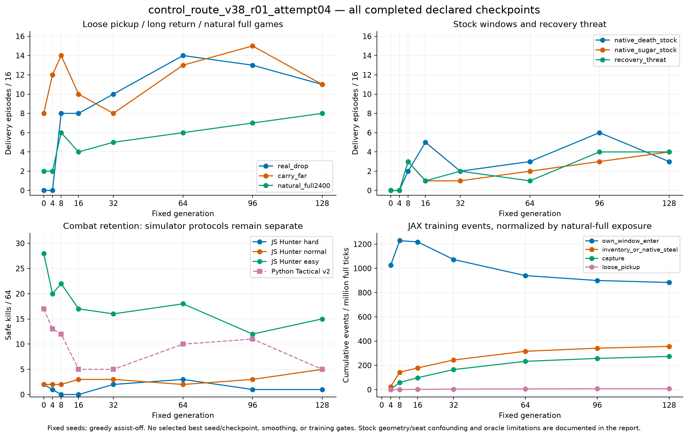
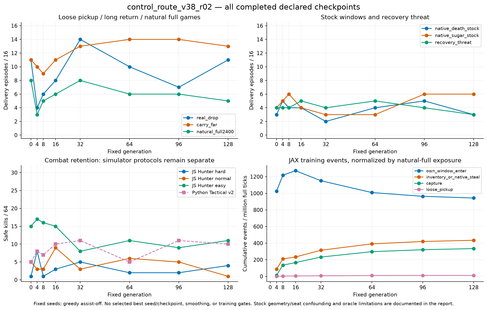
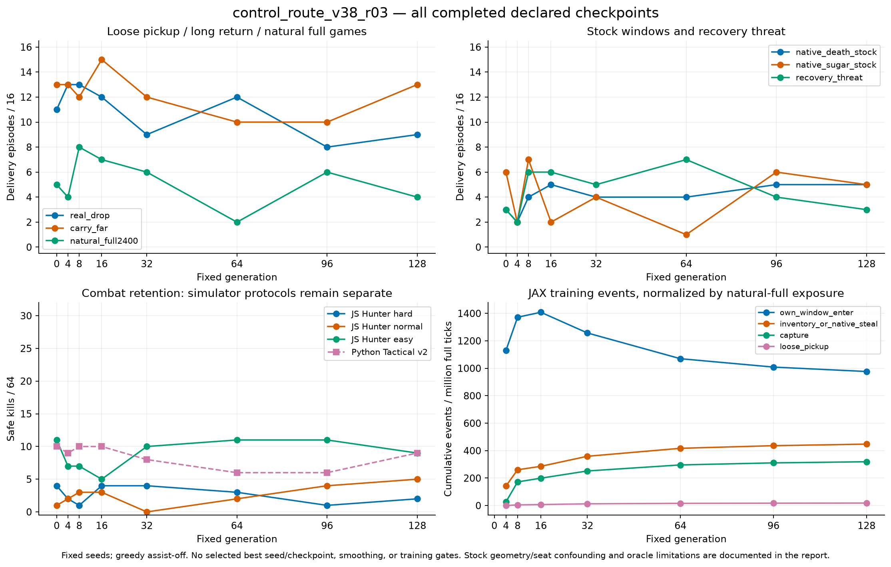
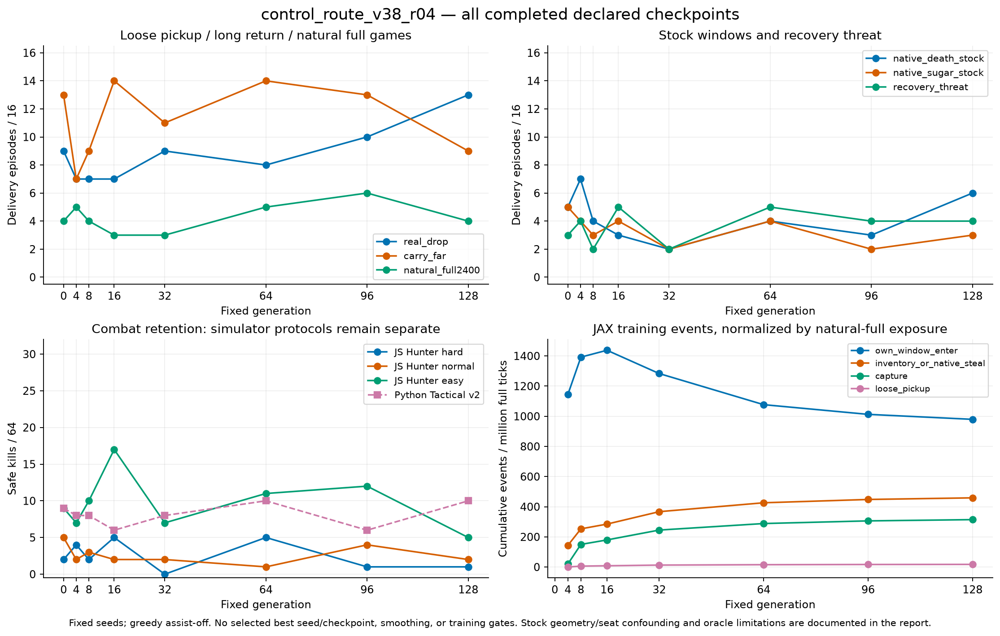
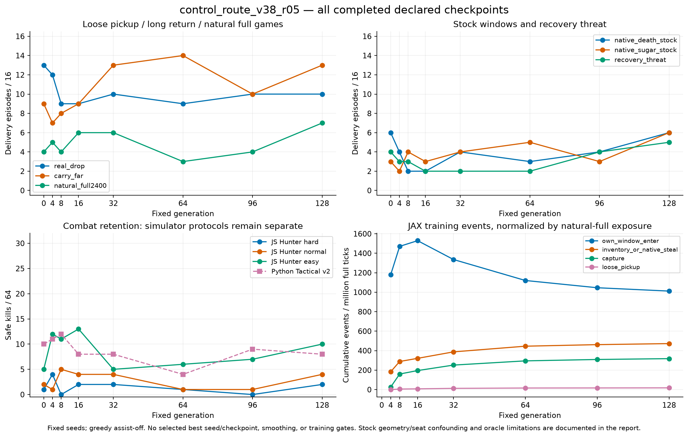
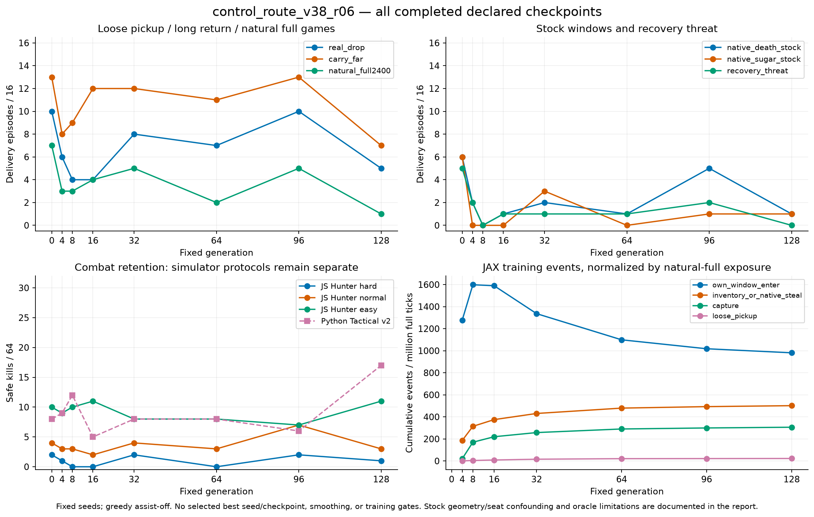

# JE10 v38 冻结训练与文档集成报告（20261018）

证据读取截至 **2026-10-18 13:33:24 UTC+8**；本报告由冻结SUMMARY/COMPLETE重新生成，没有复制仍由writer维护的训练报告。长期解释见[训练总结](../docs/je10_control_route_training_summary.md)，逐点数据和原始产物哈希见[冻结摘要](je10_evidence_20261018.json)。

## 固定点评估全表

所有点均核验COMPLETE全部shard哈希及policy身份。Hunter难/中/易和Python Tactical各64局；八路线交付各16局，顺序D/S/Drop/Near/Mid/Far/Recovery/Full。self为Hunter三档、Tactical的自伤局，分别报告；路线自伤另列总事件（不混作战斗率）。全表未择优。

| 轮次 | g | Hunter难/中/易，各64 | Tactical/64 | 八路线交付，各16 | self H难/中/易; T | 路线self事件 |
|---|---:|---|---:|---|---|---:|
| r01 | 0 | 2/2/28 | 17 | 0/0/0/16/16/8/0/2 | 0/0/0; 0 | 0 |
| r01 | 4 | 1/2/20 | 13 | 0/0/0/16/16/12/0/2 | 1/0/0; 0 | 0 |
| r01 | 8 | 0/2/22 | 12 | 2/3/8/16/16/14/3/6 | 0/0/0; 0 | 0 |
| r01 | 16 | 0/3/17 | 5 | 5/1/8/16/16/10/1/4 | 0/0/0; 0 | 0 |
| r01 | 32 | 2/3/16 | 5 | 2/1/10/16/16/8/2/5 | 0/0/0; 0 | 0 |
| r01 | 64 | 3/2/18 | 10 | 3/2/14/16/15/13/1/6 | 0/0/0; 0 | 0 |
| r01 | 96 | 1/3/12 | 11 | 6/3/13/16/16/15/4/7 | 0/0/0; 0 | 0 |
| r01 | 128 | 1/5/15 | 5 | 3/4/11/16/15/11/4/8 | 0/0/0; 0 | 0 |
| r02 | 0 | 1/5/15 | 5 | 3/4/11/16/15/11/4/8 | 0/0/0; 0 | 0 |
| r02 | 4 | 8/3/17 | 8 | 5/5/4/16/16/10/4/3 | 0/0/0; 1 | 0 |
| r02 | 8 | 1/3/16 | 7 | 4/6/6/16/16/9/4/5 | 0/0/0; 0 | 0 |
| r02 | 16 | 3/9/15 | 10 | 4/4/8/16/16/11/5/6 | 0/0/0; 0 | 0 |
| r02 | 32 | 5/3/8 | 11 | 2/3/14/16/15/13/4/8 | 0/0/0; 0 | 0 |
| r02 | 64 | 2/6/11 | 5 | 4/3/10/16/16/14/5/6 | 0/0/0; 0 | 0 |
| r02 | 96 | 2/5/9 | 11 | 5/6/7/16/16/14/4/6 | 0/0/0; 0 | 0 |
| r02 | 128 | 4/1/11 | 10 | 3/6/11/16/16/13/3/5 | 0/0/0; 0 | 0 |
| r03 | 0 | 4/1/11 | 10 | 3/6/11/16/16/13/3/5 | 0/0/0; 0 | 0 |
| r03 | 4 | 2/2/7 | 9 | 2/2/13/16/16/13/2/4 | 0/0/0; 1 | 0 |
| r03 | 8 | 1/3/7 | 10 | 4/7/13/16/16/12/6/8 | 0/0/0; 0 | 0 |
| r03 | 16 | 4/3/5 | 10 | 5/2/12/16/16/15/6/7 | 0/0/0; 2 | 0 |
| r03 | 32 | 4/0/10 | 8 | 4/4/9/16/16/12/5/6 | 0/0/0; 0 | 0 |
| r03 | 64 | 3/2/11 | 6 | 4/1/12/16/16/10/7/2 | 0/0/0; 1 | 0 |
| r03 | 96 | 1/4/11 | 6 | 5/6/8/16/16/10/4/6 | 0/0/0; 0 | 0 |
| r03 | 128 | 2/5/9 | 9 | 5/5/9/16/16/13/3/4 | 1/0/0; 0 | 0 |
| r04 | 0 | 2/5/9 | 9 | 5/5/9/16/16/13/3/4 | 1/0/0; 0 | 0 |
| r04 | 4 | 4/2/7 | 8 | 7/4/7/16/16/7/4/5 | 0/0/0; 1 | 0 |
| r04 | 8 | 2/3/10 | 8 | 4/3/7/16/16/9/2/4 | 1/0/0; 0 | 0 |
| r04 | 16 | 5/2/17 | 6 | 3/4/7/16/16/14/5/3 | 0/0/0; 0 | 0 |
| r04 | 32 | 0/2/7 | 8 | 2/2/9/16/15/11/2/3 | 0/1/0; 1 | 0 |
| r04 | 64 | 5/1/11 | 10 | 4/4/8/16/16/14/5/5 | 0/0/0; 0 | 0 |
| r04 | 96 | 1/4/12 | 6 | 3/2/10/16/16/13/4/6 | 0/0/1; 1 | 0 |
| r04 | 128 | 1/2/5 | 10 | 6/3/13/16/15/9/4/4 | 0/0/0; 1 | 0 |
| r05 | 0 | 1/2/5 | 10 | 6/3/13/16/15/9/4/4 | 0/0/0; 1 | 0 |
| r05 | 4 | 4/1/12 | 11 | 4/2/12/16/16/7/3/5 | 0/0/0; 0 | 0 |
| r05 | 8 | 0/5/11 | 12 | 2/4/9/16/16/8/3/4 | 0/0/0; 0 | 0 |
| r05 | 16 | 2/4/13 | 8 | 2/3/9/16/15/9/2/6 | 0/0/0; 0 | 0 |
| r05 | 32 | 2/4/5 | 8 | 4/4/10/16/16/13/2/6 | 0/0/0; 0 | 0 |
| r05 | 64 | 1/1/6 | 4 | 3/5/9/16/16/14/2/3 | 0/0/0; 0 | 0 |
| r05 | 96 | 0/1/7 | 9 | 4/3/10/16/16/10/4/4 | 0/0/2; 2 | 0 |
| r05 | 128 | 2/4/10 | 8 | 6/6/10/16/16/13/5/7 | 0/0/0; 1 | 0 |
| r06 | 0 | 2/4/10 | 8 | 6/6/10/16/16/13/5/7 | 0/0/0; 1 | 0 |
| r06 | 4 | 1/3/9 | 9 | 2/0/6/16/16/8/2/3 | 0/0/0; 0 | 0 |
| r06 | 8 | 0/3/10 | 12 | 0/0/4/16/15/9/0/3 | 0/0/0; 2 | 0 |
| r06 | 16 | 0/2/11 | 5 | 1/0/4/16/16/12/1/4 | 0/0/0; 0 | 0 |
| r06 | 32 | 2/4/8 | 8 | 2/3/8/16/16/12/1/5 | 0/0/0; 0 | 0 |
| r06 | 64 | 0/3/8 | 8 | 1/0/7/16/16/11/1/2 | 0/0/0; 0 | 0 |
| r06 | 96 | 2/7/7 | 6 | 5/1/10/16/16/13/2/5 | 0/2/0; 0 | 0 |
| r06 | 128 | 1/3/11 | 17 | 1/1/5/16/16/7/0/1 | 0/0/0; 0 | 0 |
| r07 | 0 | 1/3/11 | 17 | 1/1/5/16/16/7/0/1 | 0/0/0; 0 | 0 |
| r07 | 4 | 0/0/14 | 12 | 1/0/7/16/16/8/0/0 | 0/1/0; 0 | 0 |
| r07 | 8 | 0/2/13 | 10 | 1/1/5/16/16/11/1/6 | 0/0/0; 0 | 0 |
| r07 | 16 | 1/2/9 | 13 | 1/2/8/16/16/12/1/6 | 0/0/0; 0 | 0 |
| r07 | 32 | 0/2/20 | 16 | 4/4/11/16/16/10/0/2 | 0/0/1; 0 | 0 |

## 预算与终态

| 轮次 | train / technical seed | STATE代数 | 最新COMMITTED | compute秒 / terminal wall秒 |
|---|---|---:|---:|---|
| r01 | 353284308 / 3378785851 | 128 | 128 | 4751.549 / 9949.416 |
| r02 | 1881716240 / 1618573730 | 128 | 128 | 4356.956 / 5210.326 |
| r03 | 1639578875 / 3501906343 | 128 | 128 | 4397.280 / 5240.626 |
| r04 | 3688535036 / 1017883248 | 128 | 128 | 4414.817 / 5281.152 |
| r05 | 2340928073 / 4008119116 | 128 | 128 | 4396.396 / 5250.523 |
| r06 | 2236293928 / 3840110319 | 128 | 128 | 5224.867 / 6087.909 |
| r07 | 1777901369 / 814965590 | 68 | 68 | 运行中，不报完整轮耗时 |

r01–r06各完整128代/268,435,456 fresh ticks；r07预算相同，STATE采样值和COMMITTED不同步时按各自标记报告。终态wall与STATE末代wall含不同收尾范围，不能替换。后继遵循前轮final raw Actor/Critic/pool，并fresh Adam/RNG/env/FIFO，非同父随机对照。

## 已完成轮曲线

以下从[冻结绘图输入](je10_curve_data_20261018.json)重生成；48个点逐项核对冻结SUMMARY，包含全部预声明固定点。图内JAX训练事件以full有效ticks归一，与JS/Python评估分列。r07未完成，不伪造完整曲线。

## 源码集成与验证

逐文件依赖由AST（含相对import）、JS require及显式runtime文件读取构成；manifest记录每条直接边、required_by和source/published哈希。表内包含已有main依赖用于闭包审查，不代表这些已有文件都被修改。四项历史RED断言改为当前数值行为验收，另将跨测试文件的scalar fixture内联；生产数值源码按稳定字节移植。

| 文件 | 来源 | 直接依赖数 |
|---|---|---:|
| [jax_bomb/__init__.py](../jax_bomb/__init__.py) | existing main | 0 |
| [jax_bomb/bun_env.py](../jax_bomb/bun_env.py) | existing main | 4 |
| [jax_bomb/bun_jax_bots.py](../jax_bomb/bun_jax_bots.py) | existing main | 3 |
| [jax_bomb/bun_safety.py](../jax_bomb/bun_safety.py) | existing main | 3 |
| [jax_bomb/jax_env.py](../jax_bomb/jax_env.py) | existing main | 2 |
| [jax_bomb/jax_net.py](../jax_bomb/jax_net.py) | existing main | 2 |
| [jax_bomb/jax_train.py](../jax_bomb/jax_train.py) | existing main | 8 |
| [jax_bomb/je05_bun_env.py](../jax_bomb/je05_bun_env.py) | JE10 transplant | 6 |
| [jax_bomb/je05_core_env.py](../jax_bomb/je05_core_env.py) | JE10 transplant | 2 |
| [jax_bomb/je07_bun_env.py](../jax_bomb/je07_bun_env.py) | JE10 transplant | 6 |
| [jax_bomb/levels.py](../jax_bomb/levels.py) | existing main | 0 |
| [jax_bomb/platform.py](../jax_bomb/platform.py) | existing main | 0 |
| [scripts/analyze_control_route_curve.py](../scripts/analyze_control_route_curve.py) | JE10 transplant | 0 |
| [scripts/continuous_route_metric.py](../scripts/continuous_route_metric.py) | JE10 transplant | 1 |
| [scripts/eval_web_hunter.js](../scripts/eval_web_hunter.js) | existing main | 4 |
| [scripts/eval_web_hunter_residual.js](../scripts/eval_web_hunter_residual.js) | existing main | 1 |
| [scripts/frontier_native_witness.py](../scripts/frontier_native_witness.py) | JE10 transplant | 3 |
| [scripts/je03_bun_selfplay_ops_20261012.py](../scripts/je03_bun_selfplay_ops_20261012.py) | existing main | 1 |
| [scripts/je04_bun_ops.py](../scripts/je04_bun_ops.py) | JE10 transplant | 5 |
| [scripts/je05_bun_encoding.js](../scripts/je05_bun_encoding.js) | JE10 transplant | 0 |
| [scripts/je05_bun_ops.py](../scripts/je05_bun_ops.py) | JE10 transplant | 8 |
| [scripts/je05_bun_scenes.py](../scripts/je05_bun_scenes.py) | JE10 transplant | 5 |
| [scripts/je05_bun_transport.py](../scripts/je05_bun_transport.py) | JE10 transplant | 0 |
| [scripts/je05_web_hunter.js](../scripts/je05_web_hunter.js) | JE10 transplant | 4 |
| [scripts/je07_bun_curriculum.py](../scripts/je07_bun_curriculum.py) | JE10 transplant | 0 |
| [scripts/je07_bun_ops.py](../scripts/je07_bun_ops.py) | JE10 transplant | 10 |
| [scripts/je07_bun_scenes.py](../scripts/je07_bun_scenes.py) | JE10 transplant | 5 |
| [scripts/je08_bun_potential.py](../scripts/je08_bun_potential.py) | existing main | 0 |
| [scripts/je08_web_diagnostics.js](../scripts/je08_web_diagnostics.js) | JE10 transplant | 4 |
| [scripts/je09_bun_bridge.py](../scripts/je09_bun_bridge.py) | JE10 transplant | 0 |
| [scripts/je09_bun_ops.py](../scripts/je09_bun_ops.py) | JE10 transplant | 16 |
| [scripts/je09_bun_scenes.py](../scripts/je09_bun_scenes.py) | JE10 transplant | 6 |
| [scripts/je09_chase_expert.py](../scripts/je09_chase_expert.py) | JE10 transplant | 2 |
| [scripts/je09_drop_expert.py](../scripts/je09_drop_expert.py) | JE10 transplant | 3 |
| [scripts/je09_return_expert.py](../scripts/je09_return_expert.py) | JE10 transplant | 1 |
| [scripts/je09_route_pbrs.py](../scripts/je09_route_pbrs.py) | JE10 transplant | 7 |
| [scripts/je09_stage_e_coverage.py](../scripts/je09_stage_e_coverage.py) | JE10 transplant | 4 |
| [scripts/je09_stage_e_ops.py](../scripts/je09_stage_e_ops.py) | JE10 transplant | 10 |
| [scripts/je09_stage_f_mode.py](../scripts/je09_stage_f_mode.py) | JE10 transplant | 2 |
| [scripts/je09_stage_f_reward.py](../scripts/je09_stage_f_reward.py) | JE10 transplant | 2 |
| [scripts/je09_stage_g_combat.py](../scripts/je09_stage_g_combat.py) | JE10 transplant | 2 |
| [scripts/je09_stage_h2_ops.py](../scripts/je09_stage_h2_ops.py) | JE10 transplant | 1 |
| [scripts/je09_stage_h3_ops.py](../scripts/je09_stage_h3_ops.py) | JE10 transplant | 1 |
| [scripts/je09_stage_h5_course.py](../scripts/je09_stage_h5_course.py) | JE10 transplant | 4 |
| [scripts/je09_stage_h5c_dagger.py](../scripts/je09_stage_h5c_dagger.py) | JE10 transplant | 5 |
| [scripts/je09_stage_h5c_ops.py](../scripts/je09_stage_h5c_ops.py) | JE10 transplant | 19 |
| [scripts/je09_stage_h6_ops.py](../scripts/je09_stage_h6_ops.py) | JE10 transplant | 5 |
| [scripts/je09_stage_h8_course.py](../scripts/je09_stage_h8_course.py) | existing main | 4 |
| [scripts/je09_stage_h8_ops.py](../scripts/je09_stage_h8_ops.py) | existing main | 3 |
| [scripts/je09_stage_h8_pbrs_ops.py](../scripts/je09_stage_h8_pbrs_ops.py) | existing main | 6 |
| [scripts/je09_stage_h_items.py](../scripts/je09_stage_h_items.py) | JE10 transplant | 3 |
| [scripts/je09_stage_h_ops.py](../scripts/je09_stage_h_ops.py) | JE10 transplant | 14 |
| [scripts/je09_stage_h_reward.py](../scripts/je09_stage_h_reward.py) | JE10 transplant | 3 |
| [scripts/je10_control_credit.py](../scripts/je10_control_credit.py) | JE10 transplant | 0 |
| [scripts/je10_control_funnel.js](../scripts/je10_control_funnel.js) | JE10 transplant | 0 |
| [scripts/je10_diagnostics.py](../scripts/je10_diagnostics.py) | JE10 transplant | 1 |
| [scripts/je10_ops.py](../scripts/je10_ops.py) | JE10 transplant | 14 |
| [scripts/je10_route_funnel.js](../scripts/je10_route_funnel.js) | JE10 transplant | 7 |
| [scripts/je10_route_oracle.py](../scripts/je10_route_oracle.py) | JE10 transplant | 5 |
| [scripts/je10_web_hunter.js](../scripts/je10_web_hunter.js) | JE10 transplant | 4 |
| [scripts/native_route_certificate.py](../scripts/native_route_certificate.py) | JE10 transplant | 1 |
| [scripts/phase_balanced_joint_replay.py](../scripts/phase_balanced_joint_replay.py) | JE10 transplant | 2 |
| [scripts/plot_control_route_curve.py](../scripts/plot_control_route_curve.py) | JE10 transplant | 0 |
| [scripts/population_run_state.py](../scripts/population_run_state.py) | existing main | 0 |
| [scripts/prestock_fragment_queries.py](../scripts/prestock_fragment_queries.py) | JE10 transplant | 0 |
| [scripts/prestock_joint_oracle.py](../scripts/prestock_joint_oracle.py) | JE10 transplant | 3 |
| [scripts/prestock_joint_payload.py](../scripts/prestock_joint_payload.py) | JE10 transplant | 0 |
| [scripts/prestock_joint_replay.py](../scripts/prestock_joint_replay.py) | JE10 transplant | 4 |
| [scripts/prestock_native_teacher.py](../scripts/prestock_native_teacher.py) | JE10 transplant | 5 |
| [scripts/prestock_route_preparation.py](../scripts/prestock_route_preparation.py) | JE10 transplant | 5 |
| [scripts/prestock_training_state.py](../scripts/prestock_training_state.py) | JE10 transplant | 3 |
| [scripts/prestock_verified_labels.py](../scripts/prestock_verified_labels.py) | JE10 transplant | 7 |
| [scripts/render_je10_training_report.py](../scripts/render_je10_training_report.py) | integration | 0 |
| [scripts/route_frontier.py](../scripts/route_frontier.py) | JE10 transplant | 1 |
| [scripts/route_objective_consistency.py](../scripts/route_objective_consistency.py) | JE10 transplant | 1 |
| [scripts/summarize_je10_evidence.py](../scripts/summarize_je10_evidence.py) | integration | 1 |
| [scripts/verify_je10_source_manifest.py](../scripts/verify_je10_source_manifest.py) | integration | 0 |
| [tests/je10_control_funnel_test.js](../tests/je10_control_funnel_test.js) | JE10 transplant | 1 |
| [tests/test_continuous_route_metric.py](../tests/test_continuous_route_metric.py) | JE10 transplant | 5 |
| [tests/test_control_route_analysis.py](../tests/test_control_route_analysis.py) | JE10 transplant | 1 |
| [tests/test_frontier_native_witness.py](../tests/test_frontier_native_witness.py) | JE10 transplant | 2 |
| [tests/test_je09_route_pbrs.py](../tests/test_je09_route_pbrs.py) | existing main | 4 |
| [tests/test_je10_control_credit.py](../tests/test_je10_control_credit.py) | JE10 transplant | 1 |
| [tests/test_je10_custody.py](../tests/test_je10_custody.py) | JE10 transplant | 3 |
| [tests/test_je10_evidence.py](../tests/test_je10_evidence.py) | integration | 1 |
| [tests/test_je10_native_credit_wiring.py](../tests/test_je10_native_credit_wiring.py) | JE10 transplant | 1 |
| [tests/test_je10_route_oracle.py](../tests/test_je10_route_oracle.py) | JE10 transplant | 1 |
| [tests/test_native_route_certificate.py](../tests/test_native_route_certificate.py) | JE10 transplant | 4 |
| [tests/test_phase_balanced_joint_replay.py](../tests/test_phase_balanced_joint_replay.py) | JE10 transplant | 2 |
| [tests/test_prestock_fragment_queries.py](../tests/test_prestock_fragment_queries.py) | JE10 transplant | 2 |
| [tests/test_prestock_joint_oracle.py](../tests/test_prestock_joint_oracle.py) | JE10 transplant | 3 |
| [tests/test_prestock_joint_payload.py](../tests/test_prestock_joint_payload.py) | JE10 transplant | 3 |
| [tests/test_prestock_joint_replay.py](../tests/test_prestock_joint_replay.py) | JE10 transplant | 2 |
| [tests/test_prestock_native_teacher.py](../tests/test_prestock_native_teacher.py) | JE10 transplant | 6 |
| [tests/test_prestock_route_preparation.py](../tests/test_prestock_route_preparation.py) | JE10 transplant | 1 |
| [tests/test_prestock_training_state.py](../tests/test_prestock_training_state.py) | JE10 transplant | 2 |
| [tests/test_prestock_verified_labels.py](../tests/test_prestock_verified_labels.py) | JE10 transplant | 7 |
| [tests/test_route_objective_consistency.py](../tests/test_route_objective_consistency.py) | JE10 transplant | 8 |
| [web/assets/maps/levels.json](../web/assets/maps/levels.json) | existing main | 0 |
| [web/bot_contract.js](../web/bot_contract.js) | existing main | 0 |
| [web/bun_hunter_bot.js](../web/bun_hunter_bot.js) | existing main | 0 |
| [web/review-sim/route-v35.js](../web/review-sim/route-v35.js) | existing main | 0 |
| [web/review_advantage.js](../web/review_advantage.js) | existing main | 0 |
| [web/review_dagger.js](../web/review_dagger.js) | existing main | 0 |
| [web/review_protocol.js](../web/review_protocol.js) | existing main | 6 |
| [web/review_route.js](../web/review_route.js) | existing main | 0 |
| [web/sim.js](../web/sim.js) | existing main | 0 |
| [web/tactical_arena.js](../web/tactical_arena.js) | existing main | 0 |

完整启动器、历史recipe/authority/bootstrap链和外部训练资产未纳入；不能由main独立启动完整JE10长训或Python全套异步owner。具体缺口和可运行的CPU/JS范围见长期总结。未移植网页脏改动、run/checkpoint、权重、缓存、锁/PID、临时产物或无关旧实验脚本。

<!-- JE10-VALIDATION:BEGIN -->

验证范围：本独立文档分支；CPU focused检查，不启动模型评估owner、训练或GPU计算。训练工作区只读。

- 53个固定完成点评估逐shard哈希与policy身份核验通过；原始报告/账本、每轮plan/声明/STATE/终态/后继哈希归档于冻结摘要。
- 108文件依赖闭包核验通过；54个纳入的数值源码与r07封印一致。7个Python/3个JS公开JE10模块最小导入通过，Python明确CPU backend。另从Git index导出干净目录，独立核验CPU导入、credit/prestock state、joint FIFO初始化、JS导入及完整manifest。
- 最终暂存源码合并执行：JE10 focused 95项 + PBRS既有回归11项，共106/106通过，0 failure/error/skip，CPU用时365.202秒。
- `npm ci`、`npm test`（含Review）通过；独立`npm run test:review`通过。新增JS control funnel所有权/存活/主动与超时/歧义检查通过。
- 48个完整轮绘图点与冻结SUMMARY一致，归档可重绘数据并重生成六轮曲线；绘图依赖只装在本任务忽略目录。
- 126个Markdown本地链接/锚点零错误，固定表/漏斗/原墙分层/奖励与诊断计数一致性、从公共快照重复渲染字节一致通过。
- 隐私扫描覆盖全部720个tracked及待提交文件：用户标识、含标识绝对路径、内网IP、机器PID零发现。源码内一般player id及动态`os.getpid()` API不属于机器PID常量；未把锁/PID运行收据入库。
- 初始focused暴露旧RED断言与跨测试fixture依赖，已改为当前实现验收；PBRS启动砖块距离补充共享场居中项期望。未修改数值公式来迎合测试。
- 新纳入H5c ops使旧Review测试误把当前源码当v35已封印源码：历史hash保持不变，测试明确历史身份与本次manifest版本分开校验；没有改模型、录像或审计数据。

提交及main/Pages精确SHA验证记录置于忽略的`runs/je10_docs_integration/`，最终报告返回SHA和workflow状态，避免自引用提交。

<!-- JE10-VALIDATION:END -->

---

## Source-branch historical experiment record (integrated 2026-10-28)

# JE10 首次受控信用与路线整合训练（20261018）

当前状态：r01 attempt04、r02、r03均完整完成固定128代，每轮终态已先核验8卡释放并接续后继。当前r04正式8卡运行（连续拓扑场配方），最小技术smoke/保存恢复及formal g1真实非零、8副本exact通过；唯一CPU/JS owner的g0/4/8/16/32全部COMPLETE，下一固定点64，恢复每4代。r05已预声明同预算、最终父点、身份seed与固定异步协议，准备己方掉包目标链一致性最小修正。所有中间指标只诊断，不设置能力/admission/promotion门禁、不提前停健康run。v37旧技术无效尝试与以下历史记录保留，v36 stash未恢复。最新完整证据见文末。

首轮技术attempt `control_route_v37_r01` 在首个更新前由新增集成RED测试判为无效：合法reset-window库存拾取没有启动真实custody，导致返程DAgger断链。仅终止本任务创建的smoke/owner，保留g0和全部证据，optimizer_updates=0，不视为能力失败、不计正式预算。修复为事实原生窗口+真实stock/归因loose/native-transfer拾取启动custody，继承至死亡/失包/终局；同时路线势能与oracle统一恢复近威胁切换。使用独立`control_route_v37_r01_attempt02`、独立seed/cache重新smoke；不恢复旧v36 stash。

attempt02技术smoke真实g1完成2,097,152 ticks/128更新，Actor/Critic更新L2=5.65596/2.62807，finite/nonzero，8副本exact，checkpoint保存完成。宿主诊断将固定代数变量覆盖为oracle数组，退出判断异常；该attempt正式更新=0。新增两项RED复现后修复宿主命名和事件日志持久化顺序，attempt03独立身份/seed复用数值完全相同的有效smoke checkpoint，fresh CPU restore通过后立即启动正式128代；没有能力门禁。

有效namespace：`runs/je10_bun_20261018/control_route_v37_r01_attempt03`；train seed `3399754560`。父点仍为已发布JE09 Stage C g8 raw Actor/Critic/pool；选择证据与预算见实验总账。GPU worker与CPU评估owner独立，固定run终态先启动r02再汇总。

覆盖实情：40% combat/25% bridge/35% full，其余预置路线scene独立采样为0。oracle支持范围不能用作实际暴露证明；跨原生地图泛化仍未证明。先前baseline_prefetch因stock fixture回退至敌笼导致无效，已标记INVALID_FIXTURE，所有partial结果排除，不作为父点指标。

正式g1已提交：2,097,152 ticks，finite/nonzero，Actor更新L2=5.43441；控制奖励5968（learner trace）、路线净-88.6234、总137184（分别约4.35%、-0.0646%）。候选oracle ticks=408928，实际bounded verifier查询1230，不能以候选数量冒充监督覆盖。自然full窗口事件761，但该代自然full拾包/持包/交付为0；仅早期诊断，固定128代继续。current/ring/fixed league底层采样ticks=60093/180450/248725，弱课程改写另报，不等同所有真实执行对手。

异步评估v1发现production JS没有survivingKill字段，糖泡接触爆破须沿首次控制source结算；旧g0产物已保留并标记INVALID_METRICS，独立CPU owner按同seed重跑v2被动事件ledger，GPU未中断。主动接触爆破采用remaining>1保守识别，expiry-tick接触不作主动计数；native causalKill与持久control归因分列。Review继续使用唯一协议，新增reset-fixture精确重放与近似分解显示，旧16录像716项回归通过。

<!-- JE10-AUTO:control_route_v37_r01_attempt03:g0:BEGIN -->

运行 `control_route_v37_r01_attempt03` g0 异步固定评估完成。该点只作诊断，GPU固定预算继续；各simulator严格分列。

| 协议 | 安全击杀 / 局数 | 自伤局 |
|---|---:|---:|
| Python Tactical v2 | 17/64 | 0 |
| JS Hunter hard | 2/64 | 0 |
| JS Hunter normal | 2/64 | 0 |
| JS Hunter easy | 28/64 | 0 |

| JS 固定路线 | oracle机会局 | 首方向一致局 | 拾包局 | 交付局 / 局数 |
|---|---:|---:|---:|---:|
| native_death_stock | 16 | 12 | 8 | 0/16 |
| native_sugar_stock | 16 | 14 | 10 | 0/16 |
| real_drop | 16 | 16 | 0 | 0/16 |
| carry_near | 16 | 14 | 0 | 16/16 |
| carry_mid | 16 | 16 | 0 | 16/16 |
| carry_far | 16 | 9 | 0 | 8/16 |
| recovery_threat | 16 | 13 | 10 | 0/16 |
| natural_full2400 | 11 | 1 | 6 | 2/16 |

截至该点训练累计：native full事件 `{}`；DAgger query/candidate=0/0；route净/总绝对合计=0/1。原始机会分母、相对父点/前一点变化、首次偏航样本、保留指标及实际对手暴露见 `runs/je10_bun_20261018/control_route_v37_r01_attempt03/authority_je10/g000000/DIAGNOSIS.json`。

<!-- JE10-AUTO:control_route_v37_r01_attempt03:g0:END -->

v37终态：attempt03共3代/6,291,456 ticks、384 updates，compute514.318秒、wall654.650秒，`atomic_stop=true`。中止原因明确为native接触popper未进入残余ledger及受控死亡legacy16重复支付，不是早期效果门槛；`OBJECTIVE_WIRING_FAILURE.json`与RED日志保留。g3完整checkpoint保留，不作为后继父点。

v38预声明：`JE10-CONTROL-ROUTE-INTEGRATED-20261018-v38-r01-attempt04`，namespace `runs/je10_bun_20261018/control_route_v38_r01_attempt04`，train seed `353284308`，technical seed `3378785851`；父点JE09 Stage C g8。真实native popper→残余.25接线，受控死亡legacy16关闭，其他整合配方与128代固定预算不变。39项focused GREEN。八卡数值smoke正在运行；不沿用旧smoke证明新奖励数值有效，不设能力门禁。全程CPU异步同协议，固定run终态先启动v38 r02再报告。

评估口径核查：冻结真实JS Hunter快筛原协议为清砖、native_trap=false/native_items=false，不能用其零control事件解释原生糖泡能力；糖泡链由独立原生route/native_full测量。被动observer需仅记录实际模型推理sim，排除Hunter规划克隆；v38新增WeakSet实sim绑定与kill计数parity断言。旧v37 g0主Hunter/Tactical指标仍是原权威计数；旧附加control统计不作证据。

v38技术smoke完成：2,097,152 ticks/128真实updates，finite/nonzero、8副本exact、fresh CPU restore通过；首次控制5937.5、主动残余290.5、受控死亡legacy settled kill=0，总reward80999.99。全8卡正式128代已立即启动，CPU/JS owner同步独立运行g0。行政owner已无缝接管为`je10_supervise.py attach`，未触碰运行worker与不可变recipe；后继按总账预声明只改场景混合，避免无限原配方重复。

v38正式g1：2,097,152 fresh ticks，Actor/Critic有限且非零，Actor update L2=5.51265；8副本checkpoint已提交，实际信用分量与原生窗计数见STATE/events。g0 CPU评估仍与GPU独立进行。后继混合规则3项测试（含真实sampler正支持）通过，行政owner等待固定终态后自动接r02；中间无能力门禁。

<!-- JE10-AUTO:control_route_v38_r01_attempt04:g0:BEGIN -->

运行 `control_route_v38_r01_attempt04` g0 异步固定评估完成。该点只作诊断，GPU固定预算继续；各simulator严格分列。

| 协议 | 安全击杀 / 局数 | 自伤局 |
|---|---:|---:|
| Python Tactical v2 | 17/64 | 0 |
| JS Hunter hard | 2/64 | 0 |
| JS Hunter normal | 2/64 | 0 |
| JS Hunter easy | 28/64 | 0 |

| JS 固定路线 | oracle机会局 | 首方向一致局 | 拾包局 | 交付局 / 局数 |
|---|---:|---:|---:|---:|
| native_death_stock | 16 | 12 | 8 | 0/16 |
| native_sugar_stock | 16 | 14 | 10 | 0/16 |
| real_drop | 16 | 16 | 0 | 0/16 |
| carry_near | 16 | 14 | 0 | 16/16 |
| carry_mid | 16 | 16 | 0 | 16/16 |
| carry_far | 16 | 9 | 0 | 8/16 |
| recovery_threat | 16 | 13 | 10 | 0/16 |
| natural_full2400 | 11 | 1 | 6 | 2/16 |

截至该点训练累计：native full事件 `{}`；DAgger query/candidate=0/0；route净/总绝对合计=0/1。原始机会分母、相对父点/前一点变化、首次偏航样本、保留指标及实际对手暴露见 `runs/je10_bun_20261018/control_route_v38_r01_attempt04/authority_je10/g000000/DIAGNOSIS.json`。

<!-- JE10-AUTO:control_route_v38_r01_attempt04:g0:END -->

父点g0固定掉包Review诊断：seed2026101800，唯一production Review重放/hash已核验。结果帧tick4（动作前tick3）为首个oracle偏离，A_ENEMY_DROP目标cell84/nonce1，oracle moves=[1,2]（下/左），实际move3（右）；连续距离31.61，近似路线重建reward=-0.00306211，零值函数reward-GAE=-0.00595820（前tick=-0.00261558，delta=-0.00334262）。这是JS可观测重建与近似GAE，不能冒充checkpoint训练reward/Q。固定real_drop首动作一致16/16但拾包0/16，说明必须看持续推进与首次后续偏航，不能以“首步正确”断言路线解决。原始证据`authority_je10/g000000/REVIEW_FIRST_DEVIATION.json`不入Git。

v38正式g4已提交：8,388,608 fresh ticks/512 optimizer updates，g1–g4均finite/nonzero，8副本checkpoint一致。逐代compute seconds=134.55/354.74/34.60/34.61，前两代包含编译；不将compute误作完整wall。g4自然full原生窗口1820、原生击杀385、敌笼进入108、库存/原生取包108、归因custody启动64、native transfer68、capture7（事件分母不是自然对局成功率）。learner trace控制净1588、路线净-101.192、总19698.996，oracle候选324197/严格查询530。训练内信号可达，尚不能推断跨协议能力提升。CPU唯一owner已自动进入g4评估（g0完成，g4 running），GPU未等待；同协议父点/前一点变化完成后自动写DIAGNOSIS和当日报告。

终态交接技术补充（20261018）：行政owner经focused TDD RED→GREEN（6项含既有后继规则）后独立更新，当前GPU worker/CPU evaluator未中断，运行数值source/plan seal复核exact。固定run原子终态后用真实GPU清单及compute client查询验证8卡释放，立即启动预声明后继，不等待最终评估。`RUN_TERMINAL.json`先记录终态和交接；后继完成最小技术smoke/fresh restore即正式训练，并仅在formal g1 checkpoint提交、8副本一致、Actor/Critic均finite且真实非零、policy hash核验后写`FORMAL_NONZERO_CONFIRMED.json`并主动确认启动。整段分析报告在此后进行；这都是技术有效性证据，不是能力门禁。后继的行政/CPU诊断源码独立封印，避免无关报告维护污染数值训练seal。

<!-- JE10-AUTO:control_route_v38_r01_attempt04:g4:BEGIN -->

运行 `control_route_v38_r01_attempt04` g4 异步固定评估完成。该点只作诊断，GPU固定预算继续；各simulator严格分列。

| 协议 | 安全击杀 / 局数 | 自伤局 |
|---|---:|---:|
| Python Tactical v2 | 13/64 | 0 |
| JS Hunter hard | 1/64 | 1 |
| JS Hunter normal | 2/64 | 0 |
| JS Hunter easy | 20/64 | 0 |

| JS 固定路线 | oracle机会局 | 首方向一致局 | 拾包局 | 交付局 / 局数 |
|---|---:|---:|---:|---:|
| native_death_stock | 16 | 12 | 8 | 0/16 |
| native_sugar_stock | 16 | 14 | 10 | 0/16 |
| real_drop | 16 | 16 | 0 | 0/16 |
| carry_near | 16 | 16 | 0 | 16/16 |
| carry_mid | 16 | 16 | 0 | 16/16 |
| carry_far | 16 | 9 | 2 | 12/16 |
| recovery_threat | 16 | 13 | 9 | 0/16 |
| natural_full2400 | 9 | 4 | 6 | 2/16 |

截至该点训练累计：native full事件 `{'own_window_enter': 5212.0, 'own_kill': 453.0, 'enemy_base_entry': 123.0, 'loose_pickup': 0.0, 'inventory_or_native_steal': 123.0, 'attributed_custody_start': 68.0, 'capture': 7.0, 'native_transfer': 71.0}`；DAgger query/candidate=2895/1.38469e+06；route净/总绝对合计=-372.727/180652。原始机会分母、相对父点/前一点变化、首次偏航样本、保留指标及实际对手暴露见 `runs/je10_bun_20261018/control_route_v38_r01_attempt04/authority_je10/g000004/DIAGNOSIS.json`。

根因假设1（尚非单变量因果结论）：Explicit route initialization lessons have zero independent sampling mass; learner-state route exposure can remain concentrated on bridge rather than the weak full-game stage. 下一轮最小候选改动：Change only scene mixture, preserving credit/PBRS/DAgger/network: combat .35, bridge .20, full .35, remaining .10 native route lessons. Predeclare new identity, focused sampler TDD and technical smoke; healthy current fixed run continues.

根因假设2（尚非单变量因果结论）：Bounded strict-verifier queries may cover a small fraction of learner route candidates; candidate count alone does not prove useful supervision coverage. 下一轮最小候选改动：Inspect phase-specific first deviations and verifier rejection causes before changing query budget; do not change scene mix and query budget in the same causal follow-up.

根因假设3（尚非单变量因果结论）：Route shaping may be small or negative relative to task/control rewards; evaluate gross positive and negative terms, not just net. 下一轮最小候选改动：Use phase/target first-deviation traces and reward-GAE approximation to determine signal resolution before any coefficient change.

<!-- JE10-AUTO:control_route_v38_r01_attempt04:g4:END -->

后继宿主诊断修正预声明（20261018）：只在r01固定128代worker退出后，新run准备阶段安装状态切片后再D2H拷贝的hash采样，避免逐样本hash对整批观测发起host提取请求（JAX可能缓存首次转换，不将源码重复请求冒充已测量的重复物理传输）；hash语义保持exact。追加现有context verifier audit的candidate/selected/accepted/first-deviation-query及片段分项日志，区分抽样、安全/几何过滤与首次偏航配额。r01未热改，numerical seal仍exact；9项focused技术交接/采样测试GREEN。两项均只影响宿主诊断，不改奖励、oracle、动作、梯度；r02唯一配方因素仍为预声明场景混合。

g4固定seed2026101800 Review追加诊断：通过唯一production Review对real_drop、death_stock、sugar_stock、natural_full四录像逐个exact/hash重放校验。掉包首偏航提前至动作前tick2（父点动作前tick3，对应结果帧tick4），A_ENEMY_DROP cell84/nonce1，oracle下/左、实际右；连续距离31.22，近似route reward=-.003046875，零值reward-GAE=-.008327150，较前tick变化-.003487552。首动作仍16/16一致但拾取0/16，根因应定位持续路线而非首步选择。自然full同seed首次偏离tick854为B_STOCK，oracle右、实际等待；前tick近似优势含首控+4，故优势落差不可解释成反事实方向价值。首控与路线阶段转换需结合全部曲线继续诊断；中间点不控制训练。离线`analyze_control_route_curve.py`只读取有COMPLETE及summary hash匹配的固定点，输出机会归一化、固定录像首次偏航、gross/net奖励和联赛条件比例到run内`CURVE_ANALYSIS.json`，无新增评估owner。

<!-- JE10-AUTO:control_route_v38_r01_attempt04:g8:BEGIN -->

运行 `control_route_v38_r01_attempt04` g8 异步固定评估完成。该点只作诊断，GPU固定预算继续；各simulator严格分列。

| 协议 | 安全击杀 / 局数 | 自伤局 |
|---|---:|---:|
| Python Tactical v2 | 12/64 | 0 |
| JS Hunter hard | 0/64 | 0 |
| JS Hunter normal | 2/64 | 0 |
| JS Hunter easy | 22/64 | 0 |

| JS 固定路线 | oracle机会局 | 首方向一致局 | 拾包局 | 交付局 / 局数 |
|---|---:|---:|---:|---:|
| native_death_stock | 16 | 11 | 10 | 2/16 |
| native_sugar_stock | 16 | 14 | 11 | 3/16 |
| real_drop | 16 | 16 | 8 | 8/16 |
| carry_near | 16 | 16 | 0 | 16/16 |
| carry_mid | 16 | 16 | 0 | 16/16 |
| carry_far | 16 | 12 | 1 | 14/16 |
| recovery_threat | 16 | 14 | 11 | 3/16 |
| natural_full2400 | 12 | 9 | 9 | 6/16 |

截至该点训练累计：native full事件 `{'own_window_enter': 15364.0, 'own_kill': 4309.0, 'enemy_base_entry': 1749.0, 'loose_pickup': 17.0, 'inventory_or_native_steal': 1794.0, 'attributed_custody_start': 1624.0, 'capture': 741.0, 'native_transfer': 892.0}`；DAgger query/candidate=5974/2.97125e+06；route净/总绝对合计=-1476.93/229702。原始机会分母、相对父点/前一点变化、首次偏航样本、保留指标及实际对手暴露见 `runs/je10_bun_20261018/control_route_v38_r01_attempt04/authority_je10/g000008/DIAGNOSIS.json`。

根因假设1（尚非单变量因果结论）：Explicit route initialization lessons have zero independent sampling mass; learner-state route exposure can remain concentrated on bridge rather than the weak full-game stage. 下一轮最小候选改动：Change only scene mixture, preserving credit/PBRS/DAgger/network: combat .35, bridge .20, full .35, remaining .10 native route lessons. Predeclare new identity, focused sampler TDD and technical smoke; healthy current fixed run continues.

根因假设2（尚非单变量因果结论）：Bounded strict-verifier queries may cover a small fraction of learner route candidates; candidate count alone does not prove useful supervision coverage. 下一轮最小候选改动：Inspect phase-specific first deviations and verifier rejection causes before changing query budget; do not change scene mix and query budget in the same causal follow-up.

根因假设3（尚非单变量因果结论）：Route shaping may be small or negative relative to task/control rewards; evaluate gross positive and negative terms, not just net. 下一轮最小候选改动：Use phase/target first-deviation traces and reward-GAE approximation to determine signal resolution before any coefficient change.

<!-- JE10-AUTO:control_route_v38_r01_attempt04:g8:END -->

g8结构诊断补充：掉包交付8/16全部来自team1，team0为0/8；不能把总体改善当双席位均已解决。库存death/sugar的原墙组（各8局，固定协议中与team0绑定）均能拾包8/8，但C_RETURN oracle机会为0且交付0；开墙组交付分别2/8、3/8。父点/g4也有同一原墙返程不可达现象，且生产JAX oracle将brick作为blocked，PBRS则使用1+3砖块规划代价，两者的可达目标口径不同；这与需要先开墙的状态有关，不能仅增大DAgger查询就宣称解决。保持原协议和seed以继续比较，不热改当前配方；r02加入route_break等初始化质量后继续判断。g8训练累计control gross/net=21201.5/19108.5，route正/负/net=5192.613/-6669.547/-1476.934，transport capture终局=157200；终局合计主导，不以净路线为负直接判信号无效。底层联赛current/ring/fixed条件占比6.13%/31.14%/62.73%，含weak课程override的局限随原始曝光另报。

场景混合口径补充（20261018）：所有combat/bridge/full/routes预声明值均指reset抽样权重，不能称作实际训练tick份额。不同horizon和终止速度导致g15有效tick分布：combat272398、bridge123476、full1669009（约13.2%/6.0%/80.8%）。这为战斗保持下降提供暴露分布假设，尚非单变量因果结论；继续固定run并按每点实际计数报告。r02原预声明reset混合.35/.20/.35/.10不临时改变；最终曲线再决定后续最小可验证调整。

原生单步oracle冲突证据（20261018）：仅对已完成g0/g4/g8的固定seed2026101800 exact Review首偏航状态做5个原生单步诊断，敌方等待，不是新对局评估或学习Q。g8动作前tick3，A_ENEMY_DROP距离30.83，.18前瞻oracle=[下,左]；原生一步gain分别为下-.39、左+.39、实际右-.39。g0/g4同类状态下下仅+.05、左+.39，前瞻等价集合也未反映原生下一步最高gain。当前strict verifier仅检查时间安全、存活、未受控/自杀，并未验原生进度，因此这是有观测支持的oracle冲突候选根因。先准备最小native-transition progress certificate的RED方案，不热改r01，也不把它与已预声明r02场景混合合并；r01完整曲线和r02诊断再选择独立后续改动。原始证据在run内`FIXED_REVIEW_ONE_STEP_DIAGNOSIS.json`。

后续最小候选proposal（尚未选为训练配方）：新增独立`native_route_certificate.py`，对同一目标下原生一步的真实distance gain校验并在原提议集合内保留最高安全gain；等价原生gain保持set-valued，到目标的安全等待保留，不可达/无进度不监督。四项来自固定Review冲突、等价路线、安全排除和goal/INF边界的focused测试已RED→GREEN。该模块未接入r01或r02，运行numerical seal仍exact；只是准备候选，最终结合完整曲线与DAgger分解决定是否在独立后续run接线。它只保证原提议集合中的真实进度证书，尚不宣称穷尽所有native合法动作的全局最优方向。

<!-- JE10-AUTO:control_route_v38_r01_attempt04:g16:BEGIN -->

运行 `control_route_v38_r01_attempt04` g16 异步固定评估完成。该点只作诊断，GPU固定预算继续；各simulator严格分列。

| 协议 | 安全击杀 / 局数 | 自伤局 |
|---|---:|---:|
| Python Tactical v2 | 5/64 | 0 |
| JS Hunter hard | 0/64 | 0 |
| JS Hunter normal | 3/64 | 0 |
| JS Hunter easy | 17/64 | 0 |

| JS 固定路线 | oracle机会局 | 首方向一致局 | 拾包局 | 交付局 / 局数 |
|---|---:|---:|---:|---:|
| native_death_stock | 16 | 13 | 13 | 5/16 |
| native_sugar_stock | 16 | 14 | 12 | 1/16 |
| real_drop | 16 | 16 | 11 | 8/16 |
| carry_near | 16 | 16 | 0 | 16/16 |
| carry_mid | 16 | 16 | 0 | 16/16 |
| carry_far | 16 | 12 | 0 | 10/16 |
| recovery_threat | 16 | 13 | 10 | 1/16 |
| natural_full2400 | 10 | 6 | 7 | 4/16 |

截至该点训练累计：native full事件 `{'own_window_enter': 31211.0, 'own_kill': 10262.0, 'enemy_base_entry': 4419.0, 'loose_pickup': 56.0, 'inventory_or_native_steal': 4576.0, 'attributed_custody_start': 4416.0, 'capture': 2507.0, 'native_transfer': 2016.0}`；DAgger query/candidate=11277/5.95316e+06；route净/总绝对合计=-5227.28/429443。原始机会分母、相对父点/前一点变化、首次偏航样本、保留指标及实际对手暴露见 `runs/je10_bun_20261018/control_route_v38_r01_attempt04/authority_je10/g000016/DIAGNOSIS.json`。

根因假设1（尚非单变量因果结论）：Explicit route initialization lessons have zero independent sampling mass; learner-state route exposure can remain concentrated on bridge rather than the weak full-game stage. 下一轮最小候选改动：Change only scene mixture, preserving credit/PBRS/DAgger/network: combat .35, bridge .20, full .35, remaining .10 native route lessons. Predeclare new identity, focused sampler TDD and technical smoke; healthy current fixed run continues.

根因假设2（尚非单变量因果结论）：Bounded strict-verifier queries may cover a small fraction of learner route candidates; candidate count alone does not prove useful supervision coverage. 下一轮最小候选改动：Inspect phase-specific first deviations and verifier rejection causes before changing query budget; do not change scene mix and query budget in the same causal follow-up.

根因假设3（尚非单变量因果结论）：Route shaping may be small or negative relative to task/control rewards; evaluate gross positive and negative terms, not just net. 下一轮最小候选改动：Use phase/target first-deviation traces and reward-GAE approximation to determine signal resolution before any coefficient change.

<!-- JE10-AUTO:control_route_v38_r01_attempt04:g16:END -->

机会归一化补充（20261018）：截至g4/g8/g16，训练native-full capture事件/百万实际full有效tick为1.38/59.25/97.86；own窗口进入1025.72/1228.51/1218.30，真实loose pickup为0/1.36/2.19。分母是full有效tick，非独立对局成功率，也不把控制进入与击杀计数直接作因果转化率。累计combat/bridge/full实际tick份额分别约g4=.2869/.1034/.6097，g8=.1811/.0649/.7540，g16=.1649/.0611/.7741。训练信号可达且累计提升，与固定JS漏斗席位翻转及Python/JS战斗保持下降同时存在。

实际对手曝光后继补充（20261018）：原r01记录是底层抽样current/ring/fixed，受weak-role/assist覆盖影响，不回填伪造精确实际份额。r02仅在前run固定终态后增加诊断provenance：在reset更新kinds之前捕获最终动作来源，按assist优先、weak role其次、原family最后归类，并保存被选league slot及learner-alive有效位；不改任何动作/RNG/reward/loss。context既有trace79:92与label48:60保持，新增三列之后的verifier audit由末尾相对索引读取。12项focused技术测试GREEN，覆盖override排除、终态安装边界、reset前捕获及audit offset。CPU唯一owner于g16完成、g32尚未到达的空闲间隔更新，只增加可选的`executed_after_overrides`汇总，旧点COMPLETE保持；r01该字段缺失明确为不可得，非零比例。后继source/plan与独立EVAL seal分别记录。数值worker与当前r01封印未变，无能力门禁。

<!-- JE10-AUTO:control_route_v38_r01_attempt04:g32:BEGIN -->

运行 `control_route_v38_r01_attempt04` g32 异步固定评估完成。该点只作诊断，GPU固定预算继续；各simulator严格分列。

| 协议 | 安全击杀 / 局数 | 自伤局 |
|---|---:|---:|
| Python Tactical v2 | 5/64 | 0 |
| JS Hunter hard | 2/64 | 0 |
| JS Hunter normal | 3/64 | 0 |
| JS Hunter easy | 16/64 | 0 |

| JS 固定路线 | oracle机会局 | 首方向一致局 | 拾包局 | 交付局 / 局数 |
|---|---:|---:|---:|---:|
| native_death_stock | 16 | 14 | 11 | 2/16 |
| native_sugar_stock | 16 | 14 | 13 | 1/16 |
| real_drop | 16 | 16 | 16 | 10/16 |
| carry_near | 16 | 16 | 0 | 16/16 |
| carry_mid | 16 | 16 | 0 | 16/16 |
| carry_far | 16 | 10 | 0 | 8/16 |
| recovery_threat | 16 | 13 | 15 | 2/16 |
| natural_full2400 | 11 | 7 | 10 | 5/16 |

截至该点训练累计：native full事件 `{'own_window_enter': 55939.0, 'own_kill': 25403.0, 'enemy_base_entry': 12264.0, 'loose_pickup': 211.0, 'inventory_or_native_steal': 12718.0, 'attributed_custody_start': 12997.0, 'capture': 8606.0, 'native_transfer': 5140.0}`；DAgger query/candidate=20838/1.09988e+07；route净/总绝对合计=-12373/923550。原始机会分母、相对父点/前一点变化、首次偏航样本、保留指标及实际对手暴露见 `runs/je10_bun_20261018/control_route_v38_r01_attempt04/authority_je10/g000032/DIAGNOSIS.json`。

根因假设1（尚非单变量因果结论）：Explicit route initialization lessons have zero independent sampling mass; learner-state route exposure can remain concentrated on bridge rather than the weak full-game stage. 下一轮最小候选改动：Change only scene mixture, preserving credit/PBRS/DAgger/network: combat .35, bridge .20, full .35, remaining .10 native route lessons. Predeclare new identity, focused sampler TDD and technical smoke; healthy current fixed run continues.

根因假设2（尚非单变量因果结论）：Bounded strict-verifier queries may cover a small fraction of learner route candidates; candidate count alone does not prove useful supervision coverage. 下一轮最小候选改动：Inspect phase-specific first deviations and verifier rejection causes before changing query budget; do not change scene mix and query budget in the same causal follow-up.

根因假设3（尚非单变量因果结论）：Route shaping may be small or negative relative to task/control rewards; evaluate gross positive and negative terms, not just net. 下一轮最小候选改动：Use phase/target first-deviation traces and reward-GAE approximation to determine signal resolution before any coefficient change.

<!-- JE10-AUTO:control_route_v38_r01_attempt04:g32:END -->

g32跨阶段诊断补充（20261018）：固定real_drop拾取16/16、交付10/16，team0/1交付7/8与3/8，已超越g8单席位成功和g16席位翻转，但仍有拾取→交付缺口；far返程8/16回到父点，near/mid均保持16/16。固定seed2026101800首次偏航延至动作前tick15/结果帧16，A_ENEMY_DROP连续distance26.15，oracle左、实际上，近似route reward=-.005887891，零值reward-GAE=.039587276、较前tick变化-.000666190。自然full交付5/16（父点2/16），死亡3、自伤0；首控制31、唯一归因5、最终pop31、持久因果击杀/存活5/5，分别保留原机会分母，不把fixture pop与新增因果进入混成转化率。Hunter2/3/16、Tactical5，路线改善伴随战斗保持不足。训练累计终局capture714408，control gross/net78900.25/63459，route正/负17996.136/-30369.162；终局合计继续主导。底层league current/ring/fixed条件份额8.20%/38.17%/53.64%，占全部有效tick分别2.44%/11.37%/15.98%；weak课程覆盖19610316 ticks，精确执行份额r01不可得，后继已预备补齐。不改变r01固定预算或预声明r02混合。

持续监督进度（20261018）：r01达到g48/100,663,296 fresh ticks（固定预算37.5%），g1–g48均finite且真实非零更新，无technical/continuous-owner failure marker；恢复checkpoint按每4代继续提交。固定CPU点0/4/8/16/32均完成、队列无失败，下一点64；未增设能力门禁或停止健康run。g32完整漏斗与分层诊断已写入当日报告及run内CURVE_ANALYSIS，预声明r02仍继承g128最终raw Actor/Critic/pool、固定128代，reset混合.35/.20/.35/.10。

r01固定预算中点（20261018）：g64/134,217,728 fresh ticks已提交，g1–g64全部finite且Actor/Critic真实非零，g64保存8副本exact。CPU唯一owner已自动进入g64固定Tactical/JS Hunter三档64及路线漏斗；GPU继续剩余64代，未等待CPU阈值或报告。中点技术receipt保存在run，非能力门禁。

<!-- JE10-AUTO:control_route_v38_r01_attempt04:g64:BEGIN -->

运行 `control_route_v38_r01_attempt04` g64 异步固定评估完成。该点只作诊断，GPU固定预算继续；各simulator严格分列。

| 协议 | 安全击杀 / 局数 | 自伤局 |
|---|---:|---:|
| Python Tactical v2 | 10/64 | 0 |
| JS Hunter hard | 3/64 | 0 |
| JS Hunter normal | 2/64 | 0 |
| JS Hunter easy | 18/64 | 0 |

| JS 固定路线 | oracle机会局 | 首方向一致局 | 拾包局 | 交付局 / 局数 |
|---|---:|---:|---:|---:|
| native_death_stock | 16 | 13 | 13 | 3/16 |
| native_sugar_stock | 16 | 14 | 14 | 2/16 |
| real_drop | 16 | 16 | 16 | 14/16 |
| carry_near | 16 | 16 | 0 | 16/16 |
| carry_mid | 16 | 16 | 0 | 15/16 |
| carry_far | 16 | 10 | 0 | 13/16 |
| recovery_threat | 16 | 13 | 14 | 1/16 |
| natural_full2400 | 9 | 5 | 8 | 6/16 |

截至该点训练累计：native full事件 `{'own_window_enter': 98118.0, 'own_kill': 53760.0, 'enemy_base_entry': 31796.0, 'loose_pickup': 625.0, 'inventory_or_native_steal': 32998.0, 'attributed_custody_start': 33584.0, 'capture': 24343.0, 'native_transfer': 11726.0}`；DAgger query/candidate=35285/2.02531e+07；route净/总绝对合计=-25393.5/2.03543e+06。原始机会分母、相对父点/前一点变化、首次偏航样本、保留指标及实际对手暴露见 `runs/je10_bun_20261018/control_route_v38_r01_attempt04/authority_je10/g000064/DIAGNOSIS.json`。

根因假设1（尚非单变量因果结论）：Explicit route initialization lessons have zero independent sampling mass; learner-state route exposure can remain concentrated on bridge rather than the weak full-game stage. 下一轮最小候选改动：Change only scene mixture, preserving credit/PBRS/DAgger/network: combat .35, bridge .20, full .35, remaining .10 native route lessons. Predeclare new identity, focused sampler TDD and technical smoke; healthy current fixed run continues.

根因假设2（尚非单变量因果结论）：Bounded strict-verifier queries may cover a small fraction of learner route candidates; candidate count alone does not prove useful supervision coverage. 下一轮最小候选改动：Inspect phase-specific first deviations and verifier rejection causes before changing query budget; do not change scene mix and query budget in the same causal follow-up.

根因假设3（尚非单变量因果结论）：Route shaping may be small or negative relative to task/control rewards; evaluate gross positive and negative terms, not just net. 下一轮最小候选改动：Use phase/target first-deviation traces and reward-GAE approximation to determine signal resolution before any coefficient change.

<!-- JE10-AUTO:control_route_v38_r01_attempt04:g64:END -->

g64中期全漏斗（20261018）：掉包pickup16/16、delivery14/16、team0/1各7/8，固定seed2026101800首偏航需结合当点Review，不把首方向率单独作为通关；near/mid/far delivery16/16、15/16、13/16；death-stock13/16拾取、3/16交付；native sugar14/16拾取、2/16交付；recovery14/16拾取、1/16交付；natural full8/16拾取、6/16交付、死亡5/自伤0。Hunter hard/normal/easy3/2/18，Tactical10。父点基线则为real drop0交付、far8、natural2，说明局部链改善；但64局战斗仍低于父点，仅中点诊断，不停训。机会累计native full control entry35/唯一新归因13/final pop35/active接触29/causal kill13/surviving13，不混分母。g64累计control gross/net159364.5/126091.5、route正/负/net31950.640/-57344.108/-25393.467、capture终局1607352；终局信号约为路线净幅度的63倍。
协议混杂核验更正：`setup`对seed奇数清空brick，而team=game%2；故当前16固定seed使native_bricks全部team0、open_bricks全部team1。此前g8/g16/g32的team席位变化与几何完全混杂，只能报告配对单元，不能归因于席位泛化。原墙death/sugar交付0/8，开墙3/8和2/8只能描述组合差异。下一轮未来评估应解开seed奇偶、席位与墙状态的绑定；当前预声明r02预算和既有协议不变。

r02 DAgger指标口径预先校准：现有train label“eligible/active”包含无可达路径状态；后继新增audit按`eligible_active → geometrically_reachable → safety_accepted → first_deviation_query`拆分，最后含A/B/返程/交付子类。这样才能区分场景机会不足、拓扑无路径、安全过滤与episode首次偏航配额；不将query/candidate单比值说成监督覆盖率。8项host audit focused RED→GREEN，当前r01不回填不可得子项。

g64首次偏航与单步补充：固定real_drop seed2026101800 Review exact replay的首偏航是动作前tick3，拓扑距离31.17，唯一oracle左，实际下；对同一观测原生transition、敌方等待时向下后distance31.56（恶化.39），向左31.00（改善.17）。这不代表checkpoint Q，只是复现可证的动作标签/环境进度差异。对照g8同类首偏航时oracle集合含下/左，而真实一步下恶化.39、左改善.39。候选原生进度证书可筛掉集合内实际不进步动作，并保留最高安全gain set；需后续在完整训练learner态验证，不将单个JS固定seed外推。固定Review全点单步反事实只作无学习value诊断。

r01持续状态（20261018）：当前推进至g78/163,577,856 fresh ticks，g1–g78 finite/nonzero；g0/4/8/16/32/64评估COMPLETE，无failed shard，CPU owner等待g96。数值worker未重启/热改，8卡短时GPU空闲来自既有固定偏航host-hash回写，py-spy已核验；后继终态后会用单行提取版本减少该诊断阻塞。

<!-- JE10-AUTO:control_route_v38_r01_attempt04:g96:BEGIN -->

运行 `control_route_v38_r01_attempt04` g96 异步固定评估完成。该点只作诊断，GPU固定预算继续；各simulator严格分列。

| 协议 | 安全击杀 / 局数 | 自伤局 |
|---|---:|---:|
| Python Tactical v2 | 11/64 | 0 |
| JS Hunter hard | 1/64 | 0 |
| JS Hunter normal | 3/64 | 0 |
| JS Hunter easy | 12/64 | 0 |

| JS 固定路线 | oracle机会局 | 首方向一致局 | 拾包局 | 交付局 / 局数 |
|---|---:|---:|---:|---:|
| native_death_stock | 16 | 12 | 14 | 6/16 |
| native_sugar_stock | 16 | 14 | 13 | 3/16 |
| real_drop | 16 | 16 | 16 | 13/16 |
| carry_near | 16 | 16 | 0 | 16/16 |
| carry_mid | 16 | 16 | 0 | 16/16 |
| carry_far | 16 | 12 | 1 | 15/16 |
| recovery_threat | 16 | 13 | 14 | 4/16 |
| natural_full2400 | 11 | 9 | 11 | 7/16 |

截至该点训练累计：native full事件 `{'own_window_enter': 141144.0, 'own_kill': 82709.0, 'enemy_base_entry': 51646.0, 'loose_pickup': 1055.0, 'inventory_or_native_steal': 53584.0, 'attributed_custody_start': 55420.0, 'capture': 40365.0, 'native_transfer': 18649.0}`；DAgger query/candidate=45930/2.95985e+07；route净/总绝对合计=-38599.3/3.18722e+06。原始机会分母、相对父点/前一点变化、首次偏航样本、保留指标及实际对手暴露见 `runs/je10_bun_20261018/control_route_v38_r01_attempt04/authority_je10/g000096/DIAGNOSIS.json`。

根因假设1（尚非单变量因果结论）：Explicit route initialization lessons have zero independent sampling mass; learner-state route exposure can remain concentrated on bridge rather than the weak full-game stage. 下一轮最小候选改动：Change only scene mixture, preserving credit/PBRS/DAgger/network: combat .35, bridge .20, full .35, remaining .10 native route lessons. Predeclare new identity, focused sampler TDD and technical smoke; healthy current fixed run continues.

根因假设2（尚非单变量因果结论）：Bounded strict-verifier queries may cover a small fraction of learner route candidates; candidate count alone does not prove useful supervision coverage. 下一轮最小候选改动：Inspect phase-specific first deviations and verifier rejection causes before changing query budget; do not change scene mix and query budget in the same causal follow-up.

根因假设3（尚非单变量因果结论）：Route shaping may be small or negative relative to task/control rewards; evaluate gross positive and negative terms, not just net. 下一轮最小候选改动：Use phase/target first-deviation traces and reward-GAE approximation to determine signal resolution before any coefficient change.

<!-- JE10-AUTO:control_route_v38_r01_attempt04:g96:END -->

g96晚期曲线诊断（20261018）：near/mid/far delivery16/16、16/16、15/16；real drop pickup16/16、delivery13/16（team0/1=5/8、8/8），natural full pickup11/16、delivery7/16、死亡4/自伤0；death stock交付6/16、sugar stock3/16、恢复威胁4/16，原墙组合仍0/8。Hunter1/3/12、Tactical11，较g64的3/2/18、10发生战斗快筛波动，固定预算不受影响。首控制42/归因14/final pop42/active34/causal kill14/surviving14保留机会口径。固定real drop seed2026101800首偏航延至动作前tick80、结果帧81的C_RETURN，target己笼、distance33.88、oracle下、实际左，近似route reward+.000209375、零值reward-GAE-.015773907、前tick-.016100129，变化+.000326222。PBRS折扣造成正即时增量不等同选错动作有长期高Q；需原生一步进度证书和相位收益重建联合分析。累计终局capture2512752、control gross/net239846.25/189594、route正/负/net45771.017/-84370.302/-38599.284。终局依然主导，路线局部链有长程改善但原墙与战斗保持仍是弱点。

终态恢复技术修正（20261018）：预声明后继host补丁在r01退出后安装，旧CPU final-restore入口误用当前source seal而拒绝。未修改/覆盖该失败证据；新增独立CPU terminal restore，先核验保存的127份源码及plan，再核验完整state/policy hash、字段、finite和next RNG digest，g128通过。2项focused RED→GREEN，连同交接5项共7项GREEN。后继行政入口改用此终态恢复方式，不放宽运行worker seal。r02数值源码/plan保持原封印。

DAgger audit口径更正（20261018）：H6内部将labels第8列覆写为selected，故此前称为几何可达的audit项实际上是选入bounded verifier，拒绝项为selected未accepted；accepted还包含原可达gate。r02原始字段保留，但汇总按selected解释，真正几何分母为未记录。不能将该项当oracle覆盖证明。

<!-- JE10-AUTO:control_route_v38_r01_attempt04:g128:BEGIN -->

运行 `control_route_v38_r01_attempt04` g128 异步固定评估完成。该点只作诊断，GPU固定预算继续；各simulator严格分列。

| 协议 | 安全击杀 / 局数 | 自伤局 |
|---|---:|---:|
| Python Tactical v2 | 5/64 | 0 |
| JS Hunter hard | 1/64 | 0 |
| JS Hunter normal | 5/64 | 0 |
| JS Hunter easy | 15/64 | 0 |

| JS 固定路线 | oracle机会局 | 首方向一致局 | 拾包局 | 交付局 / 局数 |
|---|---:|---:|---:|---:|
| native_death_stock | 16 | 14 | 13 | 3/16 |
| native_sugar_stock | 16 | 14 | 14 | 4/16 |
| real_drop | 16 | 8 | 16 | 11/16 |
| carry_near | 16 | 16 | 0 | 16/16 |
| carry_mid | 16 | 16 | 0 | 15/16 |
| carry_far | 16 | 10 | 2 | 11/16 |
| recovery_threat | 16 | 14 | 13 | 4/16 |
| natural_full2400 | 13 | 9 | 12 | 8/16 |

截至该点训练累计：native full事件 `{'own_window_enter': 184814.0, 'own_kill': 112310.0, 'enemy_base_entry': 71865.0, 'loose_pickup': 1514.0, 'inventory_or_native_steal': 74527.0, 'attributed_custody_start': 77574.0, 'capture': 57254.0, 'native_transfer': 25708.0}`；DAgger query/candidate=55438/3.91225e+07；route净/总绝对合计=-51650.7/4.40737e+06。原始机会分母、相对父点/前一点变化、首次偏航样本、保留指标及实际对手暴露见 `runs/je10_bun_20261018/control_route_v38_r01_attempt04/authority_je10/g000128/DIAGNOSIS.json`。

根因假设1（尚非单变量因果结论）：Explicit route initialization lessons have zero independent sampling mass; learner-state route exposure can remain concentrated on bridge rather than the weak full-game stage. 下一轮最小候选改动：Change only scene mixture, preserving credit/PBRS/DAgger/network: combat .35, bridge .20, full .35, remaining .10 native route lessons. Predeclare new identity, focused sampler TDD and technical smoke; healthy current fixed run continues.

根因假设2（尚非单变量因果结论）：Bounded strict-verifier queries may cover a small fraction of learner route candidates; candidate count alone does not prove useful supervision coverage. 下一轮最小候选改动：Inspect phase-specific first deviations and verifier rejection causes before changing query budget; do not change scene mix and query budget in the same causal follow-up.

根因假设3（尚非单变量因果结论）：Route shaping may be small or negative relative to task/control rewards; evaluate gross positive and negative terms, not just net. 下一轮最小候选改动：Use phase/target first-deviation traces and reward-GAE approximation to determine signal resolution before any coefficient change.

<!-- JE10-AUTO:control_route_v38_r01_attempt04:g128:END -->

固定run `runs/je10_bun_20261018/control_route_v38_r01_attempt04` 完成128代/268,435,456 ticks；compute=4751.549s、wall=9949.416s。已先启动预声明后继 `runs/je10_bun_20261018/control_route_v38_r02`；本次scene-mixture选择依据 `Zero independent native route initialization support; reserve .10 mass while retaining .35 natural full and combat.`，正式训练不等待最终CPU结果。终态原始marker位于run，未入Git。

## r01固定终态全曲线与r02真实接续（20261018）

r01 attempt04完成固定128代/268,435,456 fresh ticks，全部finite/nonzero，compute4751.549秒、wall9949.416秒；无提前停。8卡compute client为0的释放凭据核验后，先启动预声明r02，再等待独立CPU归档与完整分析。r02最小smoke Actor/Critic L2=3.663450/2.368587并fresh restore通过，正式g1 L2=3.584486/2.357491、8副本exact、policy hash核验完成，主动通知已发。r02固定128代继续，未因战斗快筛下降或短点回落停止。

每个Hunter档及Tactical分母64，路线每任务16，固定同seed/spawn/greedy/assist-off；Python、production JS、JAX训练bot严格分列。下表路线为交付局数，不能混同初始化持包与自然取得包。

|g|JS Hunter难/中/易|Python Tactical v2|死亡敌笼|原生糖泡敌笼|真实掉包|近/中/远返程|恢复威胁|自然完整对局|
|---:|---|---:|---:|---:|---:|---|---:|---:|
|0|2/2/28|17|0|0|0|16/16/8|0|2|
|4|1/2/20|13|0|0|0|16/16/12|0|2|
|8|0/2/22|12|2|3|8|16/16/14|3|6|
|16|0/3/17|5|5|1|8|16/16/10|1|4|
|32|2/3/16|5|2|1|10|16/16/8|2|5|
|64|3/2/18|10|3|2|14|16/15/13|1|6|
|96|1/3/12|11|6|3|13|16/16/15|4|7|
|128|1/5/15|5|3|4|11|16/15/11|4|8|

最终相对父点/前点：自然full交付+6/+1，掉包+11/-2，far+3/-4，死亡敌笼+3/-3，糖泡敌笼+4/+1，恢复威胁+4/0；Tactical-12/-6，Hunter难-1/0、中+3/+2、易-13/+3。自然full拾包12/16、交付8/16、死亡3/自伤0；掉包拾取16/16、交付11/16、死亡2/自伤0。near保持，mid略回落，运输链有改善而跨情形稳定性及战斗保持尚未解决。16/64小样本变化作为诊断，不作显著性或能力晋级结论。

最终原生控制链：natural full首次控制48、唯一归因15、final pop48、主动接触42、持久因果kill15、surviving14。糖泡stock初始化控制使final pop17但新增控制仅1，禁止以两者相除当新控制转化率。冻结Hunter native_trap=false/native_items=false，控制机会不适用，独立原生任务才测该链。训练累计首次控制奖312508、主动残余9851.5、死亡扣回-66605，gross322359.5/net255754.5；未见持续包裹/反复爆破作为重复计分途径。训练终局capture3460872，route正59837.802/负-111488.497/net-51650.695，combined4407369.481；终局capture仍为主导量级。

按209129874个natural-full有效tick归一化，每百万tick：窗口进入883.728、kill537.035、敌笼进入343.638、真实loose拾取7.240、库存/原生steal356.367、归因custody启动370.937、capture273.772、native transfer122.928。它们是不同事实事件计数，不冒充同一事件ID上的逐级转化。DAgger全run active39122500、bounded首次偏航query55438，末代query245、有效聚合条目2181（8设备合计）、current/history replay各.5、非eligible标签0；未独立保存的几何/安全抽样分母仍null，不能把query/active叫oracle覆盖率。r02新增audit将按实际selected语义解释。

实际reset权重40/25/35对应有效tick仅15.385%combat/5.372%bridge/79.244%full，说明仅凭reset权重不能断言战斗暴露充足。底层league条件current/ring/fixed=9.824%/37.793%/52.382%；占全部有效tick2.932%/11.281%/15.635%。weak course39265964 ticks另列；r01缺少最后override来源，精确执行比例不可得。r02已记录assist优先、weak其次、原family最后的实际source/member/valid位，并核验计数守恒。

根因按直接证据排序：

1. 原墙stock拾取后没有可达返程标签：所有已完成点原墙组合均能拾包但交付0/8。g128 death/sugar的原墙返程target ticks1728/2737、oracle opportunities均0；JAX oracle把brick视为阻挡，PBRS则用可开墙代价规划。此结构性缺口不能靠增加query预算直接补齐。固定stock/recovery的墙体与team完全绑定，不能拆成席位因果；real_drop本身双seat都是开墙，不受此混杂。
2. 固定Review已证明`.18`虚拟端点与原生速度/转向不等价：g8建议下/左，但实际下一步下恶化.39、左改善.39；g32实际下/左同为改善.39但旧集合只给左。现有strict verifier只验安全，没有用已经算出的五个原生端点校正高回报集合。这是有确定复现的监督冲突。
3. 战斗保持下降伴随实际combat tick约15.4%、长期full占79.2%及weak/assist覆盖。相关证据支持暴露不足候选，尚非独立因果；r02只先修reset场景覆盖，不能声称已解决战斗保持。
4. 真loose native机会稀少，bounded verifier与每阶段首次偏航quota进一步限制监督；r01缺少细分拒绝原因。先补日志与native标签正确性，再决定预算或奖励系数，不同时改多个因素。

唯一Review固定seed2026101800诊断：最终real_drop首个旧oracle偏离发生动作前tick1/结果帧2，A_ENEMY_DROP、distance31.61，旧oracle下、实际左且放bomb；JS重建route约-.003031641、zero-value reward-GAE .017639550、前帧.016673784、变化+.000965765。既有g96首偏离则在C_RETURN tick80，说明位置/阶段并不单调改善。上述重建缺少训练aux和checkpoint value，绝不等同训练优势、反事实Q；native一步反事实须连同动作能力头分析。完整每点hash/事件/阶段/势能/reward近似和分层机会见run内CURVE_ANALYSIS及固定Review。

r02已执行的最小因素为reset混合`.35/.20/.35/.10`；奖励/oracle/DAgger系数、预算、网络/PPO保持。r03候选优先修第2项：在原有bounded严格验证器的五个原生一步结果上，为敌笼/真掉包/己笼选择所有合法且安全的最大正连续进度动作；保留等优集合，goal wait合法，无进度/INF/拓扑变化不发标签；不增加env.step、不接管learner、不改奖励或query/课程。原墙开路阶段是独立候选，不能把原生标签修正称作解决不可达。候选和边界安装20项focused RED→GREEN，尚未安装到运行r02数值源码；仅在r02固定终态和8卡释放后准备独立r03并执行最小技术smoke。完整r02曲线会继续用于下一轮根因排序，不设停训门禁。

<!-- JE10-AUTO:control_route_v38_r02:g0:BEGIN -->

运行 `control_route_v38_r02` g0 异步固定评估完成。该点只作诊断，GPU固定预算继续；各simulator严格分列。

| 协议 | 安全击杀 / 局数 | 自伤局 |
|---|---:|---:|
| Python Tactical v2 | 5/64 | 0 |
| JS Hunter hard | 1/64 | 0 |
| JS Hunter normal | 5/64 | 0 |
| JS Hunter easy | 15/64 | 0 |

| JS 固定路线 | oracle机会局 | 首方向一致局 | 拾包局 | 交付局 / 局数 |
|---|---:|---:|---:|---:|
| native_death_stock | 16 | 14 | 13 | 3/16 |
| native_sugar_stock | 16 | 14 | 14 | 4/16 |
| real_drop | 16 | 8 | 16 | 11/16 |
| carry_near | 16 | 16 | 0 | 16/16 |
| carry_mid | 16 | 16 | 0 | 15/16 |
| carry_far | 16 | 10 | 2 | 11/16 |
| recovery_threat | 16 | 14 | 13 | 4/16 |
| natural_full2400 | 13 | 9 | 12 | 8/16 |

截至该点训练累计：native full事件 `{}`；DAgger query/candidate=0/0；route净/总绝对合计=0/1。原始机会分母、相对父点/前一点变化、首次偏航样本、保留指标及实际对手暴露见 `runs/je10_bun_20261018/control_route_v38_r02/authority_je10/g000000/DIAGNOSIS.json`。

<!-- JE10-AUTO:control_route_v38_r02:g0:END -->

原生一步候选补证（20261018）：JAX生产转向primitive在Bun806开墙固定位置`[6.28,5.11]`、速度1.3上独立复现旧`.18` oracle下/左并列，但真实下gain=-.39、左+.39；新证书仅左。focused候选/边界/交接共21项GREEN；r02运行源码不变。行政owner已只替换自身加载r03提案，原GPU/CPU worker未变、numerical seal exact。r02 g0全部固定评估COMPLETE，与r01 g128的Hunter/Tactical及完整route对象exact相同（原始pickle序列化hash不同，不能冒称byte exact）。

r02持续监督补证（20261018）：g8/16,777,216 fresh ticks全部finite/nonzero、恢复点已提交，固定预算继续；CPU g4正在运行、无failed shard。父点继承不只依赖行为：r02 g0与r01 g128导出Actor flat权重及tensor schema exact；原始policy pickle文件hash不同，明确区分。r02数值source/plan和准备r03 certificate源码hash均exact。

r02 g8实际曝光（20261018）：有效tick比例combat16.58%、bridge3.99%、full72.89%、其他路线约6.54%，其他课程独立曝光已非零，但不视为能力改善。最终执行source累计current/ring/fixed-league占全部有效tick1.03%/6.59%/9.59%，fixed-g0/stage1为12.04%/11.60%、responsive18.60%、weak-courier/guard28.92%/10.13%、assist1.50%；均为override后真实source且计数守恒。audit active2981288、selected185252、accepted103004、first-query1740，accepted片段drop44522/stock3363/return55102/delivery17；不同阶段/抽样分母保留，不把query/active当可达率。

<!-- JE10-AUTO:control_route_v38_r02:g4:BEGIN -->

运行 `control_route_v38_r02` g4 异步固定评估完成。该点只作诊断，GPU固定预算继续；各simulator严格分列。

| 协议 | 安全击杀 / 局数 | 自伤局 |
|---|---:|---:|
| Python Tactical v2 | 8/64 | 1 |
| JS Hunter hard | 8/64 | 0 |
| JS Hunter normal | 3/64 | 0 |
| JS Hunter easy | 17/64 | 0 |

| JS 固定路线 | oracle机会局 | 首方向一致局 | 拾包局 | 交付局 / 局数 |
|---|---:|---:|---:|---:|
| native_death_stock | 16 | 14 | 16 | 5/16 |
| native_sugar_stock | 16 | 14 | 16 | 5/16 |
| real_drop | 16 | 16 | 11 | 4/16 |
| carry_near | 16 | 16 | 0 | 16/16 |
| carry_mid | 16 | 16 | 0 | 16/16 |
| carry_far | 16 | 11 | 0 | 10/16 |
| recovery_threat | 16 | 14 | 16 | 4/16 |
| natural_full2400 | 7 | 6 | 7 | 3/16 |

截至该点训练累计：native full事件 `{'own_window_enter': 5185.0, 'own_kill': 572.0, 'enemy_base_entry': 438.0, 'loose_pickup': 0.0, 'inventory_or_native_steal': 439.0, 'attributed_custody_start': 253.0, 'capture': 70.0, 'native_transfer': 36.0}`；DAgger query/candidate=861/1.32239e+06；route净/总绝对合计=-501.886/183772。原始机会分母、相对父点/前一点变化、首次偏航样本、保留指标及实际对手暴露见 `runs/je10_bun_20261018/control_route_v38_r02/authority_je10/g000004/DIAGNOSIS.json`。

根因假设1（尚非单变量因果结论）：Bounded strict-verifier queries may cover a small fraction of learner route candidates; candidate count alone does not prove useful supervision coverage. 下一轮最小候选改动：Inspect phase-specific first deviations and verifier rejection causes before changing query budget; do not change scene mix and query budget in the same causal follow-up.

根因假设2（尚非单变量因果结论）：Route shaping may be small or negative relative to task/control rewards; evaluate gross positive and negative terms, not just net. 下一轮最小候选改动：Use phase/target first-deviation traces and reward-GAE approximation to determine signal resolution before any coefficient change.

<!-- JE10-AUTO:control_route_v38_r02:g4:END -->

r02 g4固定点诊断（20261018，训练已越过g16）：Hunter难/中/易8/3/17、Python Tactical8；相对本轮父点+7/-2/+2、+3。路线交付death5/sugar5/drop4/near16/mid16/far10/recovery4/full3（各16），相对父点+2/+1/-7/0/+1/-1/0/-5。掉包team0/1拾取3/8与8/8、交付各2/8，两席都是open geometry；首方向16/16并不防止后续偏航。固定seed2026101800首偏航动作前tick3/结果帧4，A_ENEMY_DROP、distance31.17，oracle左实际下，重建route-.003048828、zero-value GAE .002883419/前帧.003098989、delta-.000215570。full首次控制32/唯一归因9/final pop32/active22/因果kill9/surviving8，拾取7/16交付3/16、death6/self0。恢复switch28/32是目标关闭observer计数，不能当持包远敌也必须combat的指标。audit active1322390、selected90282、accepted48517、first-query861；独立几何分母未记录。g4早期能力取舍不触发任何停训或promotion门禁，g8评估已异步开始。

<!-- JE10-AUTO:control_route_v38_r02:g8:BEGIN -->

运行 `control_route_v38_r02` g8 异步固定评估完成。该点只作诊断，GPU固定预算继续；各simulator严格分列。

| 协议 | 安全击杀 / 局数 | 自伤局 |
|---|---:|---:|
| Python Tactical v2 | 7/64 | 0 |
| JS Hunter hard | 1/64 | 0 |
| JS Hunter normal | 3/64 | 0 |
| JS Hunter easy | 16/64 | 0 |

| JS 固定路线 | oracle机会局 | 首方向一致局 | 拾包局 | 交付局 / 局数 |
|---|---:|---:|---:|---:|
| native_death_stock | 16 | 14 | 14 | 4/16 |
| native_sugar_stock | 16 | 14 | 16 | 6/16 |
| real_drop | 16 | 16 | 10 | 6/16 |
| carry_near | 16 | 16 | 0 | 16/16 |
| carry_mid | 16 | 16 | 0 | 16/16 |
| carry_far | 16 | 7 | 1 | 9/16 |
| recovery_threat | 16 | 14 | 15 | 4/16 |
| natural_full2400 | 8 | 5 | 8 | 5/16 |

截至该点训练累计：native full事件 `{'own_window_enter': 14736.0, 'own_kill': 3960.0, 'enemy_base_entry': 2474.0, 'loose_pickup': 46.0, 'inventory_or_native_steal': 2544.0, 'attributed_custody_start': 2121.0, 'capture': 1636.0, 'native_transfer': 511.0}`；DAgger query/candidate=1740/2.98129e+06；route净/总绝对合计=-1840.11/277806。原始机会分母、相对父点/前一点变化、首次偏航样本、保留指标及实际对手暴露见 `runs/je10_bun_20261018/control_route_v38_r02/authority_je10/g000008/DIAGNOSIS.json`。

根因假设1（尚非单变量因果结论）：Bounded strict-verifier queries may cover a small fraction of learner route candidates; candidate count alone does not prove useful supervision coverage. 下一轮最小候选改动：Inspect phase-specific first deviations and verifier rejection causes before changing query budget; do not change scene mix and query budget in the same causal follow-up.

根因假设2（尚非单变量因果结论）：Route shaping may be small or negative relative to task/control rewards; evaluate gross positive and negative terms, not just net. 下一轮最小候选改动：Use phase/target first-deviation traces and reward-GAE approximation to determine signal resolution before any coefficient change.

<!-- JE10-AUTO:control_route_v38_r02:g8:END -->

r02 g8窗口耗尽诊断（20261018，固定Review seed2026101800，不择优）：真实drop全局8tasks中该game0没有pickup；A_ENEMY_DROP从tick2进入，到动作前tick100仍distance7.00、tick101仍6.61，结果帧102切COMBAT（敌恢复），最终441tick结束且pickup/delivery均0。前段结果帧4距31.17、20距32.22、40距30.27；这40tick只净推进约1.34，之后正常推进也来不及在原生窗口内抵达。首偏航动作前tick3仍oracle左、实际下，重建route-.003048828、zero-value reward-GAE .002356804/前帧.002601206、delta-.000244403。g8固定掉包team0/1拾取2/8与8/8、交付1/8与5/8；首步一致16/16仍无法保证窗口内持续推进。该证据支持先修原生进度标签而非延长窗口/奖励补偿；敌恢复后空手关闭运输符合当前规则，不把合法切换当失败动作。

r02 g8完整点：Hunter难/中/易1/3/16、Tactical7；delivery death4/sugar6/drop6/near16/mid16/far9/recovery4/full5（各16）。相对g4为-1/+1/+2/0/0/-1/0/+2，父点为+1/+2/-5/0/+1/-2/0/-3。natural full首次控制39/唯一归因8/final pop39/active34/因果kill8/surviving7、pickup8/16、delivery5/16、death5/self0。中间结果只用于诊断和后继提案，固定run不提前停。

r02固定预算四分之一（20261018）：g32/67,108,864 fresh ticks checkpoint已原子提交，passed/devices8/replicas-exact均确认，g1–g32 finite/nonzero，训练已继续至g33。CPU完整点0/4/8已COMPLETE，g16运行、无failed shard，g32顺序排队；不等CPU、不因早期掉包/full回落停止。r03已预声明单因素native-step oracle修正，终态后才安装。

<!-- JE10-AUTO:control_route_v38_r02:g16:BEGIN -->

运行 `control_route_v38_r02` g16 异步固定评估完成。该点只作诊断，GPU固定预算继续；各simulator严格分列。

| 协议 | 安全击杀 / 局数 | 自伤局 |
|---|---:|---:|
| Python Tactical v2 | 10/64 | 0 |
| JS Hunter hard | 3/64 | 0 |
| JS Hunter normal | 9/64 | 0 |
| JS Hunter easy | 15/64 | 0 |

| JS 固定路线 | oracle机会局 | 首方向一致局 | 拾包局 | 交付局 / 局数 |
|---|---:|---:|---:|---:|
| native_death_stock | 16 | 15 | 14 | 4/16 |
| native_sugar_stock | 16 | 14 | 15 | 4/16 |
| real_drop | 16 | 16 | 13 | 8/16 |
| carry_near | 16 | 16 | 0 | 16/16 |
| carry_mid | 16 | 16 | 0 | 16/16 |
| carry_far | 15 | 11 | 0 | 11/16 |
| recovery_threat | 16 | 14 | 15 | 5/16 |
| natural_full2400 | 11 | 5 | 11 | 6/16 |

截至该点训练累计：native full事件 `{'own_window_enter': 31864.0, 'own_kill': 10523.0, 'enemy_base_entry': 5681.0, 'loose_pickup': 128.0, 'inventory_or_native_steal': 5860.0, 'attributed_custody_start': 5307.0, 'capture': 4169.0, 'native_transfer': 1397.0}`；DAgger query/candidate=3455/6.16684e+06；route净/总绝对合计=-5061.92/522282。原始机会分母、相对父点/前一点变化、首次偏航样本、保留指标及实际对手暴露见 `runs/je10_bun_20261018/control_route_v38_r02/authority_je10/g000016/DIAGNOSIS.json`。

根因假设1（尚非单变量因果结论）：Bounded strict-verifier queries may cover a small fraction of learner route candidates; candidate count alone does not prove useful supervision coverage. 下一轮最小候选改动：Inspect phase-specific first deviations and verifier rejection causes before changing query budget; do not change scene mix and query budget in the same causal follow-up.

根因假设2（尚非单变量因果结论）：Route shaping may be small or negative relative to task/control rewards; evaluate gross positive and negative terms, not just net. 下一轮最小候选改动：Use phase/target first-deviation traces and reward-GAE approximation to determine signal resolution before any coefficient change.

<!-- JE10-AUTO:control_route_v38_r02:g16:END -->

跨run因果边界补充（20261018）：每个后继按预声明继承最终raw Actor/Critic及完整pool，fresh Adam/RNG/env，DAgger FIFO重新建立；`retention_parent.pkl`实际重置为该新父Actor（c.prepare写initial），冻结g0/stage1来源保持。旧继承模板中的“unchanged historical retention reference”并非当前实际输入，不能沿用该文字声称参考权重不变。r02在这一固定run初始化机制下只改reset scene mixture，r03候选在同机制下只改strict native-step oracle；顺序训练缺少同父点对照，不声称单因素因果效果。运行数值source/plan不热改，后继声明应明确实际初始化语义。

r02 g16完整点（20261018）：Hunter难/中/易3/9/15、Tactical10，较g8+2/+6/-1、+3；相对父点+2/+4/0、+5。路线delivery death4/sugar4/drop8/near16/mid16/far11/recovery5/full6，各16；相对g8为0/-2/+2/0/0/+2/+1/+1，父点为+1/0/-3/0/+1/0/+1/-2。drop team0/1拾取8/8与5/8、交付5/8与3/8，双seat开墙，弱席再次变化；natural full拾取11/16、交付6/16、death7/self0，控制首进入56/唯一归因19/final pop56/active49/因果kill19/surviving17。固定real_drop seed2026101800首次偏航移至C_RETURN动作前tick81/结果帧82，目标己笼、distance33.90，oracle上/右、实际左；重建route-.001353906、zero-value GAE-.013705910/前帧-.014153949、delta+.000448039。早期回落后部分恢复，支持照常完成预算，未证明最终改善或单因素因果。audit active6166835、selected381054、accepted211124、first-query3455，仍缺独立几何分母；累计自然full事件按原机会记录。CPU已进入g32，GPU健康继续。

<!-- JE10-AUTO:control_route_v38_r02:g32:BEGIN -->

运行 `control_route_v38_r02` g32 异步固定评估完成。该点只作诊断，GPU固定预算继续；各simulator严格分列。

| 协议 | 安全击杀 / 局数 | 自伤局 |
|---|---:|---:|
| Python Tactical v2 | 11/64 | 0 |
| JS Hunter hard | 5/64 | 0 |
| JS Hunter normal | 3/64 | 0 |
| JS Hunter easy | 8/64 | 0 |

| JS 固定路线 | oracle机会局 | 首方向一致局 | 拾包局 | 交付局 / 局数 |
|---|---:|---:|---:|---:|
| native_death_stock | 16 | 14 | 15 | 2/16 |
| native_sugar_stock | 16 | 14 | 15 | 3/16 |
| real_drop | 16 | 16 | 16 | 14/16 |
| carry_near | 16 | 16 | 0 | 16/16 |
| carry_mid | 16 | 16 | 0 | 15/16 |
| carry_far | 16 | 13 | 0 | 13/16 |
| recovery_threat | 16 | 14 | 15 | 4/16 |
| natural_full2400 | 10 | 9 | 10 | 8/16 |

截至该点训练累计：native full事件 `{'own_window_enter': 58467.0, 'own_kill': 27333.0, 'enemy_base_entry': 15342.0, 'loose_pickup': 398.0, 'inventory_or_native_steal': 15996.0, 'attributed_custody_start': 14930.0, 'capture': 11833.0, 'native_transfer': 4387.0}`；DAgger query/candidate=6966/1.15043e+07；route净/总绝对合计=-11739.2/1.0754e+06。原始机会分母、相对父点/前一点变化、首次偏航样本、保留指标及实际对手暴露见 `runs/je10_bun_20261018/control_route_v38_r02/authority_je10/g000032/DIAGNOSIS.json`。

根因假设1（尚非单变量因果结论）：Bounded strict-verifier queries may cover a small fraction of learner route candidates; candidate count alone does not prove useful supervision coverage. 下一轮最小候选改动：Inspect phase-specific first deviations and verifier rejection causes before changing query budget; do not change scene mix and query budget in the same causal follow-up.

根因假设2（尚非单变量因果结论）：Route shaping may be small or negative relative to task/control rewards; evaluate gross positive and negative terms, not just net. 下一轮最小候选改动：Use phase/target first-deviation traces and reward-GAE approximation to determine signal resolution before any coefficient change.

<!-- JE10-AUTO:control_route_v38_r02:g32:END -->

r02 g32完整点（20261018）：Hunter难/中/易5/3/8、Tactical11，相对父点+4/-2/-7、+6；较g16+2/-6/-7、+1。路线delivery death2/sugar3/drop14/near16/mid15/far13/recovery4/full8（各16），较g16-2/-1/+6/0/-1/+2/-1/+2，父点-1/-1/+3/0/0/+2/0/0。drop拾取16/16、两席交付6/8与8/8；natural full拾取10/16、交付8/16、death3/self0，控制first39/归因14/pop39/active33/causal14/surviving13。固定real_drop seed2026101800首偏航C_RETURN动作前tick81/结果帧82，distance33.06、oracle下/右、实际左，重建route-.002621094、zero-value GAE-.022013309/前帧-.015623705、delta-.006389604。full持续oracle一致2515/3314、progress2501/6302；与pickup/delivery机会分母分列。
实际有效tick combat13.79%、bridge3.83%、full76.88%、其余路线5.51%；新增reset路线质量不等于充分combat保持。override后current/ring/fixed-league占有效tick1.285%/7.293%/11.815%，分别848982/4819968/7808448，分母66089737；weak-courier/guard14582533/5222432、assist1065671另计。audit active11504333、selected774326、accepted444451、first-query6966，phase accepted drop201523/stock29058/return213617/delivery253。旧原墙stock不可达与战斗取舍未解决；中期路线改善仍按原固定run继续，CPU下一点64。

r02固定Review相位切换补充（20261018）：real_drop seed2026101800在g16有C_RETURN→COMBAT5次、反向5次（317tick）；g32有16次与15次（801tick），包含可能的交付/终局退出，不能直接叫错误切换。新增只读curve统计每个固定Review的phase ticks及phase transitions，不运行新评估、不改协议。距离≤4的威胁代理是否在墙体遮挡或边界附近造成返程抖动，是待结合原生状态核查的独立假设；不据此热改当前run，也不与r03原生标签单因素混改。

r01完整曲线图（仅COMPLETE固定点、无平滑/择优）：[训练与固定漏斗曲线](je10_r01_curve_20261018.png)。Python Tactical、production JS Hunter及JAX事件分列；JAX面板按natural-full有效tick归一化，不把不同事件当单一因果转化率。图由独立CPU临时绘图环境生成，未改训练venv。

r02固定预算中点（20261018）：g64/134,217,728 fresh ticks已原子提交，devices8/replicas_exact确认，g1–g64全部finite/nonzero，无failure marker。CPU唯一owner已自动开始g64固定Tactical/JS Hunter三档各64及路线漏斗；GPU继续剩余64代，无能力/admission/promotion门禁，不等待CPU图表或报告。

DAgger first-query边界审计（20261018）：`first_fragment_deviations`在每次1024tick rollout内以全零failed开始，并在episode done清零；没有把每阶段failed位跨rollout checkpoint持久化。因此准确语义是“rollout内各episode片段首偏航”，跨rollout继续的同一episode可再次query。此前简称每episode首偏航配额需以此限定，不能把query数当独立完整episode或唯一事件数。该事实不改变credit事件账本的稳定ID/去重，也不构成NaN/无效run故障；当前健康固定run继续，后继若调整采样须独立预声明，不能与r03原生端点标签混改。

<!-- JE10-AUTO:control_route_v38_r02:g64:BEGIN -->

运行 `control_route_v38_r02` g64 异步固定评估完成。该点只作诊断，GPU固定预算继续；各simulator严格分列。

| 协议 | 安全击杀 / 局数 | 自伤局 |
|---|---:|---:|
| Python Tactical v2 | 5/64 | 0 |
| JS Hunter hard | 2/64 | 0 |
| JS Hunter normal | 6/64 | 0 |
| JS Hunter easy | 11/64 | 0 |

| JS 固定路线 | oracle机会局 | 首方向一致局 | 拾包局 | 交付局 / 局数 |
|---|---:|---:|---:|---:|
| native_death_stock | 16 | 15 | 15 | 4/16 |
| native_sugar_stock | 16 | 15 | 16 | 3/16 |
| real_drop | 16 | 16 | 16 | 10/16 |
| carry_near | 16 | 16 | 0 | 16/16 |
| carry_mid | 16 | 16 | 0 | 16/16 |
| carry_far | 16 | 12 | 1 | 14/16 |
| recovery_threat | 16 | 13 | 15 | 5/16 |
| natural_full2400 | 9 | 5 | 10 | 6/16 |

截至该点训练累计：native full事件 `{'own_window_enter': 101937.0, 'own_kill': 56736.0, 'enemy_base_entry': 37789.0, 'loose_pickup': 1067.0, 'inventory_or_native_steal': 39551.0, 'attributed_custody_start': 37010.0, 'capture': 30054.0, 'native_transfer': 10649.0}`；DAgger query/candidate=14835/2.1208e+07；route净/总绝对合计=-25046.3/2.26352e+06。原始机会分母、相对父点/前一点变化、首次偏航样本、保留指标及实际对手暴露见 `runs/je10_bun_20261018/control_route_v38_r02/authority_je10/g000064/DIAGNOSIS.json`。

根因假设1（尚非单变量因果结论）：Bounded strict-verifier queries may cover a small fraction of learner route candidates; candidate count alone does not prove useful supervision coverage. 下一轮最小候选改动：Inspect phase-specific first deviations and verifier rejection causes before changing query budget; do not change scene mix and query budget in the same causal follow-up.

根因假设2（尚非单变量因果结论）：Route shaping may be small or negative relative to task/control rewards; evaluate gross positive and negative terms, not just net. 下一轮最小候选改动：Use phase/target first-deviation traces and reward-GAE approximation to determine signal resolution before any coefficient change.

<!-- JE10-AUTO:control_route_v38_r02:g64:END -->

r02 g64中点完整评估（20261018）：Hunter难/中/易2/6/11、Tactical5；相对父点+1/+1/-4、0，前点g32-3/+3/+3、-6。路线delivery death4/sugar3/drop10/near16/mid16/far14/recovery5/full6（各16），较父点+1/-1/-1/0/+1/+3/+1/-2，较g32+2/0/-4/0/+1/+1/+1/-2。drop拾取16/16、两席交付8/8与2/8；natural full拾取10/16、交付6/16、death4/self0，控制first33/归因10/pop33/active28/因果kill10/surviving9。死亡stock原墙team0组合8/8拾取，C_RETURN target2123ticks但oracle机会0、交付0/8；开墙team1拾取7/8、交付4/8。这是结构性监督缺口的延续，不宜靠增加query解释。
固定real_drop seed2026101800首偏航又回到A_ENEMY_DROP动作前tick3/结果帧4，distance31.17、oracle左实际下，route重建-.003048828、zero-value GAE .018986222/前帧.018320164、delta+.000666058；该局最终仍拾包并交付，说明首偏航不等于整局失败，需联合后段漏斗。返程→对抗/反向各8次，不直接认定为错误切换。训练累计control gross/net150393.5/120148.25，route正34007.199/负-59053.497/net-25046.296、capture终局1896480，终局继续主导。audit active21208001、selected1561153、accepted936708、first-query14835，accepted drop412912/stock95183/return427928/delivery685。override后current/ring/fixed league占有效tick1.881%/8.517%/13.008%；相对各点独立曝光作诊断，不作为停训阈值。GPU固定128代继续，CPU下一点96。

r02固定晚期点（20261018）：g96/201,326,592 fresh ticks已提交，8副本exact；g1–g96有限且真实非零，无technical/owner failure。CPU唯一owner已自动进入g96固定Tactical、真实JS Hunter三档64及8路线漏斗；GPU继续最后32代，固定终态后先交接预声明r03，无能力门禁。

<!-- JE10-AUTO:control_route_v38_r02:g96:BEGIN -->

运行 `control_route_v38_r02` g96 异步固定评估完成。该点只作诊断，GPU固定预算继续；各simulator严格分列。

| 协议 | 安全击杀 / 局数 | 自伤局 |
|---|---:|---:|
| Python Tactical v2 | 11/64 | 0 |
| JS Hunter hard | 2/64 | 0 |
| JS Hunter normal | 5/64 | 0 |
| JS Hunter easy | 9/64 | 0 |

| JS 固定路线 | oracle机会局 | 首方向一致局 | 拾包局 | 交付局 / 局数 |
|---|---:|---:|---:|---:|
| native_death_stock | 16 | 14 | 15 | 5/16 |
| native_sugar_stock | 16 | 14 | 16 | 6/16 |
| real_drop | 16 | 16 | 16 | 7/16 |
| carry_near | 16 | 16 | 0 | 16/16 |
| carry_mid | 16 | 16 | 0 | 16/16 |
| carry_far | 16 | 12 | 0 | 14/16 |
| recovery_threat | 16 | 13 | 15 | 4/16 |
| natural_full2400 | 8 | 7 | 8 | 6/16 |

截至该点训练累计：native full事件 `{'own_window_enter': 146221.0, 'own_kill': 87121.0, 'enemy_base_entry': 60664.0, 'loose_pickup': 1796.0, 'inventory_or_native_steal': 63685.0, 'attributed_custody_start': 59482.0, 'capture': 48702.0, 'native_transfer': 17136.0}`；DAgger query/candidate=22232/3.09927e+07；route净/总绝对合计=-38484.8/3.47596e+06。原始机会分母、相对父点/前一点变化、首次偏航样本、保留指标及实际对手暴露见 `runs/je10_bun_20261018/control_route_v38_r02/authority_je10/g000096/DIAGNOSIS.json`。

根因假设1（尚非单变量因果结论）：Bounded strict-verifier queries may cover a small fraction of learner route candidates; candidate count alone does not prove useful supervision coverage. 下一轮最小候选改动：Inspect phase-specific first deviations and verifier rejection causes before changing query budget; do not change scene mix and query budget in the same causal follow-up.

根因假设2（尚非单变量因果结论）：Route shaping may be small or negative relative to task/control rewards; evaluate gross positive and negative terms, not just net. 下一轮最小候选改动：Use phase/target first-deviation traces and reward-GAE approximation to determine signal resolution before any coefficient change.

<!-- JE10-AUTO:control_route_v38_r02:g96:END -->

r02 g96晚期完整点（20261018）：Hunter难/中/易2/5/9、Tactical11，相对父点+1/0/-6、+6，前点g64为0/-1/-2、+6。路线delivery death5/sugar6/drop7/near16/mid16/far14/recovery4/full6（各16），相对父点+2/+2/-4/0/+1/+3/0/-2、前点+1/+3/-3/0/0/0/-1/0。drop仍pickup16/16、两席交付2/8与5/8，natural full pickup8/16、delivery6/16、death8/self0；控制first38/归因8/pop38/active30/causal8/surviving8。固定real_drop seed2026101800首偏航C_RETURN动作前tick80/结果帧81，distance33.88、oracle下实际左，route重建+.000209375、zero-value GAE-.017043125/前帧-.017299858、delta+.000256733；COMBAT422/A79/C_RETURN495 ticks、返程/对抗双向各25次。不能以即时折扣PBRS为正证明该动作有高长期Q，仍需原生进度标签及相位状态联合诊断。
训练累计control gross/net232554/184266.75，route正49374.133/负-87858.958/net-38484.824、capture终局2938176，终局继续主导。audit active30992729、selected2347853、accepted1430201、first-query22232；accepted drop624355/stock161106/return643606/delivery1134。override后current/ring/fixed league占有效tick2.109%/8.993%/13.301%。路线与战斗仍有取舍，r02固定预算继续，r03预声明最小native端点标签修正不变；最终完整曲线与后续最弱漏斗需在交接后综合。

<!-- JE10-AUTO:control_route_v38_r02:g128:BEGIN -->

运行 `control_route_v38_r02` g128 异步固定评估完成。该点只作诊断，GPU固定预算继续；各simulator严格分列。

| 协议 | 安全击杀 / 局数 | 自伤局 |
|---|---:|---:|
| Python Tactical v2 | 10/64 | 0 |
| JS Hunter hard | 4/64 | 0 |
| JS Hunter normal | 1/64 | 0 |
| JS Hunter easy | 11/64 | 0 |

| JS 固定路线 | oracle机会局 | 首方向一致局 | 拾包局 | 交付局 / 局数 |
|---|---:|---:|---:|---:|
| native_death_stock | 16 | 14 | 13 | 3/16 |
| native_sugar_stock | 16 | 14 | 16 | 6/16 |
| real_drop | 16 | 16 | 16 | 11/16 |
| carry_near | 16 | 16 | 0 | 16/16 |
| carry_mid | 16 | 16 | 0 | 16/16 |
| carry_far | 16 | 9 | 0 | 13/16 |
| recovery_threat | 16 | 13 | 13 | 3/16 |
| natural_full2400 | 7 | 2 | 7 | 5/16 |

截至该点训练累计：native full事件 `{'own_window_enter': 190600.0, 'own_kill': 117359.0, 'enemy_base_entry': 83688.0, 'loose_pickup': 2431.0, 'inventory_or_native_steal': 87819.0, 'attributed_custody_start': 82129.0, 'capture': 67593.0, 'native_transfer': 23613.0}`；DAgger query/candidate=29531/4.0841e+07；route净/总绝对合计=-51704.8/4.69901e+06。原始机会分母、相对父点/前一点变化、首次偏航样本、保留指标及实际对手暴露见 `runs/je10_bun_20261018/control_route_v38_r02/authority_je10/g000128/DIAGNOSIS.json`。

根因假设1（尚非单变量因果结论）：Bounded strict-verifier queries may cover a small fraction of learner route candidates; candidate count alone does not prove useful supervision coverage. 下一轮最小候选改动：Inspect phase-specific first deviations and verifier rejection causes before changing query budget; do not change scene mix and query budget in the same causal follow-up.

根因假设2（尚非单变量因果结论）：Route shaping may be small or negative relative to task/control rewards; evaluate gross positive and negative terms, not just net. 下一轮最小候选改动：Use phase/target first-deviation traces and reward-GAE approximation to determine signal resolution before any coefficient change.

<!-- JE10-AUTO:control_route_v38_r02:g128:END -->

固定run `runs/je10_bun_20261018/control_route_v38_r02` 完成128代/268,435,456 ticks；compute=4356.956s、wall=5210.326s。已先启动预声明后继 `runs/je10_bun_20261018/control_route_v38_r03`；本次scene-mixture选择依据 `Fixed production Review g8 has a proposed native step with -.39 gain versus +.39 alternative; g32 omits an equal +.39 direction. Reuse existing native safety-verifier endpoints to correct the legal set before changing budgets or reward.`，正式训练不等待最终CPU结果。终态原始marker位于run，未入Git。

## r02最终全曲线、r03有效接续与下一根因（20261018）

r02完整完成128代/268,435,456 fresh ticks，compute4356.956秒、wall5210.326秒，无提前停；全部更新finite/nonzero。核验8卡compute clients为0后先启动预声明r03；smoke/fresh restore通过并正式g1真实非零、8副本exact/hash核验后才做本节最终分析。r02独立CPU终态恢复核验128份保存源码、完整state/字段/finite/next RNG通过；8个固定评估点全COMPLETE，无failed shard。r03继续固定128代，未以能力设置停训门禁。

全部点同固定seed/协议，Hunter及Tactical每列分母64，路线交付每任务16；图见[完整r02曲线](je10_r02_curve_20261018.png)。

|g|JS Hunter难/中/易|Python Tactical|死亡敌笼|糖泡敌笼|掉包|近/中/远返程|恢复威胁|自然full|
|---:|---|---:|---:|---:|---:|---|---:|---:|
|0|1/5/15|5|3|4|11|16/15/11|4|8|
|4|8/3/17|8|5|5|4|16/16/10|4|3|
|8|1/3/16|7|4|6|6|16/16/9|4|5|
|16|3/9/15|10|4|4|8|16/16/11|5|6|
|32|5/3/8|11|2|3|14|16/15/13|4|8|
|64|2/6/11|5|4|3|10|16/16/14|5|6|
|96|2/5/9|11|5|6|7|16/16/14|4|6|
|128|4/1/11|10|3|6|11|16/16/13|3|5|

最终相对父点/前点：death0/-2、sugar+2/0、drop0/+4、near0/0、mid+1/0、far+2/-1、recovery-1/-1、full-3/-1。Hunter难+3/+2、中-4/-4、易-4/+2，Tactical+5/-1。结果为受控糖泡/远返程及部分战斗快筛局部改善，同时自然full、恢复威胁和部分Hunter保留恶化；不构成跨场景稳定提升，更不能归因于单一mix。前段回落、中段恢复、后段不同能力分化，证明不能靠短点停训或择优高点代替完整run。

最终掉包pickup16/16、delivery11/16，两席8/8与3/8；full pickup7/16、delivery5/16、death4/self0，window→target12/12、first-oracle2/7、sustained1155/1550、progress1170/4467。full首次控制34/唯一归因13/final pop34/active28/causal13/surviving13；Hunter冻结非native trap，控制机会不适用。stock原墙组合拾取8/8、C_RETURN target2405tick、oracle机会0、delivery0/8，结构性缺口跨r01/r02仍稳定存在。墙与seat混杂只允许描述组合，不能把它归为seat因果。

训练native-full机会归一化每百万有效full tick：窗口943.110、kill580.705、敌笼进入414.097、loose pickup12.029、库存/native steal434.538、custody406.383、capture334.458、native transfer116.840。训练机会和capture率较r01增加而固定JS full由8/16降到5/16，显示JAX课程收益没有稳定转移到production JS自然对局；不把训练bot指标冒充JS Hunter成绩。奖励累计control gross316882.75/net249938.25，route正64933.594/负-116638.414/net-51704.820、capture3988224；终局主导。DAgger active40841002、selected3134601、accepted1923773、first-query29531；accepted drop835974/stock226868/return859375/delivery1556，跨rollout同episode可重复query，独立几何分母仍缺失。

实际override后current/ring/fixed league计数5783273/22882621/36912923，占全部有效tick2.197%/8.694%/14.025%，分母263187877；frozen g0/stage1各44085748/44143271、responsive65914314、weak courier/guard28735746/9711218、assist5018763，计数守恒。底层league条件8.633%/35.096%/56.271%另列，不与最终执行来源混同。

固定Review seed2026101800最终首偏航C_RETURN动作前tick81/结果帧82，distance33.90、oracle上/右实际左，JS重建route-.001353906，zero-value reward-GAE-.021196454/前帧-.021234385、delta+.000037932。该局COMBAT207/A80/C_RETURN275tick，C_RETURN→COMBAT13次、反向12次，最终仍交付；不能将首偏航当整局失败率。额外只读同一Review重放查到动作前154–160处周期2抖动：距离4.0099/3.8299来回、上下动作交替，phase在返程/对抗间每tick翻转，期间danger从.111升至.284、两枚live bomb；这是实际边界抖动证据，不只是阶段计数。但同时存在真实危险，不能直接把所有combat切换删掉或称为奖励漏洞。

证据排序与迭代：

1. 原墙stock返程零可达监督跨所有点重复，是最确定结构性弱漏斗；后续需要安全开路/frontier阶段，单纯加query或重复mix不会生成不存在的标签。
2. 已复现原生一步oracle冲突/遗漏等优动作，r03已按最小修正有效启动：重用严格验证器的五个原生counterfactual端点，保留安全最大正连续进度集合，goal wait保留，INF/无进度/拓扑改变不发标签，query预算/奖励/网络与mix不变。21项focused RED→GREEN后技术smoke和正式真实更新均通过；不把它称为解决开墙。
3. 固定Review确认4.0距离阈值附近周期2相位抖动，是准备下一独立最小候选的依据：立即进入近威胁对抗保持，考虑有记忆的恢复返程条件（hysteresis）及危险证书，不热改r03，也不与其oracle修正混因。
4. 实际combat暴露、对手覆盖和跨sim转移仍需持续跟踪，r02未保住自然full；r03完整曲线后再选后继具体配方，不能以本轮启动就结束实验。

r03声明清除历史模板能力smoke残留，准确写明1代最小技术smoke、8卡128代/268,435,456ticks、新seed、fresh Adam/env/DAgger FIFO与新parent retention参考。新严格DAgger accepted含native progress条件，原JS快筛oracle冻结，跨run标签覆盖比较须注明语义变化。唯一CPU owner继续固定早/中/晚/最终点，健康GPU主线持续，终态先交接后汇总。

<!-- JE10-AUTO:control_route_v38_r03:g0:BEGIN -->

运行 `control_route_v38_r03` g0 异步固定评估完成。该点只作诊断，GPU固定预算继续；各simulator严格分列。

| 协议 | 安全击杀 / 局数 | 自伤局 |
|---|---:|---:|
| Python Tactical v2 | 10/64 | 0 |
| JS Hunter hard | 4/64 | 0 |
| JS Hunter normal | 1/64 | 0 |
| JS Hunter easy | 11/64 | 0 |

| JS 固定路线 | oracle机会局 | 首方向一致局 | 拾包局 | 交付局 / 局数 |
|---|---:|---:|---:|---:|
| native_death_stock | 16 | 14 | 13 | 3/16 |
| native_sugar_stock | 16 | 14 | 16 | 6/16 |
| real_drop | 16 | 16 | 16 | 11/16 |
| carry_near | 16 | 16 | 0 | 16/16 |
| carry_mid | 16 | 16 | 0 | 16/16 |
| carry_far | 16 | 9 | 0 | 13/16 |
| recovery_threat | 16 | 13 | 13 | 3/16 |
| natural_full2400 | 7 | 2 | 7 | 5/16 |

截至该点训练累计：native full事件 `{}`；DAgger query/candidate=0/0；route净/总绝对合计=0/1。原始机会分母、相对父点/前一点变化、首次偏航样本、保留指标及实际对手暴露见 `runs/je10_bun_20261018/control_route_v38_r03/authority_je10/g000000/DIAGNOSIS.json`。

<!-- JE10-AUTO:control_route_v38_r03:g0:END -->

相位恢复候选TDD（20261018，未安装）：固定Review154–160的4.0099/3.8299周期2序列已写纯状态RED→GREEN四项，定义近威胁distance≤4立即切对抗、已进入后需distance>5才恢复返程，敌死亡/糖泡受控立即解除，self死亡/受控/失包清空carrier记忆。仅纯函数`carrier_phase_hysteresis.advance`通过，不含环境/PBRS/DAgger一致接线、跨rollout保存恢复或效果证明；r03未引用该模块，后续若完整曲线支持须独立proposal/TDD/封印后在固定终态安装。r03 g0全部固定指标与r02 g128 exact相同，CPU下一点4，GPU第二代首次编译继续，未中断。

<!-- JE10-AUTO:control_route_v38_r03:g4:BEGIN -->

运行 `control_route_v38_r03` g4 异步固定评估完成。该点只作诊断，GPU固定预算继续；各simulator严格分列。

| 协议 | 安全击杀 / 局数 | 自伤局 |
|---|---:|---:|
| Python Tactical v2 | 9/64 | 1 |
| JS Hunter hard | 2/64 | 0 |
| JS Hunter normal | 2/64 | 0 |
| JS Hunter easy | 7/64 | 0 |

| JS 固定路线 | oracle机会局 | 首方向一致局 | 拾包局 | 交付局 / 局数 |
|---|---:|---:|---:|---:|
| native_death_stock | 16 | 14 | 12 | 2/16 |
| native_sugar_stock | 16 | 15 | 15 | 2/16 |
| real_drop | 16 | 16 | 16 | 13/16 |
| carry_near | 16 | 16 | 0 | 16/16 |
| carry_mid | 16 | 16 | 0 | 16/16 |
| carry_far | 16 | 14 | 1 | 13/16 |
| recovery_threat | 16 | 13 | 15 | 2/16 |
| natural_full2400 | 10 | 8 | 9 | 4/16 |

截至该点训练累计：native full事件 `{'own_window_enter': 5685.0, 'own_kill': 1115.0, 'enemy_base_entry': 712.0, 'loose_pickup': 1.0, 'inventory_or_native_steal': 716.0, 'attributed_custody_start': 459.0, 'capture': 133.0, 'native_transfer': 50.0}`；DAgger query/candidate=1450/1.3897e+06；route净/总绝对合计=-585.292/186609。原始机会分母、相对父点/前一点变化、首次偏航样本、保留指标及实际对手暴露见 `runs/je10_bun_20261018/control_route_v38_r03/authority_je10/g000004/DIAGNOSIS.json`。

根因假设1（尚非单变量因果结论）：Bounded strict-verifier queries may cover a small fraction of learner route candidates; candidate count alone does not prove useful supervision coverage. 下一轮最小候选改动：Inspect phase-specific first deviations and verifier rejection causes before changing query budget; do not change scene mix and query budget in the same causal follow-up.

根因假设2（尚非单变量因果结论）：Route shaping may be small or negative relative to task/control rewards; evaluate gross positive and negative terms, not just net. 下一轮最小候选改动：Use phase/target first-deviation traces and reward-GAE approximation to determine signal resolution before any coefficient change.

<!-- JE10-AUTO:control_route_v38_r03:g4:END -->

r03 g4固定异步点（20261018）：唯一CPU owner已COMPLETE并进入g8；GPU已过g15且健康，不等待评估。Hunter难/中/易2/2/7（各64），Python Tactical9/64；相对父点分别-2/+1/-4及-1。路线交付death2、sugar2、drop13、near16/mid16/far13、recovery2、full4（各16），相对父点-1/-4/+2/0/0/0/-1/-1。drop首方向16/16、持续3353/5465、pickup16/16、delivery13/16；full窗口→目标13/13、首方向8/10、持续1377/1912、pickup9/16、delivery4/16、death5/self0。full首次控制29/归因12/finalpop29/active26/causal12/surviving11，初始化受控pop另计，不混分母。原墙stock拾取8/8、return target2065ticks、oracle0、delivery0/8，结构缺口未消失。固定Review掉包首偏航动作前80/帧81，C_RETURN距33.93，oracle下/实际左，近似route+.000207422、reward-GAE-.022039126、前帧差-.0000148453；return→combat10/反向9。训练control gross5560.75/net5334.75、route+2225.867/-2811.159、capture127968；DAgger active1389703/selected89829/accepted54194/firstquery1450（本run accepted含native progress）。最终执行current/ring/fixed league占有效ticks2.457%/5.362%/10.949%，底层条件13.126%/28.919%/57.955%分列。早期drop改善但full/部分战斗未改善，只诊断、不停训或择优。

r04预声明（20261018）：新ID `JE10-CONTROL-ROUTE-INTEGRATED-20261018-v38-r04`，父点为r03固定最终g128 raw Actor/Critic/完整pool，train seed3688535036、technical seed1017883248，8卡固定128代/268,435,456 fresh ticks。唯一配方因素是“统一持包对抗/返程相位状态与恢复滞后”，同时把旧return teacher的权限与PBRS及learner-state DAgger对齐；近敌distance≤4立即对抗，进入后直到distance>5才恢复，敌死亡/受控立即恢复，self死亡/受控/失包/终局/reset清理。保留r03原生端点证书，reset mix .35 combat/.20 bridge/.35 full/.10 native routes，奖励/DAgger系数及query预算/网络/PPO不变。Actor不读phase记忆，非recurrent，不能把辅助状态接线通过当作策略已会稳定切换。23项focused RED→GREEN含真实原生transition/reset树、JIT分段保存恢复、两席状态、三种监督一致性及仅固定终态后安装边界，凭据与候选source hash存r03 `PHASE_CANDIDATE_TDD.json` / `NEXT_RECIPE_PROPOSAL.json`。行政owner仅自身重载attach，原GPU/CPU进程未变，数值source/plan seal exact；未提前安装或中断r03。

后继启动与异步协议继续无门禁：r03健康照常完成；固定终态核验8卡释放后立即安装已准备r04，1代最小技术smoke/fresh restore后直接正式训练，formal g1 finite/nonzero/8副本exact/hash后主动确认。恢复checkpoint每4代；CPU唯一全局owner按0/4/8/16/32/64/96/128跟随，Tactical v2及真实JS Hunter难/中/易各64、八类固定路线各16，固定seed/出生/Review链路不变。COMPLETE为消费marker，EVALUATION_COMPLETE为全固定点评估终态，报告与评估均不阻塞GPU；中间点只准备下一proposal。r03最终整段曲线在r04正式有效更新后综合，继续按最弱漏斗及保留指标准备后继，不因短点不佳停健康run。fresh Adam/RNG/env/DAgger FIFO与新parent retention参考照实记录，顺序继承不能声称同父对照因果。

原墙开路候选准备（20261018，未安装）：`route_frontier.plan`四项RED→GREEN仅证明离散规划：已有开放绕路优先；仅断连时选当前位置可达、加权最短第一块brick之前的开放staging等优集合；硬墙不造路、不同spawn独立；真实开墙后恢复home目标。它不授权走进brick、不授予放泡奖励，尚未有合法安全joint move/ability证书、learner-state查询/能力损失接线及完整TDD，因此不纳入r04，不能称为已解决原墙stock返程。后续在健康GPU主线持续期间准备这一最强结构缺口。

<!-- JE10-AUTO:control_route_v38_r03:g8:BEGIN -->

运行 `control_route_v38_r03` g8 异步固定评估完成。该点只作诊断，GPU固定预算继续；各simulator严格分列。

| 协议 | 安全击杀 / 局数 | 自伤局 |
|---|---:|---:|
| Python Tactical v2 | 10/64 | 0 |
| JS Hunter hard | 1/64 | 0 |
| JS Hunter normal | 3/64 | 0 |
| JS Hunter easy | 7/64 | 0 |

| JS 固定路线 | oracle机会局 | 首方向一致局 | 拾包局 | 交付局 / 局数 |
|---|---:|---:|---:|---:|
| native_death_stock | 16 | 15 | 13 | 4/16 |
| native_sugar_stock | 16 | 15 | 16 | 7/16 |
| real_drop | 16 | 16 | 16 | 13/16 |
| carry_near | 16 | 15 | 0 | 16/16 |
| carry_mid | 16 | 16 | 0 | 16/16 |
| carry_far | 16 | 11 | 2 | 12/16 |
| recovery_threat | 16 | 13 | 15 | 6/16 |
| natural_full2400 | 12 | 6 | 10 | 8/16 |

截至该点训练累计：native full事件 `{'own_window_enter': 16394.0, 'own_kill': 5875.0, 'enemy_base_entry': 3037.0, 'loose_pickup': 56.0, 'inventory_or_native_steal': 3114.0, 'attributed_custody_start': 2597.0, 'capture': 2057.0, 'native_transfer': 611.0}`；DAgger query/candidate=2553/3.20813e+06；route净/总绝对合计=-1938.51/294667。原始机会分母、相对父点/前一点变化、首次偏航样本、保留指标及实际对手暴露见 `runs/je10_bun_20261018/control_route_v38_r03/authority_je10/g000008/DIAGNOSIS.json`。

根因假设1（尚非单变量因果结论）：Bounded strict-verifier queries may cover a small fraction of learner route candidates; candidate count alone does not prove useful supervision coverage. 下一轮最小候选改动：Inspect phase-specific first deviations and verifier rejection causes before changing query budget; do not change scene mix and query budget in the same causal follow-up.

根因假设2（尚非单变量因果结论）：Route shaping may be small or negative relative to task/control rewards; evaluate gross positive and negative terms, not just net. 下一轮最小候选改动：Use phase/target first-deviation traces and reward-GAE approximation to determine signal resolution before any coefficient change.

<!-- JE10-AUTO:control_route_v38_r03:g8:END -->

r03 g8固定异步点（20261018）：CPU已COMPLETE并顺序进入g16，GPU继续g24/50,331,648ticks，未停。Hunter难/中/易1/3/7（各64）、Tactical10/64；相对父点-3/+2/-4及0，相对g4 -1/+1/0及+1。路线交付death4/sugar7/drop13/near16/mid16/far12/recovery6/full8（各16），父点变化+1/+1/+2/0/0/-1/+3/+3，前点+2/+5/0/0/0/-1/+4/+4。drop首方向16/16、持续3229/4772、pickup16/16、death1/self0；full首方向6/12、持续1750/2435、pickup10/16、delivery8/16、death6/self0，首次控制37/归因14/finalpop37/active31/causal14/surviving14。原墙stock仍pickup8/8、return target2889tick、oracle0、delivery0/8，不能把总体stock改善冒充该组合已会返程。固定掉包Review首偏航动作前80/帧81，C_RETURN距33.88、oracle下/实际左，route近似+.000209375、GAE-.017710178、相邻变化+.000220212；return→combat19/反向18，比g4切换更频繁。full首偏航1266/帧1267、距29.84、oracle下/实际上、近似GAE变化-.000530248。累计control gross15420.5/net13549.75，route+5292.538/-7231.046/net-1938.508，capture223080；DAgger active3208134/selected184541/native-safe-progress accepted111523/query2553。最终执行current/ring/fixed league占有效ticks3.100%/3.212%/10.864%；底层条件19.248%/17.244%/63.507%另列。早期full/恢复局部恢复且战斗保留仍分化；保持固定128预算，不依据这一点停训或择优。

<!-- JE10-AUTO:control_route_v38_r03:g16:BEGIN -->

运行 `control_route_v38_r03` g16 异步固定评估完成。该点只作诊断，GPU固定预算继续；各simulator严格分列。

| 协议 | 安全击杀 / 局数 | 自伤局 |
|---|---:|---:|
| Python Tactical v2 | 10/64 | 2 |
| JS Hunter hard | 4/64 | 0 |
| JS Hunter normal | 3/64 | 0 |
| JS Hunter easy | 5/64 | 0 |

| JS 固定路线 | oracle机会局 | 首方向一致局 | 拾包局 | 交付局 / 局数 |
|---|---:|---:|---:|---:|
| native_death_stock | 16 | 14 | 15 | 5/16 |
| native_sugar_stock | 16 | 15 | 16 | 2/16 |
| real_drop | 16 | 16 | 16 | 12/16 |
| carry_near | 16 | 16 | 0 | 16/16 |
| carry_mid | 16 | 16 | 0 | 16/16 |
| carry_far | 16 | 13 | 0 | 15/16 |
| recovery_threat | 16 | 13 | 15 | 6/16 |
| natural_full2400 | 11 | 6 | 9 | 7/16 |

截至该点训练累计：native full事件 `{'own_window_enter': 34994.0, 'own_kill': 14326.0, 'enemy_base_entry': 6856.0, 'loose_pickup': 176.0, 'inventory_or_native_steal': 7105.0, 'attributed_custody_start': 6209.0, 'capture': 4956.0, 'native_transfer': 1668.0}`；DAgger query/candidate=4658/6.54118e+06；route净/总绝对合计=-5088.38/536735。原始机会分母、相对父点/前一点变化、首次偏航样本、保留指标及实际对手暴露见 `runs/je10_bun_20261018/control_route_v38_r03/authority_je10/g000016/DIAGNOSIS.json`。

根因假设1（尚非单变量因果结论）：Bounded strict-verifier queries may cover a small fraction of learner route candidates; candidate count alone does not prove useful supervision coverage. 下一轮最小候选改动：Inspect phase-specific first deviations and verifier rejection causes before changing query budget; do not change scene mix and query budget in the same causal follow-up.

根因假设2（尚非单变量因果结论）：Route shaping may be small or negative relative to task/control rewards; evaluate gross positive and negative terms, not just net. 下一轮最小候选改动：Use phase/target first-deviation traces and reward-GAE approximation to determine signal resolution before any coefficient change.

<!-- JE10-AUTO:control_route_v38_r03:g16:END -->

r03 g16固定异步点（20261018）：COMPLETE后消费，CPU顺序进入g32；GPU已继续g36/75,497,472ticks，无健康run中断。Hunter难/中/易4/3/5（各64）、Tactical10/64，父点变化0/+2/-6及0，前点+3/0/-2及0。交付death5/sugar2/drop12/near16/mid16/far15/recovery6/full7（各16），父点+2/-4/+1/0/0/+2/+3/+2，前点+1/-5/-1/0/0/+3/0/-1。drop首方向16/16、持续2683/3497、pickup16/16、death3/self0；full首方向6/11、持续2559/3398、pickup9/16、delivery7/16、death7/self0，首次控制43/归因18/finalpop42/active32/causal17/surviving17。原墙stock拾取8/8、返程target4150tick、oracle0、delivery0/8。固定Review掉包首偏航动作前64/帧65，A追包距6.95、oracle上/实际左，近似route+.001291016、GAE+.012498867、相邻变化-.001399281；full首偏航820/帧821，stock距8.2571、oracle左/实际右，route-.007041406、GAE+.000349188、相邻变化-.433294498（JS重建近似，非训练Q）。累计control gross33433/net27734.5、route+10892.468/-15980.843、capture427392；DAgger active6541176/selected380064/native-safe-progress accepted229031/query4658。实际执行current/ring/fixed league占有效ticks2.079%/5.234%/10.255%，底层条件12.611%/29.013%/58.376%分列。

新根因证据（20261018，候选未安装）：同一r03 g8固定Review seed2026101800动作前80精确hash匹配重放，掉包返程位置[5.94,9.82]，实际左native gain+.18、下+.82；full动作前1266实际上gain-.18、下+.18。保留原对手/ability的一步fork只读诊断不构成额外评估owner，非长期Q/完整安全证书。对同一固定地图场在[5.999999,9.82]与[6.000001,9.82]，移动2e-6产生旧距离jump .640002；JAX oracle与PBRS均RED复现。旧“连续”五邻格connector随floor候选变化并不C0连续，不能继续声称全域连续。独立连续场候选以共享角点+cell-center分片插值处理可通行边界、隔离对角断连、保留中心网格值与goal0；初版角点平均虽连续，却在1260原生无危险near-center状态产生44处无正进度方向，已用新增RED捕获，尚未选入后继。r04相位声明当前保留；只有连续场的方向信号与PBRS/oracle一致接线正确后，才会单独更新后继提案并保留旧声明证据，不与相位混改。当前r03固定预算照常完成。

<!-- JE10-AUTO:control_route_v38_r03:g32:BEGIN -->

运行 `control_route_v38_r03` g32 异步固定评估完成。该点只作诊断，GPU固定预算继续；各simulator严格分列。

| 协议 | 安全击杀 / 局数 | 自伤局 |
|---|---:|---:|
| Python Tactical v2 | 8/64 | 0 |
| JS Hunter hard | 4/64 | 0 |
| JS Hunter normal | 0/64 | 0 |
| JS Hunter easy | 10/64 | 0 |

| JS 固定路线 | oracle机会局 | 首方向一致局 | 拾包局 | 交付局 / 局数 |
|---|---:|---:|---:|---:|
| native_death_stock | 16 | 15 | 14 | 4/16 |
| native_sugar_stock | 16 | 16 | 16 | 4/16 |
| real_drop | 16 | 8 | 16 | 9/16 |
| carry_near | 16 | 16 | 0 | 16/16 |
| carry_mid | 16 | 16 | 0 | 16/16 |
| carry_far | 16 | 12 | 3 | 12/16 |
| recovery_threat | 16 | 13 | 15 | 5/16 |
| natural_full2400 | 11 | 5 | 10 | 6/16 |

截至该点训练累计：native full事件 `{'own_window_enter': 63140.0, 'own_kill': 32966.0, 'enemy_base_entry': 17072.0, 'loose_pickup': 637.0, 'inventory_or_native_steal': 18023.0, 'attributed_custody_start': 15978.0, 'capture': 12650.0, 'native_transfer': 4507.0}`；DAgger query/candidate=9307/1.20251e+07；route净/总绝对合计=-12004.8/1.07298e+06。原始机会分母、相对父点/前一点变化、首次偏航样本、保留指标及实际对手暴露见 `runs/je10_bun_20261018/control_route_v38_r03/authority_je10/g000032/DIAGNOSIS.json`。

根因假设1（尚非单变量因果结论）：Bounded strict-verifier queries may cover a small fraction of learner route candidates; candidate count alone does not prove useful supervision coverage. 下一轮最小候选改动：Inspect phase-specific first deviations and verifier rejection causes before changing query budget; do not change scene mix and query budget in the same causal follow-up.

根因假设2（尚非单变量因果结论）：Route shaping may be small or negative relative to task/control rewards; evaluate gross positive and negative terms, not just net. 下一轮最小候选改动：Use phase/target first-deviation traces and reward-GAE approximation to determine signal resolution before any coefficient change.

<!-- JE10-AUTO:control_route_v38_r03:g32:END -->

r03 g32固定异步点（20261018）：全部COMPLETE、CPU等待g64；GPU继续g45，未以能力门禁停训。Hunter难/中/易4/0/10（各64）、Tactical8/64；相对父点0/-1/-1及-2，前点0/-3/+5及-2。交付death4/sugar4/drop9/near16/mid16/far12/recovery5/full6（各16），父点+1/-2/-2/0/0/-1/+2/+1，前点-1/+2/-3/0/0/-3/-1/-1。drop首方向8/16、持续2571/3458、pickup16/16、death4/self0；full首方向5/11、持续1634/2173、pickup10/16、delivery6/16、death4/self0，首次控制28/归因17/finalpop28/active23/causal17/surviving17。原墙stock仍pickup8/8、return target1941tick、oracle0、delivery0/8。固定Review掉包首偏航动作前1/帧2，A追包距31.61、oracle下/实际左，近似route-.003031641、GAE+.049530753、相邻变化+.002711809；本固定full game0全2400ticks均COMBAT，无路线机会且无首偏航，不能称其路线完美或换seed择优。累计control gross78197.75/net61142，route+19873.596/-31878.373，capture904848；DAgger active12025146/selected773324/native-safe-progress accepted480201/query9307。实际current/ring/fixed league占有效ticks2.889%/6.626%/10.874%，底层条件14.421%/32.017%/53.562%分列。

连续场候选追加证据（20261018，未安装）：初版角点均值与goal相邻角点归零造成对齐动作零/负进度，失败audit原件保留。修正为连接分量内最小值+.5、仅纯goal角点0、cell中心三角插值并加.125连续子格居中代价（格中心值不变，原生转向需要先对齐）；不是exact continuous geodesic或Q。双笼各4706个碰撞合法开放子格、两种速度1/1.3及原墙可达区57位置/笼均有正进度原生动作，dense audit v3记录；开放双笼各700起点、500步纯原生motor oracle全部到目标，无zero-progress，旧metric也700/700，故只证明候选信号可达而非模型或策略效果提升。四项基本场测试后追加native-alignment RED→GREEN，真实PBRS/终局归零与后继边界focused检查正在固定hash收据。

r04后继提案更新（20261018，取代上文相位配方、尚未安装）：在r03健康运行期间完成更近因的数值证据与22项focused RED→GREEN：旧JAX oracle及PBRS在真实固定Review格边界出现.640002/2e-6距离跳变。后继新ID/父点/seed/8卡128预算/场景mix/固定CPU协议保持，r04唯一因素改为“PBRS与路线oracle共用连续拓扑场”，包括局部连通角点min+.5、cell中心三角插值、.125连续原生转向居中代价。保留原生一步证书和既有相位阈值，不混入hysteresis。奖励及DAgger外系数、query预算、网络/PPO不变；field是规划potential非精确geodesic/Q。focused涵盖连续边界、对角阻隔、网格中心值、真实native对齐、stock/drop/home一致接线、真实reward transition/terminal phi0、固定终态与8卡release安装边界，完整hash凭据为r03 `CONTINUOUS_CANDIDATE_TDD.json`，22项全GREEN。原相位声明原件保留为 `PHASE_RECIPE_PROPOSAL_SUPERSEDED.json`，其实现与TDD保留供后续单独实验。行政owner再次仅自身attach重载新proposal，原GPU/CPU owner未重启，r03 numerical seal exact；不等能力评估、不热改健康run。

连续场限制与比较：无危险原生motor路径双笼各700/700达目标，旧metric也700/700，不能当模型能力提升。新的连续场按当前open/weighted静态图采样，无法替代安全开墙目标或ability监督；原墙stock仍是独立最弱结构漏斗。冻结JS统一评估继续使用旧场/阈值以保持协议可比，该oracle含已知floor边界跳变，首方向不一致须结合实际native端点诊断，不把旧JS一致率当新教师覆盖率。终态后先r04有效formal g1确认再综合r03最终完整曲线，下一轮继续最弱漏斗而不机械重复mix。

连续场持包速度补充（20261018）：原生移动在受控/持包状态采用absolute72，等效基础speed .6；已补0.5/.6/.65/1/1.3五档、双笼开放4706位置/笼及原墙可达57位置/笼，均存在正进度native一步，原始audit独立保留。相同固定Review g8掉包动作前80场，旧gain下+.82/左+.18/右-.06，候选下+.127499/左-.157497/右+.217503；full动作前1266旧上下-.18/+.18，候选-.162498/+.157501，实际上仍为反向。候选会改变teacher偏好，不能称为仅oracle无行为语义变化或将旧JS方向一致率直接当新teacher一致率；仍须安全证书和完整学习曲线。

r03固定中点（20261018）：g64/134,217,728 fresh ticks已原子提交，passed/devices8/replicas_exact均核验，已完成代数全部finite/nonzero。CPU唯一owner自动开始g64统一快筛及固定路线漏斗，GPU继续后64代；r04连续场提案source hash复核exact。不中断、不等CPU、不设能力门禁。固定终态仍先8卡release→r04技术smoke/正式真实非零→完整分析。

<!-- JE10-AUTO:control_route_v38_r03:g64:BEGIN -->

运行 `control_route_v38_r03` g64 异步固定评估完成。该点只作诊断，GPU固定预算继续；各simulator严格分列。

| 协议 | 安全击杀 / 局数 | 自伤局 |
|---|---:|---:|
| Python Tactical v2 | 6/64 | 1 |
| JS Hunter hard | 3/64 | 0 |
| JS Hunter normal | 2/64 | 0 |
| JS Hunter easy | 11/64 | 0 |

| JS 固定路线 | oracle机会局 | 首方向一致局 | 拾包局 | 交付局 / 局数 |
|---|---:|---:|---:|---:|
| native_death_stock | 16 | 15 | 13 | 4/16 |
| native_sugar_stock | 16 | 15 | 16 | 1/16 |
| real_drop | 16 | 16 | 16 | 12/16 |
| carry_near | 16 | 16 | 0 | 16/16 |
| carry_mid | 16 | 16 | 0 | 16/16 |
| carry_far | 16 | 7 | 4 | 10/16 |
| recovery_threat | 16 | 13 | 16 | 7/16 |
| natural_full2400 | 8 | 3 | 7 | 2/16 |

截至该点训练累计：native full事件 `{'own_window_enter': 107388.0, 'own_kill': 63172.0, 'enemy_base_entry': 39425.0, 'loose_pickup': 1607.0, 'inventory_or_native_steal': 41865.0, 'attributed_custody_start': 36859.0, 'capture': 29712.0, 'native_transfer': 10319.0}`；DAgger query/candidate=19035/2.13825e+07；route净/总绝对合计=-25137.5/2.11601e+06。原始机会分母、相对父点/前一点变化、首次偏航样本、保留指标及实际对手暴露见 `runs/je10_bun_20261018/control_route_v38_r03/authority_je10/g000064/DIAGNOSIS.json`。

根因假设1（尚非单变量因果结论）：Bounded strict-verifier queries may cover a small fraction of learner route candidates; candidate count alone does not prove useful supervision coverage. 下一轮最小候选改动：Inspect phase-specific first deviations and verifier rejection causes before changing query budget; do not change scene mix and query budget in the same causal follow-up.

根因假设2（尚非单变量因果结论）：Route shaping may be small or negative relative to task/control rewards; evaluate gross positive and negative terms, not just net. 下一轮最小候选改动：Use phase/target first-deviation traces and reward-GAE approximation to determine signal resolution before any coefficient change.

<!-- JE10-AUTO:control_route_v38_r03:g64:END -->

r03 g64固定异步点（20261018）：COMPLETE后消费，GPU已继续g76；CPU等待g96。Hunter难/中/易3/2/11（各64）、Tactical6/64；父点-1/+1/0及-4，前点-1/+2/+1及-2。交付death4/sugar1/drop12/near16/mid16/far10/recovery7/full2（各16），父点+1/-5/+1/0/0/-3/+4/-3，前点0/-3/+3/0/0/-2/+2/-4。drop首方向16/16、持续3043/3718、pickup16/16、death1/self0；full窗口→目标11/11、首方向3/8、持续1439/1789、pickup7/16、delivery2/16、death8/self0，首次控制40/归因17/finalpop40/active32/causal17/surviving16。固定full game0仍全2400tick COMBAT、无路线机会，无首偏航不是路线成功。drop首偏航动作前80/帧81，C_RETURN距33.93、oracle下/实际左，近似route+.000207422、GAE-.016118577、相邻变化+.000309305。

必须更新原墙结论：此前早期点零返程oracle不代表此后永久为零。g64 death-stock原墙组合pickup8/8、return target2847tick、oracle553、match277、progress274，来自固定game4/8/12共三局（188/181/184机会），仍delivery0/8、death6/self0。sugar-stock原墙组合也有一局185次机会，仍0/8交付。固定game0精确Review重放核验：初始81块brick到最终73，动作前34/137/176/220/333共五次真实opening，包含敌方仍死亡时34处开一砖；该局return844tick但oracle0，说明“有开墙动作/事件”仍不等于目标连通或有效返程。未对非固定game4/8/12另造择优录像，也未仅从机会数推断开墙施害者；其机会来源需以后精确provenance区分。

累计control gross161590/net120992.75、route+34880.944/-60018.421、capture1867152；DAgger active21382482/selected1559975/native-safe-progress accepted1012582/query19035。实际current/ring/fixed league占有效ticks3.111%/7.685%/12.659%，底层条件13.483%/32.504%/54.013%分列。native full每百万有效ticks窗口1069.843、kill629.345、库存/native steal417.076、custody367.204、capture296.003，训练JAX收益仍未转成JS full稳定改善。该点继续暴露安全、目标有效开路及跨sim保持问题；不提前停健康run，r04仍先修复已实证的不连续方向信号，后续独立解开路/安全漏斗。

固定Review开墙归因补证（20261018）：只重放r03 g64固定game0/seed2026101800的唯一production Review Player，1200tick动作前后hash逐项exact；观察原生resolver返回source并保留穿过4tick brick linger的来源，未生成新对局或择优录像。8块实际移除砖中，cell83由learner的cell68糖泡在动作前30爆炸覆盖、34开放，owner0/cause mask1；其余7块由enemy糖泡覆盖（133→137、172→176、216→220、329→333），owner1/cause mask2。各次移除前后己笼连通分量均仅8格，learner到己笼距离均INF；所以“存在真实开墙”并不意味着有效返程开路，且本固定样本大部分开墙来自对手。凭据 `runs/je10_bun_20261018/control_route_v38_r03/REVIEW_G64_NATIVE_STOCK_TERRAIN_CAUSES.json`；这是simulator source/chain provenance，不是安全ability证书，也不能推广归因到其他seed或g64另三局机会。r03已过g84仍finite/nonzero、数值source/plan seal exact；不热改配方或停训。

监督目标冲突诊断（20261018，未改运行配方）：仅消费r03 g64 COMPLETE之前的1024条按遇到顺序截取偏航样本，kind3返程283条中252条route即时负、30条正，kind1敌掉包297条中160条正、kind2库存237条中84条正、kind4己掉包207条中139条正；样本每代first16、有设备/时间偏序及同episode重复，不能当总体错误率或“第一唯一偏航”。kind4中200条同时PBRS phase1 STOCK，7条NONE。源码与构造合法原生状态复现：敌死亡、有库存、己方归因掉包在左时，DAgger kind4指左，PBRS选敌笼stock上/右；是目标身份冲突而非同一目标势能分辨率问题。凭据 `LEARNER_DEVIATION_G64_SUMMARY.json` / `OWN_RECOVERY_OBJECTIVE_CONFLICT.json`位于r03 run；后者是明确构造状态、不是额外评估或录像、不冒称真实首偏航hash复现。该缺口可影响保留/目标选择，列为后续独立最小因素候选；r04只修连续场，暂不把目标优先级、相位与开墙混改。即时正PBRS并不必然证明反向刷分（折扣/offset和native等优集合不同），近似advantage也非因果Q。

<!-- JE10-AUTO:control_route_v38_r03:g96:BEGIN -->

运行 `control_route_v38_r03` g96 异步固定评估完成。该点只作诊断，GPU固定预算继续；各simulator严格分列。

| 协议 | 安全击杀 / 局数 | 自伤局 |
|---|---:|---:|
| Python Tactical v2 | 6/64 | 0 |
| JS Hunter hard | 1/64 | 0 |
| JS Hunter normal | 4/64 | 0 |
| JS Hunter easy | 11/64 | 0 |

| JS 固定路线 | oracle机会局 | 首方向一致局 | 拾包局 | 交付局 / 局数 |
|---|---:|---:|---:|---:|
| native_death_stock | 16 | 15 | 15 | 5/16 |
| native_sugar_stock | 16 | 15 | 16 | 6/16 |
| real_drop | 16 | 16 | 16 | 8/16 |
| carry_near | 16 | 16 | 0 | 16/16 |
| carry_mid | 16 | 16 | 0 | 16/16 |
| carry_far | 16 | 7 | 1 | 10/16 |
| recovery_threat | 16 | 13 | 16 | 4/16 |
| natural_full2400 | 10 | 8 | 10 | 6/16 |

截至该点训练累计：native full事件 `{'own_window_enter': 151905.0, 'own_kill': 93747.0, 'enemy_base_entry': 61816.0, 'loose_pickup': 2610.0, 'inventory_or_native_steal': 65683.0, 'attributed_custody_start': 57975.0, 'capture': 46814.0, 'native_transfer': 16275.0}`；DAgger query/candidate=28545/3.0749e+07；route净/总绝对合计=-37987.2/3.14213e+06。原始机会分母、相对父点/前一点变化、首次偏航样本、保留指标及实际对手暴露见 `runs/je10_bun_20261018/control_route_v38_r03/authority_je10/g000096/DIAGNOSIS.json`。

根因假设1（尚非单变量因果结论）：Bounded strict-verifier queries may cover a small fraction of learner route candidates; candidate count alone does not prove useful supervision coverage. 下一轮最小候选改动：Inspect phase-specific first deviations and verifier rejection causes before changing query budget; do not change scene mix and query budget in the same causal follow-up.

根因假设2（尚非单变量因果结论）：Route shaping may be small or negative relative to task/control rewards; evaluate gross positive and negative terms, not just net. 下一轮最小候选改动：Use phase/target first-deviation traces and reward-GAE approximation to determine signal resolution before any coefficient change.

<!-- JE10-AUTO:control_route_v38_r03:g96:END -->

r03 g96固定异步点（20261018）：统一COMPLETE后消费，GPU继续g107，CPU等待最终g128；无能力门禁。Hunter难/中/易1/4/11（各64）、Tactical6/64；相对父点-3/+3/0及-4，相对g64 -2/+2/0及0。交付death5/sugar6/drop8/near16/mid16/far10/recovery4/full6（各16），相对父点+2/0/-3/0/0/-3/+1/+1，前点+1/+5/-4/0/0/0/-3/+4。drop首方向16/16、持续3019/4335、pickup16/16、death2/self0；full窗口→目标14/14、首方向8/10、持续2182/2643、pickup10/16、delivery6/16、death10/self0；恢复切换38/47。full首次控制48/唯一归因16/finalpop48/active39/causal16/surviving15，初始化fixture pop不混归因分母。原墙death-stock拾取8/8、return1933tick、oracle16/match8、delivery0/8、death1；sugar-stock原墙return2283tick、oracle0、delivery0/8，不能把总体sugar恢复冒充原墙路线解决。

固定Review g96 real_drop首偏航动作前81/帧82，C_RETURN、距33.11、旧oracle下/右、实际左，route重建-.002623047、零值reward-GAE-.008556670、相邻变化-.005650900；return→combat5/反向5。full固定game0仍全2400tick COMBAT，无路线机会、不能称路线成功。唯一Review端点fork保留原对手及ability，分别real_drop81实际左旧gain-.18/新-.157501、death-stock1184实际上旧-.18/新-.127499、recovery1198实际左旧-.179996/新-.337498；候选均提供正进度替代方向，非长期Q或完整安全证书。原始逐hash端点与场比较为r03 `REVIEW_G96_PHASE_NATIVE_ENDPOINTS.json` / `REVIEW_G96_PHASE_FIELD_COMPARISON.json`。

累计control gross244790.5/net181504.5、route+49861.058/-87848.231/net-37987.174、capture2811264，终局仍主导。DAgger active30748993/selected2346336/native-safe-progress accepted1546319/first-query28545；真实几何候选独立分母未记录，query跨rollout可重复同episode。实际override后current/ring/fixed league占有效ticks2.832%/8.572%/13.029%，底层条件11.893%/34.760%/53.347%分列。JAX natural-full每百万有效ticks窗口1008.744、kill622.539、库存/native steal436.176、custody384.990、capture310.874；与JS自然完整对局不混合。前段局部改善尚未稳定，r03照常完成，r04连续场单因素预声明保持。

后续目标一致性纯候选4项RED→GREEN（20261018）：`route_objective_consistency.align_recovery`复用既有反origin drop距离缓存，对齐已归因且当前存在的己方掉包目标，负identity命名空间与enemy/stock/carry不碰撞；敌方掉包及持包返程优先，native窗口关闭/自身受控或死亡/持包/foreign credit/stale nonce拒绝。覆盖双席位、目标切换offset连续及terminal phi0。它没有installer或production transition/reset接线，没有进入r04；TDD收据 `OBJECTIVE_CANDIDATE_TDD.json`保留初始RED和一次测试期望修正。待完整曲线与r04信号修正后的实际覆盖再决定是否单独选择，不能将候选pure GREEN当能力门禁或完成原墙开路。

目标一致性候选补充（20261018）：追加第5项真实native env.step构造transition检验，现有己包teacher指左，原PBRS选stock，对齐后左移的同一归因目标势能上升，5项全GREEN（`OBJECTIVE_CANDIDATE_GREEN_v3.log`及更新hash收据）。这仍无production installer/full reset接线、未进入r04，不改变既有连续场后继。

<!-- JE10-AUTO:control_route_v38_r03:g128:BEGIN -->

运行 `control_route_v38_r03` g128 异步固定评估完成。该点只作诊断，GPU固定预算继续；各simulator严格分列。

| 协议 | 安全击杀 / 局数 | 自伤局 |
|---|---:|---:|
| Python Tactical v2 | 9/64 | 0 |
| JS Hunter hard | 2/64 | 1 |
| JS Hunter normal | 5/64 | 0 |
| JS Hunter easy | 9/64 | 0 |

| JS 固定路线 | oracle机会局 | 首方向一致局 | 拾包局 | 交付局 / 局数 |
|---|---:|---:|---:|---:|
| native_death_stock | 16 | 14 | 16 | 5/16 |
| native_sugar_stock | 16 | 14 | 16 | 5/16 |
| real_drop | 16 | 16 | 16 | 9/16 |
| carry_near | 16 | 16 | 0 | 16/16 |
| carry_mid | 16 | 16 | 0 | 16/16 |
| carry_far | 16 | 10 | 1 | 13/16 |
| recovery_threat | 16 | 13 | 16 | 3/16 |
| natural_full2400 | 10 | 6 | 9 | 4/16 |

截至该点训练累计：native full事件 `{'own_window_enter': 195964.0, 'own_kill': 123702.0, 'enemy_base_entry': 84390.0, 'loose_pickup': 3629.0, 'inventory_or_native_steal': 89776.0, 'attributed_custody_start': 78952.0, 'capture': 64025.0, 'native_transfer': 22076.0}`；DAgger query/candidate=37574/4.0173e+07；route净/总绝对合计=-50910.4/4.21088e+06。原始机会分母、相对父点/前一点变化、首次偏航样本、保留指标及实际对手暴露见 `runs/je10_bun_20261018/control_route_v38_r03/authority_je10/g000128/DIAGNOSIS.json`。

根因假设1（尚非单变量因果结论）：Bounded strict-verifier queries may cover a small fraction of learner route candidates; candidate count alone does not prove useful supervision coverage. 下一轮最小候选改动：Inspect phase-specific first deviations and verifier rejection causes before changing query budget; do not change scene mix and query budget in the same causal follow-up.

根因假设2（尚非单变量因果结论）：Route shaping may be small or negative relative to task/control rewards; evaluate gross positive and negative terms, not just net. 下一轮最小候选改动：Use phase/target first-deviation traces and reward-GAE approximation to determine signal resolution before any coefficient change.

<!-- JE10-AUTO:control_route_v38_r03:g128:END -->

固定run `runs/je10_bun_20261018/control_route_v38_r03` 完成128代/268,435,456 ticks；compute=4397.280s、wall=5240.626s。已先启动预声明后继 `runs/je10_bun_20261018/control_route_v38_r04`；本次后继配方选择依据 `Fixed r03 g8 Review and actual JAX/PBRS focused RED reproduce .640002 metric jump for 2e-6 motion. Correct the direction signal shared by PBRS, route teacher and native-step DAgger before separately changing phase state; full curves show current recipe has not stabilized across tasks.`，正式训练不等待最终CPU结果。终态原始marker位于run，未入Git。

r03完整固定run终态综合（20261018，在r04正式g1真实非零后）：128代/268,435,456 fresh ticks完整完成，8卡release收据compute_clients0；最终snapshot恢复passed、129份保存源码核验一致。已先接r04，正式g1 Actor/Critic update L2=4.130642/2.328964（各8副本exact）、finite、policy hash及COMMITTED核验。r04当前共享连续场单因素，train3688535036/technical1017883248，固定8卡128代；恢复每4代，唯一CPU owner按0/4/8/16/32/64/96/128独立评估，不等能力阈值。没有恢复v36 stash，没有commit/stage/run入Git。

| g | JS Hunter难/中/易（各64） | Python Tactical（64） | death/sugar/drop交付（各16） | near/mid/far（各16） | recovery/full（各16） |
|---:|---|---:|---|---|---|
| 0 | 4/1/11 | 10 | 3/6/11 | 16/16/13 | 3/5 |
| 4 | 2/2/7 | 9 | 2/2/13 | 16/16/13 | 2/4 |
| 8 | 1/3/7 | 10 | 4/7/13 | 16/16/12 | 6/8 |
| 16 | 4/3/5 | 10 | 5/2/12 | 16/16/15 | 6/7 |
| 32 | 4/0/10 | 8 | 4/4/9 | 16/16/12 | 5/6 |
| 64 | 3/2/11 | 6 | 4/1/12 | 16/16/10 | 7/2 |
| 96 | 1/4/11 | 6 | 5/6/8 | 16/16/10 | 4/6 |
| 128 | 2/5/9 | 9 | 5/5/9 | 16/16/13 | 3/4 |

最终相对父点：Hunter -2/+4/-2、Tactical-1；death/sugar/drop +2/-1/-2，near/mid/far0/0/0，recovery/full0/-1。相对g96：Hunter+1/+1/-2、Tactical+3；death/sugar/drop0/-1/+1、far+3、recovery/full-1/-2。整段drop11→13→13→12→9→12→8→9、full5→4→8→7→6→2→6→4；没有稳定跨场景提升，不能选g8最佳点冒充最终或因短点停止。完整曲线 `reports/je10_r03_curve_20261018.png`。

最终固定漏斗：full窗口→目标12/12、首方向6/10、持续1543/1881、进度1576/5083目标tick、pickup9/16→delivery4/16、恢复切换33/37、death10/self0；首控39→唯一归因8，finalpop39/active28/因果kill8/存活8，fixture与新控制严格分母分开。drop首方向16/16、持续2803/3737、pickup16/16→delivery9/16、death3/self0。原墙death/sugar/recovery均pickup8/8、return1967/3263/2231tick、oracle0、delivery0/8；该组合仍是结构缺口，早期g64确有部分开路机会的事实保留。近/中返程16/16保持，far13/16、death2/self0；carry fixture初始持包无拾取阶段。JS Hunter hard最终self1/death_episode2，normal trade1、easy self0；Python Tactical death1/self0，均独立诊断。

最终唯一Review：掉包首偏航动作前64/帧65，A_ENEMY_DROP距6.95、旧oracle上/实际左；即时重建route+.001291016、零值reward-GAE+.012801261、相邻变化-.001382725；native实际左旧gain+.29/连续候选+.68125，上+.39/+.73125，说明这是相对最优方向偏差而非必然无推进。首返程偏航80实际左旧+.18/新-.157497，候选右+.267498/下+.215000。保留原对手及ability的一步fork与hash见r03 `REVIEW_G128_PHASE_NATIVE_ENDPOINTS.json` / `REVIEW_G128_PHASE_FIELD_COMPARISON.json`，不是长期Q/完整安全证书。fixed full game0在914tick结束、全COMBAT无路线机会，不能把无首偏航解读成路线成功或换seed。

最终奖励分解：entry317358.5/residual8883.25/clawback-84750.25，control gross326241.75/net241491.5；残余仅gross约2.72%。route+64854.928/-115765.287/net-50910.360；capture终局3778128，仍大于control gross约11.6倍。负net本身不能证明PBRS无用或应直接加系数，须连同offset/折扣/terminal与首次偏航解读。DAgger active40172960→selected3132993→native-safe progress accepted2075890→first-query37574，accepted drop1033398/stock212755/return828451/delivery1286；既非独立几何覆盖，也非唯一episode数。

最终实际current/ring/fixed league占有效ticks2.848%/8.598%/13.515%，底层条件11.632%/34.244%/54.125%分列，覆盖所有128代。实际场景tick combat13.668%、bridge4.158%、full76.589%，reset .35/.20/.35不能冒充实际占用。JAX full每百万有效ticks：window976.615、kill616.487、steal447.412、custody393.469、capture319.078、真实loose pickup18.086；训练事件增长没有稳定转成JS自然完整局，不能合并Python/JS/JAX分母。

证据排序根因1：Static route-field discontinuity and nominal geometry misrank native endpoints. 最小后续工作：r04 already running: shared continuous field only, existing native certificate retained; whole fixed run finishes regardless of intermediate performance. 限制：Sequential final-parent continuation, not same-parent randomized causality.

证据排序根因2：Disconnected native-wall return has no useful reachable movement objective or goal-directed ability teaching. 最小后续工作：Prepare reachable first-brick staging plus legal safe joint ability witness and learner-state supervision; planner-only GREEN is insufficient to install. 限制：Seat and stock geometry are confounded; do not call this a seat effect or infer every opening owner from opportunity counts.

证据排序根因3：Phase switching and distinct target identities can create inconsistent supervision. 最小后续工作：Use r04 fixed-phase deviations to select one phase or target-consistency factor; do not combine them or add reward coefficients. 限制：Capped learner samples are not population failure rates; no production alignment installer or full transition/reset integration yet.

证据排序根因4：Sparse stage-stratified query coverage and actual opponent/reset exposure can limit transfer and combat retention. 最小后续工作：Inspect rejected/accepted first-deviation stages and threat conditions before changing bounded query budget or scene mixture; keep simulator populations separate. 限制：Independent geometric candidate coverage not logged, same episode may reappear across rollout chunks; query/candidate alone does not locate rejection cause.

r05后继预声明：ID `JE10-CONTROL-ROUTE-INTEGRATED-20261018-v38-r05`，父r04最终g128 raw Actor/Critic/完整pool，train seed2340928073、technical seed4008119116，8卡固定128代/268,435,456 ticks，恢复每4代；快筛与固定八路线、seed/greedy/64 spawns、唯一Review、owner/COMPLETE marker与早中晚最终点完全沿用。数值单因素候选保持reset .35/.20/.35/.10；若证据选择曝光混合因素，须在安装前单独写明唯一变化。按r04已完成固定点及r03整段证据准备最小proposal/TDD，r04健康照常完成，终态先8卡release→后继技术smoke→正式真实非零，再综合最终评估；无admission/promotion/能力门禁。运行级前瞻收据为r04 `SUCCESSOR_PREDECLARATION.json`。

分析分母修正：window→target改为有window且有target的episode交集/有window episode数；初始持包、无window的target不再进入分子，避免carry_far出现>1伪比例。该统计只能表示episode共现，非逐window事件因果转化；两项RED→GREEN，r01/r02/r03完成曲线已重算，原始训练/评估产物未改。

<!-- JE10-AUTO:control_route_v38_r04:g0:BEGIN -->

运行 `control_route_v38_r04` g0 异步固定评估完成。该点只作诊断，GPU固定预算继续；各simulator严格分列。

| 协议 | 安全击杀 / 局数 | 自伤局 |
|---|---:|---:|
| Python Tactical v2 | 9/64 | 0 |
| JS Hunter hard | 2/64 | 1 |
| JS Hunter normal | 5/64 | 0 |
| JS Hunter easy | 9/64 | 0 |

| JS 固定路线 | oracle机会局 | 首方向一致局 | 拾包局 | 交付局 / 局数 |
|---|---:|---:|---:|---:|
| native_death_stock | 16 | 14 | 16 | 5/16 |
| native_sugar_stock | 16 | 14 | 16 | 5/16 |
| real_drop | 16 | 16 | 16 | 9/16 |
| carry_near | 16 | 16 | 0 | 16/16 |
| carry_mid | 16 | 16 | 0 | 16/16 |
| carry_far | 16 | 10 | 1 | 13/16 |
| recovery_threat | 16 | 13 | 16 | 3/16 |
| natural_full2400 | 10 | 6 | 9 | 4/16 |

截至该点训练累计：native full事件 `{}`；DAgger query/candidate=0/0；route净/总绝对合计=0/1。原始机会分母、相对父点/前一点变化、首次偏航样本、保留指标及实际对手暴露见 `runs/je10_bun_20261018/control_route_v38_r04/authority_je10/g000000/DIAGNOSIS.json`。

<!-- JE10-AUTO:control_route_v38_r04:g0:END -->

目标一致性接线候选（20261018，r04未热改）：8项focused全GREEN，凭据r04 `OBJECTIVE_RECIPE_CANDIDATE_TDD.json`，包括native PBRS reward/terminal phi0、原reset树结构与仅前run128终态且8卡released可安装的AST边界。installer只包装PBRS目标身份及复用已有反origin距离缓存，不新增env.step/actor输入/aux字段，不改reward/DAgger系数或预算；敌方掉包和持包返程优先级保持，stale/foreign/absent/closed window拒绝。仍保留weighted PBRS与brick-blocked oracle地图语义差异，不能承诺全球同一安全动作集。尚未接入自动relay或选择为r05；r03旧pure候选收据是当时版本，当前测试抽出共享native fixture后的hash及全部8项新收据保留于r04。r04继续唯一连续场配方、当前g7健康，g4唯一CPU快筛中。

<!-- JE10-AUTO:control_route_v38_r04:g4:BEGIN -->

运行 `control_route_v38_r04` g4 异步固定评估完成。该点只作诊断，GPU固定预算继续；各simulator严格分列。

| 协议 | 安全击杀 / 局数 | 自伤局 |
|---|---:|---:|
| Python Tactical v2 | 8/64 | 1 |
| JS Hunter hard | 4/64 | 0 |
| JS Hunter normal | 2/64 | 0 |
| JS Hunter easy | 7/64 | 0 |

| JS 固定路线 | oracle机会局 | 首方向一致局 | 拾包局 | 交付局 / 局数 |
|---|---:|---:|---:|---:|
| native_death_stock | 16 | 14 | 16 | 7/16 |
| native_sugar_stock | 16 | 14 | 16 | 4/16 |
| real_drop | 16 | 8 | 16 | 7/16 |
| carry_near | 16 | 16 | 0 | 16/16 |
| carry_mid | 16 | 16 | 0 | 16/16 |
| carry_far | 16 | 8 | 2 | 7/16 |
| recovery_threat | 16 | 14 | 16 | 4/16 |
| natural_full2400 | 8 | 4 | 6 | 5/16 |

截至该点训练累计：native full事件 `{'own_window_enter': 5818.0, 'own_kill': 1401.0, 'enemy_base_entry': 725.0, 'loose_pickup': 0.0, 'inventory_or_native_steal': 729.0, 'attributed_custody_start': 491.0, 'capture': 101.0, 'native_transfer': 51.0}`；DAgger query/candidate=2902/1.35515e+06；route净/总绝对合计=-540.77/182345。原始机会分母、相对父点/前一点变化、首次偏航样本、保留指标及实际对手暴露见 `runs/je10_bun_20261018/control_route_v38_r04/authority_je10/g000004/DIAGNOSIS.json`。

根因假设1（尚非单变量因果结论）：Bounded strict-verifier queries may cover a small fraction of learner route candidates; candidate count alone does not prove useful supervision coverage. 下一轮最小候选改动：Inspect phase-specific first deviations and verifier rejection causes before changing query budget; do not change scene mix and query budget in the same causal follow-up.

根因假设2（尚非单变量因果结论）：Route shaping may be small or negative relative to task/control rewards; evaluate gross positive and negative terms, not just net. 下一轮最小候选改动：Use phase/target first-deviation traces and reward-GAE approximation to determine signal resolution before any coefficient change.

<!-- JE10-AUTO:control_route_v38_r04:g4:END -->

原墙结构根因进一步定位（20261018，未改r04）：原生 `je07_bun_env.legal_mask` 的can_place_bomb明确要求bun_carried<0，step也把持包者放泡强制清零。候选native witness首轮正例把learner设为持敌包，所有placement被拒绝；这是发现非法前提，不应放松合法mask或改变游戏规则。先前g64 learner自泡在拾包后34tick开放，也来自此前空手放置/30tick爆炸，并不证明持包能放泡。因此当原墙stock5tick即拾包且返程图断连，事后仅给frontier放泡标签不可能可达；需在合法控制窗口、空手阶段先准备能返程的走廊，再取库存包，或等待已真实放置的开墙事件建立通路。原candidate正例已改为空手并追加“持包必须无放泡标签”；原失败日志保留为r04 `FRONTIER_NATIVE_WITNESS_GREEN_v2.log`。该约束比泛称“能力head缺监督”更近因，应升为原墙后续proposal核心；不热改r04、不设能力门禁。

r04 g4固定异步点（20261018，COMPLETE后消费，GPU继续g22）：Hunter难/中/易4/2/7（各64）、Tactical8/64，父点变化+2/-3/-2及-1；交付death7/sugar4/drop7/near16/mid16/far7/recovery4/full5（各16），父点+2/-1/-2/0/0/-6/+1/+1。drop旧冻结JS首方向8/16、持续3212/4915、pickup16/16、death3/self0；full窗口→目标9/9、首方向4/8、持续1134/1596、pickup6/16→delivery5/16、death5/self0，恢复切换20/24。full首次控制24/唯一归因8/finalpop24/active21/因果kill8/存活8。原墙death-stock pickup8/8、return2896tick、oracle0、delivery0/8；fixed game0返程→对抗45/反向45，原墙recovery42/41，需检查阈值抖动与真正威胁，不能取消近敌对抗。

必须结合新场解读冻结JS一致率：固定掉包game0首偏航动作前1，旧JS oracle下、实际左；保留原对手/ability的真实native端点，新连续场gain左+.341251/下+.241251，旧场左-.389999/下+.390001，说明这处“旧协议不一致”实际符合新field方向。返程动作前80实际左仍新gain-.157497（右+.267498/下+.215000），是真实新场偏航。fixed full game0 stock2162实际等待、新gain0而替代方向正；return2192实际下，新gain+.157497优于右+.027500，旧场却下-.18/右+.18。不能直接将旧JS oracle首方向8/16当新teacher错误率；需分开方向场协议与实际交付/安全指标。逐hash唯一Review证据r04 `REVIEW_G4_PHASE_NATIVE_ENDPOINTS.json` / `REVIEW_G4_PHASE_FIELD_COMPARISON.json`；GAE仍为JS重建近似，非训练Q。

截至g4训练：control gross6155/net5780.75、route+2100.147/-2640.917、capture125040。DAgger active1355153/selected88205/native-safe-progress accepted50802/first-query2902；实际override后current/ring/fixed league占有效ticks2.304%/7.491%/8.911%，底层条件12.560%/40.704%/46.736%分列。局部full/death改善与远返程/drop退化并存；不以短点停训，固定128预算继续。

原生开路候选进展（20261018，未安装）：frontier planner7项及40步实际native见证2项全GREEN，r04 `FRONTIER_PREPARATION_CANDIDATE_TDD.json`固定source hash及RED/失败/最终GREEN日志。见证枚举5个合法初始move+place与4个直线逃生续行（阻塞时wait）；只接受自方所放泡覆盖并实际移除所需第一砖、40步内自身存活不受控/无自伤、敌始终受控、泡/火焰/残骸全部结束、固定原起点weighted topology严格改善的joint集合。正例空手，持包拒绝、短控制窗口拒绝、既有危险场拒绝、无目标/无目标砖拒绝。仅clear场且窗口>40、固定native RNG与有限续行，不是对活跃对手/所有RNG的通用安全证明，仍没有learner-state挑选、能力loss、PBRS准备相位或relay接线。下一步目标是拾库存前准备合法返程走廊，不是在持包状态授予非法放泡。

<!-- JE10-AUTO:control_route_v38_r04:g8:BEGIN -->

运行 `control_route_v38_r04` g8 异步固定评估完成。该点只作诊断，GPU固定预算继续；各simulator严格分列。

| 协议 | 安全击杀 / 局数 | 自伤局 |
|---|---:|---:|
| Python Tactical v2 | 8/64 | 0 |
| JS Hunter hard | 2/64 | 1 |
| JS Hunter normal | 3/64 | 0 |
| JS Hunter easy | 10/64 | 0 |

| JS 固定路线 | oracle机会局 | 首方向一致局 | 拾包局 | 交付局 / 局数 |
|---|---:|---:|---:|---:|
| native_death_stock | 16 | 14 | 16 | 4/16 |
| native_sugar_stock | 16 | 14 | 16 | 3/16 |
| real_drop | 16 | 8 | 16 | 7/16 |
| carry_near | 16 | 16 | 0 | 16/16 |
| carry_mid | 16 | 16 | 0 | 16/16 |
| carry_far | 16 | 11 | 2 | 9/16 |
| recovery_threat | 16 | 14 | 15 | 2/16 |
| natural_full2400 | 11 | 6 | 11 | 4/16 |

截至该点训练累计：native full事件 `{'own_window_enter': 16794.0, 'own_kill': 6813.0, 'enemy_base_entry': 2972.0, 'loose_pickup': 72.0, 'inventory_or_native_steal': 3054.0, 'attributed_custody_start': 2553.0, 'capture': 1809.0, 'native_transfer': 583.0}`；DAgger query/candidate=5613/3.15039e+06；route净/总绝对合计=-1889.64/275548。原始机会分母、相对父点/前一点变化、首次偏航样本、保留指标及实际对手暴露见 `runs/je10_bun_20261018/control_route_v38_r04/authority_je10/g000008/DIAGNOSIS.json`。

根因假设1（尚非单变量因果结论）：Bounded strict-verifier queries may cover a small fraction of learner route candidates; candidate count alone does not prove useful supervision coverage. 下一轮最小候选改动：Inspect phase-specific first deviations and verifier rejection causes before changing query budget; do not change scene mix and query budget in the same causal follow-up.

根因假设2（尚非单变量因果结论）：Route shaping may be small or negative relative to task/control rewards; evaluate gross positive and negative terms, not just net. 下一轮最小候选改动：Use phase/target first-deviation traces and reward-GAE approximation to determine signal resolution before any coefficient change.

<!-- JE10-AUTO:control_route_v38_r04:g8:END -->

拾库存前走廊纯planner候选（20261018，未安装）：4项新RED→GREEN并联既有frontier7项，共11项通过，凭据r04 `PRESTOCK_PLANNER_CANDIDATE_TDD.json`。ready要求当前位置、真实库存笼与己笼在开放图连通；近敌笼但返程断连时先home frontier，准备时排除库存笼以防过早拾取；处于home分量则先forward frontier，已有绕路或真实开墙后才direct stock。inactive/硬墙断连不造标签。native eligibility、learner-state查询、PBRS/DAgger/ability接线尚未完成，不声称已解决原墙问题。

r04 g8固定异步点（20261018）：Hunter难/中/易2/3/10、Tactical8，各64；相对父点0/-2/+1及-1，相对g4为-2/+1/+3及0。death/sugar/drop交付4/3/7，near/mid/far16/16/9，recovery/full2/4（各16）。full窗口→目标13/13（episode共现）、首方向6/11、持续1441/1911、pickup11/16→delivery4/16，death3/self0、恢复切换37/43；首次控制44/归因12/pop44/active40/因果kill12/存活12。drop旧JS首方向8/16、持续2854/4299、pickup16/16、death2/self0；旧JS方向场缺陷仍保留，不能把它等同新teacher。原墙death-stock返程3549ticks、oracle0、交付0/8，recovery返程3631ticks同样0机会/0交付，尚需拾包前开路准备。

截至g8训练control gross16098.5/net13657.75、route+4986.755/-6876.400、capture终局209616，终局继续主导。DAgger active3150393/selected182029/native-safe-progress accepted105420/first-query5613；accepted stock仅3046，独立几何候选分母未记录，不将selected当全部几何覆盖。override后current/ring/fixed league占有效tick1.887%/7.552%/7.652%，底层条件10.843%/45.484%/43.673%分列。固定full game0全2400ticks COMBAT，无路线机会，不能将“无首偏航”当路线成功。固定drop动作前1左仍须结合新field端点解读；返程动作前80为后段核查点。所有中间结果只诊断，r04健康固定128代继续。

r05最小因素已具体预声明（20261018，尚未安装）：保持既定父r04最终g128、train2340928073/technical4008119116、8卡128代、reset .35/.20/.35/.10及固定快筛；仅将PBRS己方真实归因掉包目标与既有learner-state DAgger teacher对齐，复用反origin距离cache，保留连续场与native一步证书，不改系数、query预算、Actor输入或环境规则。直接证据是合法native状态teacher左而PBRS敌笼上/右，以及r03 capped样本207条own-recovery中200条PBRS STOCK；该抽样非总体频率。18项focused TDD全GREEN（原8项接线+继承、install-before-prepare、plan/declaration/source seal、技术交接），收据r04 `OBJECTIVE_RELAY_CANDIDATE_TDD.json`，具体`NEXT_RECIPE_PROPOSAL.json`。取库存前开路与相位hysteresis保持独立候选，未混入r05。当前r04固定连续场run继续，不等待能力阈值；终态先release→r05技术smoke→formal真实非零，再综合最终评估。

拾包前候选新增native接线与移动标签13项GREEN（20261018，未入训练）：两席检查self空手/自由/alive、敌死或原生受控窗口、真实敌库存、非terminal和已有loose优先级；准备途中排除库存接触，到staging中心不教wait。候选endpoint检查支持砖旁子格居中，仍必须通过真实native速度/安全筛选；没有能力loss、learner-state replay或生产相位接线。凭据r04 `PRESTOCK_NATIVE_CANDIDATE_TDD.json`，未将纯planner测试通过当作能力或安装门禁。

<!-- JE10-AUTO:control_route_v38_r04:g16:BEGIN -->

运行 `control_route_v38_r04` g16 异步固定评估完成。该点只作诊断，GPU固定预算继续；各simulator严格分列。

| 协议 | 安全击杀 / 局数 | 自伤局 |
|---|---:|---:|
| Python Tactical v2 | 6/64 | 0 |
| JS Hunter hard | 5/64 | 0 |
| JS Hunter normal | 2/64 | 0 |
| JS Hunter easy | 17/64 | 0 |

| JS 固定路线 | oracle机会局 | 首方向一致局 | 拾包局 | 交付局 / 局数 |
|---|---:|---:|---:|---:|
| native_death_stock | 16 | 14 | 14 | 3/16 |
| native_sugar_stock | 16 | 14 | 15 | 4/16 |
| real_drop | 16 | 16 | 16 | 7/16 |
| carry_near | 16 | 16 | 0 | 16/16 |
| carry_mid | 16 | 16 | 1 | 16/16 |
| carry_far | 16 | 8 | 0 | 14/16 |
| recovery_threat | 16 | 14 | 16 | 5/16 |
| natural_full2400 | 5 | 3 | 5 | 3/16 |

截至该点训练累计：native full事件 `{'own_window_enter': 35855.0, 'own_kill': 16517.0, 'enemy_base_entry': 6775.0, 'loose_pickup': 208.0, 'inventory_or_native_steal': 7102.0, 'attributed_custody_start': 6216.0, 'capture': 4482.0, 'native_transfer': 1588.0}`；DAgger query/candidate=10937/6.52303e+06；route净/总绝对合计=-4965.96/507206。原始机会分母、相对父点/前一点变化、首次偏航样本、保留指标及实际对手暴露见 `runs/je10_bun_20261018/control_route_v38_r04/authority_je10/g000016/DIAGNOSIS.json`。

根因假设1（尚非单变量因果结论）：Bounded strict-verifier queries may cover a small fraction of learner route candidates; candidate count alone does not prove useful supervision coverage. 下一轮最小候选改动：Inspect phase-specific first deviations and verifier rejection causes before changing query budget; do not change scene mix and query budget in the same causal follow-up.

根因假设2（尚非单变量因果结论）：Route shaping may be small or negative relative to task/control rewards; evaluate gross positive and negative terms, not just net. 下一轮最小候选改动：Use phase/target first-deviation traces and reward-GAE approximation to determine signal resolution before any coefficient change.

<!-- JE10-AUTO:control_route_v38_r04:g16:END -->

r04 g16完整固定点（20261018）：Hunter难/中/易5/2/17、Tactical6，各64；相对父点+3/-3/+8及-3，前点g8+3/-1/+7及-2。交付death3/sugar4/drop7/near16/mid16/far14/recovery5/full3，各16；相对父点-2/-1/-2/0/0/+1/+2/-1，前点-1/+1/0/0/0/+5/+3/-1。drop窗口目标16/16、首方向16/16、持续2780/3984、pickup16/16→delivery7/16、death2/self0。full窗口目标9/9、首方向3/5、持续788/994、pickup5/16→delivery3/16、death2/self0，恢复18/23；首控制23/归因10/pop23/active19/因果kill10/存活10。原墙death-stock返程2318ticks、oracle0、交付0/8；近中返程保持与远程恢复尚未转成full稳定改善，健康固定run继续。

唯一固定Review g16掉包首偏航动作前15实际下：旧场下/左gain各+.389999，新场下+.288748高于左+.266251，是旧协议不一致而非新field负进度；近似route+.002818359、reward-GAE .045088528，前帧差-.000364997。返程动作前80实际左仍新gain-.157497，右+.267498/下+.215000；近似JS route+.000207422、reward-GAE-.015708581，不能用旧JS折扣reward正值证明真实推进。phase返程→对抗/反向各6次，固定full game0全COMBAT无路线机会，均不择优替换seed。端点hash及原对手/ability保留于r04 `REVIEW_G16_PHASE_NATIVE_ENDPOINTS.json` / `REVIEW_G16_PHASE_FIELD_COMPARISON.json`。

截至g16：control gross34803.75/net28679.5，route+10410.906/-15376.869，capture终局401760；DAgger active6523026/selected376941/accepted221572/first-query10937，accepted drop115682/stock7402/return98400/delivery88，独立几何分母未知。override后current/ring/fixed league占有效ticks1.468%/8.323%/7.776%，底层条件8.532%/48.224%/43.244%分列。行政owner已仅重载attach以支持r05目标一致性dispatch，GPU worker marker exact、CPU owner未重启、数值source/plan seal exact；凭据r04 `ADMINISTRATIVE_OBJECTIVE_RELOAD.json`。

r04 g16真实learner snapshot候选覆盖（20261018，只读、不添评估对局）：以已COMPLETE的g16原始state.pkl并核验SHA，沿训练固定learner seat=environment%2的8192个rollout-end状态，空手/自由/alive/合法敌死亡或糖泡窗口/真实敌库存/无优先loose/非terminal共969。固定device/environment顺序前64个，ready8、forward frontier47、home frontier9，移动候选57；staged+clear+window>40为0，实际40步witness查询0、接受0。不能把这一受限快照的0查询当全轨迹0机会，也不能把57/64当无偏总体覆盖率；该证据支持先让空手learner学会合法staging并增加准备阶段日志，不能宣称现有ability witness已在训练分布可用。没有替换seed或启动额外失败录像链；保存于r04 `PRESTOCK_SNAPSHOT_G16_AUDIT.json`，candidate源码hash及完整native状态hash均保存，数值训练不受影响。

拾包前joint候选补证（20261018，未安装）：开路逃生途中提前拾包的RED已复现，native witness现要求完整40步保持空手（仅起步空手不足），原持包/短窗口/危险/错误目标拒绝仍GREEN。联合7项focused TDD通过：3项实际native witness、4项joint set-mass loss/权限测试；联合move×ability集合保留合法配对，不以两个head的独立边缘集合制造非法交叉动作；任何一个等优合法joint均可，不强制均匀；inactive/空集/非法ability梯度有限且为零；移动推进与staging开路仅有一个监督owner。凭据r04 `PRESTOCK_JOINT_CANDIDATE_TDD.json`。新源码尚未进入任何数值训练依赖；还缺与PBRS准备目标的统一接线、受限learner-state查询及replay/optimizer，不能把loss单测通过写成已训练能力。g16快照收据保留的是当时witness源码hash，历史结果不改写。

<!-- JE10-AUTO:control_route_v38_r04:g32:BEGIN -->

运行 `control_route_v38_r04` g32 异步固定评估完成。该点只作诊断，GPU固定预算继续；各simulator严格分列。

| 协议 | 安全击杀 / 局数 | 自伤局 |
|---|---:|---:|
| Python Tactical v2 | 8/64 | 1 |
| JS Hunter hard | 0/64 | 0 |
| JS Hunter normal | 2/64 | 1 |
| JS Hunter easy | 7/64 | 0 |

| JS 固定路线 | oracle机会局 | 首方向一致局 | 拾包局 | 交付局 / 局数 |
|---|---:|---:|---:|---:|
| native_death_stock | 16 | 14 | 14 | 2/16 |
| native_sugar_stock | 16 | 14 | 15 | 2/16 |
| real_drop | 16 | 16 | 16 | 9/16 |
| carry_near | 16 | 16 | 0 | 16/16 |
| carry_mid | 16 | 16 | 0 | 15/16 |
| carry_far | 16 | 13 | 1 | 11/16 |
| recovery_threat | 16 | 13 | 14 | 2/16 |
| natural_full2400 | 10 | 5 | 7 | 3/16 |

截至该点训练累计：native full事件 `{'own_window_enter': 64568.0, 'own_kill': 35970.0, 'enemy_base_entry': 17461.0, 'loose_pickup': 648.0, 'inventory_or_native_steal': 18474.0, 'attributed_custody_start': 16008.0, 'capture': 12335.0, 'native_transfer': 4187.0}`；DAgger query/candidate=22414/1.21347e+07；route净/总绝对合计=-11632.2/1.01965e+06。原始机会分母、相对父点/前一点变化、首次偏航样本、保留指标及实际对手暴露见 `runs/je10_bun_20261018/control_route_v38_r04/authority_je10/g000032/DIAGNOSIS.json`。

根因假设1（尚非单变量因果结论）：Bounded strict-verifier queries may cover a small fraction of learner route candidates; candidate count alone does not prove useful supervision coverage. 下一轮最小候选改动：Inspect phase-specific first deviations and verifier rejection causes before changing query budget; do not change scene mix and query budget in the same causal follow-up.

根因假设2（尚非单变量因果结论）：Route shaping may be small or negative relative to task/control rewards; evaluate gross positive and negative terms, not just net. 下一轮最小候选改动：Use phase/target first-deviation traces and reward-GAE approximation to determine signal resolution before any coefficient change.

<!-- JE10-AUTO:control_route_v38_r04:g32:END -->

r04 g32完整固定点（20261018）：JS Hunter难/中/易0/2/7、Python Tactical8，各64；相对父点-2/-3/-2及-1，较g16为-5/0/-10及+2。路线交付death2/sugar2/drop9/near16/mid15/far11/recovery2/full3，各16；父点-3/-3/0/0/-1/-2/-1/-1，前点-1/-2/+2/0/-1/-3/-3/0。drop首方向16/16、持续3237/4676、pickup16/16→delivery9/16、death1/self0；full窗口目标11/11、首方向5/10、持续1079/1676、pickup7/16→delivery3/16、death6/self0、恢复29/34。full首控制34/归因12/pop34/active27/因果kill12/存活12；原墙death-stock仍pickup8/8、return3578ticks、oracle0、交付0/8。未见不同场景稳定提升，仍照常完成固定128代，不把低safe win当能力停训门禁。

固定Review g32掉包首方向动作前6实际左，新field gain+.406252高于下+.241251，旧field左/下各+.730001；不以冻结JS首偏航直接判新teacher错误。返程动作前82实际左，新-.157497而右+.267498/下+.215000，是真实新场偏航；JS重建route+.000176953、zero-value reward-GAE-.018437273（非训练Q），返程/对抗双向各5次。hash、原对手/ability一步fork及每阶段首偏航保存在r04 `REVIEW_G32_PHASE_NATIVE_ENDPOINTS.json` / `REVIEW_G32_PHASE_FIELD_COMPARISON.json`。

g32累计control gross79093/net61979，route+19318.824/-30951.029，capture终局855864；DAgger active12134748/selected770010/native-safe-progress accepted470750/first-query22414，accepted drop246103/stock27810/return196605/delivery232。实际override后current/ring/fixed league占有效tick1.262%/8.821%/10.403%，底层条件6.566%/44.424%/49.010%分列。r04 g1–g32固定截断样本之外没有择优seed：已完成g16边界内256条偏航样本中35条own-recovery全部PBRS STOCK，另两条return teacher活跃但PBRS NONE；native真实拾回自己包的RED确认原phase只覆盖敌包，拾回自己包后PBRS会冻结。后继目标链候选正在补足这一同一目标一致性缺口，保留原近威胁外层gate及terminal/reset，尚未热装进r04。

r04 g32 learner snapshot候选可达性（20261018，checkpoint SHA核验、未增加评估对局）：8192个真实rollout-end learner状态，合法空手库存窗口406；固定前64个ready11、home frontier9、forward frontier44，移动候选61，staged+clear+window>40仍0，因此witness queries/accepted均0。与g16分列，不能以两次截断快照外推全轨迹频率或声称ability已覆盖；r04 `PRESTOCK_SNAPSHOT_G32_AUDIT.json`保留状态hash/选择顺序/源码hash。接下来的准备阶段必须协调移动目标与PBRS，并为实际到达staging后的合法joint提供查询和replay，单纯提高原stock奖励或query总数不能让持包者合法放泡。

r05目标链最终候选补全（20261018，未安装，替代上方仅空手目标版本）：当前r04 g1–g16固定截断256条accepted偏航中，35条own-recovery均PBRS STOCK；两条return teacher活跃但PBRS NONE。真实native wait拾回己方掉包后，DAgger kind3仍可用而原PBRS phase0的RED已复现。修正同一目标链：空手时归因own-loose目标与teacher一致，真实持己方包后沿现有home cache继续CARRY/DELIVERY势能；原enemy-drop/carry优先级、近敌外层gate、phase/identity offset连续与terminal清零保持。20项focused全GREEN，收据r04 `OBJECTIVE_CHAIN_CANDIDATE_TDD.json`、`OBJECTIVE_CHAIN_GREEN.log`。`NEXT_RECIPE_PROPOSAL.json`已更新helper hash/证据/20项TDD，旧仅空手提案保存`OBJECTIVE_EMPTY_TARGET_PROPOSAL_SUPERSEDED.json`，不改写历史收据；scene mix、seed、父点、128代预算、固定异步协议及系数/query/Actor输入全部沿既定预声明。r04现有数值源码/plan未改，行政owner无需再次重启，终态读取已更新提案；无能力门禁。

r04固定中点g64（20261018）：134,217,728 fresh ticks checkpoint已原子提交，passed/devices8/replicas_exact核验，g1–g64全部finite/nonzero；唯一CPU owner已自动开始预声明g64完整快筛，GPU继续后半程。没有technical/owner failure，不设能力门禁，终态仍先核验8卡release并启动已预声明r05。

取库存前目标选择候选（20261018，未安装）：推箱占位RED确认原native adapter会把尚未真实移开的推箱当通路，已修正为当前hard包含pushable，仅实际transition打开后重算。14项planner/native/frontier测试GREEN；另外3项选择/势能测试GREEN：可达且拓扑未变时保留staging集合，目标/阶段边沿才推进revision，不因持续准备重复生成身份；真实opening切direct stock；terminal/reset全清；准备PBRS使用同一stage距离并保持offset边界连续，不覆盖已有drop/carry目标。17项收据r04 `PRESTOCK_SELECTION_CANDIDATE_TDD.json`。selection_state和phase5/6都尚未进入生产reward/DAgger，仍缺统一的native标签、查询配额、replay/optimizer接线，不能以独立模块GREEN声称完成路线能力。

r04 g32候选原生端点核查（20261018，未入训练）：保留同一checkpoint及固定64个state的选择顺序，每状态5个movement、ability0、原生敌wait、RNG6106做一步fork（非新对局/失败录像）。名义.18步长移动标签61/64，按实际native端点正进度集合59/64，17个集合不同；此批提前拾包moves涉及状态0，staged-clear-long仍0，无40步ability查询。证据r04 `PRESTOCK_SNAPSHOT_G32_NATIVE_AUDIT.json`，对所有状态保留hash与结果，未择成功样本。这里仅一步alive/free/无自伤/非terminal、当前合法mask和进度/拓扑过滤，没有额外time-expanded survivability，因此不是完整时间安全证书；生产准备接线必须继续合并既有bun_safety与native endpoint verifier，不能直接把这59条当安全teacher入训。结果支持保留原生端点计算，不用固定速度近似替代。

<!-- JE10-AUTO:control_route_v38_r04:g64:BEGIN -->

运行 `control_route_v38_r04` g64 异步固定评估完成。该点只作诊断，GPU固定预算继续；各simulator严格分列。

| 协议 | 安全击杀 / 局数 | 自伤局 |
|---|---:|---:|
| Python Tactical v2 | 10/64 | 0 |
| JS Hunter hard | 5/64 | 0 |
| JS Hunter normal | 1/64 | 0 |
| JS Hunter easy | 11/64 | 0 |

| JS 固定路线 | oracle机会局 | 首方向一致局 | 拾包局 | 交付局 / 局数 |
|---|---:|---:|---:|---:|
| native_death_stock | 16 | 14 | 15 | 4/16 |
| native_sugar_stock | 16 | 15 | 16 | 4/16 |
| real_drop | 16 | 8 | 16 | 8/16 |
| carry_near | 16 | 16 | 0 | 16/16 |
| carry_mid | 16 | 16 | 0 | 16/16 |
| carry_far | 16 | 14 | 0 | 14/16 |
| recovery_threat | 16 | 13 | 16 | 5/16 |
| natural_full2400 | 11 | 6 | 12 | 5/16 |

截至该点训练累计：native full事件 `{'own_window_enter': 108253.0, 'own_kill': 65707.0, 'enemy_base_entry': 40223.0, 'loose_pickup': 1561.0, 'inventory_or_native_steal': 42837.0, 'attributed_custody_start': 36799.0, 'capture': 28995.0, 'native_transfer': 9624.0}`；DAgger query/candidate=46773/2.17745e+07；route净/总绝对合计=-25040.3/2.05283e+06。原始机会分母、相对父点/前一点变化、首次偏航样本、保留指标及实际对手暴露见 `runs/je10_bun_20261018/control_route_v38_r04/authority_je10/g000064/DIAGNOSIS.json`。

根因假设1（尚非单变量因果结论）：Bounded strict-verifier queries may cover a small fraction of learner route candidates; candidate count alone does not prove useful supervision coverage. 下一轮最小候选改动：Inspect phase-specific first deviations and verifier rejection causes before changing query budget; do not change scene mix and query budget in the same causal follow-up.

根因假设2（尚非单变量因果结论）：Route shaping may be small or negative relative to task/control rewards; evaluate gross positive and negative terms, not just net. 下一轮最小候选改动：Use phase/target first-deviation traces and reward-GAE approximation to determine signal resolution before any coefficient change.

<!-- JE10-AUTO:control_route_v38_r04:g64:END -->

r04 g64中点完整评估（20261018，COMPLETE后消费）：Hunter难/中/易5/1/11、Tactical10，各64；相对父点+3/-4/+2及+1，前点g32+5/-1/+4及+2。交付death4/sugar4/drop8/near16/mid16/far14/recovery5/full5，各16；父点-1/-1/-1/0/0/+1/+2/+1，前点+2/+2/-1/0/+1/+3/+3/+2。drop首方向旧JS8/16、持续3129/4755、pickup16/16→delivery8/16、death3/self0、恢复16/18；full窗口目标11/11、首方向6/11、持续1261/1539、pickup12/16→delivery5/16、death3/self0、恢复26/33，首控33/归因7/pop33/active28/因果kill7/存活7。原墙death-stock pickup8/8、return1980tick、oracle0、delivery0/8，结构性返程缺口仍在。

唯一固定Review g64掉包首步1实际左仍新场+.341251优于下+.241251；返程80实际左新-.157497，右+.267498/下+.215000，是实际负进度。natural full首偏航C_RETURN1990实际下，新gain+.085266虽推进但小于右+.309639，属于非最大方向；旧场下-.139900/右+.180000。JS近似route-.001087504、zero-value reward-GAE+.000374341、前帧差+.0000204952，不代表训练Q。逐hash原生端点/新旧场对比保存在r04 `REVIEW_G64_PHASE_NATIVE_ENDPOINTS.json` / `REVIEW_G64_PHASE_FIELD_COMPARISON.json`，固定seed2026101800，不择优。

g64训练control gross159493.25/net120991.75，route+34089.489/-59129.749，capture终局1795200；actual tick combat13.771%/bridge3.989%/full76.574%，与reset权重分列。JAX full每百万有效full ticks窗口1076.912、kill653.660、真实loose pickup15.529、custody366.080、capture288.445，只作同JAX人口归一化，不与JS/Python混算。DAgger active21774474/selected1556585/accepted1000956/first-query46773；override后current/ring/fixed league占有效ticks1.745%/9.366%/12.415%，底层条件7.470%/40.926%/51.603%另列。

分相位机会覆盖新增分析（20261018）：4项RED→GREEN，r04 `PHASE_COVERAGE_TDD.json`，r01–r04已完成点重算且原评估/训练未改。g64 drop active1402536/accepted507370/query16161；stock active9753985/accepted91950/query8361；return active10617386/accepted401070/query22200；delivery active567/accepted566/query51。accepted/active为drop36.175%、stock0.943%、return3.777%、delivery99.824%的实际已认证标签覆盖，包含bounded选择与安全/进度筛选，绝不能叫独立几何覆盖率或全体候选的安全通过率；分相位selected/geometric未记录，仍null。四phase active/accepted/query分别与全量audit严格守恒，scope均为所有native route scenes；不能除以仅natural full visited，query跨rollout可重复episode。库存信号薄弱仍是重要漏斗，不宜只看总候选多就说监督充分。

g64真实snapshot准备候选：8192个状态中405个合法空手库存窗口，固定前64个ready14、forward45、home5，名义/原生一步候选均63/64，集合不同12，提前拾包状态0；staged+clear+长窗口0，witness查询0。仍为截断snapshot和一步非完整时间安全诊断，保存r04 `PRESTOCK_SNAPSHOT_G64_NATIVE_AUDIT.json`。中点full与部分战斗回升尚不等于全曲线稳定改善，r04健康继续固定128代，r05目标链配方不混入这些准备候选。

后继初始化语义补全（20261018，仅元数据，数值未改）：r05继承r04最终raw Actor/Critic和所有pool成员权重；不是整个训练state resume。除已记录fresh Adam/RNG/env/DAgger FIFO外，EMA重新设为raw父点，funnel/course计数、pool_counts/PFSP统计及distance_stage0也重建；完整pool指成员权重完整，不代表PFSP胜率历史继承。既有各轮初始化方式一致，此处补全透明口径；实际每轮对手source及比例仍按执行tick报告。r04 `NEXT_RECIPE_PROPOSAL.json`增加initialization_scope，helper hash、系数、配方/预算/seed不变，dispatch收据hash同步。隐私扫描在618个tracked文件及18个明确准备文件未见本机绝对路径、用户标识或内网IP；run/checkpoint/本地编排未纳入扫描，未stage或commit。

r04 g64固定返程偏航的FIFO覆盖补证（20261018，仅只读诊断）：从唯一production Review的game0/seed2026101800导出真实Actor观测，使用bun24-trap-timer-v2编码并精确核验state hash；只比较同一已完成g64 checkpoint的bounded FIFO，不新增对局或训练评估样本。5706条有效标签中return2500条。real_drop动作前80（约[5.89,9.82]，实际左）有13条同terrain/pushable/base、同持包origin且位置曼哈顿距离≤1的return标签，目标质量为下5/右8，接受实际左0；最近同图样本距.169897。完整Actor输入exact匹配0，其他全局/危险/对手特征仍可能不同，因此不能称监督冲突，但已不能以“该返程区域完全无teacher几何覆盖”解释重复负进度。natural_full动作前1990相同几何筛选0条，需分任务看分布缺口。收据r04 `REVIEW_G64_FIFO_COVERAGE.json`，明确bounded FIFO快照不是整段轨迹/总体覆盖率，未把固定评估状态入训；r04继续健康固定预算。

r04 g64 FIFO拟合补证（20261018）：同checkpoint raw Actor在CPU对上述固定Review输入重算，greedy与录像动作均一致（drop左概率.929852；full下.506060、右.445253），编码/推理核验通过。有效FIFO内kind1/2/3/4 greedy命中分别1174/1622、770/1241、1549/2500、232/343，对应target概率均值.6664/.6066/.6047/.6743；这些是当前参数对缓存训练标签的样本内拟合，非holdout能力。掉包返程附近13条几何匹配teacher样本，仅6条greedy落入target、mean target probability .506187；最近同图样本teacher右，但当前Actor wait概率.992265。进一步支持检查既有监督的有效拟合/与其他loss竞争，而非只增加oracle机会计数。危险/对手/全局差异仍未消除，不能据此认定同输入矛盾或决定系数；r05仍只做预声明目标链对齐，未混入权重/采样改动。

r06连续预算预声明（20261018，r05尚未启动）：ID `JE10-CONTROL-ROUTE-INTEGRATED-20261018-v38-r06`，父r05最终g128 raw Actor/Critic/所有pool成员权重，train2236293928/technical3840110319，8卡128代/268,435,456 fresh ticks，恢复每4代。固定CPU/JS唯一owner继续0/4/8/16/32/64/96/128、既有Tactical/Hunter各64与八路线各16、固定seed/Review/COMPLETE协议。先具体声明“保持r05目标链配方、无新增数值因素”的连续后备方案，scene mix .35/.20/.35/.10不自动改动；r05已完成点若支持更小可验证因素，只在准备完整proposal/TDD后于固定终态前替换，并保存旧声明。连续后备收据预置于r05 `SUCCESSOR_PREDECLARATION.json` / `NEXT_RECIPE_PROPOSAL.json`，不创建plan或启动第二GPU owner。终态照常先8卡释放→后继最小技术smoke/fresh restore→正式真实非零，再综合最终曲线；不等最终CPU、不设能力/admission/promotion门禁。

<!-- JE10-AUTO:control_route_v38_r04:g96:BEGIN -->

运行 `control_route_v38_r04` g96 异步固定评估完成。该点只作诊断，GPU固定预算继续；各simulator严格分列。

| 协议 | 安全击杀 / 局数 | 自伤局 |
|---|---:|---:|
| Python Tactical v2 | 6/64 | 1 |
| JS Hunter hard | 1/64 | 0 |
| JS Hunter normal | 4/64 | 0 |
| JS Hunter easy | 12/64 | 1 |

| JS 固定路线 | oracle机会局 | 首方向一致局 | 拾包局 | 交付局 / 局数 |
|---|---:|---:|---:|---:|
| native_death_stock | 16 | 14 | 14 | 3/16 |
| native_sugar_stock | 16 | 15 | 16 | 2/16 |
| real_drop | 16 | 8 | 16 | 10/16 |
| carry_near | 16 | 16 | 0 | 16/16 |
| carry_mid | 16 | 16 | 0 | 16/16 |
| carry_far | 16 | 9 | 0 | 13/16 |
| recovery_threat | 16 | 13 | 16 | 4/16 |
| natural_full2400 | 13 | 6 | 11 | 6/16 |

截至该点训练累计：native full事件 `{'own_window_enter': 152778.0, 'own_kill': 96259.0, 'enemy_base_entry': 63455.0, 'loose_pickup': 2540.0, 'inventory_or_native_steal': 67605.0, 'attributed_custody_start': 57732.0, 'capture': 46179.0, 'native_transfer': 15054.0}`；DAgger query/candidate=70709/3.1581e+07；route净/总绝对合计=-38371.4/3.13142e+06。原始机会分母、相对父点/前一点变化、首次偏航样本、保留指标及实际对手暴露见 `runs/je10_bun_20261018/control_route_v38_r04/authority_je10/g000096/DIAGNOSIS.json`。

根因假设1（尚非单变量因果结论）：Bounded strict-verifier queries may cover a small fraction of learner route candidates; candidate count alone does not prove useful supervision coverage. 下一轮最小候选改动：Inspect phase-specific first deviations and verifier rejection causes before changing query budget; do not change scene mix and query budget in the same causal follow-up.

根因假设2（尚非单变量因果结论）：Route shaping may be small or negative relative to task/control rewards; evaluate gross positive and negative terms, not just net. 下一轮最小候选改动：Use phase/target first-deviation traces and reward-GAE approximation to determine signal resolution before any coefficient change.

<!-- JE10-AUTO:control_route_v38_r04:g96:END -->

r04全部已完成早/中固定点FIFO拟合（20261018，非新增评估）：g4/8/16/32/64中同一drop返程偏航位置约[5.89,9.82]，当前Actor的左概率分别.962167/.965362/.965528/.995130/.929852；FIFO几何匹配标签数7/14/17/16/13，均无左目标，附近样本greedy命中4/9/12/8/6。全return FIFO命中1337/1707、2388/3179、1784/2713、1746/2687、1549/2500，target概率均值.774886/.736980/.649960/.632287/.604666。各点FIFO分布随learner改变，不能把这一序列直接视为同分布遗忘曲线；但“多个固定点持续负方向且附近已有未充分拟合teacher”的证据稳定存在。r04各点 `REVIEW_G*_FIFO_COVERAGE.json`保存完整checkpoint/脚本hash、nearest样本和限制，无评估样本入训；g8/g16/g32 full固定game0无C_RETURN首偏航时保持缺项，未补选其他录像。

r04 g96晚点完整评估（20261018，COMPLETE后消费，GPU继续固定128代）：JS Hunter难/中/易1/4/12、Python Tactical6，各64；相对父点-1/-1/+3及-3，较g64 -4/+3/+1及-4。Hunter hard/normal/easy自伤0/0/1，Tactical自伤1；路线self均0，未把零星安全回落隐去或设能力门禁。路线交付death3/sugar2/drop10/near16/mid16/far13/recovery4/full6，各16；父点-2/-3/+1/0/0/0/+1/+2，前点-1/-2/+2/0/0/-1/-1/+1。full窗口→目标14/14为episode共现，首方向6/13、持续oracle1907/2665、实际进度1944/4699、pickup11/16→delivery6/16、death6/self0、恢复27/34；首控34→唯一归因16→pop34/active27→因果kill16/存活14。drop旧JS首方向8/16、持续oracle3302/5098、实际进度3308/5162、pickup16/16→delivery10/16、death1/self0、恢复16/16。原墙death/sugar/recovery均pickup8/8→delivery0/8，返程target3415/2587/3424ticks且oracle全0，持包无法放泡的结构缺口仍在。

固定Review g96掉包首步1实际左新场gain+.341251，高于下+.241251；返程80实际左-.157497，右+.267498/下+.215000，仍是真实负进度。该步JS重建route+.000207422、zero-value reward-GAE-.018775030，较前帧+.000163864；新旧场方向差异证明不能把这份重建当作实际JAX reward/Q。full stock1382实际左新+.678775优于下+.143950，full return2091实际右+.202499优于下+.182598，均不能用旧JS偏航判新teacher错误；full return近似GAE-.022286768、前帧差-.0000944232。drop返程/对抗6/5次、full2/1次。原生一步端点/field/状态hash/事件仍走唯一Review固定game0/seed2026101800，存r04 `REVIEW_G96_PHASE_NATIVE_ENDPOINTS.json` / `REVIEW_G96_PHASE_FIELD_COMPARISON.json`。g96 FIFO返程1542/2407 greedy命中、target概率均值.623210；附近9条teacher命中6，固定drop仍左概率.686383，full返程右概率.950722且无同图邻近FIFO样本，分布覆盖与拟合须分任务判断。

g96训练累计control gross240518.5/net180761.5，route+49142.610/-87513.987，capture终局2764344仍主导；DAgger active31580979/selected2343179/native-safe-progress accepted1530202/first-query70709。drop/stock/return/delivery accepted768640/154945/605728/889，active2185002/13059501/16335585/891，accepted/active约35.178%/1.186%/3.708%/99.776%，包含bounded选择、非独立几何覆盖。actual ticks combat13.695%/bridge4.005%/full76.685%；JAX full每百万有效full tick窗口1012.573、kill637.980、loose pickup16.834、custody382.633、capture306.063。override后current/ring/fixed league占alive-learner有效tick1.700%/9.698%/13.089%，底层league条件7.022%/40.344%/52.634%另列，不混JS/Python/JAX分母。

分析口径修正（20261018，6项focused RED→GREEN）：原始SUMMARY的oracle_agreement/progress_per_target_tick是逐局比值之和，不是总体率，原始收据与历史评估不改写。CURVE_ANALYSIS一直按原始计数重算正确总体率，现增normalized_route_delta_parent/previous，零机会差值保持null。g96 drop持续oracle率相对父点-10.236pp、较g64 -1.034pp；full为-10.474pp/-10.379pp；不能使用原始summed-rate字段的delta。r01–r04已完成点均重算，6项TDD及hash收据r04 `NORMALIZED_DELTA_TDD.json`，数值训练/当前CPU协议和源封印未改。

r04 g96全部rollout-end snapshot可达性补证（20261018，区别于此前前64截断）：8192个真实learner末状态中375个合法空手库存窗口全部按固定顺序分析，ready69、forward frontier225、home frontier81，名义移动标签353；staged+clear+长窗口仍0，native opening witness查询0。306/375处于需要预取包准备的断连目标，但这是单个末状态快照，不能推成全轨迹81.6%或说原生安全teacher已覆盖353条。此证据支持先让learner在空手时走到可开路位置，而非仅增加尚不可达的放泡标签；候选仍未接生产查询/回放/optimizer。收据r04 `PRESTOCK_SNAPSHOT_G96_AUDIT.json`（本次limit8192覆盖所有eligible，旧点仍原截断口径）。

g96信用分量：首次控制正奖励233936，主动爆破残余6582.5（gross240518.5的2.737%），clawback-59757；事件计数entry75333/residual49657与实际支付因上限/去重/回收规则分列，不能把计数乘系数当实际支付。capture终局2764344仍显著高于两者总正信用；数字不证明战斗能力已学成。r04 numerical source/plan seal再次exact，当前analysis/本地只读诊断未进入数值配方。

后续开路候选回放schema补证（20261018，r05 smoke期间、未安装）：7项focused RED→GREEN。统一5×3合法joint payload对旧movement teacher严格保留loss与movement梯度，ability梯度为零；只允许库存准备替换原标签，drop/carry权限保持；准备状态若没有安全证书则抑制原stock标签，不能回退教提前拾包；非法-only集合无标签、合法joint配对不拆独立marginal。收据r05 `JOINT_PAYLOAD_CANDIDATE_TDD.json`。仍缺生产collector/共用query配额、FIFO/optimizer及目标相位统一接线；单测GREEN不代表已具备开路能力。当前r05 source/plan封印无此模块、GPU配方未改。

<!-- JE10-AUTO:control_route_v38_r04:g128:BEGIN -->

运行 `control_route_v38_r04` g128 异步固定评估完成。该点只作诊断，GPU固定预算继续；各simulator严格分列。

| 协议 | 安全击杀 / 局数 | 自伤局 |
|---|---:|---:|
| Python Tactical v2 | 10/64 | 1 |
| JS Hunter hard | 1/64 | 0 |
| JS Hunter normal | 2/64 | 0 |
| JS Hunter easy | 5/64 | 0 |

| JS 固定路线 | oracle机会局 | 首方向一致局 | 拾包局 | 交付局 / 局数 |
|---|---:|---:|---:|---:|
| native_death_stock | 16 | 14 | 15 | 6/16 |
| native_sugar_stock | 16 | 14 | 16 | 3/16 |
| real_drop | 16 | 8 | 16 | 13/16 |
| carry_near | 16 | 16 | 0 | 16/16 |
| carry_mid | 16 | 16 | 1 | 15/16 |
| carry_far | 16 | 16 | 1 | 9/16 |
| recovery_threat | 16 | 13 | 15 | 4/16 |
| natural_full2400 | 12 | 10 | 11 | 4/16 |

截至该点训练累计：native full事件 `{'own_window_enter': 197035.0, 'own_kill': 126694.0, 'enemy_base_entry': 86530.0, 'loose_pickup': 3515.0, 'inventory_or_native_steal': 92308.0, 'attributed_custody_start': 78670.0, 'capture': 63229.0, 'native_transfer': 20453.0}`；DAgger query/candidate=93249/4.13416e+07；route净/总绝对合计=-51832.4/4.19401e+06。原始机会分母、相对父点/前一点变化、首次偏航样本、保留指标及实际对手暴露见 `runs/je10_bun_20261018/control_route_v38_r04/authority_je10/g000128/DIAGNOSIS.json`。

根因假设1（尚非单变量因果结论）：Bounded strict-verifier queries may cover a small fraction of learner route candidates; candidate count alone does not prove useful supervision coverage. 下一轮最小候选改动：Inspect phase-specific first deviations and verifier rejection causes before changing query budget; do not change scene mix and query budget in the same causal follow-up.

根因假设2（尚非单变量因果结论）：Route shaping may be small or negative relative to task/control rewards; evaluate gross positive and negative terms, not just net. 下一轮最小候选改动：Use phase/target first-deviation traces and reward-GAE approximation to determine signal resolution before any coefficient change.

<!-- JE10-AUTO:control_route_v38_r04:g128:END -->

固定run `runs/je10_bun_20261018/control_route_v38_r04` 完成128代/268,435,456 ticks；compute=4414.817s、wall=5281.152s。已先启动预声明后继 `runs/je10_bun_20261018/control_route_v38_r05`；本次后继配方选择依据 `Current r04 capped g1-g16 learner deviations reproduce 35 own-recovery labels with stock PBRS and 2 return labels with PBRS NONE. Native RED reproduces both own-loose target conflict and own-origin pickup followed by frozen PBRS. Align this own-recovery drop->home objective chain before separate corridor/ability work.`，正式训练不等待最终CPU结果。终态原始marker位于run，未入Git。

r04完整固定终态与有效后继（20261018，在r05正式g1真实非零后综合）：128代/268,435,456 fresh ticks完整结束，128次均finite/nonzero，最终8副本exact；compute4414.817s、wall5281.152s。8卡释放compute_clients0后立即安装并启动r05；最小smoke Actor/Critic L2=3.226400/2.229073，保存/fresh CPU恢复通过；正式g1 L2=3.146591/2.156716，8副本exact、finite、checkpoint/hash及FORMAL_NONZERO_CONFIRMED核验。r04保存源码131份与最终完整state/fresh CPU恢复passed；r05 source/plan seal exact。继续固定8卡128代、无门禁；独立CPU/JS唯一owner已跟随g0。

| r04固定代数 | JS Hunter难/中/易（各64） | Python Tactical64 | death/sugar/drop交付（各16） | near/mid/far（各16） | recovery/full（各16） |
|---:|---|---:|---|---|---|
|0|2/5/9|9|5/5/9|16/16/13|3/4|
|4|4/2/7|8|7/4/7|16/16/7|4/5|
|8|2/3/10|8|4/3/7|16/16/9|2/4|
|16|5/2/17|6|3/4/7|16/16/14|5/3|
|32|0/2/7|8|2/2/9|16/15/11|2/3|
|64|5/1/11|10|4/4/8|16/16/14|5/5|
|96|1/4/12|6|3/2/10|16/16/13|4/6|
|128|1/2/5|10|6/3/13|16/15/9|4/4|

完整曲线图：`reports/je10_r04_curve_20261018.png`。drop晚段交付改善，far和Hunter末点回落、full最终未高于父点，尚无不同场景稳定提升证据。最终Hunter难/中/易相对父点-1/-3/-4、较g96 0/-2/-7；Tactical+1/+4。最终各路线交付父点delta death+1/sugar-2/drop+4/near0/mid-1/far-4/recovery+1/full0，前点+3/+1/+3/0/-1/-4/0/-2。Hunter自伤各0，Tactical自伤1/64；全部路线self0，不把安全和攻击效能混为一个成功指标。

最终full窗口→目标12/13为episode共现，首方向10/12、持续oracle2043/2738、进度1904/5990、pickup11/16→delivery4/16、death6/self0、恢复36/43；首控44→归因15→pop44/主动40→因果kill15/存活14。drop旧JS首方向8/16、持续oracle3399/5223、进度3567/5348、pickup16/16→delivery13/16、death0/self0、恢复16/16。原墙death/sugar/recovery各pickup8/8、delivery0/8，返程target2223/2890/2422tick，oracle72/56/64；末点有部分开墙机会，不能再说每点返程oracle恒0，但尚未转成交付。

唯一固定Review最终drop首方向1实际左新gain+.341251优于下+.241251；return80实际左-.157497，右+.217503/下+.127499。JS重建route+.000209375、近似GAE-.022021878、前帧差-.000015854；full stock864实际wait而下+.650537/左+.419106，return938实际下-.157501而右+.157497，近似route-.003877065/GAE-.042946054/前帧差-.001279700。drop返程/对抗14/13次，full1/0次；不把phase切换次数等同根因。state hash/动作/事件/阶段/目标/势能/近似优势见r04 `REVIEW_G128_PHASE_NATIVE_ENDPOINTS.json` / `REVIEW_G128_PHASE_FIELD_COMPARISON.json`。最终FIFO返程1472/2320 greedy命中、target概率均值.633536；附近12条几何匹配命中8，固定drop仍左概率.900300。full返程下概率.910542、无同图邻近FIFO样本。不能声称完整Actor输入冲突、全轨迹未覆盖或同分布遗忘。

最终训练control正信用322755（entry314029/residual8726）、净241506.5；route+64045.663/-115878.066，capture终局3724272仍主导。DAgger active41341568/selected3129800/native-safe accepted2055512/first-query93249；drop/stock/return/delivery accepted1029922/218580/805789/1221，active2959408/16302831/22078106/1223，stock覆盖仅1.341%且包含bounded选择。JAX full每百万有效full ticks窗口979.505、kill629.824、loose pickup17.474、custody391.086、capture314.325；不与JS/Python换分母。实际current/ring/fixed league在override后占有效ticks1.838%/9.472%/13.658%，底层条件7.386%/38.609%/54.005%分列。

证据排序与最小改动已写r04 `FULL_CURVE_ROOT_CAUSE_REVIEW.json`：1）取库存前未准备真实返程走廊，原生持包不能放泡；2）己方掉包→拾回返笼PBRS与teacher目标链冲突，已由20项TDD支持并单因素装入r05；3）已有标签拟合不足且full/drop覆盖缺口不同；4）stock标签薄、实际战斗/对手暴露与reset权重不等。r05先修可具体审查的目标链，取包前准备的生产joint回放/optimizer仍在单独准备，不混入当前run。r06已预声明连续128代后备，不等待最终报告或阈值；继续监督r05完整固定点并按新证据准备最小可验证下一因素。此序列无同父随机对照，不能将前后曲线当单变量因果证明；额外地图泛化仍未验证。

<!-- JE10-AUTO:control_route_v38_r05:g0:BEGIN -->

运行 `control_route_v38_r05` g0 异步固定评估完成。该点只作诊断，GPU固定预算继续；各simulator严格分列。

| 协议 | 安全击杀 / 局数 | 自伤局 |
|---|---:|---:|
| Python Tactical v2 | 10/64 | 1 |
| JS Hunter hard | 1/64 | 0 |
| JS Hunter normal | 2/64 | 0 |
| JS Hunter easy | 5/64 | 0 |

| JS 固定路线 | oracle机会局 | 首方向一致局 | 拾包局 | 交付局 / 局数 |
|---|---:|---:|---:|---:|
| native_death_stock | 16 | 14 | 15 | 6/16 |
| native_sugar_stock | 16 | 14 | 16 | 3/16 |
| real_drop | 16 | 8 | 16 | 13/16 |
| carry_near | 16 | 16 | 0 | 16/16 |
| carry_mid | 16 | 16 | 1 | 15/16 |
| carry_far | 16 | 16 | 1 | 9/16 |
| recovery_threat | 16 | 13 | 15 | 4/16 |
| natural_full2400 | 12 | 10 | 11 | 4/16 |

截至该点训练累计：native full事件 `{}`；DAgger query/candidate=0/0；route净/总绝对合计=0/1。原始机会分母、相对父点/前一点变化、首次偏航样本、保留指标及实际对手暴露见 `runs/je10_bun_20261018/control_route_v38_r05/authority_je10/g000000/DIAGNOSIS.json`。

<!-- JE10-AUTO:control_route_v38_r05:g0:END -->

r04最终旧离线返程标签一致性审计（20261018，只读、非重标注）：固定short1062/long996条历史训练记录全部分析；根据Actor输入重建静态terrain/base、当前名义.18端点field（缺完整native state/ledger，非实际端点或安全证书）。与当前名义集合完全不相交均0条；short10条旧集合包含至少一个负进度成员，但仍有新集合可接受成员，long为0。r04最终Actor命中旧集合short1062/1062、long996/996；新名义集合1024/1062与983/996，旧集合概率均值.997540/.991865。drop固定偏航邻近同图long只有3条，旧目标下.5/右2.5，新均右；没有支持“旧离线标签在该区域教向左”的证据，不据此删除离线回放或盲增系数。相比learner FIFO返程1472/2320，提示历史固定数据拟合强而新learner-state分布拟合不足，但两者难度/分布不同，不构成loss竞争的因果证明。收据r04 `FROZEN_RETURN_REPLAY_G128_AUDIT.json`；完整记录hash及所有不相交索引，未选样本、未改训练数据。下一准备仍优先真实取包前走廊的统一目标/联合监督接线，保持r05固定128代健康运行。

r05基线连续性（20261018，g0 COMPLETE后）：g0 raw Actor的canonical tree（所有leaf值/shape/dtype/结构）与r04最终g128 exact，全部Hunter/Python Tactical/八路线完整结果逐项exact；policy.pkl序列化文件SHA不同，未误记成权重变化或SHA相同。凭据r05 `PARENT_BASELINE_PARITY.json`。没有把新seed初始化或PBRS目标链当成g0策略改善。正式训练继续。联合FIFO候选新增3项RED→GREEN，逐字段验证普通movement标签的旧FIFO、随机选择、current/history各半回放、全部旧统计bitwise一致；joint pairs与obs/合法mask经环形覆盖/历史采样仍严格配对，illegal-only不入有效回放。r05 `JOINT_REPLAY_CANDIDATE_TDD.json`；尚无生产native collector/query/目标相位统一接线及真实optimizer梯度收据，未安装。

统一准备状态候选（20261018，未安装）：3项native/JIT focused RED→GREEN，双席共用所选stage及revision，持续相同物理拓扑不抖动；真实opening连通后切回原stock；基于native真实loose存在、routing/drop nonce一致和credit选择优先级，不依赖可能滞后一帧的DAgger loose缓存；自方死亡/受控/terminal全清，窗口关闭去除权限，pickle后JIT恢复逐字段一致。潜在方向只替换stock，新增phase5/6沿既有offset连续账本；hard不可开断连无stock回退。收据r05 `PRESTOCK_STATE_CANDIDATE_TDD.json`。尚未接生产reward、原生安全联合teacher及查询/optimizer；r05当前数值不变。

<!-- JE10-AUTO:control_route_v38_r05:g4:BEGIN -->

运行 `control_route_v38_r05` g4 异步固定评估完成。该点只作诊断，GPU固定预算继续；各simulator严格分列。

| 协议 | 安全击杀 / 局数 | 自伤局 |
|---|---:|---:|
| Python Tactical v2 | 11/64 | 0 |
| JS Hunter hard | 4/64 | 0 |
| JS Hunter normal | 1/64 | 0 |
| JS Hunter easy | 12/64 | 0 |

| JS 固定路线 | oracle机会局 | 首方向一致局 | 拾包局 | 交付局 / 局数 |
|---|---:|---:|---:|---:|
| native_death_stock | 16 | 14 | 14 | 4/16 |
| native_sugar_stock | 16 | 14 | 16 | 2/16 |
| real_drop | 16 | 16 | 16 | 12/16 |
| carry_near | 16 | 16 | 0 | 16/16 |
| carry_mid | 16 | 16 | 0 | 16/16 |
| carry_far | 16 | 12 | 2 | 7/16 |
| recovery_threat | 16 | 13 | 15 | 3/16 |
| natural_full2400 | 6 | 5 | 6 | 5/16 |

截至该点训练累计：native full事件 `{'own_window_enter': 6135.0, 'own_kill': 1783.0, 'enemy_base_entry': 949.0, 'loose_pickup': 0.0, 'inventory_or_native_steal': 952.0, 'attributed_custody_start': 626.0, 'capture': 135.0, 'native_transfer': 56.0}`；DAgger query/candidate=2066/1.38696e+06；route净/总绝对合计=-574.776/186518。原始机会分母、相对父点/前一点变化、首次偏航样本、保留指标及实际对手暴露见 `runs/je10_bun_20261018/control_route_v38_r05/authority_je10/g000004/DIAGNOSIS.json`。

根因假设1（尚非单变量因果结论）：Bounded strict-verifier queries may cover a small fraction of learner route candidates; candidate count alone does not prove useful supervision coverage. 下一轮最小候选改动：Inspect phase-specific first deviations and verifier rejection causes before changing query budget; do not change scene mix and query budget in the same causal follow-up.

根因假设2（尚非单变量因果结论）：Route shaping may be small or negative relative to task/control rewards; evaluate gross positive and negative terms, not just net. 下一轮最小候选改动：Use phase/target first-deviation traces and reward-GAE approximation to determine signal resolution before any coefficient change.

<!-- JE10-AUTO:control_route_v38_r05:g4:END -->

r05 g4固定点诊断（20261018，COMPLETE核验后消费）：Hunter难/中/易4/1/12、Python Tactical11（各64），相对父点及前一点分别+3/-1/+7、+1；Hunter自伤均0，Tactical0。交付death4/sugar2/drop12/near16/mid16/far7/recovery3/full5（各16），父点及前点delta -2/-1/-1/0/+1/-2/-1/+1。full窗口→目标11/11为episode共现，首方向5/6，持续1076/1319、进度1075/3918，拾包6/16→交付5/16、death4/self0，恢复26/32；首控33→归因11→pop33/主动27→因果kill11/存活8。drop首方向16/16，持续2677/3545、进度2673/3563、pickup16/16→delivery12/16、death3/self0。原始控制fixture与新因果控制分开，零机会率保持null。

唯一固定Review game0/seed2026101800补证：drop动作前3旧JS首偏航实际左，新field gain+.341251高于下+.241251，不能判作新teacher偏航；返程82实际左-.157497，右+.267498/下+.215000，真实返程反向仍在。death-stock1084实际下-.202503、上+.243210；recovery970实际左-.157391、上+.172501。全部保持记录中的对手/ability，只从已验证production Review重放做五个一步端点，无额外评估对局；近似奖励/GAE与state hash见r05 `REVIEW_G4_PHASE_FIELD_COMPARISON.json`，不是JAX真实奖励或Q。

截至g4训练control gross7481.75/net7101.75，route+2205.285/-2780.061，capture终局124992仍主导。DAgger active1386961/selected89167/native-safe accepted51643/firstquery2066；stock accepted1151/active747707=.154%，包含bounded选择，独立几何分母未记录。override后current/ring/fixed league占有效ticks1.727%/6.823%/10.087%，底层league条件8.912%/36.445%/54.643%，严格分列。中间改善与退化只诊断；r05继续固定128代，r06连续后备声明有效，候选取库存前开路尚未安装。

<!-- JE10-AUTO:control_route_v38_r05:g8:BEGIN -->

运行 `control_route_v38_r05` g8 异步固定评估完成。该点只作诊断，GPU固定预算继续；各simulator严格分列。

| 协议 | 安全击杀 / 局数 | 自伤局 |
|---|---:|---:|
| Python Tactical v2 | 12/64 | 0 |
| JS Hunter hard | 0/64 | 0 |
| JS Hunter normal | 5/64 | 0 |
| JS Hunter easy | 11/64 | 0 |

| JS 固定路线 | oracle机会局 | 首方向一致局 | 拾包局 | 交付局 / 局数 |
|---|---:|---:|---:|---:|
| native_death_stock | 16 | 14 | 14 | 2/16 |
| native_sugar_stock | 16 | 14 | 16 | 4/16 |
| real_drop | 16 | 16 | 16 | 9/16 |
| carry_near | 16 | 16 | 0 | 16/16 |
| carry_mid | 16 | 16 | 0 | 16/16 |
| carry_far | 16 | 10 | 2 | 8/16 |
| recovery_threat | 16 | 13 | 15 | 3/16 |
| natural_full2400 | 10 | 7 | 9 | 4/16 |

截至该点训练累计：native full事件 `{'own_window_enter': 17968.0, 'own_kill': 8428.0, 'enemy_base_entry': 3435.0, 'loose_pickup': 68.0, 'inventory_or_native_steal': 3527.0, 'attributed_custody_start': 3003.0, 'capture': 1955.0, 'native_transfer': 673.0}`；DAgger query/candidate=4117/3.31206e+06；route净/总绝对合计=-2127.52/283875。原始机会分母、相对父点/前一点变化、首次偏航样本、保留指标及实际对手暴露见 `runs/je10_bun_20261018/control_route_v38_r05/authority_je10/g000008/DIAGNOSIS.json`。

根因假设1（尚非单变量因果结论）：Bounded strict-verifier queries may cover a small fraction of learner route candidates; candidate count alone does not prove useful supervision coverage. 下一轮最小候选改动：Inspect phase-specific first deviations and verifier rejection causes before changing query budget; do not change scene mix and query budget in the same causal follow-up.

根因假设2（尚非单变量因果结论）：Route shaping may be small or negative relative to task/control rewards; evaluate gross positive and negative terms, not just net. 下一轮最小候选改动：Use phase/target first-deviation traces and reward-GAE approximation to determine signal resolution before any coefficient change.

<!-- JE10-AUTO:control_route_v38_r05:g8:END -->

r05 g8固定点诊断（20261018，COMPLETE后）：Hunter难/中/易0/5/11、Python Tactical12（各64），相对父点-1/+3/+6、+2，相对g4 -4/+4/-1、+1；四项自伤均0。交付death2/sugar4/drop9/near16/mid16/far8/recovery3/full4（各16），父点delta -4/+1/-4/0/+1/-1/-1/0，前点-2/+2/-3/0/0/+1/0/-1。full窗口→目标10/10（episode共现）、首方向7/10、持续1460/1977、进度1520/3812、pickup9/16→delivery4/16、death9/self0、恢复21/28；首控28→归因9→pop28/主动22→因果kill9/存活9。drop首方向16/16、持续2843/4703、进度3002/4847、pickup16/16→delivery9/16、death1/self0。原墙death-stock pickup8/8、返程1779ticks/oracle0/delivery0，尚未学习拾包前准备。

唯一固定Review g8：drop3实际左新gain+.341251，旧JS报告首偏航仍非新场负进度；return82实际左-.157497，右+.217503、下+.127499，近似route+.000178906/GAE-.022751309。full stock2286实际wait，上/右各+1.020893，近似route-.001860770/GAE-.045019886。carry_near2实际下+.157500，而右+.267500，仍正进度但非最大；carry_mid98实际上+.202500是新场最佳；carry_far146实际右+.277504低于下+.337502。记录原对手/ability/state hash，未择seed；JS零值GAE近似不是JAX真实优势或Q。

截至g8：control gross19329.5/net16857.75，route+5258.023/-7385.546，capture终局213144。DAgger active3312063/selected181796/native-safe accepted102869/firstquery4117；stock3332/1999882=.1666%，query377，包含bounded选择。override后current/ring/fixed league有效tick占1.887%/4.370%/10.806%，底层条件10.978%/24.402%/64.621%。中间结果不作门禁，r05固定128代继续；下一机制候选将同一prestock selection/revision用于PBRS与联合原生teacher，尚须真实collector/reset/恢复检查后才能预声明安装。

r05 g8固定Review→FIFO只读补证（20261018）：最终该点有效FIFO4117条，其中返程1786条，当前Actor greedy命中1286、target概率均值.705853。固定drop返程82位置[5.94,9.82]附近同terrain/base/origin且L1≤1共12条，标签集合质量下4.5/右7.5、向左0，当前greedy命中11/12、target均值.805724；固定Review输入却仍左概率.927074。完整Actor输入exact匹配0；不能用几何邻近声称监督冲突，亦不能从bounded FIFO缺项推断全轨迹未见。支持进一步分辨威胁/对手/位置细节的分布差异，未支持盲增query预算或删除旧离线数据；评估样本未入训。原始收据r05 `REVIEW_G8_FIFO_COVERAGE.json`，GPU健康固定run继续。

取库存前统一目标候选进度（20261018，未安装）：新增原生导航/开路3项、joint首次偏航配额3项、bounded verifier2项、terminal-only源码接线3项均GREEN；joint FIFO新增运行时hook递归与metadata配对/保存恢复测试，五项GREEN。真实split Actor/Critic网络验证movement/ability/backbone梯度非零、Critic监督梯度为0，真实参数步降低该联合loss。PBRS与teacher消费同一selection/revision，导航必须真实native正进度且持续空手、物理拓扑稳定；开路保留40步真实native witness并与完整joint survivable相交，使用scalar lax.map避免导航行执行长分支。普通movement标签接受所有合法ability，旧FIFO字段/抽样/统计维持bitwise等价；stock导航与opening各一首次偏航quota，仍复用既有槽位。未以独立模块测试替代生产collector/reset/恢复验证；r06连续后备仍权威，新机制只有完整接线核验后才替换预声明。该候选是统一目标机制内PBRS+联合DAgger的整合，不声称分别识别reward与supervision的因果效果。

<!-- JE10-AUTO:control_route_v38_r05:g16:BEGIN -->

运行 `control_route_v38_r05` g16 异步固定评估完成。该点只作诊断，GPU固定预算继续；各simulator严格分列。

| 协议 | 安全击杀 / 局数 | 自伤局 |
|---|---:|---:|
| Python Tactical v2 | 8/64 | 0 |
| JS Hunter hard | 2/64 | 0 |
| JS Hunter normal | 4/64 | 0 |
| JS Hunter easy | 13/64 | 0 |

| JS 固定路线 | oracle机会局 | 首方向一致局 | 拾包局 | 交付局 / 局数 |
|---|---:|---:|---:|---:|
| native_death_stock | 16 | 14 | 15 | 2/16 |
| native_sugar_stock | 16 | 14 | 16 | 3/16 |
| real_drop | 16 | 8 | 16 | 9/16 |
| carry_near | 16 | 16 | 0 | 16/16 |
| carry_mid | 16 | 16 | 0 | 15/16 |
| carry_far | 16 | 13 | 0 | 9/16 |
| recovery_threat | 16 | 13 | 16 | 2/16 |
| natural_full2400 | 12 | 4 | 12 | 6/16 |

截至该点训练累计：native full事件 `{'own_window_enter': 38329.0, 'own_kill': 20094.0, 'enemy_base_entry': 7734.0, 'loose_pickup': 196.0, 'inventory_or_native_steal': 8047.0, 'attributed_custody_start': 7121.0, 'capture': 4900.0, 'native_transfer': 1720.0}`；DAgger query/candidate=8271/6.8922e+06；route净/总绝对合计=-5525.33/521510。原始机会分母、相对父点/前一点变化、首次偏航样本、保留指标及实际对手暴露见 `runs/je10_bun_20261018/control_route_v38_r05/authority_je10/g000016/DIAGNOSIS.json`。

根因假设1（尚非单变量因果结论）：Bounded strict-verifier queries may cover a small fraction of learner route candidates; candidate count alone does not prove useful supervision coverage. 下一轮最小候选改动：Inspect phase-specific first deviations and verifier rejection causes before changing query budget; do not change scene mix and query budget in the same causal follow-up.

根因假设2（尚非单变量因果结论）：Route shaping may be small or negative relative to task/control rewards; evaluate gross positive and negative terms, not just net. 下一轮最小候选改动：Use phase/target first-deviation traces and reward-GAE approximation to determine signal resolution before any coefficient change.

<!-- JE10-AUTO:control_route_v38_r05:g16:END -->

r05 g16固定点（20261018，COMPLETE后）：Hunter难/中/易2/4/13、Python Tactical8（各64），相对父点+1/+2/+8、-2，前点g8 +2/-1/+2、-4。交付death2/sugar3/drop9/near16/mid15/far9/recovery2/full6（各16），父点-4/0/-4/0/0/0/-2/+2，前点0/-1/0/0/-1/+1/-1/+2。full窗口→目标14/14（episode共现）、首方向4/12、持续1848/2705、进度1850/5493、pickup12/16→delivery6/16、death6/self0、恢复28/36；首次控制36→归因15→pop36/主动31→因果kill15/存活15。drop旧JS首方向8/16、持续3207/4723、进度3184/4848、pickup16/16→delivery9/16、death4/self0、恢复18/18。短点full增加未消除远程、掉包与战斗波动；固定128代继续。

唯一固定Review g16：drop1实际左新gain+.341251，旧JS首偏航仍不等于新field偏航；return80实际左-.157497而右+.267498、下+.215000，近似reward-GAE-.016969048。full stock1885实际右-.705025而左+.755000，近似GAE-.018051221；return1894实际右+.267475但下+.337498，是正进度非最佳集合，近似GAE-.022829979。sugar-stock1077左+.701786为新场最佳；far247左-.157497而右+.162525。原生端点保持记录中的对手与ability，完整state hash/近似reward和优势前后变化保存在固定Review诊断，未新增评估对局。

截至g16训练control gross41122/net33925、route+11005.619/-16530.946、capture终局411432；DAgger active6892198/selected377168/native-safe accepted215923/firstquery8271，stock accepted7751/active4081631=.1899%、query859，包含bounded选择。override后current/ring/fixed league有效tick占1.926%/4.498%/11.380%，底层条件10.842%/24.508%/64.651%，Python/JS/JAX分母分开。r05前g1..16每代固定前16 mismatch（非总体频率）共40条own-recovery全部oracle kind4/PBRS phase2、无旧stock冲突；90条carry均phase3/4，无冻结NONE。证明目标链修复实际可达并进入learner轨迹，尚不构成跨场景能力改善证明；收据`OBJECTIVE_ALIGNMENT_G16_AUDIT.json`。

r05 g16固定Review→FIFO补证（20261018，只读）：返程1755条，greedy命中1225、target均值.678442；固定drop80附近同terrain/base/origin且L1≤1为10条、拟合7条，固定输入仍左概率.950638；full返程1894附近0条，实际右概率.547855、下.448585。两项完整Actor输入exact匹配均0。与g8相比，learner FIFO分布已变化，不能称同分布遗忘或直接证明相同状态监督冲突。行政owner仅重载接续dispatch，首次锁释放延迟已重试恢复；worker marker exact、数值source/plan seal exact，训练和CPU评估未中断，凭据`ADMINISTRATIVE_PRESTOCK_RELOAD.json`。

<!-- JE10-AUTO:control_route_v38_r05:g32:BEGIN -->

运行 `control_route_v38_r05` g32 异步固定评估完成。该点只作诊断，GPU固定预算继续；各simulator严格分列。

| 协议 | 安全击杀 / 局数 | 自伤局 |
|---|---:|---:|
| Python Tactical v2 | 8/64 | 0 |
| JS Hunter hard | 2/64 | 0 |
| JS Hunter normal | 4/64 | 0 |
| JS Hunter easy | 5/64 | 0 |

| JS 固定路线 | oracle机会局 | 首方向一致局 | 拾包局 | 交付局 / 局数 |
|---|---:|---:|---:|---:|
| native_death_stock | 16 | 14 | 16 | 4/16 |
| native_sugar_stock | 16 | 15 | 16 | 4/16 |
| real_drop | 16 | 8 | 16 | 10/16 |
| carry_near | 16 | 16 | 0 | 16/16 |
| carry_mid | 16 | 16 | 0 | 16/16 |
| carry_far | 16 | 12 | 1 | 13/16 |
| recovery_threat | 16 | 13 | 14 | 2/16 |
| natural_full2400 | 9 | 4 | 10 | 6/16 |

截至该点训练累计：native full事件 `{'own_window_enter': 67526.0, 'own_kill': 39911.0, 'enemy_base_entry': 18610.0, 'loose_pickup': 652.0, 'inventory_or_native_steal': 19593.0, 'attributed_custody_start': 17160.0, 'capture': 12731.0, 'native_transfer': 4270.0}`；DAgger query/candidate=17941/1.25972e+07；route净/总绝对合计=-13186.7/1.03302e+06。原始机会分母、相对父点/前一点变化、首次偏航样本、保留指标及实际对手暴露见 `runs/je10_bun_20261018/control_route_v38_r05/authority_je10/g000032/DIAGNOSIS.json`。

根因假设1（尚非单变量因果结论）：Bounded strict-verifier queries may cover a small fraction of learner route candidates; candidate count alone does not prove useful supervision coverage. 下一轮最小候选改动：Inspect phase-specific first deviations and verifier rejection causes before changing query budget; do not change scene mix and query budget in the same causal follow-up.

根因假设2（尚非单变量因果结论）：Route shaping may be small or negative relative to task/control rewards; evaluate gross positive and negative terms, not just net. 下一轮最小候选改动：Use phase/target first-deviation traces and reward-GAE approximation to determine signal resolution before any coefficient change.

<!-- JE10-AUTO:control_route_v38_r05:g32:END -->

r06具体配方替换连续后备（20261018，在r05 g50附近预声明，未安装）：ID `JE10-CONTROL-ROUTE-INTEGRATED-20261018-v38-r06`，父r05最终g128 raw Actor/Critic及完整pool，train2236293928/technical3840110319；8卡固定128代/268435456 fresh ticks，恢复每4代。reset mix固定combat.35/bridge.20/full.35/other native.10；无能力/admission/promotion门禁。唯一新目标机制为“空手取库存前准备真实返程走廊”：PBRS phase5/6与DAgger共用stage/revision，原生导航保持空手/物理拓扑稳定/真实正进度；staging后40步native opening witness与joint safety相交，联合set-mass Actor loss不拆head marginals。普通move标签仍接受所有合法ability，PPO、Actor输入、外系数、控制信用和原生规则不变，复用16 bounded verifier slots。这个机制同时包含PBRS与joint DAgger，是整合目标机制配方，不能分别识别二者因果效果。

具体证据：r04完整曲线原墙拾包后无法交付；r05已COMPLETE g4/8/16/32仍重复该瓶颈，g1..16 capped40/40己方掉包目标已对齐，不能继续归因于已修目标链。候选最终37项focused GREEN、15项relay/连续声明GREEN，真实production-shaped双席collector、终局reset/PBRS零端点、联合payload/FIFO、完整PPO Actor/Critic非零、host保存恢复下一rollout exact；另真实split网络联合DAgger梯度Actor move/ability/backbone非零、Critic为0。收据r05 `PRESTOCK_PRODUCTION_CANDIDATE_TDD.json`，旧后备保存在`OBJECTIVE_CONTINUITY_NEXT_RECIPE_PROPOSAL.json`。运行中数值源码未改；只在r05固定128代、8卡release后安装→最小8卡技术smoke→fresh CPU restore→正式g1 committed nonzero，GPU不等最终CPU/报告。新扩展aux/FIFO schema标记v38-prestock-v1。

异步协议保持g0/4/8/16/32/64/96/128，各Python Tactical64、真实JS Hunter难/中/易各64及八路线各16固定seed；全局唯一CPU/JS owner和COMPLETE/EVALUATION_COMPLETE marker不变。旧JS movement oracle冻结维持纵向比较，新prestock相位/joint ability不能由旧首方向指标直接判错，使用独立native训练首次joint偏航、准备/开路accepted/query、revision和真实奖励/近似优势分解诊断。新增只读joint FIFO分析精确完整Actor输入+mask冲突与各阶段联合集合拟合；不添评估对局、不导入评估样本训练。开路witness是受限有限搜索，不证明主动对抗/全RNG安全。r06开始技术smoke前自动具体预声明同配方r07固定连续后备，新的有证据最小proposal可在终态前替换，最终评估永不成为GPU启动依赖。

r05 g32固定点（20261018，COMPLETE后）：Hunter难/中/易2/4/5、Python Tactical8（各64），父点+1/+2/0、-2，前点g16 0/0/-8、0；四项自伤均0。交付death4/sugar4/drop10/near16/mid16/far13/recovery2/full6（各16），父点-2/+1/-3/0/+1/+4/-2/+2，前点+2/+1/+1/0/+1/+4/0/0。full窗口→目标11/11（episode共现）、首方向4/9、持续1468/1802、进度1513/5573、pickup10/16→delivery6/16、death6/self0、恢复33/41；首控41→归因9→pop41/主动32→因果kill9/存活9。drop首方向8/16、持续2631/3749、进度2594/3794、pickup16/16→delivery10/16、death2/self0、恢复17/17。原墙death-stock pickup8/8、return1945ticks/oracle29/匹配13、delivery0；有部分真实开墙机会，不能说此点恒oracle0，但仍未转成交付。

唯一固定Review g32：drop return80实际左-.157497，右+.267498，近似GAE-.017185249；full stock1539实际上-.396250而左+.533036，近似GAE-.015039383；return1577实际下+.176069低于右+.192501，近似GAE-.025551481。death return979实际右-.092503而其他方向+.022499，sugar return1080实际下-.202499而上+.202503。mid98实际上为新场最佳，旧JS偏航不等同当前teacher；far197左-.202576而右+.337498。全部固定game0/seed与唯一Review链路，不择优，不将近似JS优势当JAX真实Q。

截至g32训练control gross86716/net68258.5、route+19992.324/-33179.006、capture终局868392；DAgger active12597192/selected770227/native-safe accepted461770/firstquery17941，stock28803/6577523=.4379%、query2729，仍含bounded选择。override后current/ring/fixed league有效tick1.583%/6.212%/12.759%，底层条件8.065%/29.258%/62.677%。full与far中点改善、Hunter easy回落和原墙交付缺口并存，r05健康固定128代继续，r06预声明机制与源码hash/dispatch已核验，不等最终评估。

r05 g32固定Review→FIFO（20261018，只读）：返程2119条，greedy1363、target均值.639206；固定drop80附近12条、拟合7，固定输入左概率.945936；full return1577附近0条、固定下概率.998058。两者完整Actor输入exact均0，bounded FIFO拟合与不同Review分布分列，不称oracle冲突或同分布遗忘。r05继续固定预算；r06优先已证据充分的真实取包前走廊目标机制，保留当前掉包目标链和安全/战斗保持。

r05 g32全部eligible末状态候选覆盖（20261018，只读）：核验COMMITTED/state SHA后，固定8192个learner rollout-end状态共379个空手/自由/alive/合法敌死亡或原生受控/真实库存/无优先loose；全部379个按device/env顺序分析，ready77、forward frontier226、home frontier76，名义movement355；staged+clear+长窗口0，实际opening witness查询0、接受0。与r04 g96的相同类快照一致，支持必须先学习走到可开路stage，不能仅给稀缺的placement标签。该末状态分布不是全轨迹机会率，名义355亦非temporal-safe通过率；收据`PRESTOCK_SNAPSHOT_G32_AUDIT.json`。r06已预声明同时教stage导航与有native witness的opening，未增bounded槽位；r05健康固定预算继续。

r05 g32原生偏航优势补证（20261018）：按每代固定前16个accepted-set mismatch、g1..32（有截断与重复episode，不代表总体频率），kind3返程168条中115条真实JAX route reward为负、125条control+route零值GAE近似为负，其中77条剩余task advantage分量为正。kind4 own-recovery63条中48条route负、39条extra近似负、9条extra负且task分量正。kind1 enemy-drop222条中196条route正；正值可含负势能折扣项，必须结合实际方向与field，不能只用即时reward判进度。该分解不识别动作因果Q或梯度方向，不支持直接盲增系数；收据`MISMATCH_ADVANTAGE_G32_AUDIT.json`。g32完整FIFO5138条中精确obs/global/movement mask重复输入4组，接受move集合均有交集、无冲突组；旧FIFO缺ability mask，只审计旧movement监督，不伪称完整joint冲突覆盖。`FIFO_G32_EXACT_CONFLICT.json`。新joint FIFO审计保留实际ability mask及联合关联，后继按固定COMPLETE跟随。

终态schema兼容补齐（20261018，行政CPU工具）：旧restore硬编码v38会使未来prestock终态校验误失败，已TDD RED→GREEN改为与封存plan schema逐项一致，并明确允许既有v38/新v38-prestock-v1；7项schema/installer检查GREEN，不改变运行中的r05数值依赖。后继proposal收据和源码hash同步更新，r05 seal仍exact。

<!-- JE10-AUTO:control_route_v38_r05:g64:BEGIN -->

运行 `control_route_v38_r05` g64 异步固定评估完成。该点只作诊断，GPU固定预算继续；各simulator严格分列。

| 协议 | 安全击杀 / 局数 | 自伤局 |
|---|---:|---:|
| Python Tactical v2 | 4/64 | 0 |
| JS Hunter hard | 1/64 | 0 |
| JS Hunter normal | 1/64 | 0 |
| JS Hunter easy | 6/64 | 0 |

| JS 固定路线 | oracle机会局 | 首方向一致局 | 拾包局 | 交付局 / 局数 |
|---|---:|---:|---:|---:|
| native_death_stock | 16 | 13 | 12 | 3/16 |
| native_sugar_stock | 16 | 15 | 15 | 5/16 |
| real_drop | 16 | 8 | 16 | 9/16 |
| carry_near | 16 | 16 | 0 | 16/16 |
| carry_mid | 16 | 16 | 0 | 16/16 |
| carry_far | 16 | 13 | 0 | 14/16 |
| recovery_threat | 16 | 13 | 13 | 2/16 |
| natural_full2400 | 10 | 5 | 9 | 3/16 |

截至该点训练累计：native full事件 `{'own_window_enter': 112841.0, 'own_kill': 71356.0, 'enemy_base_entry': 42151.0, 'loose_pickup': 1640.0, 'inventory_or_native_steal': 44897.0, 'attributed_custody_start': 38585.0, 'capture': 29720.0, 'native_transfer': 9831.0}`；DAgger query/candidate=39098/2.24905e+07；route净/总绝对合计=-29694.4/2.08353e+06。原始机会分母、相对父点/前一点变化、首次偏航样本、保留指标及实际对手暴露见 `runs/je10_bun_20261018/control_route_v38_r05/authority_je10/g000064/DIAGNOSIS.json`。

根因假设1（尚非单变量因果结论）：Bounded strict-verifier queries may cover a small fraction of learner route candidates; candidate count alone does not prove useful supervision coverage. 下一轮最小候选改动：Inspect phase-specific first deviations and verifier rejection causes before changing query budget; do not change scene mix and query budget in the same causal follow-up.

根因假设2（尚非单变量因果结论）：Route shaping may be small or negative relative to task/control rewards; evaluate gross positive and negative terms, not just net. 下一轮最小候选改动：Use phase/target first-deviation traces and reward-GAE approximation to determine signal resolution before any coefficient change.

<!-- JE10-AUTO:control_route_v38_r05:g64:END -->

r05 g64固定点（20261018，COMPLETE后）：Hunter难/中/易1/1/6、Python Tactical4（各64），父点0/-1/+1、-6，前点g32 -1/-3/+1、-4；四项自伤均0。交付death3/sugar5/drop9/near16/mid16/far14/recovery2/full3（各16），父点-3/+2/-4/0/+1/+5/-2/-1，前点-1/+1/-1/0/0/+1/0/-3。full窗口→目标15/15（episode共现）、首方向5/10、持续1404/1999、进度1435/6885、pickup9/16→delivery3/16、death6/self0、恢复43/48；首控制49→归因15→pop48/主动40→因果kill14/存活14、另native causal kill1，既有控制fixture与新首控分开，不强造pop/control比例。drop旧JS首方向8/16、持续3231/4784、进度3219/4869、pickup16/16→delivery9/16、death2/self0、恢复17/17。原墙death-stock pickup8/8、return3282ticks/oracle0/delivery0，不能仅从远程子任务改善声称规划普适提升。

唯一固定Review g64：drop1实际左新gain+.341251（旧JS首偏航假阳性），return81实际左-.257496而右+.337502、下+.237499，近似reward-GAE-.023511111。mid334实际左+.022501低于上+.167525，为正进度非最佳集合；far211左-.202499而右+.187475，近似GAE-.007269830。固定full game0只有COMBAT906ticks与STOCK231ticks，无记录首方向偏航不等于成功；有无oracle机会与阶段必须分开。原生state hash、动作、事件、目标、势能、奖励与近似优势前后变化均从唯一production Review导出，不择seed。

截至g64训练control gross172608.75/net131703.75、route+35159.455/-64853.838、capture终局1829352；DAgger active22490480/selected1556821/native-safe accepted983205/firstquery39098；stock91884/9887326=.9293%、query7334，含bounded选择。override后current/ring/fixed league有效tick占2.436%/7.321%/13.785%，底层条件10.251%/30.543%/59.206%。Hunter/Tactical回落、full交付回落和原墙缺口排序优先于near/far子任务单点改善；继续固定128代，不设停训门禁。r06已具体预声明目标机制，奖励/DAgger外系数及mix保持；完整最终曲线将用于准备r07最小因素。

r06联合FIFO审计异步接线（20261018，terminal-only未安装）：由同一个CPU/JS owner在固定快筛COMPLETE后执行，输出`DAGGER_JOINT_COVERAGE.json`（ordinary/准备导航/opening/各kind的joint set概率、greedy拟合和精确Actor输入+合法mask无公共pair冲突）；诊断异常单独marker，不影响已完成固定评估或GPU。7项相关focused GREEN，收据r05`JOINT_EVALUATOR_GREEN.log`；r05当前CPU评估源码未改。

r05 g64固定Review→FIFO（20261018，只读）：返程2142条、当前greedy1403、target均值.645467；drop返程81附近同terrain/base/origin且L1≤1共21条、拟合14，固定Review向左概率.993531。没有完整Actor输入exact匹配，不能声称同状态矛盾；固定full无C_RETURN首偏航，未选择其他seed补造样本。当前完整已COMPLETE曲线图为`reports/je10_r05_curve_20261018.png`（g0..64，无平滑/最佳点筛选，后续固定点完成后覆盖更新），图中远程改善、full与战斗波动并列；不能用JAX训练事件率的增长替代真实JS对局保留。绘图依赖单独放在忽略的run cache，未改训练环境。

r05监督里程碑（20261018）：g96/201326592 fresh ticks已COMMITTED，8副本exact，g1..96全部finite/nonzero；唯一CPU/JS owner已跟随g96，g0/4/8/16/32/64全部COMPLETE，无评估failed。健康run继续至固定g128；r06具体proposal/hash/最小技术收据已准备，终态先核验8卡release→r06 smoke/restore→formal committed g1 nonzero，再综合最终曲线，不等待CPU终点或人工批准。当前未安装prestock数值配方，r05 source/plan seal仍exact。

<!-- JE10-AUTO:control_route_v38_r05:g96:BEGIN -->

运行 `control_route_v38_r05` g96 异步固定评估完成。该点只作诊断，GPU固定预算继续；各simulator严格分列。

| 协议 | 安全击杀 / 局数 | 自伤局 |
|---|---:|---:|
| Python Tactical v2 | 9/64 | 2 |
| JS Hunter hard | 0/64 | 0 |
| JS Hunter normal | 1/64 | 0 |
| JS Hunter easy | 7/64 | 2 |

| JS 固定路线 | oracle机会局 | 首方向一致局 | 拾包局 | 交付局 / 局数 |
|---|---:|---:|---:|---:|
| native_death_stock | 16 | 14 | 14 | 4/16 |
| native_sugar_stock | 16 | 15 | 16 | 3/16 |
| real_drop | 16 | 8 | 16 | 10/16 |
| carry_near | 16 | 16 | 0 | 16/16 |
| carry_mid | 16 | 16 | 0 | 16/16 |
| carry_far | 16 | 11 | 1 | 10/16 |
| recovery_threat | 16 | 13 | 15 | 4/16 |
| natural_full2400 | 7 | 5 | 7 | 4/16 |

截至该点训练累计：native full事件 `{'own_window_enter': 158120.0, 'own_kill': 102613.0, 'enemy_base_entry': 65375.0, 'loose_pickup': 2581.0, 'inventory_or_native_steal': 69805.0, 'attributed_custody_start': 59899.0, 'capture': 46770.0, 'native_transfer': 15369.0}`；DAgger query/candidate=58867/3.22701e+07；route净/总绝对合计=-45696/3.1453e+06。原始机会分母、相对父点/前一点变化、首次偏航样本、保留指标及实际对手暴露见 `runs/je10_bun_20261018/control_route_v38_r05/authority_je10/g000096/DIAGNOSIS.json`。

根因假设1（尚非单变量因果结论）：Bounded strict-verifier queries may cover a small fraction of learner route candidates; candidate count alone does not prove useful supervision coverage. 下一轮最小候选改动：Inspect phase-specific first deviations and verifier rejection causes before changing query budget; do not change scene mix and query budget in the same causal follow-up.

根因假设2（尚非单变量因果结论）：Route shaping may be small or negative relative to task/control rewards; evaluate gross positive and negative terms, not just net. 下一轮最小候选改动：Use phase/target first-deviation traces and reward-GAE approximation to determine signal resolution before any coefficient change.

<!-- JE10-AUTO:control_route_v38_r05:g96:END -->

r05 g96固定点（20261018，COMPLETE后）：Hunter难/中/易0/1/7、Python Tactical9（各64），父点-1/-1/+2、-1，前点g64 -1/0/+1、+5；Hunter self0/0/2、Tactical self2。交付death4/sugar3/drop10/near16/mid16/far10/recovery4/full4（各16），父点-2/0/-3/0/+1/+1/0/0，前点+1/-2/+1/0/0/-4/+2/+1。full窗口→目标9/9（episode共现）、首方向5/7、持续1051/1441、进度1100/4372、pickup7/16→delivery4/16、death5/self0、恢复25/30；首控31→归因8→pop31/主动23→因果kill8/存活8。drop首方向8/16、持续3552/5733、进度3503/5791、pickup16/16→delivery10/16、death2/self0、恢复16/17。原墙death-stock pickup8/8、return3681ticks/oracle0/delivery0；不从某点far14/16择优宣称稳定改善。

唯一固定Review g96：drop1实际左仍新场最佳+.341251；return80实际左-.157497而右+.267498、下+.215000，近似reward-GAE-.018757083。far83实际左-.127499而下+.202503，近似GAE-.001306305。固定full无C_RETURN首偏航，不换seed补造；状态hash、动作、事件/阶段/目标、势能与近似优势保持唯一Review入口。r05继续固定128代，未因自设能力阈值或短点回落停训；self2/64的风险记录进入完整曲线，不混同攻击效能。

截至g96训练control gross256631.25/net193074.75、route+50245.501/-95941.468、capture终局2793600仍主导；DAgger active32270112/selected2343308/native-safe accepted1505314/firstquery58867；stock153668/13199930=1.1642%、query11554，包含bounded选择。override后current/ring/fixed league有效tick占2.272%/8.421%/13.878%，底层条件9.267%/33.684%/57.049%，真实JS/Python与JAX训练协议分列。最终只在r05终态、r06正式真实非零之后综合全曲线；当前r06预声明机制不等待最终CPU。

r05 g96 FIFO补证（20261018）：返程1976条，当前greedy1280、target均值.635821；drop80附近12条、拟合4，固定Review左概率.999472，完整Actor输入exact0。该bounded FIFO与固定JS输入不同，不由几何邻近推断同输入冲突；后继继续独立报告joint set拟合/覆盖/首次偏航。r05截至g118全部健康finite/nonzero，CPU固定点只剩g128；不增补择优seed或额外门禁。

<!-- JE10-AUTO:control_route_v38_r05:g128:BEGIN -->

运行 `control_route_v38_r05` g128 异步固定评估完成。该点只作诊断，GPU固定预算继续；各simulator严格分列。

| 协议 | 安全击杀 / 局数 | 自伤局 |
|---|---:|---:|
| Python Tactical v2 | 8/64 | 1 |
| JS Hunter hard | 2/64 | 0 |
| JS Hunter normal | 4/64 | 0 |
| JS Hunter easy | 10/64 | 0 |

| JS 固定路线 | oracle机会局 | 首方向一致局 | 拾包局 | 交付局 / 局数 |
|---|---:|---:|---:|---:|
| native_death_stock | 16 | 14 | 16 | 6/16 |
| native_sugar_stock | 16 | 15 | 16 | 6/16 |
| real_drop | 16 | 8 | 16 | 10/16 |
| carry_near | 16 | 16 | 0 | 16/16 |
| carry_mid | 16 | 16 | 0 | 16/16 |
| carry_far | 16 | 13 | 1 | 13/16 |
| recovery_threat | 16 | 13 | 14 | 5/16 |
| natural_full2400 | 11 | 9 | 10 | 7/16 |

截至该点训练累计：native full事件 `{'own_window_enter': 203723.0, 'own_kill': 133953.0, 'enemy_base_entry': 89023.0, 'loose_pickup': 3625.0, 'inventory_or_native_steal': 95138.0, 'attributed_custody_start': 81487.0, 'capture': 64039.0, 'native_transfer': 20662.0}`；DAgger query/candidate=79009/4.22505e+07；route净/总绝对合计=-62160.4/4.20287e+06。原始机会分母、相对父点/前一点变化、首次偏航样本、保留指标及实际对手暴露见 `runs/je10_bun_20261018/control_route_v38_r05/authority_je10/g000128/DIAGNOSIS.json`。

根因假设1（尚非单变量因果结论）：Bounded strict-verifier queries may cover a small fraction of learner route candidates; candidate count alone does not prove useful supervision coverage. 下一轮最小候选改动：Inspect phase-specific first deviations and verifier rejection causes before changing query budget; do not change scene mix and query budget in the same causal follow-up.

根因假设2（尚非单变量因果结论）：Route shaping may be small or negative relative to task/control rewards; evaluate gross positive and negative terms, not just net. 下一轮最小候选改动：Use phase/target first-deviation traces and reward-GAE approximation to determine signal resolution before any coefficient change.

<!-- JE10-AUTO:control_route_v38_r05:g128:END -->

固定run `runs/je10_bun_20261018/control_route_v38_r05` 完成128代/268,435,456 ticks；compute=4396.396s、wall=5250.523s。已先启动预声明后继 `runs/je10_bun_20261018/control_route_v38_r06`；本次后继配方选择依据 `Completed r04 curve and r05 fixed g4..32 retain native original-wall pickup-to-return disconnection; carriers cannot place bombs. r05 target alignment is live (40/40 capped own-recovery labels align), yet stock native-safe coverage remains thin and corridor preparation is absent. Use one shared preparation objective before inventory acquisition.`，正式训练不等待最终CPU结果。终态原始marker位于run，未入Git。

r05完整固定终态及r06有效启动（20261018，正式非零后综合）：r05完整128代/268,435,456 fresh ticks，128次均finite/nonzero，最终8副本exact；compute4396.396s、wall5250.523s。8卡compute_clients=0释放后立即交接r06。r06最小技术smoke Actor/Critic每卡L2=5.591779/2.253800，保存与fresh CPU完整state/next RNG恢复通过；正式g1/2,097,152 ticks已COMMITTED，L2=5.489913/2.253784，8副本exact、finite、policy SHA与FORMAL_NONZERO_CONFIRMED亲自核验。r05最终133份保存源码及fresh CPU终态恢复通过，r06数值source/plan seal exact。无能力/admission/promotion门禁；唯一CPU/JS evaluator与GPU并行，后继已有效更新后才综合本段结果。

r05全部固定点（各列分母固定，未择优）：

|代数|JS Hunter难/中/易，各64|Python Tactical64|death/sugar/drop，各16|near/mid/far，各16|recovery/full，各16|
|---:|---|---:|---|---|---|
|0|1/2/5|10|6/3/13|16/15/9|4/4|
|4|4/1/12|11|4/2/12|16/16/7|3/5|
|8|0/5/11|12|2/4/9|16/16/8|3/4|
|16|2/4/13|8|2/3/9|16/15/9|2/6|
|32|2/4/5|8|4/4/10|16/16/13|2/6|
|64|1/1/6|4|3/5/9|16/16/14|2/3|
|96|0/1/7|9|4/3/10|16/16/10|4/4|
|128|2/4/10|8|6/6/10|16/16/13|5/7|

最终相对父点Hunter+1/+2/+5、Tactical-2；相对g96 +2/+3/+3、-1。最终交付death/sugar/drop/near/mid/far/recovery/full相对父点0/+3/-3/0/+1/+4/+1/+3，相对g96 +2/+3/0/0/0/+3/+1/+3。完整曲线仍波动，不能将终点或最佳far点当跨场景稳定提升。Hunter终点self0/0/0、normal death3/64/trade1，Tactical self1/death1；g96曾Hunter easy self2/Tactical self2，安全波动保留。曲线图覆盖所有预声明点：`reports/je10_r05_curve_20261018.png`。

最终full按计数重新归一：窗口→目标12/12（episode共现，非逐window因果转化），首方向9/11，持续2120/3058，进度2223/5608，拾包10/16→交付7/16，death3/self0，恢复切换22/32；相对父点进度率+7.8535百分点、持续一致率-5.2902百分点、恢复率-14.9709百分点。首控33→可归因11→最终pop33（主动30）→因果击杀11/存活11，初始化fixture与自然首控分开。drop窗口目标16/16、旧JS首方向8/16、持续3864/6069、进度3595/6123、拾包16/16→交付10/16、death1/self0、恢复16/16。原墙death/sugar/recovery均拾包8/8、交付0/8，返程3798/3288/3851 ticks且oracle机会0；库存总体改善来自开放墙分层，不冒称原墙解决。原始计数、normalized delta及COMPLETE哈希链位于r05 `CURVE_ANALYSIS.json`；SUMMARY逐局比值之和不用于总体率比较。

最终唯一固定Review（game0/seed2026101800，不补选失败seed）及native一步fork：drop动作前1向左新gain+.341251为最佳，旧JS首偏航是假阳性；返程80仍左-.157497而右+.267498/下+.215000，近似JS reward-GAE-.018970627。far207等待0而下+.157497；full返程595实际右+.200176，低于下+.333218但仍正进度，近似GAE+.014485708；stock1285实际左+.631965为新场最佳，不按旧JS判错。mid138实际上+.182500亦为新场最佳，不能因近似GAE-.112351声称动作Q负。状态hash、原动作/对手/ability、目标/阶段/事件、势能、分量及前后近似优势保留于r05 `REVIEW_G128_PHASE_NATIVE_ENDPOINTS.json` / `REVIEW_G128_PHASE_FIELD_COMPARISON.json`，入口仅production Review Player。JS重构GAE不是JAX真实优势或因果Q。

r05最终FIFO返程1894条、greedy1278、target均值.660931；固定drop80同几何附近10条/拟合7，固定输入左概率.983082；full595附近0条，右概率.931747；两者完整Actor输入exact均0。只支持有限FIFO拟合与固定失败分布分列，不以几何邻近推断同输入oracle冲突，也不将缺项视为全轨迹未见。此前精确旧movement冲突审计无无交集组；r06使用新完整joint输入/mask独立审计。

r05累计控制gross341661.75/net255995.5（entry332449.25、residual9212.5、clawback-85666.25）；route+65403.191/-127563.610/net-62160.419，capture终局3755856仍主导，不以net掩盖正负组成。DAgger active42250470/selected3129871/native-safe-progress accepted2025712/query79009；stock216663/16509711=1.31234%，query15748，包含bounded选择而非独立几何通过率。训练JAX full每百万有效ticks：window1011.555、kill665.123、库存/native steal472.393、归因custody404.611、capture317.976、loose17.999；不合并真实JS/Python分母。override后current/ring/fixed league实际有效tick份额2.1682%/8.6325%/14.3136%，底层league条件8.6801%/33.9431%/57.3768%；full实际有效tick占76.8527%，与reset35%分列。

证据排序已保存r05 `FULL_CURVE_ROOT_CAUSE_REVIEW.json`：①原墙取库存前没有真实返程走廊，原生持包不能放泡；r06已选共享stage/revision PBRS+native-safe joint监督，是整合机制而非分别识别reward/DAgger因果。②返程有限标签拟合及分布覆盖仍弱；r06固定点先检查joint准备导航/开路覆盖、精确冲突与首次偏航，不盲增系数。③full/战斗保持及恢复切换波动，结合最终动作来源曝光诊断。新run首代准备active100346/selected6747/accepted6016/query1352，其中opening accepted/query各1，证明信号进入实际learner collection，不证明开路能力已学会。健康r06固定128代继续，当前源码/plan不热改。

r07连续后备已在r06 smoke前具体预声明：ID `JE10-CONTROL-ROUTE-INTEGRATED-20261018-v38-r07`，父r06最终g128 raw Actor/Critic/完整pool，train1777901369/technical814965590；同8卡128代/268435456 ticks、mix .35/.20/.35/.10、恢复每4代，初始化fresh Adam/RNG/env/EMA-to-raw/FIFO/counters。固定异步点0/4/8/16/32/64/96/128，唯一全局CPU/JS owner、COMPLETE及EVALUATION_COMPLETE、Python Tactical/真实Hunter各64和八路线各16、固定Review不变。中间完成点仅准备有证据最小proposal/TDD；若尚无充分可核验新因素则按同配方后备连续训练，终态先核验8卡释放→最小技术smoke/fresh restore→正式g1 committed nonzero，再最终综合。无能力门禁，不等待CPU/报告/人工批准，不因短点不佳中断。r06/r07连续前瞻收据分别保存在run本地，run/checkpoint不入Git。

<!-- JE10-AUTO:control_route_v38_r06:g0:BEGIN -->

运行 `control_route_v38_r06` g0 异步固定评估完成。该点只作诊断，GPU固定预算继续；各simulator严格分列。

| 协议 | 安全击杀 / 局数 | 自伤局 |
|---|---:|---:|
| Python Tactical v2 | 8/64 | 1 |
| JS Hunter hard | 2/64 | 0 |
| JS Hunter normal | 4/64 | 0 |
| JS Hunter easy | 10/64 | 0 |

| JS 固定路线 | oracle机会局 | 首方向一致局 | 拾包局 | 交付局 / 局数 |
|---|---:|---:|---:|---:|
| native_death_stock | 16 | 14 | 16 | 6/16 |
| native_sugar_stock | 16 | 15 | 16 | 6/16 |
| real_drop | 16 | 8 | 16 | 10/16 |
| carry_near | 16 | 16 | 0 | 16/16 |
| carry_mid | 16 | 16 | 0 | 16/16 |
| carry_far | 16 | 13 | 1 | 13/16 |
| recovery_threat | 16 | 13 | 14 | 5/16 |
| natural_full2400 | 11 | 9 | 10 | 7/16 |

截至该点训练累计：native full事件 `{}`；DAgger query/candidate=0/0；route净/总绝对合计=0/1。原始机会分母、相对父点/前一点变化、首次偏航样本、保留指标及实际对手暴露见 `runs/je10_bun_20261018/control_route_v38_r06/authority_je10/g000000/DIAGNOSIS.json`。

<!-- JE10-AUTO:control_route_v38_r06:g0:END -->

r06固定早期监督（20261018）：g4/8,388,608 fresh ticks已COMMITTED，四代全部finite/nonzero、8副本exact，无技术failure。首两代含编译约173.005/171.494s，g3/g4约38.222/38.255s；八卡持续训练，无评估门禁。唯一CPU/JS owner已完成g0并进入g4，g0 joint FIFO为空（fresh初始化，非缺失标注）。g0 Actor canonical tree与r05 g128逐叶值/shape/dtype/结构exact，Hunter/Tactical/八路线完整结果逐项exact，收据r06 `PARENT_BASELINE_PARITY.json`。四代准备active777691/selected30768/accepted28781/query7564，opening accepted21/query16；限定learner训练数据覆盖，不能当路线能力改善。中间点只诊断，健康run继续固定128代。

<!-- JE10-AUTO:control_route_v38_r06:g4:BEGIN -->

运行 `control_route_v38_r06` g4 异步固定评估完成。该点只作诊断，GPU固定预算继续；各simulator严格分列。

| 协议 | 安全击杀 / 局数 | 自伤局 |
|---|---:|---:|
| Python Tactical v2 | 9/64 | 0 |
| JS Hunter hard | 1/64 | 0 |
| JS Hunter normal | 3/64 | 0 |
| JS Hunter easy | 9/64 | 0 |

| JS 固定路线 | oracle机会局 | 首方向一致局 | 拾包局 | 交付局 / 局数 |
|---|---:|---:|---:|---:|
| native_death_stock | 16 | 13 | 12 | 2/16 |
| native_sugar_stock | 16 | 14 | 16 | 0/16 |
| real_drop | 16 | 16 | 16 | 6/16 |
| carry_near | 16 | 16 | 0 | 16/16 |
| carry_mid | 16 | 16 | 0 | 16/16 |
| carry_far | 16 | 11 | 1 | 8/16 |
| recovery_threat | 16 | 13 | 13 | 2/16 |
| natural_full2400 | 8 | 4 | 8 | 3/16 |

截至该点训练累计：native full事件 `{'own_window_enter': 6560.0, 'own_kill': 1804.0, 'enemy_base_entry': 952.0, 'loose_pickup': 2.0, 'inventory_or_native_steal': 955.0, 'attributed_custody_start': 602.0, 'capture': 105.0, 'native_transfer': 45.0}`；DAgger query/candidate=9660/1.4561e+06；route净/总绝对合计=-377.08/182356。原始机会分母、相对父点/前一点变化、首次偏航样本、保留指标及实际对手暴露见 `runs/je10_bun_20261018/control_route_v38_r06/authority_je10/g000004/DIAGNOSIS.json`。

根因假设1（尚非单变量因果结论）：Bounded strict-verifier queries may cover a small fraction of learner route candidates; candidate count alone does not prove useful supervision coverage. 下一轮最小候选改动：Inspect phase-specific first deviations and verifier rejection causes before changing query budget; do not change scene mix and query budget in the same causal follow-up.

根因假设2（尚非单变量因果结论）：Route shaping may be small or negative relative to task/control rewards; evaluate gross positive and negative terms, not just net. 下一轮最小候选改动：Use phase/target first-deviation traces and reward-GAE approximation to determine signal resolution before any coefficient change.

<!-- JE10-AUTO:control_route_v38_r06:g4:END -->

r06 g4固定完成点（20261018，COMPLETE后）：Hunter难/中/易1/3/9、Tactical9（各64），相对父点及前点g0 -1/-1/-1、+1；Hunter self0/0/0，Tactical self0。交付death2/sugar0/drop6/near16/mid16/far8/recovery2/full3（各16），相对父点/前点-4/-6/-4/0/0/-5/-3/-4。full窗口目标12/13（episode共现）、首方向4/8、持续1886/3124、进度1976/5445、pickup8/16→delivery3/16、death6/self0、恢复31/37；首控38→归因16→pop38/主动27→因果kill16/存活14。drop首方向16/16（旧冻结JS）、持续3453/5769、进度3463/5869、pickup16/16→delivery6/16，death1/self0、恢复16/16。原墙death pickup8/8→delivery0/8，return2062ticks/oracle0；sugar原墙8/8→0/8、return2837/oracle0，开放墙亦8/8→0/8。早点不佳只用于后继诊断，健康128代继续。

r06 g4新joint FIFO：valid7985，准备导航6229/greedy2616/mean joint mass.419417；opening8/greedy2/mass.277088；ordinary1748/greedy1034/mass.567981，return kind3为741/greedy407/mass.542771。完整Actor obs/global/合法move+ability mask精确重复4组，无无公共joint pair冲突。准备导航占FIFO78.01%，accepted变多不等于已学会；单个早点尚不能识别样本竞争的因果作用。已明确的候选方向是检查准备导航是否大量占用普通返程监督，待g8/16/32同协议完整点与曲线确认后，再选择一轮最小数值因素；不盲加系数或同时改mix。

r06 g4全部8192个实际learner保存末状态（只读，无新对局/原生fork）：prestock active1240、ready82、preparing1158；已达staging14、其中clear7、clear且native控制>40仅1，且place合法1。objective2返己方走廊266/staged8/clear5/long0；objective3通敌库存892/staged6/clear2/long1；全部无pushable。使用实际checkpoint selection/revision，不以重新选择的stage代替训练目标。此为rollout-end快照，不是全轨迹机会率；“满足前提”不是安全witness接受率。收据r06 `ACTUAL_PREPARATION_G4_SNAPSHOT.json`。先学习到达stage与长窗口/清场的联合稀缺均需分开，不从opening样本少直接放宽安全。

r06 g4唯一固定Review game0/seed2026101800：掉包return80依旧实际左gain-.157497，右+.267498/下+.215000，近似JS GAE-.019083478；far85实际右-.337500而下+.162500；full stock1127实际右-.195200而上+.685000，近似GAE-.015761369。full return1455实际左+.022499为新field等优集合，旧JS首偏航不可直接判错；drop64左+.681250低于上+.731250但仍正进度。库存原墙death动作前3实际右-.153751、sugar动作前4右-.341250，对照上为正；此处是直接stock场信号，preparation目标应独立解读。所有状态hash、事件/动作、目标/阶段、势能与近似GAE来自唯一production Review，未择seed、未导入评估数据训练。

g4训练累计control gross7616.75/net7087.75、route+2660.709/-3037.789、capture122088仍主导；DAgger active1456097/selected89934/accepted81710/query9660。override后current/ring/fixed实际有效tick .5016%/5.7709%/12.4638%，底层league条件3.1869%/30.2665%/66.5466%，保持分列。g0/g4已COMPLETE、唯一CPU owner跟随g8；r06 g15全部finite/nonzero，数值配方冻结，无门禁和提前停训。r07已有同配方连续后备，新的证据因素只有TDD与完整proposal后才替换。

<!-- JE10-AUTO:control_route_v38_r06:g8:BEGIN -->

运行 `control_route_v38_r06` g8 异步固定评估完成。该点只作诊断，GPU固定预算继续；各simulator严格分列。

| 协议 | 安全击杀 / 局数 | 自伤局 |
|---|---:|---:|
| Python Tactical v2 | 12/64 | 2 |
| JS Hunter hard | 0/64 | 0 |
| JS Hunter normal | 3/64 | 0 |
| JS Hunter easy | 10/64 | 0 |

| JS 固定路线 | oracle机会局 | 首方向一致局 | 拾包局 | 交付局 / 局数 |
|---|---:|---:|---:|---:|
| native_death_stock | 16 | 13 | 12 | 0/16 |
| native_sugar_stock | 16 | 14 | 15 | 0/16 |
| real_drop | 16 | 8 | 16 | 4/16 |
| carry_near | 16 | 16 | 0 | 16/16 |
| carry_mid | 16 | 16 | 0 | 15/16 |
| carry_far | 16 | 14 | 1 | 9/16 |
| recovery_threat | 16 | 13 | 15 | 0/16 |
| natural_full2400 | 11 | 7 | 10 | 3/16 |

截至该点训练累计：native full事件 `{'own_window_enter': 19301.0, 'own_kill': 10206.0, 'enemy_base_entry': 3696.0, 'loose_pickup': 53.0, 'inventory_or_native_steal': 3792.0, 'attributed_custody_start': 3227.0, 'capture': 2052.0, 'native_transfer': 656.0}`；DAgger query/candidate=22360/3.4908e+06；route净/总绝对合计=-1299.52/282909。原始机会分母、相对父点/前一点变化、首次偏航样本、保留指标及实际对手暴露见 `runs/je10_bun_20261018/control_route_v38_r06/authority_je10/g000008/DIAGNOSIS.json`。

根因假设1（尚非单变量因果结论）：Bounded strict-verifier queries may cover a small fraction of learner route candidates; candidate count alone does not prove useful supervision coverage. 下一轮最小候选改动：Inspect phase-specific first deviations and verifier rejection causes before changing query budget; do not change scene mix and query budget in the same causal follow-up.

根因假设2（尚非单变量因果结论）：Route shaping may be small or negative relative to task/control rewards; evaluate gross positive and negative terms, not just net. 下一轮最小候选改动：Use phase/target first-deviation traces and reward-GAE approximation to determine signal resolution before any coefficient change.

<!-- JE10-AUTO:control_route_v38_r06:g8:END -->

r06 g8固定完成点（20261018）：Hunter难/中/易0/3/10、Tactical12（各64），相对父点-2/-1/0、+4，相对g4 -1/0/+1、+3；Hunter self均0，Tactical self2/death2，安全保持分列。交付death0/sugar0/drop4/near16/mid15/far9/recovery0/full3（各16），相对父点-6/-6/-6/0/-1/-4/-5/-4，相对g4 -2/0/-2/0/-1/+1/-2/0。full窗口目标13/13、首方向7/11、持续1757/2775、进度1856/5965、拾包10/16→交付3/16、death5/self0、恢复35/41；首控41→归因13→pop41/主动32→因果kill13/存活12。drop旧首方向8/16、持续3335/5576、进度3361/5681、拾包16/16→交付4/16、death2/self0、恢复16/16。原墙death拾包8/8→0/8、return1983/oracle0；sugar8/8→0/8、return1977/oracle34/match28，动态已有部分开墙但仍无交付。

joint FIFO g8 valid16177，其中准备导航12665/greedy5208/mass.411261（78.29%）；opening20/greedy10/mass.482473；ordinary3492/greedy1913/mass.529235；返程kind3 1625/greedy786/mass.492793，较g4返程fit.542771回落。完整obs/global/move+ability mask精确重复8组，无无公共pair冲突。实际8192保存末状态prestock active1298、ready122、preparing1176，staged10/clear4/clear且long0；objective2 196/staged2，objective3 980/staged8。该分布与g4均显示到stage不足及开路前提联合稀缺；有限FIFO占比/拟合不能单独证明梯度竞争或安全条件过严。

g8唯一固定Review：drop1实际左+.341251为新场最佳，不用旧JS判错；return80实际左-.157497、右+.217503/下+.127499，近似JS GAE-.019065605。mid167实际右-.022500而上+.257500，far143实际左-.187473而下+.162500，full stock645实际下-.386607而左+.636225；full return839右+.284641低于下/左+.337502但为正进度，近似GAE-.022675533非动作Q。持续监督r06全部固定预算；唯一CPU owner已进入g16，不增补评估seed。

r07候选方向（尚未选择/安装）：只改变DAgger回放阶段分配，防止准备导航占满联合监督并保留掉包/返程；保持FIFO新增/容量、当前/历史各半、总回放64每设备、监督/奖励系数、query/native安全、scene mix和PPO不变。先对无组/稀有组/重复保存恢复及当前历史边界写RED，候选不会热改r06。g16/32/64等完成点继续检查实际分布与首次偏航，再决定具体proposal；当前同配方连续后备始终可执行，无门禁或CPU等待。

<!-- JE10-AUTO:control_route_v38_r06:g16:BEGIN -->

运行 `control_route_v38_r06` g16 异步固定评估完成。该点只作诊断，GPU固定预算继续；各simulator严格分列。

| 协议 | 安全击杀 / 局数 | 自伤局 |
|---|---:|---:|
| Python Tactical v2 | 5/64 | 0 |
| JS Hunter hard | 0/64 | 0 |
| JS Hunter normal | 2/64 | 0 |
| JS Hunter easy | 11/64 | 0 |

| JS 固定路线 | oracle机会局 | 首方向一致局 | 拾包局 | 交付局 / 局数 |
|---|---:|---:|---:|---:|
| native_death_stock | 16 | 13 | 12 | 1/16 |
| native_sugar_stock | 16 | 14 | 14 | 0/16 |
| real_drop | 16 | 16 | 16 | 4/16 |
| carry_near | 16 | 16 | 0 | 16/16 |
| carry_mid | 16 | 16 | 0 | 16/16 |
| carry_far | 16 | 12 | 0 | 12/16 |
| recovery_threat | 16 | 13 | 13 | 1/16 |
| natural_full2400 | 9 | 6 | 9 | 4/16 |

截至该点训练累计：native full事件 `{'own_window_enter': 39425.0, 'own_kill': 24093.0, 'enemy_base_entry': 8971.0, 'loose_pickup': 220.0, 'inventory_or_native_steal': 9303.0, 'attributed_custody_start': 8268.0, 'capture': 5452.0, 'native_transfer': 1658.0}`；DAgger query/candidate=44806/7.11668e+06；route净/总绝对合计=-4028.85/521709。原始机会分母、相对父点/前一点变化、首次偏航样本、保留指标及实际对手暴露见 `runs/je10_bun_20261018/control_route_v38_r06/authority_je10/g000016/DIAGNOSIS.json`。

根因假设1（尚非单变量因果结论）：Bounded strict-verifier queries may cover a small fraction of learner route candidates; candidate count alone does not prove useful supervision coverage. 下一轮最小候选改动：Inspect phase-specific first deviations and verifier rejection causes before changing query budget; do not change scene mix and query budget in the same causal follow-up.

根因假设2（尚非单变量因果结论）：Route shaping may be small or negative relative to task/control rewards; evaluate gross positive and negative terms, not just net. 下一轮最小候选改动：Use phase/target first-deviation traces and reward-GAE approximation to determine signal resolution before any coefficient change.

<!-- JE10-AUTO:control_route_v38_r06:g16:END -->

r06 g16固定完成点（20261018）：Hunter难/中/易0/2/11、Tactical5（各64），父点-2/-2/+1、-3，前点g8 0/-1/+1、-7；Hunter self均0，hard/normal各trade1，Tactical death/self0。交付death1/sugar0/drop4/near16/mid16/far12/recovery1/full4（各16），父点-5/-6/-6/0/0/-1/-4/-3，前点+1/0/0/0/+1/+3/+1/+1。full窗口目标12/12（episode共现）、首方向6/9、持续2851/4389、进度3007/7789、pickup9/16→delivery4/16、death4/self0、恢复35/45；首控45→归因11→pop45/主动39→因果kill11/存活11。drop首方向旧JS16/16、持续3404/6229、进度3405/6286、pickup16/16→delivery4/16，death2/self0、恢复16/16。原墙death拾包8/8→0/8、return4458/oracle0；弱漏斗尚未稳定改善，健康固定run继续。

joint FIFO g16 valid16384，准备导航11848/greedy4560/mass.388084（72.31%）、opening52/greedy16/mass.329502、ordinary4484/greedy2336/mass.500867；返程kind3 2321/greedy1076/mass.464052。普通返程mass从g4 .542771→g8 .492793→g16 .464052，准备导航亦未掌握；精确Actor输入+mask重复3组、无无公共pair冲突，不由无冲突小样本宣称全分布无冲突。全部保存末状态prestock active845/ready94/preparing751，staged15/clear8/long4/place4；objective2 220/staged7/long1，objective3 531/staged8/long3。虽有可用开路前提，末状态到stage仍稀疏，不将样本计数当能力或全轨迹覆盖率。

g16唯一固定Review game0：drop82实际左-.157497而右+.267498/下+.215000，近似JS GAE-.018362705；far87实际右-.337500而下+.162500，GAE-.002337863。drop3左+.341251和mid138上+.182500均为新field最佳，旧JS偏航是假阳性。fixed full game0无记录route首偏航，保留无机会/阶段缺项，不换seed补造。原墙death/sugar stock2实际左-.241249，对照上+.027500；此为冻结direct-stock oracle目标，新prestock stage必须独立解读。

g16训练累计control gross50136.25/net41794.75、route+12821.886/-16850.732、capture终局414984；DAgger active7116679/selected380584/accepted339084/query44806。override后current/ring/fixed实际有效ticks1.2349%/5.2340%/11.3123%，底层league条件7.6944%/29.4206%/62.8850%，不混为曝光比例。g16恢复checkpoint与8副本exact已核验，g32训练checkpoint已COMMITTED，唯一CPU评估g32中。未来最小候选仅回放阶段分配；11项focused GREEN（含终态/8卡释放才能安装）和真实collector/PPO/reset/恢复检查独立准备中，不修改当前worker/数值源码。

<!-- JE10-AUTO:control_route_v38_r06:g32:BEGIN -->

运行 `control_route_v38_r06` g32 异步固定评估完成。该点只作诊断，GPU固定预算继续；各simulator严格分列。

| 协议 | 安全击杀 / 局数 | 自伤局 |
|---|---:|---:|
| Python Tactical v2 | 8/64 | 0 |
| JS Hunter hard | 2/64 | 0 |
| JS Hunter normal | 4/64 | 0 |
| JS Hunter easy | 8/64 | 0 |

| JS 固定路线 | oracle机会局 | 首方向一致局 | 拾包局 | 交付局 / 局数 |
|---|---:|---:|---:|---:|
| native_death_stock | 16 | 14 | 13 | 2/16 |
| native_sugar_stock | 16 | 15 | 15 | 3/16 |
| real_drop | 16 | 8 | 16 | 8/16 |
| carry_near | 16 | 16 | 0 | 16/16 |
| carry_mid | 16 | 16 | 0 | 16/16 |
| carry_far | 16 | 13 | 0 | 12/16 |
| recovery_threat | 16 | 14 | 13 | 1/16 |
| natural_full2400 | 9 | 6 | 7 | 5/16 |

截至该点训练累计：native full事件 `{'own_window_enter': 67189.0, 'own_kill': 43495.0, 'enemy_base_entry': 20510.0, 'loose_pickup': 803.0, 'inventory_or_native_steal': 21667.0, 'attributed_custody_start': 18954.0, 'capture': 12957.0, 'native_transfer': 3576.0}`；DAgger query/candidate=79896/1.29446e+07；route净/总绝对合计=-11152.8/987833。原始机会分母、相对父点/前一点变化、首次偏航样本、保留指标及实际对手暴露见 `runs/je10_bun_20261018/control_route_v38_r06/authority_je10/g000032/DIAGNOSIS.json`。

根因假设1（尚非单变量因果结论）：Bounded strict-verifier queries may cover a small fraction of learner route candidates; candidate count alone does not prove useful supervision coverage. 下一轮最小候选改动：Inspect phase-specific first deviations and verifier rejection causes before changing query budget; do not change scene mix and query budget in the same causal follow-up.

根因假设2（尚非单变量因果结论）：Route shaping may be small or negative relative to task/control rewards; evaluate gross positive and negative terms, not just net. 下一轮最小候选改动：Use phase/target first-deviation traces and reward-GAE approximation to determine signal resolution before any coefficient change.

<!-- JE10-AUTO:control_route_v38_r06:g32:END -->

r06 g32固定完成点（20261018）：Hunter难/中/易2/4/8、Tactical8（各64），父点0/0/-2、0，前点g16 +2/+2/-3、+3；Hunter self均0、hard trade1/easy death2，Tactical death/self0。交付death2/sugar3/drop8/near16/mid16/far12/recovery1/full5（各16），父点-4/-3/-2/0/0/-1/-4/-2，前点+1/+3/+4/0/0/0/0/+1。full窗口目标10/10（episode共现）、首方向6/9、持续1405/1882、进度1432/4410、pickup7/16→delivery5/16、death7/self0、恢复26/32；首控32→归因11→pop32/主动22→因果kill11/存活11。drop旧首方向8/16、持续3218/5123、进度3214/5196、pickup16/16→delivery8/16、death2/self0、恢复16/16。原墙death拾包8/8→0/8、return3631/oracle0。中段有恢复但尚未稳定超越父点，既不择优宣称改善也不因早期不佳停训。

joint FIFO g32 valid15705：准备导航8506/greedy3501/mass.409304（54.16%），opening42/greedy17/mass.407895，ordinary7157/greedy3765/mass.512858；返程kind3 3860/greedy1850/mass.480193（24.58%）。精确输入+move/ability mask重复8组、无无公共pair冲突。全部learner末状态prestock active387/ready101/preparing286，staged5/clear3/long1/place1；objective2 92/staged3/long0，objective3 194/staged2/long1。占比随learner分布明显改变，不能机械沿用g4的78%作为整段恒定值。

g32唯一固定Review：drop80实际左-.157497，右+.267498/下+.215000，近似JS GAE-.018563406；far306实际左-.162472而右+.157497，GAE-.005798739。drop1左+.341251、mid143上+.157500均为新场最佳，full return1686下+.022499为新field等优，近似GAE+2.562751不是动作Q；stock无固定首偏航不补选seed。记录完整hash/动作/事件/目标/势能/近似优势前后变化于r06 `REVIEW_G32_PHASE_FIELD_COMPARISON.json`。

g32训练累计control gross95094.25/net74943.25、route+22508.838/-33661.665、capture845568仍主导；DAgger active12944606/selected773796/accepted688985/query79896。override后current/ring/fixed实际有效ticks1.7516%/6.6359%/12.3374%，底层league条件8.5296%/31.7062%/59.7642%，不将reset权重或底层抽样当实际对手曝光。唯一CPU g0/4/8/16/32均COMPLETE，无failed；GPU健康继续。

回放分配候选依据g32修正（仍未选入/安装）：最初ordinary三类均分会将返程降至每半约5/32，低于g32已有约25%返程，追加RED捕获并改为每半32中ordinary16（有组时return8/drop4/ready-stock4）、navigation14、opening2；缺组在同一current/history半内再分配，完全无preparation时旧uniform逐位exact。14项focused GREEN；真实collector/PPO/保存恢复首次版本已通过，分配修正后必要复验正在CPU独立进行。没有改FIFO容量/新增随机选择、query/native安全、原生规则、系数、PPO或scene mix；只有返回的监督batch分配改变。

保存g32全部8个device FIFO、固定sampler seeds6107..6122、每设备每seed32条history、总4096条：uniform ordinary1893（drop513/ready313/return1067）、navigation2187、opening16；候选ordinary2048（512/512/1024）、navigation1792、opening256。完整joint合法性逐条通过，候选返程1024并不高于该特定uniform抽样1067，诚实保留此代价；总量不变，开路提高来自重复有效历史样本而非新增状态或更多原生query。该只读分配审计验证机制而非能力，不导入评估样本。TDD与终态installer/relay检查只决定技术可执行性，不构成能力门禁；r07同配方后备继续有效，最终选择结合后续完成曲线。

后继回放候选最终技术收据（20261018）：14项focused及15项relay/连续声明GREEN；修正普通返程份额后真实production-shaped双席collector→joint payload/FIFO→完整PPO Actor/Critic非零、terminal reset/PBRS零、host保存恢复下一rollout exact复验通过。收据r06 `PHASE_REPLAY_PRODUCTION_CANDIDATE_TDD.json`，candidate源码hash与所有初始RED/最终GREEN日志均本地保存。只读g16/g32历史FIFO分配证据独立保留，重复opening标签不是新增独立机会。未安装candidate数值配方；r06继续固定预算。

行政交接支持已仅重载唯一监督owner以加载未来replay installer/封存helpers（20261018，g50附近）；原GPU worker和唯一CPU/JS evaluator均未重启，146份数值source与plan SHA exact，日志无failure。`ADMINISTRATIVE_PHASE_RELOAD.json`为run本地收据；这项行政变动不会在r06执行回放修改。新的installer只在父128代成功终态且8卡release后修改aggregate dispatch，不改变loss、buffer或env规则，支持后继按同配方连续预声明。r07当前仍是原具体连续后备，后续完成点可选择已验证的最小回放因素；CPU最终报告不成为GPU依赖。

r06 g1..32原生capped偏航信号补证（20261018，只读，不新增轨迹）：每代保存前16条accepted joint-set mismatch，共512条；按generation/device/env/control episode只保留已保存最早条后410条。准备导航290条中247条当步route负、148条距离增加，82条虽当步route负但零值extra-GAE正、134条remaining-task-GAE正；route均值-.003164、extra-GAE中位-.003500、task-GAE绝对均值.162439。返程62条中53条route负、12条距离增加，extra-GAE中位-.018215，task-GAE绝对均值.805429；现有信号能在部分偏航处给负分，不支持简单认定奖励完全不可达。drop31条全部当步route正但仍不在joint最佳集合，说明正进度与最高回报集合一致必须分开。opening仅2条，不能用此截断样本推断总体开路率。

收据r06 `CAPPED_NATIVE_DEVIATION_SIGNAL_G32.json`保存源hash与全量/去重分层；这是设备/时间前序截断样本，已保存最早不必是原生episode首偏航，不能当总体事件率或因果梯度证据。extra/task均是零值GAE近似，不是带真实Critic的PPO advantage或动作Q；hash只覆盖Actor observation/global，原生完整state/失败录像仍走唯一production Review。当前数值146份source/plan、评估11份source均exact；GPU/worker/唯一行政owner健康，继续固定128代。

后继候选补充实际replay遥测（20261018，未安装）：新增RED确认原先未记录每半实际阶段使用量，GREEN后逐代按current/history记录valid、ordinary、returning、drop、ready-stock、navigation和opening真实计数（含fallback重复），不以FIFO占比代替监督batch暴露。15项focused、15项relay/continuity与真实collector→joint FIFO→完整PPO Actor/Critic非零/reset/保存恢复复验通过；更新收据与源码hash于r06 `PHASE_REPLAY_PRODUCTION_CANDIDATE_TDD.json`。采样配方不变；遥测未进入r06数值源码。g64/134217728 fresh ticks已COMMITTED，唯一CPU/JS owner同步跟随，GPU继续后半程。

<!-- JE10-AUTO:control_route_v38_r06:g64:BEGIN -->

运行 `control_route_v38_r06` g64 异步固定评估完成。该点只作诊断，GPU固定预算继续；各simulator严格分列。

| 协议 | 安全击杀 / 局数 | 自伤局 |
|---|---:|---:|
| Python Tactical v2 | 8/64 | 0 |
| JS Hunter hard | 0/64 | 0 |
| JS Hunter normal | 3/64 | 0 |
| JS Hunter easy | 8/64 | 0 |

| JS 固定路线 | oracle机会局 | 首方向一致局 | 拾包局 | 交付局 / 局数 |
|---|---:|---:|---:|---:|
| native_death_stock | 16 | 14 | 15 | 1/16 |
| native_sugar_stock | 16 | 15 | 16 | 0/16 |
| real_drop | 16 | 8 | 16 | 7/16 |
| carry_near | 16 | 16 | 0 | 16/16 |
| carry_mid | 16 | 16 | 0 | 16/16 |
| carry_far | 16 | 12 | 0 | 11/16 |
| recovery_threat | 16 | 13 | 13 | 1/16 |
| natural_full2400 | 8 | 5 | 8 | 2/16 |

截至该点训练累计：native full事件 `{'own_window_enter': 110605.0, 'own_kill': 73066.0, 'enemy_base_entry': 45138.0, 'loose_pickup': 2115.0, 'inventory_or_native_steal': 48264.0, 'attributed_custody_start': 41426.0, 'capture': 29208.0, 'native_transfer': 7402.0}`；DAgger query/candidate=139253/2.34017e+07；route净/总绝对合计=-28135.5/1.96235e+06。原始机会分母、相对父点/前一点变化、首次偏航样本、保留指标及实际对手暴露见 `runs/je10_bun_20261018/control_route_v38_r06/authority_je10/g000064/DIAGNOSIS.json`。

根因假设1（尚非单变量因果结论）：Bounded strict-verifier queries may cover a small fraction of learner route candidates; candidate count alone does not prove useful supervision coverage. 下一轮最小候选改动：Inspect phase-specific first deviations and verifier rejection causes before changing query budget; do not change scene mix and query budget in the same causal follow-up.

根因假设2（尚非单变量因果结论）：Route shaping may be small or negative relative to task/control rewards; evaluate gross positive and negative terms, not just net. 下一轮最小候选改动：Use phase/target first-deviation traces and reward-GAE approximation to determine signal resolution before any coefficient change.

<!-- JE10-AUTO:control_route_v38_r06:g64:END -->

r06 g64固定完成点（20261018，COMPLETE后）：production JS Hunter难/中/易0/3/8、Python Tactical8（各64）；相对父点-2/-1/-2、0，相对g32 -2/-1/0、0；Hunter self全0，Tactical death/self0/0。八路线交付death1/sugar0/drop7/near16/mid16/far11/recovery1/full2（各16），相对父点-5/-6/-3/0/0/-2/-4/-5，相对g32 -1/-3/-1/0/0/-1/0/-3。完整机会归一化parent/previous变化保存r06 `POINT_G64_OWNER_REPORT.md`与`CURVE_ANALYSIS.json`，曲线图包含全部g0..64固定点；不以部分恢复或单点择优替代整段结论。健康run继续128代。

full窗口→目标9/9（episode共现）、首方向5/8、持续819/1203、进度871/4589、pickup8/16→delivery2/16、death6/self0、恢复27/34；首控34→归因6→pop34主动23→因果kill6/存活6。drop旧首方向8/16、持续3627/5841、进度3639/5989、pickup16/16→delivery7/16、death2/self0、恢复16/16。原墙death/sugar/recovery均pickup8/8→delivery0/8，return2213/1667/1682ticks、oracle112/555/376，已有动态开墙机会但闭环交付仍缺失；death原墙death8/8需作为保留风险记录，不能仅看self0。

joint FIFO g64 valid14424，准备导航6723/greedy2672/mass.401872、opening60/greedy11/mass.187832、ordinary7641/greedy3793/mass.491363；返程4293/greedy1887/mass.446698（29.76%），精确Actor输入+mask重复4组，无无公共pair冲突，不证明全分布无冲突。实际8192末状态prestock active363/ready81/preparing282，staged17/clear12/long+place5；这是末状态前提分布而非安全接受率或全轨迹覆盖。g1..64实际prestock active8012480/selected426523/accepted395005/query83401，其中navigation394248、opening757/query452，开路可达但稀少。

g64唯一固定Review game0：drop1实际左+.341251为新场最佳，return80左-.157497而右+.267498/下+.215000，近似JS GAE-.018867591；mid103右-.157499而左+.157501，GAE+.004423688非动作Q；far181左+.182501为新场最佳，不沿旧JS误判。固定full无记录首偏航，不另选seed补造。stock3右-.153751、上+.021250为旧direct-stock场对照，新prestock准备阶段独立解读。g1..64 capped样本1024，保存最早去重796；返程154中141当步route负，准备导航499中432负，重复/前序截断与零值GAE限制继续保留。

训练累计control gross178882.500/net136463.250、route+39094.836/-67230.319、终局capture1763160主导；DAgger active23401682/selected1560538/native-safe accepted1397499/query139253。override后current/ring/fixed有效ticks2.3854%/8.3514%/12.9760%，底层league条件9.8863%/34.7340%/55.3797%；实际对手暴露与reset mix分列。

r07候选分配进一步修正（仍未安装）：g64固定4096 history draw中原uniform返程1141、初候选1024（不同FIFO条目1008/916），opening10/256（不同条目10/59）。初候选仍稀释返程，追加RED后将每半32设为ordinary20（return12/drop4/ready-stock4）、navigation10、opening2；无preparation仍旧uniform逐位exact，缺组仅同半分配。原审计保存`PHASE_REPLAY_G64_ALLOCATION_SUPERSEDED_16_14_2.json`，不覆盖历史机制证据。该修正仍只改变监督batch分配，奖励/外系数/query/native安全/FIFO新增容量/总量/PPO/scene mix不变；最终技术复验独立CPU执行，r06不受影响。

r07具体proposal已在r06 g80附近选定并封存（20261018，无门禁）：`JE10-CONTROL-ROUTE-INTEGRATED-20261018-v38-r07`，父r06 final g128 raw Actor/Critic与完整pool；train seed1777901369、technical814965590；fresh Adam/RNG/env/EMA-to-raw/FIFO/counters。固定8卡128代/268435456 fresh ticks，reset mix .35 combat/.20 bridge/.35 full/.10 other native routes，g0/4/8/16/32/64/96/128唯一CPU/JS评估及全部seed/局数不变，恢复每4代。终态先8卡release→安装→最小technical smoke/保存恢复→正式g1非零，不等待最终CPU或报告。

唯一新数值因素为joint DAgger回放阶段分配：current/history各32，每半有组时return12/drop4/ready-stock4/navigation10/opening2；缺组同半再分配、无preparation旧uniform逐位exact。奖励及监督外系数、native安全/query预算、FIFO新增容量、Actor输入/network/PPO/retention/mix均不变。具体来源hash、15项focused+15项relay与真实双席collector/PPO/reset/恢复GREEN、证据路径与限制保存r06 `NEXT_RECIPE_PROPOSAL.json`和`PHASE_REPLAY_PRODUCTION_CANDIDATE_TDD.json`；原同配方后备保存`CONTINUOUS_FALLBACK_BEFORE_PHASE_SELECTION.json`。r06数值仍未修改。

选择依据按证据排序：①g64开路mass.187832/greedy11/60而757 accepted/452 query说明可达但稀有，uniform history4096仅10条开路；②返程mass.446698、固定drop80实际负方向且交付/自然full回落；③准备navigation与ordinary分布随learner改变、见证限制和原墙闭环缺口。修正候选history4096为return1536（不同条目1295）/opening256（不同59）/navigation1280，对照uniform1141（不同1008）/10（不同10）/1984。开路重复上采样不等于新增机会，导航份额下降是明确风险；检查逐代实际监督计数与固定点fit/推进/安全，不设阈值门禁。当前父选择为连续训练轨迹最终raw，沿用已记录发布起点，不宣称r06是能力最佳发布点；顺序followup不是同父随机因果实验。r08仍会在r07启动时预声明同配方连续后备，完整最终曲线用于选择其最小改动。

测试计数口径补充（20261018）：最终candidate为12项sampler/installer focused GREEN，另15项relay/continuity GREEN（其中3项为candidate recipe relay，先前“15项focused”将这3项并入且与relay有重叠）；真实collector/PPO/reset/恢复为独立1项GREEN。收据已标明分组，避免误读为30项互不重叠测试。所有最终source/proposal hash与r06数值146份seal亲自核验exact。

后继诊断非数值补充（20261018，r06未修改）：新增2项RED→GREEN，封存installer在终态后为worker偏航行写入`collector_gae_advantage`、`collector_value_target`、`collector_value_estimate`、`behavior_action_log_probability`。字段直接读取已选中device/tick/env的batch scalar，不复制完整observations/batch，不变更GAE、PPO归一化或更新。真实GAE注明Critic-backed rollout且在per-device PPO normalization之前；与已有zero-value extra/task GAE近似分列，不冒称Q或反事实。最终14项sampler/installer/诊断focused与15项relay/continuity GREEN；分配修正后真实collector/PPO/reset/保存恢复已独立通过。proposal/receipt源码hash已同步；r06数值146份seal仍exact。

原生capped诊断字段校正（20261018）：`phase`是DAgger kind，kind4为attributed own-loose recovery，不是CAGE_DELIVERY；PBRS阶段在`trace.route_phase`，delivery子阶段不能仅凭kind3/4倒推。只读汇总已将kind4明确标为`own_recovery`并重生成g32/g64收据，其数值和训练不变。r06 g96/201326592 fresh ticks已COMMITTED、8副本exact，唯一CPU/JS owner异步跟随；GPU继续固定末段。

<!-- JE10-AUTO:control_route_v38_r06:g96:BEGIN -->

运行 `control_route_v38_r06` g96 异步固定评估完成。该点只作诊断，GPU固定预算继续；各simulator严格分列。

| 协议 | 安全击杀 / 局数 | 自伤局 |
|---|---:|---:|
| Python Tactical v2 | 6/64 | 0 |
| JS Hunter hard | 2/64 | 0 |
| JS Hunter normal | 7/64 | 2 |
| JS Hunter easy | 7/64 | 0 |

| JS 固定路线 | oracle机会局 | 首方向一致局 | 拾包局 | 交付局 / 局数 |
|---|---:|---:|---:|---:|
| native_death_stock | 16 | 15 | 15 | 5/16 |
| native_sugar_stock | 16 | 15 | 15 | 1/16 |
| real_drop | 16 | 8 | 16 | 10/16 |
| carry_near | 16 | 16 | 0 | 16/16 |
| carry_mid | 16 | 16 | 0 | 16/16 |
| carry_far | 16 | 12 | 1 | 13/16 |
| recovery_threat | 16 | 14 | 15 | 2/16 |
| natural_full2400 | 8 | 6 | 8 | 5/16 |

截至该点训练累计：native full事件 `{'own_window_enter': 153632.0, 'own_kill': 102202.0, 'enemy_base_entry': 69475.0, 'loose_pickup': 3293.0, 'inventory_or_native_steal': 74400.0, 'attributed_custody_start': 63329.0, 'capture': 45199.0, 'native_transfer': 11133.0}`；DAgger query/candidate=198617/3.3731e+07；route净/总绝对合计=-45112.3/2.9392e+06。原始机会分母、相对父点/前一点变化、首次偏航样本、保留指标及实际对手暴露见 `runs/je10_bun_20261018/control_route_v38_r06/authority_je10/g000096/DIAGNOSIS.json`。

根因假设1（尚非单变量因果结论）：Bounded strict-verifier queries may cover a small fraction of learner route candidates; candidate count alone does not prove useful supervision coverage. 下一轮最小候选改动：Inspect phase-specific first deviations and verifier rejection causes before changing query budget; do not change scene mix and query budget in the same causal follow-up.

根因假设2（尚非单变量因果结论）：Route shaping may be small or negative relative to task/control rewards; evaluate gross positive and negative terms, not just net. 下一轮最小候选改动：Use phase/target first-deviation traces and reward-GAE approximation to determine signal resolution before any coefficient change.

<!-- JE10-AUTO:control_route_v38_r06:g96:END -->

r06 g96固定完成点（20261018，COMPLETE后）：JS Hunter难/中/易2/7/7、Python Tactical6（各64）；相对父点0/+3/-3、-2，相对g64 +2/+4/-1、-2。Hunter self0/2/0，Tactical death/self0/0。交付death5/sugar1/drop10/near16/mid16/far13/recovery2/full5（各16），相对父点-1/-5/0/0/0/0/-3/-2，相对g64 +4/+1/+3/0/0/+2/+1/+3。中后段有恢复但原墙/糖泡窗口闭环与完整曲线仍不稳定，不改变健康固定预算或后继启动条件。

full窗口→目标10/10（episode共现）、first6/8、持续1215/1722、进度1256/5021、pickup8/16→delivery5/16、death10/self0、恢复28/36；首控36/归因6/pop36主动32/因果kill6存活6。drop旧first8/16、持续3632/6119、进度3665/6322、pickup16/16→delivery10/16、death1/self0、恢复16/17。原墙death/sugar/recovery均pickup8/8→delivery0/8，return1719/1578/997ticks、oracle36/357/31；death原墙仍death8/8。完整parent/previous机会归一化变化在r06 `POINT_G96_OWNER_REPORT.md`，缺分母保留null，不混池不同simulator。

joint FIFO g96 valid14580，navigation6876/greedy2690/mass.390994、opening93/greedy32/mass.349103、ordinary7611/greedy3895/mass.502709；return4388/greedy2051/mass.473376。开路fit较g64 .187832回升仍有限，准备导航与返程均未掌握；不得把不同FIFO分布当固定holdout。实际8192末状态prestock active375/ready96/preparing279、staged20/clear12/long+place2。修正候选history4096抽样return1536/opening256/navigation1280，对照uniform1225/27/1997，仍只验证分配机制，非能力结果。

g96唯一固定Review：drop return80仍左-.157497、右+.267498，近似JS GAE-.020736774；far82左-.202499而右+.222502，GAE+.000850374说明后续回报近似不等于动作Q。drop1左+.341251、mid93上+.202499、full stock1273下+.474998为等优、full return1323右+.202499为新场最佳，旧JS偏航均不能直接判错。stock旧direct场与新prestock目标分列，完整原生hash/动作/事件/目标/势能/奖励和近似优势链保存r06 `REVIEW_G96_PHASE_FIELD_COMPARISON.json`，不择seed。

累计control gross261030/net197298、route+55609.406/-100721.657、终局capture2675064；DAgger active33730964/selected2347368/native-safe accepted2106697/query198617。override后current/ring/fixed有效ticks2.2813%/8.6906%/13.7458%，底层条件9.1943%/34.8224%/55.9832%。g96完成点不成为门禁，r07继续使用已封存phase-balanced replay最小因素；r06 GPU末段健康，CPU仅剩g128。

r06固定终态与立即交接（20261018，正式非零尚待确认）：r06完整128代/268435456 fresh ticks、128次finite/nonzero；compute5224.867s、wall6087.909s。8卡release收据released=true、compute_clients=0已亲自核验，唯一owner立即启动r07最小技术smoke，不等待最终CPU；r06最终CPU/JS g128已并行运行。r07已安装封存phase-balanced replay及selected Critic-backed GAE诊断，148份数值source/plan与评估source exact。r08同配方连续后备已具体预声明：`JE10-CONTROL-ROUTE-INTEGRATED-20261018-v38-r08`，父r07 final g128 raw Actor/Critic+完整pool，train2176341172、technical2775223227，固定8卡128代/268435456ticks、mix/评估不变；收据在r07 `NEXT_RECIPE_PROPOSAL.json`。r06最终146份保存源码snapshot已验证、fresh CPU完整state与next RNG恢复passed，后继新source不能替代前run保存源码验证。完整最终综合将在r07正式非零后进行，监督继续。

<!-- JE10-AUTO:control_route_v38_r06:g128:BEGIN -->

运行 `control_route_v38_r06` g128 异步固定评估完成。该点只作诊断，GPU固定预算继续；各simulator严格分列。

| 协议 | 安全击杀 / 局数 | 自伤局 |
|---|---:|---:|
| Python Tactical v2 | 17/64 | 0 |
| JS Hunter hard | 1/64 | 0 |
| JS Hunter normal | 3/64 | 0 |
| JS Hunter easy | 11/64 | 0 |

| JS 固定路线 | oracle机会局 | 首方向一致局 | 拾包局 | 交付局 / 局数 |
|---|---:|---:|---:|---:|
| native_death_stock | 16 | 13 | 14 | 1/16 |
| native_sugar_stock | 16 | 14 | 16 | 1/16 |
| real_drop | 16 | 16 | 16 | 5/16 |
| carry_near | 16 | 15 | 0 | 16/16 |
| carry_mid | 16 | 16 | 0 | 16/16 |
| carry_far | 16 | 14 | 0 | 7/16 |
| recovery_threat | 16 | 14 | 14 | 0/16 |
| natural_full2400 | 5 | 3 | 4 | 1/16 |

截至该点训练累计：native full事件 `{'own_window_enter': 197189.0, 'own_kill': 132083.0, 'enemy_base_entry': 94024.0, 'loose_pickup': 4538.0, 'inventory_or_native_steal': 100820.0, 'attributed_custody_start': 85383.0, 'capture': 61534.0, 'native_transfer': 14849.0}`；DAgger query/candidate=257225/4.40794e+07；route净/总绝对合计=-62137.8/3.9372e+06。原始机会分母、相对父点/前一点变化、首次偏航样本、保留指标及实际对手暴露见 `runs/je10_bun_20261018/control_route_v38_r06/authority_je10/g000128/DIAGNOSIS.json`。

根因假设1（尚非单变量因果结论）：Bounded strict-verifier queries may cover a small fraction of learner route candidates; candidate count alone does not prove useful supervision coverage. 下一轮最小候选改动：Inspect phase-specific first deviations and verifier rejection causes before changing query budget; do not change scene mix and query budget in the same causal follow-up.

根因假设2（尚非单变量因果结论）：Route shaping may be small or negative relative to task/control rewards; evaluate gross positive and negative terms, not just net. 下一轮最小候选改动：Use phase/target first-deviation traces and reward-GAE approximation to determine signal resolution before any coefficient change.

<!-- JE10-AUTO:control_route_v38_r06:g128:END -->

固定run `runs/je10_bun_20261018/control_route_v38_r06` 完成128代/268,435,456 ticks；compute=5224.867s、wall=6087.909s。已先启动预声明后继 `runs/je10_bun_20261018/control_route_v38_r07`；本次后继配方选择依据 `Completed r06 g0..64 shows opening mean accepted-pair mass 0.187832 (11/60 greedy), return mass 0.446698, persistent fixed drop return80 wrong direction, full delivery2/16 versus parent7/16. Opening labels are reachable (757 accepted/452 query) but rare beside394248 navigation labels. Increase stage-balanced replay of verified opening and ordinary return while holding numerical coefficients, collector/query and scene mixture fixed. This is diagnostic sequential evidence, not proof of gradient competition.`，正式训练不等待最终CPU结果。终态原始marker位于run，未入Git。

r06完整终态及r07正式有效接续（20261018，后继非零后综合）：r06完整128代/268435456 fresh ticks，128次finite/nonzero，compute5224.867s、wall6087.909s；最终146份保存源码与fresh CPU完整state/next RNG恢复passed。8卡compute_clients=0释放后立即交接r07；最小smoke Actor/Critic每卡L2=3.408885/2.256444、finite/保存fresh CPU恢复passed。r07正式g1/2097152 ticks已COMMITTED，8副本exact、finite、Actor/Critic L2=3.463828/2.273113、policy SHA亲自核验，`FORMAL_NONZERO_CONFIRMED.json`及r06终态successor=true均已确认；当前148份数值source/plan exact。唯一CPU/JS owner已开始r07 g0，监督持续，不在报告后退出。

r06全部预声明固定点（未择优、分母固定）：

|代数|JS Hunter难/中/易，各64|Python Tactical64|death/sugar/drop，各16|near/mid/far，各16|recovery/full，各16|
|---:|---|---:|---|---|---|
|0|2/4/10|8|6/6/10|16/16/13|5/7|
|4|1/3/9|9|2/0/6|16/16/8|2/3|
|8|0/3/10|12|0/0/4|16/15/9|0/3|
|16|0/2/11|5|1/0/4|16/16/12|1/4|
|32|2/4/8|8|2/3/8|16/16/12|1/5|
|64|0/3/8|8|1/0/7|16/16/11|1/2|
|96|2/7/7|6|5/1/10|16/16/13|2/5|
|128|1/3/11|17|1/1/5|16/16/7|0/1|

最终相对父点Hunter-1/-1/+1、Tactical+9，相对g96 -1/-4/+4、+11；Hunter终点self0/0/0、Tactical death/self0/0，但g96普通Hunter self2/64和中间波动保留。八路线交付相对父点-5/-5/-5/0/0/-6/-5/-6，相对g96 -4/0/-5/0/0/-6/-2/-4。原生prestock整合机制没有给出稳定路线提升证据；不得用Tactical终点提升覆盖JS路线与Hunter差异。完整曲线图`reports/je10_r06_curve_20261018.png`已包含全部点并人工view核验，训练事件按natural-full tick归一，与JS/Python不混池。

最终full窗口→目标7/7（episode共现）、首方向3/5、持续758/1145、进度785/2105、pickup4/16→delivery1/16、death6/self0、恢复11/14；首控15→归因3→pop14主动12→因果kill3/存活3。相对父点首方向-21.8182pp、持续-3.1255pp、进度-2.3476pp、拾包/交付各-37.5pp、恢复+9.8214pp、归因-13.3333pp；人口/机会改变与缺分母null独立记录。drop旧JS首方向16/16、持续3510/6157、进度3451/6246、pickup16/16→delivery5/16、death0/self0、恢复16/16。原墙death/sugar/recovery均pickup8/8→delivery0/8，return2688/2087/2323ticks、oracle0/187/0；death分层终点death0却交付0，表明不能只用存活率代替路线能力。

最终joint FIFO valid14671：导航7391/greedy2957/mass.400843、opening56/greedy17/mass.330983、ordinary7224/greedy3801/mass.512364；返程4032/greedy1906/mass.476660。精确Actor input+mask重复5组、无无公共pair冲突，有限FIFO不证明总体无冲突。实际8192末状态prestock active428/ready101/preparing327、staged13/clear8/long3/place2；全run active12811949/selected825732/accepted752391/query140823，其中navigation750467、opening1924/query1032，既有可达标签也有严重阶段稀疏。末状态前提计数非全轨迹成功率。r07新增实际每半replay计数，g1 current/history各valid256、ordinary160/return96/navigation80/opening16；history来自fresh FIFO fallback重复，不能当独立历史机会。

最终唯一Review game0/seed2026101800：drop初次真实偏离变为64步，实际左+.681250但上+.731250更优；return81左-.257496而右+.337502/下+.237499，近似JS reward-GAE-.016523604；far107右-.202499而上/左+.202501，GAE+.007016748非动作Q。mid92上+.172500为新field最佳，旧JS误报分列。固定full无记录route首偏航，不换seed补造。drop81向左概率.995055；返程4032 FIFO中同terrain/base/origin且L1≤1共14条，左target接受0、greedy拟合3、target概率均值.236103，完整Actor输入exact0；这支持执行/分布缺口，不构成同输入矛盾或未曾访问的证明。原生hash、动作、事件、阶段、目标、势能与奖励/近似优势链均保留唯一Review来源。r07偏航收据已实际保存Critic-backed collector GAE/value target/estimate/logp，明确区别于zero-value重建GAE，未改优化。

最终累计control gross343451.750/net258465，route+72225.692/-134363.487，capture终局3606192仍主导；DAgger active44079409/selected3134060/native-safe accepted2811055/query257225。override后current/ring/fixed有效ticks2.4129%/8.5026%/14.2882%，底层条件9.5318%/33.5582%/56.9100%。natural-full JAX事件own_window197189/ownkill132083/pickup4538/steal100820/capture61534，对应每百万full tick窗口981.202、capture306.190，不能用训练bot事件增长替代JS自然完整局能力。

证据排序根因假设及已启动最小改动：①开路joint标签可达但回放稀少、拟合不足，返程又明显退化；r07只改变current/history阶段分配（return12/drop4/ready-stock4/navigation10/opening2每半32），实际量/覆盖/fit可逐点验证。②原墙拾包前未稳定完成通路准备，拾包后仍有负方向执行；有限安全开路见证与准备阶段目标可观测性是后续待检假设，不能凭低fit证明梯度竞争。③真实完整对局、威胁恢复、JS战斗和不同地图覆盖仍不足；按实际曝光和固定失败状态继续诊断，不一次改mix/系数/Actor输入。完整源hash链、曲线、normalized delta、阶段FIFO、actual preparation、capped reward/advantage、固定Review、ranked hypotheses保存r06 `FULL_CURVE_ROOT_CAUSE_REVIEW.json`。原生Bun806/open墙与座位混杂尚未证明跨地图泛化；本实验目标尚未完成，r07固定128代继续，r08具体连续后备有效，后续proposal依据固定完成点准备，无能力/admission/promotion门禁。

<!-- JE10-AUTO:control_route_v38_r07:g0:BEGIN -->

运行 `control_route_v38_r07` g0 异步固定评估完成。该点只作诊断，GPU固定预算继续；各simulator严格分列。

| 协议 | 安全击杀 / 局数 | 自伤局 |
|---|---:|---:|
| Python Tactical v2 | 17/64 | 0 |
| JS Hunter hard | 1/64 | 0 |
| JS Hunter normal | 3/64 | 0 |
| JS Hunter easy | 11/64 | 0 |

| JS 固定路线 | oracle机会局 | 首方向一致局 | 拾包局 | 交付局 / 局数 |
|---|---:|---:|---:|---:|
| native_death_stock | 16 | 13 | 14 | 1/16 |
| native_sugar_stock | 16 | 14 | 16 | 1/16 |
| real_drop | 16 | 16 | 16 | 5/16 |
| carry_near | 16 | 15 | 0 | 16/16 |
| carry_mid | 16 | 16 | 0 | 16/16 |
| carry_far | 16 | 14 | 0 | 7/16 |
| recovery_threat | 16 | 14 | 14 | 0/16 |
| natural_full2400 | 5 | 3 | 4 | 1/16 |

截至该点训练累计：native full事件 `{}`；DAgger query/candidate=0/0；route净/总绝对合计=0/1。原始机会分母、相对父点/前一点变化、首次偏航样本、保留指标及实际对手暴露见 `runs/je10_bun_20261018/control_route_v38_r07/authority_je10/g000000/DIAGNOSIS.json`。

<!-- JE10-AUTO:control_route_v38_r07:g0:END -->

<!-- JE10-AUTO:control_route_v38_r07:g4:BEGIN -->

运行 `control_route_v38_r07` g4 异步固定评估完成。该点只作诊断，GPU固定预算继续；各simulator严格分列。

| 协议 | 安全击杀 / 局数 | 自伤局 |
|---|---:|---:|
| Python Tactical v2 | 12/64 | 0 |
| JS Hunter hard | 0/64 | 0 |
| JS Hunter normal | 0/64 | 1 |
| JS Hunter easy | 14/64 | 0 |

| JS 固定路线 | oracle机会局 | 首方向一致局 | 拾包局 | 交付局 / 局数 |
|---|---:|---:|---:|---:|
| native_death_stock | 16 | 14 | 16 | 1/16 |
| native_sugar_stock | 16 | 14 | 16 | 0/16 |
| real_drop | 16 | 16 | 16 | 7/16 |
| carry_near | 16 | 16 | 0 | 16/16 |
| carry_mid | 16 | 16 | 0 | 16/16 |
| carry_far | 16 | 13 | 1 | 8/16 |
| recovery_threat | 16 | 13 | 15 | 0/16 |
| natural_full2400 | 1 | 0 | 3 | 0/16 |

截至该点训练累计：native full事件 `{'own_window_enter': 6441.0, 'own_kill': 2395.0, 'enemy_base_entry': 1191.0, 'loose_pickup': 2.0, 'inventory_or_native_steal': 1191.0, 'attributed_custody_start': 814.0, 'capture': 131.0, 'native_transfer': 36.0}`；DAgger query/candidate=9190/1.41481e+06；route净/总绝对合计=-465.988/176883。原始机会分母、相对父点/前一点变化、首次偏航样本、保留指标及实际对手暴露见 `runs/je10_bun_20261018/control_route_v38_r07/authority_je10/g000004/DIAGNOSIS.json`。

根因假设1（尚非单变量因果结论）：Bounded strict-verifier queries may cover a small fraction of learner route candidates; candidate count alone does not prove useful supervision coverage. 下一轮最小候选改动：Inspect phase-specific first deviations and verifier rejection causes before changing query budget; do not change scene mix and query budget in the same causal follow-up.

根因假设2（尚非单变量因果结论）：Route shaping may be small or negative relative to task/control rewards; evaluate gross positive and negative terms, not just net. 下一轮最小候选改动：Use phase/target first-deviation traces and reward-GAE approximation to determine signal resolution before any coefficient change.

<!-- JE10-AUTO:control_route_v38_r07:g4:END -->

r07 g0/g4异步评估（20261018，仅诊断）：g0与父Actor/Python Tactical/JS/固定路线结果exact parity（Actor逐叶value/dtype/shape，序列化SHA可不同）；g4 Hunter难/中/易0/0/14、Python Tactical12（各64），death/sugar/drop/near/mid/far/recovery/full交付1/0/7/16/16/8/0/0（各16）。相对g0尚早期波动，不用于停训门禁。g4 actual replay current/history各256有效：return各96 (37.5%)、navigation88/80、opening8/16，replay来源含current/historical fallback与重复标签，不是独立机会数。唯一CPU/JS evaluator完成g0，继续预声明g8及后续点；r07 GPU健康固定128代继续。

<!-- JE10-AUTO:control_route_v38_r07:g8:BEGIN -->

运行 `control_route_v38_r07` g8 异步固定评估完成。该点只作诊断，GPU固定预算继续；各simulator严格分列。

| 协议 | 安全击杀 / 局数 | 自伤局 |
|---|---:|---:|
| Python Tactical v2 | 10/64 | 0 |
| JS Hunter hard | 0/64 | 0 |
| JS Hunter normal | 2/64 | 0 |
| JS Hunter easy | 13/64 | 0 |

| JS 固定路线 | oracle机会局 | 首方向一致局 | 拾包局 | 交付局 / 局数 |
|---|---:|---:|---:|---:|
| native_death_stock | 16 | 14 | 16 | 1/16 |
| native_sugar_stock | 16 | 14 | 16 | 1/16 |
| real_drop | 16 | 8 | 16 | 5/16 |
| carry_near | 16 | 16 | 0 | 16/16 |
| carry_mid | 16 | 16 | 0 | 16/16 |
| carry_far | 16 | 14 | 0 | 11/16 |
| recovery_threat | 16 | 13 | 15 | 1/16 |
| natural_full2400 | 13 | 8 | 12 | 6/16 |

截至该点训练累计：native full事件 `{'own_window_enter': 17582.0, 'own_kill': 9975.0, 'enemy_base_entry': 4299.0, 'loose_pickup': 76.0, 'inventory_or_native_steal': 4413.0, 'attributed_custody_start': 3731.0, 'capture': 2264.0, 'native_transfer': 527.0}`；DAgger query/candidate=20914/3.34306e+06；route净/总绝对合计=-2093.29/284832。原始机会分母、相对父点/前一点变化、首次偏航样本、保留指标及实际对手暴露见 `runs/je10_bun_20261018/control_route_v38_r07/authority_je10/g000008/DIAGNOSIS.json`。

根因假设1（尚非单变量因果结论）：Bounded strict-verifier queries may cover a small fraction of learner route candidates; candidate count alone does not prove useful supervision coverage. 下一轮最小候选改动：Inspect phase-specific first deviations and verifier rejection causes before changing query budget; do not change scene mix and query budget in the same causal follow-up.

根因假设2（尚非单变量因果结论）：Route shaping may be small or negative relative to task/control rewards; evaluate gross positive and negative terms, not just net. 下一轮最小候选改动：Use phase/target first-deviation traces and reward-GAE approximation to determine signal resolution before any coefficient change.

<!-- JE10-AUTO:control_route_v38_r07:g8:END -->

r07 g8固定评估（20261018）：Hunter难/中/易0/2/13、Python Tactical10；death/sugar/drop/near/mid/far/recovery/full交付1/1/5/16/16/11/1/6。相对g0主要路线交付不一致，训练health正常。实际replay current/history各256有效，return96/半，opening current/history 2.25%/6.25%、navigation35.3%/31.3%，记录完整归一与不同FIFO分布；中间点仅诊断。g16已由唯一CPU owner跟随，训练继续128代。

<!-- JE10-AUTO:control_route_v38_r07:g16:BEGIN -->

运行 `control_route_v38_r07` g16 异步固定评估完成。该点只作诊断，GPU固定预算继续；各simulator严格分列。

| 协议 | 安全击杀 / 局数 | 自伤局 |
|---|---:|---:|
| Python Tactical v2 | 13/64 | 0 |
| JS Hunter hard | 1/64 | 0 |
| JS Hunter normal | 2/64 | 0 |
| JS Hunter easy | 9/64 | 0 |

| JS 固定路线 | oracle机会局 | 首方向一致局 | 拾包局 | 交付局 / 局数 |
|---|---:|---:|---:|---:|
| native_death_stock | 16 | 14 | 13 | 1/16 |
| native_sugar_stock | 16 | 14 | 15 | 2/16 |
| real_drop | 16 | 8 | 16 | 8/16 |
| carry_near | 16 | 16 | 0 | 16/16 |
| carry_mid | 16 | 16 | 0 | 16/16 |
| carry_far | 16 | 13 | 0 | 12/16 |
| recovery_threat | 16 | 13 | 15 | 1/16 |
| natural_full2400 | 8 | 3 | 8 | 6/16 |

截至该点训练累计：native full事件 `{'own_window_enter': 35379.0, 'own_kill': 21726.0, 'enemy_base_entry': 9707.0, 'loose_pickup': 266.0, 'inventory_or_native_steal': 10087.0, 'attributed_custody_start': 8649.0, 'capture': 5976.0, 'native_transfer': 1332.0}`；DAgger query/candidate=41537/6.75717e+06；route净/总绝对合计=-5878.64/541791。原始机会分母、相对父点/前一点变化、首次偏航样本、保留指标及实际对手暴露见 `runs/je10_bun_20261018/control_route_v38_r07/authority_je10/g000016/DIAGNOSIS.json`。

根因假设1（尚非单变量因果结论）：Bounded strict-verifier queries may cover a small fraction of learner route candidates; candidate count alone does not prove useful supervision coverage. 下一轮最小候选改动：Inspect phase-specific first deviations and verifier rejection causes before changing query budget; do not change scene mix and query budget in the same causal follow-up.

根因假设2（尚非单变量因果结论）：Route shaping may be small or negative relative to task/control rewards; evaluate gross positive and negative terms, not just net. 下一轮最小候选改动：Use phase/target first-deviation traces and reward-GAE approximation to determine signal resolution before any coefficient change.

<!-- JE10-AUTO:control_route_v38_r07:g16:END -->

r07 g16 COMPLETE（20261018，异步诊断）：Hunter难/中/易1/2/9、Python Tactical13；death/sugar/drop/near/mid/far/recovery/full交付1/2/8/16/16/12/1/6。相较g8掉包5→8、full维持6，Hunter hard0→1但normal2、easy9有波动。actual replay各半valid256、return96，opening current/history 2.05%/5.91%，navigation35.4%/31.6%；FIFO重复/回退口径已明示。g32固定CPU评估开始，GPU健康run继续，早期点不构成能力结论或门禁。

<!-- JE10-AUTO:control_route_v38_r07:g32:BEGIN -->

运行 `control_route_v38_r07` g32 异步固定评估完成。该点只作诊断，GPU固定预算继续；各simulator严格分列。

| 协议 | 安全击杀 / 局数 | 自伤局 |
|---|---:|---:|
| Python Tactical v2 | 16/64 | 0 |
| JS Hunter hard | 0/64 | 0 |
| JS Hunter normal | 2/64 | 0 |
| JS Hunter easy | 20/64 | 1 |

| JS 固定路线 | oracle机会局 | 首方向一致局 | 拾包局 | 交付局 / 局数 |
|---|---:|---:|---:|---:|
| native_death_stock | 16 | 14 | 12 | 4/16 |
| native_sugar_stock | 16 | 15 | 16 | 4/16 |
| real_drop | 16 | 8 | 16 | 11/16 |
| carry_near | 16 | 16 | 0 | 16/16 |
| carry_mid | 16 | 16 | 0 | 16/16 |
| carry_far | 16 | 13 | 2 | 10/16 |
| recovery_threat | 16 | 14 | 13 | 0/16 |
| natural_full2400 | 4 | 3 | 3 | 2/16 |

截至该点训练累计：native full事件 `{'own_window_enter': 61648.0, 'own_kill': 40053.0, 'enemy_base_entry': 21690.0, 'loose_pickup': 783.0, 'inventory_or_native_steal': 22858.0, 'attributed_custody_start': 19277.0, 'capture': 14531.0, 'native_transfer': 3157.0}`；DAgger query/candidate=73170/1.23626e+07；route净/总绝对合计=-13462.8/1.07187e+06。原始机会分母、相对父点/前一点变化、首次偏航样本、保留指标及实际对手暴露见 `runs/je10_bun_20261018/control_route_v38_r07/authority_je10/g000032/DIAGNOSIS.json`。

根因假设1（尚非单变量因果结论）：Bounded strict-verifier queries may cover a small fraction of learner route candidates; candidate count alone does not prove useful supervision coverage. 下一轮最小候选改动：Inspect phase-specific first deviations and verifier rejection causes before changing query budget; do not change scene mix and query budget in the same causal follow-up.

根因假设2（尚非单变量因果结论）：Route shaping may be small or negative relative to task/control rewards; evaluate gross positive and negative terms, not just net. 下一轮最小候选改动：Use phase/target first-deviation traces and reward-GAE approximation to determine signal resolution before any coefficient change.

<!-- JE10-AUTO:control_route_v38_r07:g32:END -->

<!-- JE10-AUTO:control_route_v38_r07:g64:BEGIN -->

运行 `control_route_v38_r07` g64 异步固定评估完成。该点只作诊断，GPU固定预算继续；各simulator严格分列。

| 协议 | 安全击杀 / 局数 | 自伤局 |
|---|---:|---:|
| Python Tactical v2 | 6/64 | 0 |
| JS Hunter hard | 0/64 | 0 |
| JS Hunter normal | 5/64 | 0 |
| JS Hunter easy | 6/64 | 0 |

| JS 固定路线 | oracle机会局 | 首方向一致局 | 拾包局 | 交付局 / 局数 |
|---|---:|---:|---:|---:|
| native_death_stock | 16 | 13 | 15 | 3/16 |
| native_sugar_stock | 16 | 15 | 16 | 2/16 |
| real_drop | 16 | 8 | 16 | 6/16 |
| carry_near | 16 | 16 | 0 | 16/16 |
| carry_mid | 16 | 16 | 0 | 16/16 |
| carry_far | 16 | 11 | 2 | 10/16 |
| recovery_threat | 16 | 13 | 13 | 3/16 |
| natural_full2400 | 4 | 3 | 5 | 0/16 |

截至该点训练累计：native full事件 `{'own_window_enter': 105775.0, 'own_kill': 69946.0, 'enemy_base_entry': 47388.0, 'loose_pickup': 1949.0, 'inventory_or_native_steal': 50278.0, 'attributed_custody_start': 41069.0, 'capture': 33190.0, 'native_transfer': 6554.0}`；DAgger query/candidate=127024/2.25109e+07；route净/总绝对合计=-31119.7/2.2004e+06。原始机会分母、相对父点/前一点变化、首次偏航样本、保留指标及实际对手暴露见 `runs/je10_bun_20261018/control_route_v38_r07/authority_je10/g000064/DIAGNOSIS.json`。

根因假设1（尚非单变量因果结论）：Bounded strict-verifier queries may cover a small fraction of learner route candidates; candidate count alone does not prove useful supervision coverage. 下一轮最小候选改动：Inspect phase-specific first deviations and verifier rejection causes before changing query budget; do not change scene mix and query budget in the same causal follow-up.

根因假设2（尚非单变量因果结论）：Route shaping may be small or negative relative to task/control rewards; evaluate gross positive and negative terms, not just net. 下一轮最小候选改动：Use phase/target first-deviation traces and reward-GAE approximation to determine signal resolution before any coefficient change.

<!-- JE10-AUTO:control_route_v38_r07:g64:END -->

r07 g32/g64固定诊断及r08具体proposal（20261018）：g32 Hunter难/中/易0/2/20、Python Tactical16；death/sugar/drop/near/mid/far/recovery/full交付4/4/11/16/16/10/0/2。g64 Hunter0/5/6、Tactical6；交付3/2/6/16/16/10/3/0。full g64窗口目标10/10（episode共现）、first3/4、持续574/953、进度618/5382、pickup5/16→delivery0/16、death5/self0、恢复39/40，首控43/归因6/pop42主动36/kill6存活6。局部掉包/战斗改善未持续，不因短点回落停健康run；当前g77 finite/nonzero。

联合FIFO：g4/8/16/32/64开路mass.969344/.990422/.993732/.965650/.958427，greedy24/25、32/32、24/24、27/28、22/23；导航mass.320527/.344536/.297872/.352904/.369536；返程.705250/.614773/.598365/.584889/.559542。g64 valid13091、navigation7115/opening23/ordinary5953/return2831；精确输入重复7组无无公共pair冲突，有限FIFO/in-sample分布不同，不能证明梯度竞争或全分布无冲突。实际8192末状态prep active/ready及完整分层在`ACTUAL_PREPARATION_G64_SNAPSHOT.json`，preparing303/staged26/clear16/long+place5；开路集合高fit仍未转化原墙闭环。

actual replay g1..64每半return37.5%，current导航35.5835%/opening1.9165%，history导航31.7993%/opening5.7007%；current/history fallback、重复标签和固定一次selected batch而非optimizer使用次数均明示。capped g1..32已保存最早行导航315中264当步route负，其中157 raw Critic-backed GAE正，raw GAE中位.025693；返程44中34当步route负、19 raw GAE正，中位.045606。raw GAE在PPO per-device normalization之前，不能凭其正号断言policy-gradient正向，zero-value extra/task近似分列。观测hash非完整原生state，capped前序样本不是总体频率。

g64唯一Review fixed game0：drop1左+.341251为新场最佳，return80左-.157497而右+.267498，近似JS GAE-.018462911；far52左-.157499而右+.167501，GAE-.011307598。mid92上+.172500为最佳，旧JS误报不直接判错；fixed full无记录首偏航，不换seed补造。g64累计control gross176797.5/net137480.75、route+36716.284/-67835.959、capture1930056，完整parent/previous机会归一化与实际曝光保存在`POINT_G64_OWNER_REPORT.md`/`CURVE_ANALYSIS.json`。

r08 `JE10-CONTROL-ROUTE-INTEGRATED-20261018-v38-r08`已在r07 g77附近具体预声明：父r07最终g128 raw Actor/Critic+完整pool，train2176341172、technical2775223227，固定8卡128代/268435456 ticks；reset mix .35 combat/.20 bridge/.35 full/.10 other native routes、checkpoint每4代、g0/4/8/16/32/64/96/128唯一CPU/JS评估协议与seed不变。唯一因素为joint replay quota每半32 return12/drop2/ready-stock2/navigation15/opening1（current/history各半），不改奖励/DAgger/retention系数、query/native安全、FIFO新增容量、Actor输入/network/PPO/GAE或mix。8项focused+18项relay/continuity（合并26）GREEN，真实双席collector/PPO Actor/Critic非零/reset/保存恢复独立GREEN，初始RED与源码hash封存r07 `NAVIGATION_REPLAY_TDD.json`/`NEXT_RECIPE_PROPOSAL.json`；原同配方后备保存。

同g64已保存8设备FIFO、固定16 sampler seeds、4096 history draw：当前return1536/navigation1312/opening224；候选return1536/navigation1936/opening112，不同FIFO导航1709、开路28（与g32同计数但snapshot/sourcehash独立）；drop/ready-stock各512→256是明确保留风险，开路重复减少并不增加独立机会。g64仍导航low-fit、开路high-fit，选择此最小分配而不同时更改目标可观测性或系数；顺序followup没有同父随机对照，非因果结论。r07 g96/final只诊断及准备r09，固定run不早停；终态先8卡release→r08最小smoke/恢复→formalg1真实非零，再综合最终CPU，不等报告或阈值。

唯一行政owner已仅重载一次以加载未来navigation installer（r07 g77，20261018）；原GPU worker与唯一CPU/JS evaluator未重启，r07数值148份source/plan exact。run本地`ADMINISTRATIVE_NAVIGATION_RELOAD.json`为收据；数值candidate仍未安装，行政接线非训练restart。r08启动时会自动预声明r09同配方后备，持续迭代不静默空卡。

r07 g64 frozen-reference方向补证（20261018，只读）：每phase最多256条按device/slot均匀固定抽样，navigation current/parent/g0/stage1 mass=.376618/.329793/.109084/.096184（greedy90/83/32/32，各256），return=.580870/.428434/.125878/.148545，opening current.958427、parent.192939、g0.213069/stage1.191110（23条）。这表明现有保留参考在新目标上方向经常不一致，但FIFO不是在线PPO分布、未计算loss梯度或权重贡献，不能由此证明KL导致低fit或直接改系数。收据`REFERENCE_ORACLE_ALIGNMENT_G64.json`保存checkpoint SHA和限制；r08仍只改回放配额，该潜在竞争/目标可观测性留待后继固定证据验证。r07 g84健康finite/nonzero，监督持续。

<!-- JE10-AUTO:control_route_v38_r07:g96:BEGIN -->

运行 `control_route_v38_r07` g96 异步固定评估完成。该点只作诊断，GPU固定预算继续；各simulator严格分列。

| 协议 | 安全击杀 / 局数 | 自伤局 |
|---|---:|---:|
| Python Tactical v2 | 16/64 | 0 |
| JS Hunter hard | 0/64 | 0 |
| JS Hunter normal | 3/64 | 0 |
| JS Hunter easy | 8/64 | 0 |

| JS 固定路线 | oracle机会局 | 首方向一致局 | 拾包局 | 交付局 / 局数 |
|---|---:|---:|---:|---:|
| native_death_stock | 16 | 15 | 14 | 1/16 |
| native_sugar_stock | 16 | 14 | 16 | 1/16 |
| real_drop | 16 | 16 | 16 | 9/16 |
| carry_near | 16 | 16 | 0 | 16/16 |
| carry_mid | 16 | 16 | 0 | 16/16 |
| carry_far | 16 | 13 | 1 | 11/16 |
| recovery_threat | 16 | 14 | 16 | 2/16 |
| natural_full2400 | 8 | 8 | 8 | 1/16 |

截至该点训练累计：native full事件 `{'own_window_enter': 149668.0, 'own_kill': 99669.0, 'enemy_base_entry': 72961.0, 'loose_pickup': 3125.0, 'inventory_or_native_steal': 77652.0, 'attributed_custody_start': 62807.0, 'capture': 51020.0, 'native_transfer': 9944.0}`；DAgger query/candidate=181633/3.26596e+07；route净/总绝对合计=-48986.9/3.26577e+06。原始机会分母、相对父点/前一点变化、首次偏航样本、保留指标及实际对手暴露见 `runs/je10_bun_20261018/control_route_v38_r07/authority_je10/g000096/DIAGNOSIS.json`。

根因假设1（尚非单变量因果结论）：Bounded strict-verifier queries may cover a small fraction of learner route candidates; candidate count alone does not prove useful supervision coverage. 下一轮最小候选改动：Inspect phase-specific first deviations and verifier rejection causes before changing query budget; do not change scene mix and query budget in the same causal follow-up.

根因假设2（尚非单变量因果结论）：Route shaping may be small or negative relative to task/control rewards; evaluate gross positive and negative terms, not just net. 下一轮最小候选改动：Use phase/target first-deviation traces and reward-GAE approximation to determine signal resolution before any coefficient change.

<!-- JE10-AUTO:control_route_v38_r07:g96:END -->

r07 g96固定完成点（20261018）：production JS Hunter难/中/易0/3/8、Python Tactical16（各64），相对父点-1/0/-3、-1，相对g64 0/-2/+2、+10；Hunter self全0、Tactical death/self0/0。death/sugar/drop/near/mid/far/recovery/full交付1/1/9/16/16/11/2/1（各16），相对父点0/0/+4/0/0/+4/+2/0，相对g64 -2/-1/+3/0/0/+1/-1/+1。完整中间曲线波动仍大，不择最佳子任务宣称跨场景稳定提升，不中断健康run。

full窗口目标10/10（episode共现）、first8/8、持续802/1383、进度865/4865、pickup8/16→delivery1/16、death7/self0、恢复36/39；首控40→归因13→pop40主动36→因果kill13存活13。原墙death/sugar/recovery均pickup8/8、delivery0/8，return3291/1716/2379ticks且oracle均0。joint FIFO valid13562：navigation7177/greedy2768/mass.389691、opening10/greedy10/mass.999517、ordinary6375/greedy3655/mass.558973、return3236/greedy1842/mass.564386。实际末状态preparing331/staged18/clear8/long+place1；开路fit高、到stage和完整路线仍稀少，有限FIFO与末状态不是整体能力证明。

g96唯一fixed Review：drop65实际上+.341250为新场最佳，return80左-.157497而右+.217503，近似JS GAE-.021150073；mid100右+.157500低于上+.232500但为正进度，GAE-.007793910；far108右-.202497而上/左+.162500，GAE-.007254031。原生hash/事件/动作/阶段/目标/势能/近似优势链保存`REVIEW_G96_PHASE_FIELD_COMPARISON.json`，full固定game0无route首偏航，不另选seed。reward/advantage实值与zero-value近似在capped收据分列、PPO normalization之前限定不变。

累计control gross259731.5/net199257.5、route+52925.367/-101912.270、终局capture2917776；DAgger active32659608/selected2347530/native-safe accepted2120684/query181633。override后current/ring/fixed有效ticks1.9449%/10.2995%/12.7115%，底层条件7.6859%/41.1957%/51.1184%。r08封存navigation_replay仍是单一配额因素，源hash/技术收据exact；r07 g106健康，终态先接续r08再综合最终CPU。

<!-- JE10-AUTO:control_route_v38_r07:g128:BEGIN -->

运行 `control_route_v38_r07` g128 异步固定评估完成。该点只作诊断，GPU固定预算继续；各simulator严格分列。

| 协议 | 安全击杀 / 局数 | 自伤局 |
|---|---:|---:|
| Python Tactical v2 | 12/64 | 1 |
| JS Hunter hard | 0/64 | 0 |
| JS Hunter normal | 1/64 | 0 |
| JS Hunter easy | 6/64 | 0 |

| JS 固定路线 | oracle机会局 | 首方向一致局 | 拾包局 | 交付局 / 局数 |
|---|---:|---:|---:|---:|
| native_death_stock | 16 | 13 | 14 | 0/16 |
| native_sugar_stock | 16 | 15 | 16 | 1/16 |
| real_drop | 16 | 8 | 16 | 7/16 |
| carry_near | 16 | 16 | 0 | 16/16 |
| carry_mid | 16 | 15 | 1 | 15/16 |
| carry_far | 15 | 12 | 2 | 9/16 |
| recovery_threat | 16 | 14 | 13 | 2/16 |
| natural_full2400 | 5 | 3 | 5 | 2/16 |

截至该点训练累计：native full事件 `{'own_window_enter': 194462.0, 'own_kill': 130134.0, 'enemy_base_entry': 98477.0, 'loose_pickup': 4391.0, 'inventory_or_native_steal': 105075.0, 'attributed_custody_start': 84405.0, 'capture': 68526.0, 'native_transfer': 13588.0}`；DAgger query/candidate=236986/4.28272e+07；route净/总绝对合计=-66446.9/4.29998e+06。原始机会分母、相对父点/前一点变化、首次偏航样本、保留指标及实际对手暴露见 `runs/je10_bun_20261018/control_route_v38_r07/authority_je10/g000128/DIAGNOSIS.json`。

根因假设1（尚非单变量因果结论）：Bounded strict-verifier queries may cover a small fraction of learner route candidates; candidate count alone does not prove useful supervision coverage. 下一轮最小候选改动：Inspect phase-specific first deviations and verifier rejection causes before changing query budget; do not change scene mix and query budget in the same causal follow-up.

根因假设2（尚非单变量因果结论）：Route shaping may be small or negative relative to task/control rewards; evaluate gross positive and negative terms, not just net. 下一轮最小候选改动：Use phase/target first-deviation traces and reward-GAE approximation to determine signal resolution before any coefficient change.

<!-- JE10-AUTO:control_route_v38_r07:g128:END -->

r07固定终态及r08正式接续核验（20261018）：r07完成128代/268435456 fresh ticks，128次finite/nonzero，compute5277.189s/wall6153.142s；最终checkpoint8副本exact，8卡release已核验compute clients0，148份封存源码的fresh CPU完整状态/下一RNG恢复passed。首次行政交接因解释器缺少NumPy在r08目录创建前失败，使用项目训练解释器恢复同一预声明配方/seed；保留本地原故障和恢复收据，未更改已完成r07。随后r08最小smoke Actor/Critic每卡L2 3.297072/2.215420，finite/nonzero及保存/fresh CPU恢复通过；正式g1/2097152 ticks已COMMITTED且policy SHA核验、8副本exact、每卡Actor/Critic L2 3.273269/2.239966，正式非零亲自确认。无能力/admission/promotion门禁，正式训练已先于r07最终综合继续。

r08 ID `JE10-CONTROL-ROUTE-INTEGRATED-20261018-v38-r08`，父r07 final g128 raw Actor/Critic+完整pool；父Actor75叶value/dtype/shape exact。train2176341172、technical2775223227；149份数值source和plan seal exact。唯一新数值因素为每半32 joint replay：return12/drop2/ready-stock2/navigation15/opening1；mix .35 combat/.20 bridge/.35 full/.10 other native routes，8卡128代/268435456 fresh ticks、每4代恢复checkpoint和g0/4/8/16/32/64/96/128唯一CPU/JS固定评估均不变。r09同配方连续后备已预声明，父r08 final g128，train219297504、technical646635502；只在后续固定点证据和TDD支持时替换为单轮最小改动，最终CPU不延迟GPU交接。

r07完整固定曲线综合（20261018，已先确认r08正式非零）：全部g0/4/8/16/32/64/96/128均COMPLETE，唯一production Review保持game0/seed2026101800，不择seed或最佳checkpoint。图 `reports/je10_r07_curve_20261018.png` 已更新全部固定点并目视核验，完整计数/机会归一化父点及前点变化保存在run `CURVE_ANALYSIS.json`、`POINT_G128_OWNER_REPORT.md`、`FULL_CURVE_ROOT_CAUSE_REVIEW.json`。

|g|JS Hunter难/中/易（各64）|Python Tactical（64）|死亡/糖泡/掉包交付（各16）|近/中/远返程交付（各16）|恢复/自然完整局交付（各16）|
|---:|---|---:|---|---|---|
|0|1/3/11|17|1/1/5|16/16/7|0/1|
|4|0/0/14|12|1/0/7|16/16/8|0/0|
|8|0/2/13|10|1/1/5|16/16/11|1/6|
|16|1/2/9|13|1/2/8|16/16/12|1/6|
|32|0/2/20|16|4/4/11|16/16/10|0/2|
|64|0/5/6|6|3/2/6|16/16/10|3/0|
|96|0/3/8|16|1/1/9|16/16/11|2/1|
|128|0/1/6|12|0/1/7|16/15/9|2/2|

最终相对父点Hunter−1/−2/−5、Tactical−5；相对g96为0/−2/−2、−4。Hunter self均0，Tactical death/self1/1须保留报告。路线最终相对父点−1/0/+2/0/−1/+2/+2/+1，前点−1/0/−2/0/−1/−2/0/+1。中期自然局6/16未保持，最终不足以支持稳定跨场景提升。固定run已照常完成，以上指标不作能力门禁。

最终natural full漏斗：窗口→目标9/9（episode共现，非逐事件因果转化）、首oracle一致3/5、持续700/1241、进度768/3961、拾包5/16→交付2/16、恢复威胁切换29/31；death7/self0。首次控制32→施害归因7→最终pop32/主动接触26→因果kill7/存活7；预置糖泡、首次新控、主动pop分开，不能混成pop/control成功率。相对父点持续一致率−9.7947pp、目标ticks进度−17.9031pp，拾包/交付各+6.25pp；相对g96首一致−40pp、持续−1.5838pp、进度+1.6090pp，机会数随轨迹变化不作等暴露因果比较。原墙death/sugar/recovery均拾包8/8→交付0/8，返程2740/3111/1637ticks且oracle机会均0；地形与座位混杂，不能称多地图泛化。

唯一fixed Review终点诊断：drop1实际左+.341251为新连续场最佳（旧JS oracle假阳性）；真正drop返程80左−.157497，对照右+.267498/下+.215000，近似JS GAE−.017917143。far51左−.082497、下+.337502/右+.277504，近似GAE−.006055049。stock3右−.153751对照上+.021250是旧direct-stock目标，当前准备stage需分列。fixed full无记录route首偏航，不换seed补造。完整原生state hash、动作、事件、阶段、目标、势能和近似优势链在 `REVIEW_G128_PHASE_FIELD_COMPARISON.json`；这些一原生步端点不是Q或完整时间安全证书。drop80对应Actor左概率.989764，保存FIFO邻近同地形/基地/携带origin18条，其标签均不接受左、greedy拟合7/18、集合mass.361321，但完整Actor输入exact0，不能直接当相同状态标签冲突或证明从未访问。

joint FIFO最终valid13607；navigation7307/greedy2649/mass.372898，opening17/greedy16/mass.937785，ordinary6283/greedy3605/mass.555079，return3151/greedy1750/mass.550638。精确输入+mask重复6组、无无公共pair冲突，仅限有限FIFO。末状态8192 learner中preparing304/staged23/clear15/long+place2，不能当全轨迹成功率。全run prep active12960953/selected841267/accepted754547/query137487，其中navigation753246/opening1301、opening query366；新增开路机会仍稀少。actual replay current/history返程均37.5%，导航35.7239%/31.7627%，opening1.7761%/5.7373%，是每代selected batch包含fallback重复，不是独立native机会或每optimizer-step独立暴露。

capped真实信号：2048条截断偏航，按generation/device/env/control-episode保留已保存最早后1575条。导航994中868当步route负、457距离增加，其中490 raw Critic-backed GAE正，median .018866；返程279中229当步route负、106 raw GAE正，median−.007895。raw GAE在per-device PPO normalization之前，其符号不能当归一化策略梯度方向；zero-value extra/task近似与实值分列。截断前序、重复episode与observation-only hash限制保留，不能把这些计数当总体偏航率。

训练累计control gross343636.5/net261043.75、route+69411.458/−135858.351/net−66446.893、capture3882360，终局主导；control gross/capture8.8512%，route gross absolute/capture5.2872%。自动段落“总绝对合计”分母是combined reward的绝对合计，不是route自身gross，不能混读。DAgger active42827181/selected3134255/native-safe accepted2833341/query236986，几何独立候选分母未记录，保留null。override后current/ring/fixed有效ticks1.9903%/9.8986%/13.5220%，底层league条件7.7498%/39.0324%/53.2178%，JAX对手曝光不与Python/JS评估池混合。

证据排序与继续方案：①开路有限FIFO拟合高、准备导航及普通返程低，首要验证r08已封存的单一回放配额因素，保留return12而将navigation10→15；acquisition/opening减少为明确保留风险，不承诺因果改善。②原墙准备/返程闭环、有限native opening witness和真实首次偏航覆盖仍弱，r08按固定点检查实际导航推进/见证/DAgger覆盖后再选择r09一个因素。③冻结保留参考在新route目标上的方向常不一致，raw GAE和局部route符号也可不同，但尚无在线loss梯度贡献证明，不据此同时改KL系数/奖励/输入。若r08最终仍不佳，用整曲线和首偏航证据替换r09同配方后备的最小proposal，按RED→GREEN→最小技术smoke→8卡训练继续；健康run不因中间回落停训，终态先接续后综合。目标仍未完成，唯一CX owner持续监督r08。

<!-- JE10-AUTO:control_route_v38_r08:g0:BEGIN -->

运行 `control_route_v38_r08` g0 异步固定评估完成。该点只作诊断，GPU固定预算继续；各simulator严格分列。

| 协议 | 安全击杀 / 局数 | 自伤局 |
|---|---:|---:|
| Python Tactical v2 | 12/64 | 1 |
| JS Hunter hard | 0/64 | 0 |
| JS Hunter normal | 1/64 | 0 |
| JS Hunter easy | 6/64 | 0 |

| JS 固定路线 | oracle机会局 | 首方向一致局 | 拾包局 | 交付局 / 局数 |
|---|---:|---:|---:|---:|
| native_death_stock | 16 | 13 | 14 | 0/16 |
| native_sugar_stock | 16 | 15 | 16 | 1/16 |
| real_drop | 16 | 8 | 16 | 7/16 |
| carry_near | 16 | 16 | 0 | 16/16 |
| carry_mid | 16 | 15 | 1 | 15/16 |
| carry_far | 15 | 12 | 2 | 9/16 |
| recovery_threat | 16 | 14 | 13 | 2/16 |
| natural_full2400 | 5 | 3 | 5 | 2/16 |

截至该点训练累计：native full事件 `{}`；DAgger query/candidate=0/0；route净/总绝对合计=0/1。原始机会分母、相对父点/前一点变化、首次偏航样本、保留指标及实际对手暴露见 `runs/je10_bun_20261018/control_route_v38_r08/authority_je10/g000000/DIAGNOSIS.json`。

<!-- JE10-AUTO:control_route_v38_r08:g0:END -->

r07保留竞争的进一步只读补证（20261018，r08继续）：在g128已保存FIFO按device/slot固定均匀取navigation64/return64/opening17，同一组Actor输入，使用实际网络参数梯度分别计算joint DAgger(.2)、假设非combat的g0/stage1 KL(.025/.01)、parent非携带KL(.05)。导航DAgger与合并保留梯度cosine−.459699，norm5.048387/2.298534，dot−5.334294；返程cosine−.571244、norm5.398283/1.523787、dot−4.698960，parent携带mask梯度为0。开路cosine−.387877、norm2.284850/.401676。负dot支持这些固定状态上存在局部参数梯度对抗，但导航反向投影约为DAgger自身norm²的20.9%，不能据此认定保留项压倒训练或是唯一根因。

收据r07 `FIFO_CONDITIONAL_GRADIENT_ALIGNMENT_G128.json`保留固定索引、checkpoint hash、权重和限制：FIFO不是online PPO batch，缺scene/danger上下文而明确使用weak条件；未包含PPO/value/entropy/其他expert、跨状态混合或Adam预条件，不是实际完整更新梯度或因果证明。不新增轨迹/query/评估episode、不用GPU、不导入训练。r08仍只改变replay配额，等待其固定点导航/返程/保留证据后再选择r09一个数值因素，不直接同时改KL。

后继诊断候选（未安装r08）：`scripts/ppo_advantage_diagnostics.py`与`scripts/ppo_advantage_diagnostic_recipe.py`经8项focused RED→GREEN，仅从每个PPO replica原始rollout优势归约mean/std两个scalar，给已选中的capped偏航补归一化GAE（ratio/clipping之前，非Q或完整loss梯度）；常数批/独立卡归约/原始正但归一化负、无输入变更、幂等installer及固定终态+8卡release约束均覆盖。当前worker/数值源码未改，候选hash与日志在r08 `NORMALIZED_ADVANTAGE_CANDIDATE_TDD.json`。这项非数值可观测性改进不替代r09数值因素的证据选择，也不引入能力门禁。

<!-- JE10-AUTO:control_route_v38_r08:g4:BEGIN -->

运行 `control_route_v38_r08` g4 异步固定评估完成。该点只作诊断，GPU固定预算继续；各simulator严格分列。

| 协议 | 安全击杀 / 局数 | 自伤局 |
|---|---:|---:|
| Python Tactical v2 | 9/64 | 3 |
| JS Hunter hard | 0/64 | 0 |
| JS Hunter normal | 2/64 | 0 |
| JS Hunter easy | 11/64 | 0 |

| JS 固定路线 | oracle机会局 | 首方向一致局 | 拾包局 | 交付局 / 局数 |
|---|---:|---:|---:|---:|
| native_death_stock | 16 | 15 | 13 | 2/16 |
| native_sugar_stock | 16 | 15 | 16 | 0/16 |
| real_drop | 16 | 8 | 16 | 4/16 |
| carry_near | 16 | 16 | 0 | 16/16 |
| carry_mid | 16 | 15 | 0 | 16/16 |
| carry_far | 16 | 12 | 0 | 9/16 |
| recovery_threat | 16 | 15 | 15 | 4/16 |
| natural_full2400 | 5 | 1 | 5 | 2/16 |

截至该点训练累计：native full事件 `{'own_window_enter': 7063.0, 'own_kill': 3319.0, 'enemy_base_entry': 1473.0, 'loose_pickup': 1.0, 'inventory_or_native_steal': 1474.0, 'attributed_custody_start': 1106.0, 'capture': 253.0, 'native_transfer': 77.0}`；DAgger query/candidate=9210/1.50011e+06；route净/总绝对合计=-634.327/192711。原始机会分母、相对父点/前一点变化、首次偏航样本、保留指标及实际对手暴露见 `runs/je10_bun_20261018/control_route_v38_r08/authority_je10/g000004/DIAGNOSIS.json`。

根因假设1（尚非单变量因果结论）：Bounded strict-verifier queries may cover a small fraction of learner route candidates; candidate count alone does not prove useful supervision coverage. 下一轮最小候选改动：Inspect phase-specific first deviations and verifier rejection causes before changing query budget; do not change scene mix and query budget in the same causal follow-up.

根因假设2（尚非单变量因果结论）：Route shaping may be small or negative relative to task/control rewards; evaluate gross positive and negative terms, not just net. 下一轮最小候选改动：Use phase/target first-deviation traces and reward-GAE approximation to determine signal resolution before any coefficient change.

<!-- JE10-AUTO:control_route_v38_r08:g4:END -->

r08 g4固定完成点（20261018，COMPLETE后）：production JS Hunter难/中/易0/2/11、Python Tactical9（各64）；相对父点暨前点g0为0/+1/+5、−3。Hunter self全0，Tactical death/self3/3（父点1/1），如实记录安全回落，单点不当能力门禁。death/sugar/drop/near/mid/far/recovery/full交付2/0/4/16/16/9/4/2（各16），相对父点暨前点+2/−1/−3/0/+1/0/+2/0。机会归一化完整变化保存在r08 `POINT_G4_OWNER_REPORT.md`、`CURVE_ANALYSIS.json`。

full窗口目标10/10（episode共现）、first1/5、持续887/1412、进度929/3860、pickup5/16→delivery2/16、death6/self0、恢复21/24；首控25/归因6/pop25主动19/kill6存活6。joint FIFO valid7716：navigation5678/greedy2030/mass.370459，opening36/greedy30/mass.852460，ordinary2002/greedy1253/mass.606483，return901/greedy606/mass.666444。actual current/history return均37.5%，navigation48.1445%/46.8750%，opening1.8555%/3.1250%，配额机制已实际生效；尚不能由首点认定能力改善。末状态preparing1105/staged59/clear38/long+place5，不当全轨迹成功率。

g4唯一Review fixed game0：drop return80仍左−.157497，右+.267498/下+.215000，近似JS GAE−.018940562；far51左−.082497、下+.337502，GAE−.003701749。drop1左+.341251和mid98上+.202500均为新场最佳，旧JS偏航不能直接判错。full return1188下+.301861低于上/右+.337502但有正进度，近似GAE−.022848218不代表动作Q；full stock1154等direct-stock场与prestock准备目标分列。原生hash/动作/事件/阶段/目标/势能保存在 `REVIEW_G4_PHASE_FIELD_COMPARISON.json`。

训练累计control gross12228.75/net11674.75，route+2652.948/−3287.276，capture126336终局主导；DAgger active1500112/selected91219/native-safe accepted81560/query9210。override后current/ring/fixed有效ticks1.6725%/8.8433%/7.9035%，底层league条件9.3891%/47.3072%/43.3037%，两类比例不混读。

只读条件梯度g4复核（同固定选样规则，但FIFO分布及parent已随run改变，不是同状态跨checkpoint对照）：navigation DAgger/合并保留cosine−.027716、norm6.338884/.954000、dot−.167605，反向投影仅约自身norm² .42%；return cosine−.634990、norm3.018163/1.365825、dot−2.617609，opening cosine−.399144。相比r07最终导航的局部反向更弱，**不支持凭r07单点就选“导航保留冲突主导”或直接减KL**；继续观察g8/16/32的导航拟合、真实首次偏航与机会覆盖。此审计仍是假设weak非combat条件的FIFO局部参数梯度，非实际在线PPO/完整更新，限制与索引保存在 `FIFO_CONDITIONAL_GRADIENT_ALIGNMENT_G4.json`。r08 GPU固定128代继续，r09数值因素尚未改选。

<!-- JE10-AUTO:control_route_v38_r08:g8:BEGIN -->

运行 `control_route_v38_r08` g8 异步固定评估完成。该点只作诊断，GPU固定预算继续；各simulator严格分列。

| 协议 | 安全击杀 / 局数 | 自伤局 |
|---|---:|---:|
| Python Tactical v2 | 14/64 | 0 |
| JS Hunter hard | 1/64 | 0 |
| JS Hunter normal | 1/64 | 1 |
| JS Hunter easy | 4/64 | 0 |

| JS 固定路线 | oracle机会局 | 首方向一致局 | 拾包局 | 交付局 / 局数 |
|---|---:|---:|---:|---:|
| native_death_stock | 16 | 14 | 15 | 1/16 |
| native_sugar_stock | 16 | 15 | 16 | 1/16 |
| real_drop | 16 | 8 | 16 | 10/16 |
| carry_near | 16 | 16 | 0 | 16/16 |
| carry_mid | 16 | 15 | 1 | 16/16 |
| carry_far | 16 | 12 | 0 | 9/16 |
| recovery_threat | 16 | 14 | 14 | 0/16 |
| natural_full2400 | 7 | 2 | 6 | 1/16 |

截至该点训练累计：native full事件 `{'own_window_enter': 17951.0, 'own_kill': 11962.0, 'enemy_base_entry': 5033.0, 'loose_pickup': 75.0, 'inventory_or_native_steal': 5132.0, 'attributed_custody_start': 4398.0, 'capture': 3029.0, 'native_transfer': 536.0}`；DAgger query/candidate=20264/3.43633e+06；route净/总绝对合计=-3053.11/334949。原始机会分母、相对父点/前一点变化、首次偏航样本、保留指标及实际对手暴露见 `runs/je10_bun_20261018/control_route_v38_r08/authority_je10/g000008/DIAGNOSIS.json`。

根因假设1（尚非单变量因果结论）：Bounded strict-verifier queries may cover a small fraction of learner route candidates; candidate count alone does not prove useful supervision coverage. 下一轮最小候选改动：Inspect phase-specific first deviations and verifier rejection causes before changing query budget; do not change scene mix and query budget in the same causal follow-up.

根因假设2（尚非单变量因果结论）：Route shaping may be small or negative relative to task/control rewards; evaluate gross positive and negative terms, not just net. 下一轮最小候选改动：Use phase/target first-deviation traces and reward-GAE approximation to determine signal resolution before any coefficient change.

<!-- JE10-AUTO:control_route_v38_r08:g8:END -->

r08 g8固定完成点（20261018，COMPLETE后）：JS Hunter难/中/易1/1/4、Python Tactical14（各64）；相对父点+1/0/−2、+2，相对g4 +1/−1/−7、+5。Hunter self0/1/0、Tactical death/self0/0（g4为3/3），不因早期安全波动设置门禁。交付death1/sugar1/drop10/near16/mid16/far9/recovery0/full1（各16），父点+1/0/+3/0/+1/0/−2/−1，前点−1/+1/+6/0/0/0/−4/−1。full窗口目标11/11（episode共现）、first2/7、持续465/984、进度485/5135、pickup6/16→delivery1/16、death6/self0、恢复38/39；首控41/归因6/pop41主动36/kill6存活6。原墙death/sugar均pickup8/8→0/8，return2680/2762ticks且oracle0；recovery原墙pickup8/8→0/8但return1181/oracle539，区分新增可达机会与真正闭环交付。

joint FIFO valid15908，navigation11514/greedy4170/mass.371940，opening45/greedy43/mass.928437，ordinary4349/greedy2652/mass.586673，return2136/greedy1363/mass.630200。导航在增加配额后首两个固定点仍低fit，掉包和战斗有恢复但不能称稳定跨场景改善。末状态preparing773/staged47/clear32/long+place3，限定snapshot非全轨迹率。累计control gross28246/net24961.5、route+5569.375/−8622.482、capture249480终局主导；DAgger active3436334/selected187599/native-safe accepted168162/query20264。override后current/ring/fixed有效ticks1.5897%/8.2179%/7.9089%，底层league条件9.1600%/45.7554%/45.0845%。

g8唯一fixed Review：drop return80左−.157497、右+.267498，近似JS GAE−.018197180；mid445右−.202499而左+.162500，GAE−.009171229；far51左−.157499而右+.207500/下+.162500，GAE−.003819139。drop1左+.341251仍是新场最佳，旧JS假阳性分列；full固定game0没有route首偏航，不换seed。完整parent/previous机会归一化与原生hash链在r08 `POINT_G8_OWNER_REPORT.md`、`CURVE_ANALYSIS.json`、`REVIEW_G8_PHASE_FIELD_COMPARISON.json`。

保存状态的阶段历史只读审计g4：1105 preparing learner中固定均匀256条，objective均与stateless重规划相同，staging/first-bricks/distance分别251/256相同；微小.05几何势能方向可比256条，仅2条最佳方向集合不相交，均为changed-stage。收据 `STAGE_HISTORY_GEOMETRY_G4.json`；不是全轨迹或精确Actor标签冲突证明，探测方向不是原生合法oracle/时间安全/Q，不新增fork或训练query。该样本暂不支持把目标历史歧义列为主要根因，也不证明Actor已能学会拓扑目标。r08继续固定预算，下一轮数值因素未改选；继续检查阶段奖励与原生事件机会。

<!-- JE10-AUTO:control_route_v38_r08:g16:BEGIN -->

运行 `control_route_v38_r08` g16 异步固定评估完成。该点只作诊断，GPU固定预算继续；各simulator严格分列。

| 协议 | 安全击杀 / 局数 | 自伤局 |
|---|---:|---:|
| Python Tactical v2 | 18/64 | 4 |
| JS Hunter hard | 2/64 | 0 |
| JS Hunter normal | 1/64 | 0 |
| JS Hunter easy | 10/64 | 0 |

| JS 固定路线 | oracle机会局 | 首方向一致局 | 拾包局 | 交付局 / 局数 |
|---|---:|---:|---:|---:|
| native_death_stock | 16 | 14 | 16 | 0/16 |
| native_sugar_stock | 16 | 14 | 15 | 0/16 |
| real_drop | 16 | 8 | 16 | 12/16 |
| carry_near | 16 | 16 | 0 | 16/16 |
| carry_mid | 16 | 15 | 0 | 16/16 |
| carry_far | 16 | 11 | 1 | 11/16 |
| recovery_threat | 16 | 13 | 14 | 1/16 |
| natural_full2400 | 6 | 2 | 4 | 0/16 |

截至该点训练累计：native full事件 `{'own_window_enter': 35267.0, 'own_kill': 24476.0, 'enemy_base_entry': 10901.0, 'loose_pickup': 250.0, 'inventory_or_native_steal': 11292.0, 'attributed_custody_start': 9547.0, 'capture': 7293.0, 'native_transfer': 1197.0}`；DAgger query/candidate=39948/6.79312e+06；route净/总绝对合计=-7835.39/614622。原始机会分母、相对父点/前一点变化、首次偏航样本、保留指标及实际对手暴露见 `runs/je10_bun_20261018/control_route_v38_r08/authority_je10/g000016/DIAGNOSIS.json`。

根因假设1（尚非单变量因果结论）：Bounded strict-verifier queries may cover a small fraction of learner route candidates; candidate count alone does not prove useful supervision coverage. 下一轮最小候选改动：Inspect phase-specific first deviations and verifier rejection causes before changing query budget; do not change scene mix and query budget in the same causal follow-up.

根因假设2（尚非单变量因果结论）：Route shaping may be small or negative relative to task/control rewards; evaluate gross positive and negative terms, not just net. 下一轮最小候选改动：Use phase/target first-deviation traces and reward-GAE approximation to determine signal resolution before any coefficient change.

<!-- JE10-AUTO:control_route_v38_r08:g16:END -->

r08 g16固定完成点（20261018，COMPLETE后）：JS Hunter难/中/易2/1/10、Python Tactical18（各64）；相对父点+2/0/+4、+6，相对g8 +1/0/+6、+4。Hunter self均0，Tactical death/self4/4，战斗safe win与自伤必须同时报告，未构成当前硬安全中断判定。交付death0/sugar0/drop12/near16/mid16/far11/recovery1/full0（各16），相对父点0/−1/+5/0/+1/+2/−1/−2，相对g8 −1/−1/+2/0/0/+2/+1/−1。full窗口目标9/9（episode共现）、first2/6、持续616/1099、进度651/3190、pickup4/16→delivery0/16、death6/self0、恢复23/24；首控27/归因4/pop27主动21/kill4/存活3。局部掉包/返程及战斗改善未形成原墙/自然全局闭环，不宣称稳定改善，健康固定run继续。

joint FIFO valid16384，navigation11301/greedy3743/mass.341219（g4/8 .370459/.371940），opening23/greedy22/mass.948377，ordinary5060/greedy2880/mass.554752，return2574/greedy1553/mass.596036。累计control gross54108.25/net45993.75、route+10725.555/−18560.942、capture486792终局主导；DAgger active6793118/selected383915/native-safe accepted344021/query39948。override后current/ring/fixed有效ticks1.4381%/7.9017%/9.4232%，底层league条件7.7654%/42.4103%/49.8243%。完整机会归一化与父点/前点变化在r08 `POINT_G16_OWNER_REPORT.md`/`CURVE_ANALYSIS.json`。

g16唯一Review：drop return80左−.157497、右+.267498，近似JS GAE−.018604175；far51左−.157499、右+.207500，GAE−.005253523。full return1824下−.157501而右+.170715，近似JS GAE+1.444194，说明后续回报可与局部进度相反但不是动作Q；完整原生hash/动作/阶段/目标/势能见 `REVIEW_G16_PHASE_FIELD_COMPARISON.json`，stock direct目标仍与prestock准备目标分列。

当前携带通路只读补证g8：所有保存rollout-end敌origin携带learner2354个，旧weighted-home距离2354个均finite，其中880个在当前wall+brick图不可达；含pushables后计数相同。自然full携带1709个中757个当前砖阻断；scene1为72/72、scene7为51/56。weighted>=64为116/2354，仅scene1/7，不能把距离clip当自然full主要根因。收据 `CARRIER_TOPOLOGY_G8.json`：这是末状态snapshot非全轨迹率，敌人未来爆破可能改变连通，不当永久不可达证明。native carrier不能放炸弹，有限weighted场不是当前可执行返家路线。

后继最小候选尚未选入/安装：仅重建共享routing的home2/3 channel时将当前砖视为blocked，drop0/1 channel仍原weighted逐位exact，复用原dirty cache/同schema，不改系数、PPO、scene mix、query或Actor输入。共享home场的legacy carry/bridge和PBRS消费者会共同改变；native DAgger已有独立砖阻断距离，保持其oracle/query不变，明确这是同一field机制的整合影响，非奖励单变量。5项field RED→GREEN覆盖双席、开墙/绕行、多尺寸布局、hard断连和砖内goal；cache/installer及真实collector/PPO/reset/恢复复验独立准备中。即使field修正减少不可执行进度，它本身不会补开路前的即时取包奖励激励，也不会保证提前规划成功，需依g32/64完成点再选择r09最小因素；r08原配方继续128代。

<!-- JE10-AUTO:control_route_v38_r08:g32:BEGIN -->

运行 `control_route_v38_r08` g32 异步固定评估完成。该点只作诊断，GPU固定预算继续；各simulator严格分列。

| 协议 | 安全击杀 / 局数 | 自伤局 |
|---|---:|---:|
| Python Tactical v2 | 11/64 | 0 |
| JS Hunter hard | 0/64 | 0 |
| JS Hunter normal | 2/64 | 0 |
| JS Hunter easy | 5/64 | 0 |

| JS 固定路线 | oracle机会局 | 首方向一致局 | 拾包局 | 交付局 / 局数 |
|---|---:|---:|---:|---:|
| native_death_stock | 16 | 14 | 15 | 4/16 |
| native_sugar_stock | 16 | 14 | 13 | 1/16 |
| real_drop | 16 | 8 | 16 | 11/16 |
| carry_near | 16 | 16 | 0 | 16/16 |
| carry_mid | 16 | 16 | 0 | 16/16 |
| carry_far | 16 | 12 | 2 | 10/16 |
| recovery_threat | 16 | 14 | 13 | 2/16 |
| natural_full2400 | 7 | 2 | 4 | 3/16 |

截至该点训练累计：native full事件 `{'own_window_enter': 61407.0, 'own_kill': 42984.0, 'enemy_base_entry': 23324.0, 'loose_pickup': 787.0, 'inventory_or_native_steal': 24506.0, 'attributed_custody_start': 19691.0, 'capture': 16155.0, 'native_transfer': 2664.0}`；DAgger query/candidate=71408/1.22921e+07；route净/总绝对合计=-17164/1.16366e+06。原始机会分母、相对父点/前一点变化、首次偏航样本、保留指标及实际对手暴露见 `runs/je10_bun_20261018/control_route_v38_r08/authority_je10/g000032/DIAGNOSIS.json`。

根因假设1（尚非单变量因果结论）：Bounded strict-verifier queries may cover a small fraction of learner route candidates; candidate count alone does not prove useful supervision coverage. 下一轮最小候选改动：Inspect phase-specific first deviations and verifier rejection causes before changing query budget; do not change scene mix and query budget in the same causal follow-up.

根因假设2（尚非单变量因果结论）：Route shaping may be small or negative relative to task/control rewards; evaluate gross positive and negative terms, not just net. 下一轮最小候选改动：Use phase/target first-deviation traces and reward-GAE approximation to determine signal resolution before any coefficient change.

<!-- JE10-AUTO:control_route_v38_r08:g32:END -->

r08 g32固定完成点（20261018，COMPLETE后）：JS Hunter难/中/易0/2/5、Python Tactical11（各64）；相对父点0/+1/−1、−1，前点g16 −2/+1/−5、−7。Hunter self全0，Tactical death/self2/0。交付death4/sugar1/drop11/near16/mid16/far10/recovery2/full3（各16），相对父点+4/0/+4/0/+1/+1/0/+1，前点+4/+1/−1/0/0/−1/+1/+3。full窗口目标11/11（episode共现）、first2/7、持续848/1412、进度899/5170、pickup4/16→delivery3/16、death2/self0、恢复39/41；首控41/归因8/pop41主动39/kill8存活8。局部navigation fit较首点提高、自然局有恢复，仍无稳定原墙/跨场景闭环结论，不变更run预算。

joint FIFO valid14582，navigation8020/greedy3507/mass.438389，opening16/greedy13/mass.785326，ordinary6546/greedy3569/mass.532013，return3240/greedy1912/mass.581544。末状态preparing330/staged22/clear14/long+place3，限定snapshot。累计control gross97364.75/net78942.75，route+19402.718/−36566.718，capture976728终局主导；DAgger active12292086/selected777128/native-safe accepted702931/query71408。override后current/ring/fixed有效ticks2.1842%/8.4045%/11.0021%，底层league条件9.7235%/39.4841%/50.7925%。完整机会归一化与父点/前点变化见r08 `POINT_G32_OWNER_REPORT.md`/`CURVE_ANALYSIS.json`。

g32唯一Review fixed game0：drop return80左−.157497对右+.267498，近似JS GAE−.018555288；far108右−.157499对上/左+.162500，GAE−.010007573。full return1793上−.263573而下+.337502，GAE−.021702117；full stock1601左+.274645但下+.523930，GAE+.027124329，direct-stock与prestock准备stage仍分列。drop1左+.341251为新连续场最佳，旧JS偏航假阳性保留。完整原生hash/动作/事件/目标/势能及近似GAE在 `REVIEW_G32_PHASE_FIELD_COMPARISON.json`。

返家reward/DAgger拓扑偏差g16补证：全部保存敌origin携带learner2274，weighted reward home2274均finite，native DAgger物理home857 unreachable；当前wall+brick不可达亦857（含pushables计数相同）。自然full携带1514，其中698不可达、DAgger不可达698。该结果支持先修reward侧当前可执行拓扑对齐；不把保存末状态比例当全轨迹失败率，不假设未来敌爆破不可能开路。

r09具体proposal已在r08 g46附近选定并封存（20261018，无能力门禁）：`JE10-CONTROL-ROUTE-INTEGRATED-20261018-v38-r09`，父r08最终g128 raw Actor/Critic+完整pool；train219297504、technical646635502；fresh Adam/RNG/env/EMA-to-raw/FIFO/counters。固定8卡128代/268435456 ticks、mix .35 combat/.20 bridge/.35 full/.10 other native routes、恢复每4代、g0/4/8/16/32/64/96/128唯一CPU/JS评估与全部seed/局数不变。原同配方连续后备保存在 `CONTINUOUS_FALLBACK_BEFORE_CARRIER_FIELD_SELECTION.json`；具体收据 `CARRIER_FIELD_PRODUCTION_CANDIDATE_TDD.json` 与 `NEXT_RECIPE_PROPOSAL.json`。

唯一新数值因素：共享routing home2/3 channel将当前砖视为blocked，drop0/1保持原weighted逐位exact。仅一次四通道Bellman搜索不同blocked/brick权重，不添cache字段，不改query、DAgger oracle/新增容量、replay配额、所有系数、PPO/GAE、Actor输入或mix。它共同影响legacy carry/bridge及PBRS的同一返家field，native DAgger独立砖阻断oracle不变，不能声称奖励单变量或同父因果实验。风险：不可执行路线上的局部进度信号会减少；原生pushable移动/未来敌爆破仍需检查；即时条件steal .75仍保留，field修正本身不会保证取包前开路。另附非数值normalized-GAE诊断（两scalar/device，仅capped选中行），明确与数值因素分列。

TDD：9项field/cache/installer、18项relay/continuity、8项normalized-diagnostic合并35 GREEN，初始RED日志均保存；独立真实双席production collector→joint FIFO→完整PPO Actor/Critic非零→terminal reset/PBRS零→host保存恢复下一rollout exact GREEN。candidate未安装r08。唯一行政owner已在g46仅重载以支持后继安装并使用正确训练解释器；首次锁尚未释放造成attach失败，锁释放核验后重试active，原failure本地保留；GPU worker/CPU evaluator均未重启，149份数值source/plan exact。`ADMINISTRATIVE_CARRIER_RELOAD.json`记录行政恢复，不是训练restart。r08 g48 healthy，终态先release→r09最小smoke/恢复→正式g1非零再综合final，r10会在r09启动时自动预声明同配方后备。

r08 g32 carrier topology只读复核（20261018）：所有保存敌origin携带learner2238个，reward weighted home均finite；DAgger unreachable783，当前wall+brick不可达783（加入pushables同数）。natural full携带1506个，其中636物理及DAgger不可达。与g8/g16独立snapshot一致支持r09候选，但不是全轨迹失败率。r09 proposal十份source hash再次exact，r08未安装carrier/normalized候选。r08 g59/123731968 ticks healthy，唯一CPU队列等待g64，无评估failed。r10仅在r09启动时自动预声明；目前具体封存后继为r09。

<!-- JE10-AUTO:control_route_v38_r08:g64:BEGIN -->

运行 `control_route_v38_r08` g64 异步固定评估完成。该点只作诊断，GPU固定预算继续；各simulator严格分列。

| 协议 | 安全击杀 / 局数 | 自伤局 |
|---|---:|---:|
| Python Tactical v2 | 11/64 | 0 |
| JS Hunter hard | 0/64 | 0 |
| JS Hunter normal | 1/64 | 0 |
| JS Hunter easy | 6/64 | 0 |

| JS 固定路线 | oracle机会局 | 首方向一致局 | 拾包局 | 交付局 / 局数 |
|---|---:|---:|---:|---:|
| native_death_stock | 16 | 13 | 14 | 4/16 |
| native_sugar_stock | 16 | 14 | 14 | 3/16 |
| real_drop | 16 | 16 | 16 | 7/16 |
| carry_near | 16 | 16 | 0 | 16/16 |
| carry_mid | 16 | 15 | 0 | 16/16 |
| carry_far | 16 | 11 | 3 | 14/16 |
| recovery_threat | 16 | 14 | 14 | 3/16 |
| natural_full2400 | 8 | 7 | 8 | 3/16 |

截至该点训练累计：native full事件 `{'own_window_enter': 105389.0, 'own_kill': 72245.0, 'enemy_base_entry': 49572.0, 'loose_pickup': 1917.0, 'inventory_or_native_steal': 52336.0, 'attributed_custody_start': 41222.0, 'capture': 35795.0, 'native_transfer': 5931.0}`；DAgger query/candidate=125315/2.23256e+07；route净/总绝对合计=-39117.2/2.29148e+06。原始机会分母、相对父点/前一点变化、首次偏航样本、保留指标及实际对手暴露见 `runs/je10_bun_20261018/control_route_v38_r08/authority_je10/g000064/DIAGNOSIS.json`。

根因假设1（尚非单变量因果结论）：Bounded strict-verifier queries may cover a small fraction of learner route candidates; candidate count alone does not prove useful supervision coverage. 下一轮最小候选改动：Inspect phase-specific first deviations and verifier rejection causes before changing query budget; do not change scene mix and query budget in the same causal follow-up.

根因假设2（尚非单变量因果结论）：Route shaping may be small or negative relative to task/control rewards; evaluate gross positive and negative terms, not just net. 下一轮最小候选改动：Use phase/target first-deviation traces and reward-GAE approximation to determine signal resolution before any coefficient change.

<!-- JE10-AUTO:control_route_v38_r08:g64:END -->

r08 g64固定完成点（20261018，COMPLETE后）：JS Hunter难/中/易0/1/6、Python Tactical11（各64），相对父点0/0/0、−1，前点g32 0/−1/+1、0。Hunter self全0、easy trade1，Tactical death/self0/0。交付death4/sugar3/drop7/near16/mid16/far14/recovery3/full3（各16），相对父点+4/+2/0/0/+1/+5/+1/+1，前点0/+2/−4/0/0/+4/+1/0。远返程与部分窗口改善，掉包和战斗波动，不能由中段单点宣称跨场景稳定提升。曲线 `reports/je10_r08_curve_20261018.png` 已包含g0..64全部完成固定点并目视核验。

full窗口目标12/12（episode共现）、first7/8、持续899/1285、进度956/6078、pickup8/16→delivery3/16、death5/self0、恢复42/46；首控48/归因8/pop48主动42/kill8存活8。原墙death/sugar仍pickup8/8→delivery0/8，但return1768/oracle78和return1557/oracle1471，说明动态开墙产生过部分合法返程机会；应区分“无路”和“已有路但未完成”，不全归因为静态断连。joint FIFO valid13472，navigation6165/greedy2912/mass.472899（g32 .438389），opening29/29/mass.992802，ordinary7278/greedy3862/mass.520833，return3737/greedy2029/mass.540372。末状态preparing327/staged40/clear30/long+place6，snapshot非全轨迹率。actual current/history return37.5%，navigation48.8464%/46.9421%，opening1.1536%/3.0579%。

g64唯一Review：drop return80左−.157497、右+.267498，近似JS GAE−.013786283；far54左−.202499、右+.157499，GAE−.008416090。native sugar return689下−.337502，其他三向+.022499，GAE−.001508331；death return1139下+.184994为新连续场最佳、mid94上+.202500亦最佳，旧JS假阳性不能直接算真偏航。near2下+.157500低于右+.267500但有正进度；drop64左+.681250低于上+.731250但正进度；direct-stock与prestock准备目标仍分列。fixed full game0无记录route首偏航，不另选seed；完整原生hash/动作/事件/阶段/目标/势能/近似GAE保存在r08 `REVIEW_G64_PHASE_FIELD_COMPARISON.json`。

累计control gross181491.75/net143075.5、route+34887.912/−74005.084、capture2009904终局主导；DAgger active22325570/selected1563852/native-safe accepted1432331/query125315。override后current/ring/fixed有效ticks2.5564%/8.6878%/13.0163%，底层league条件10.3198%/36.3557%/53.3245%。完整父点/前点机会归一化变化在r08 `POINT_G64_OWNER_REPORT.md`/`CURVE_ANALYSIS.json`。

g64携带拓扑snapshot2247个，reward weighted均finite，physical/DAgger不可达624；natural full1531中478不可达，较g32 snapshot636/1506下降但分布不同，不能当同样本改进率。r09封存shared reward-home field对齐继续有效；原墙已有路未交付、开路/导航/返程fit同时保留为后续弱漏斗，不据局部改善提前结束r08。GPU g76/159383552 fresh ticks healthy，唯一CPU队列完成到g64、等待g96，无failed。

r08 g64固定Review与learner FIFO覆盖补证（20261018，只读既有状态）：固定real_drop return80动作左，checkpoint在该JS Actor输入的左概率.989387；完整Actor输入精确匹配0条，限定“相同wall/brick、pushable、base、携带origin且位置L1<=1”几何匹配17条，其中标签下9/右8、无标签接受左，9/17当前greedy在集合内，目标概率均值.495685。全return FIFO3737条mass.540372。收据 `REVIEW_G64_FIFO_COVERAGE.json`：附近几何监督确实存在，但威胁/时间/其他global等不完全匹配（平均global绝对差.057899），不能当exact标签冲突或全分布覆盖结论，也不能证明KL为根因。该固定状态仍需检查执行泛化、归一化优势和时序安全；r09只修共享reward-home field，现有数值run不改。r08当前g84/176160768 ticks健康，唯一CPU队列等待g96，无failed，149份source/plan与后继10份source hash核验exact。

<!-- JE10-AUTO:control_route_v38_r08:g96:BEGIN -->

运行 `control_route_v38_r08` g96 异步固定评估完成。该点只作诊断，GPU固定预算继续；各simulator严格分列。

| 协议 | 安全击杀 / 局数 | 自伤局 |
|---|---:|---:|
| Python Tactical v2 | 11/64 | 0 |
| JS Hunter hard | 0/64 | 0 |
| JS Hunter normal | 0/64 | 0 |
| JS Hunter easy | 11/64 | 1 |

| JS 固定路线 | oracle机会局 | 首方向一致局 | 拾包局 | 交付局 / 局数 |
|---|---:|---:|---:|---:|
| native_death_stock | 16 | 14 | 14 | 1/16 |
| native_sugar_stock | 16 | 14 | 15 | 2/16 |
| real_drop | 16 | 8 | 16 | 11/16 |
| carry_near | 16 | 16 | 0 | 16/16 |
| carry_mid | 16 | 16 | 0 | 16/16 |
| carry_far | 15 | 11 | 2 | 10/16 |
| recovery_threat | 16 | 14 | 15 | 1/16 |
| natural_full2400 | 5 | 4 | 5 | 2/16 |

截至该点训练累计：native full事件 `{'own_window_enter': 149052.0, 'own_kill': 101141.0, 'enemy_base_entry': 76155.0, 'loose_pickup': 3051.0, 'inventory_or_native_steal': 80546.0, 'attributed_custody_start': 63752.0, 'capture': 56230.0, 'native_transfer': 9287.0}`；DAgger query/candidate=179277/3.27267e+07；route净/总绝对合计=-62901/3.45822e+06。原始机会分母、相对父点/前一点变化、首次偏航样本、保留指标及实际对手暴露见 `runs/je10_bun_20261018/control_route_v38_r08/authority_je10/g000096/DIAGNOSIS.json`。

根因假设1（尚非单变量因果结论）：Bounded strict-verifier queries may cover a small fraction of learner route candidates; candidate count alone does not prove useful supervision coverage. 下一轮最小候选改动：Inspect phase-specific first deviations and verifier rejection causes before changing query budget; do not change scene mix and query budget in the same causal follow-up.

根因假设2（尚非单变量因果结论）：Route shaping may be small or negative relative to task/control rewards; evaluate gross positive and negative terms, not just net. 下一轮最小候选改动：Use phase/target first-deviation traces and reward-GAE approximation to determine signal resolution before any coefficient change.

<!-- JE10-AUTO:control_route_v38_r08:g96:END -->

r08 g96固定完成点（20261018，COMPLETE后消费）：production JS Hunter难/中/易0/0/11、Python Tactical11（各64）；相对父点0/−1/+5、−1，前点g64 0/−1/+5、0。Hunter self0/0/1，Tactical death/self0/0。八路线交付death1/sugar2/drop11/near16/mid16/far10/recovery1/full2（各16），相对父点+1/+1/+4/0/+1/+1/−1/0，前点−3/−1/+4/0/0/−4/−2/−1。full窗口目标8/8（episode共现）、first4/5、持续634/1136、进度709/5381、pickup5/16→delivery2/16、death6/self0、恢复38/40；首控42/归因12/pop42主动35/kill12存活12。原墙death/sugar/recovery均pickup8/8→delivery0/8，return1359/1258/1492ticks且oracle均0，与g64出现部分动态可达机会不同，不能把不同轨迹snapshot混为改善率。

joint FIFO valid13481，navigation5469/greedy2798/mass.508226（g64 .472899），opening52/greedy40/mass.781789（g64 .992802），ordinary7960/greedy4080/mass.505446，return4149/greedy2141/mass.515095（g64 .540372）。精确Actor输入重复12组无无公共pair冲突；FIFO分布改变，非holdout或全分布无冲突证明。末状态preparing285/staged47/clear27/long+place5，限定snapshot。actual replay g1..96 current/history return均37.5%，navigation48.7712%/46.9198%，opening1.2288%/3.0802%；含fallback与重复标签，非独立native机会或optimizer使用次数。

g96唯一production Review固定game0/seed2026101800：drop return81左−.257496，右+.337502/下+.237499，JS近似GAE−.018738240；death stock2左−.241249，向上+.027500，GAE−.002251335；sugar stock3右−.153751、向上+.021250，GAE−.005980061，direct-stock与prestock准备目标分列。mid138上+.182500为新连续场最佳，旧JS偏航假阳性；far52下+.217501低于右+.267502但正进度，GAE−.002704147。drop1左+.341251亦新连续场最佳。fixed full game0无记录route首偏航，不换seed；原生hash/动作/事件/阶段/目标/势能/近似GAE在 `REVIEW_G96_PHASE_FIELD_COMPARISON.json`。

累计control gross266705.75/net208612.5、route+50207.498/−113108.515、终局capture3071784仍主导；DAgger active32726743/selected2350609/native-safe accepted2160329/query179277。override后current/ring/fixed有效ticks2.5772%/9.0914%/13.4715%，底层league条件10.1501%/36.4873%/53.3626%，两口径分列。携带末状态2238个中weighted finite2237、physical wall+brick不可达495（含pushables同数）、DAgger不可达496；natural full1373中346物理/DAgger不可达。scene6有1例物理finite而缓存/DAgger非finite，故不笼统声称两field逐例恒等。非全轨迹或永久不可达结论，未来敌爆破仍能改通路。当前曲线包含全部g0..96固定点并已目视核验；导航FIFO fit上升未稳定转化原墙/完整局，不早停健康r08。r09仍只修shared reward-home field并附非数值normalized-GAE诊断；终态先接后继正式非零，再综合final。

r08 g96条件网络梯度补证（20261018，只读固定FIFO、每phase最多64均匀device/slot样本）：navigation DAgger/合并weak保留cosine−.470144，norm4.482342/1.555396，dot−3.277758，反向投影约自身norm²16.31%；return cosine−.641673、norm4.298952/.884913，dot−2.441053（约13.21%）；opening为正cosine+.446850。相对g4导航−.027716/.42%投影表明这种条件局部竞争会随checkpoint/FIFO变化，不是稳定同状态因果对照，也不足以直接改KL。系数假定非combat weak g0 .025/stage1 .01/parent .05，joint DAgger .2；不含在线PPO/value/entropy/其他expert/Adam或实际scene/danger选择。收据 `FIFO_CONDITIONAL_GRADIENT_ALIGNMENT_G96.json`；该证据保留作r09/r10诊断，既定r09唯一数值因素不变。r08 g109/228589568 ticks仍finite/nonzero，CPU固定点g96完成、仅等待g128，无failed。

地图范围入口只读审计（20261018）：`web/assets/maps/levels.json`带bun标记且native_rule3的资产仅1张（806）；`jax_bomb/je07_bun_env.py`的加载器显式选择806，固定JS路线亦使用同一level。现有多尺寸纯field/oracle测试及Bun806原墙/开墙不等于不同原生地图泛化，且stock fixture的seat与墙状态混杂已持续明示。后续真实跨地图/变体协议应独立预声明并验证native目标、出生与cache一致性；当前r08/r09封存数值因素不在健康run中扩张。该能力目标仍未完成，不把资产单一误报为训练技术阻塞。

<!-- JE10-AUTO:control_route_v38_r08:g128:BEGIN -->

运行 `control_route_v38_r08` g128 异步固定评估完成。该点只作诊断，GPU固定预算继续；各simulator严格分列。

| 协议 | 安全击杀 / 局数 | 自伤局 |
|---|---:|---:|
| Python Tactical v2 | 8/64 | 0 |
| JS Hunter hard | 1/64 | 0 |
| JS Hunter normal | 4/64 | 0 |
| JS Hunter easy | 7/64 | 1 |

| JS 固定路线 | oracle机会局 | 首方向一致局 | 拾包局 | 交付局 / 局数 |
|---|---:|---:|---:|---:|
| native_death_stock | 16 | 13 | 13 | 2/16 |
| native_sugar_stock | 16 | 14 | 14 | 3/16 |
| real_drop | 16 | 8 | 16 | 8/16 |
| carry_near | 16 | 16 | 0 | 16/16 |
| carry_mid | 16 | 16 | 0 | 16/16 |
| carry_far | 16 | 11 | 1 | 9/16 |
| recovery_threat | 16 | 14 | 12 | 0/16 |
| natural_full2400 | 9 | 6 | 8 | 3/16 |

截至该点训练累计：native full事件 `{'own_window_enter': 192564.0, 'own_kill': 129409.0, 'enemy_base_entry': 102967.0, 'loose_pickup': 4379.0, 'inventory_or_native_steal': 109079.0, 'attributed_custody_start': 86678.0, 'capture': 76716.0, 'native_transfer': 12655.0}`；DAgger query/candidate=234865/4.3344e+07；route净/总绝对合计=-88756.4/4.57913e+06。原始机会分母、相对父点/前一点变化、首次偏航样本、保留指标及实际对手暴露见 `runs/je10_bun_20261018/control_route_v38_r08/authority_je10/g000128/DIAGNOSIS.json`。

根因假设1（尚非单变量因果结论）：Bounded strict-verifier queries may cover a small fraction of learner route candidates; candidate count alone does not prove useful supervision coverage. 下一轮最小候选改动：Inspect phase-specific first deviations and verifier rejection causes before changing query budget; do not change scene mix and query budget in the same causal follow-up.

根因假设2（尚非单变量因果结论）：Route shaping may be small or negative relative to task/control rewards; evaluate gross positive and negative terms, not just net. 下一轮最小候选改动：Use phase/target first-deviation traces and reward-GAE approximation to determine signal resolution before any coefficient change.

<!-- JE10-AUTO:control_route_v38_r08:g128:END -->

固定run `runs/je10_bun_20261018/control_route_v38_r08` 完成128代/268,435,456 ticks；compute=5464.397s、wall=6330.240s。已先启动预声明后继 `runs/je10_bun_20261018/control_route_v38_r09`；本次后继配方选择依据 `r08 completed g4/8/16/32 navigation joint set mass .370/.372/.341/.438 while original-wall pickup-to-delivery still missing. Saved g8 carrier states2354:880 current wall+brick disconnected though weighted reward home distance finite; g16 states2274:857 disconnected and existing native DAgger distance already unreachable. Full carriers g16:698/1514 disconnected. Align reward-side carrier home topology with current executable brick-blocked routes before changing coefficients or oracle coverage.`，正式训练不等待最终CPU结果。终态原始marker位于run，未入Git。

r08固定终态及r09正式接续亲自核验（20261018）：r08正常完成128代/268435456 fresh ticks，128次finite/nonzero，compute5464.397s、wall6330.240s、atomic_stop=false。终态先核验8卡compute_clients0及released=true，随后立即交给预声明r09，不等待final CPU/JS。r09最小smoke每卡Actor/Critic L2 3.225763/2.283982，完整保存及fresh CPU恢复passed；正式g1每卡Actor/Critic L2 3.247570/2.290320、8副本exact、finite，2,097,152 fresh ticks，COMMITTED policy SHA亲自核验。`OWNER_HANDOFF_VERIFIED.json`记录父raw Actor75叶/Critic75叶/完整pool75叶value/dtype/shape exact，r08保存149份source及r09当前/保存153份source与plan seal exact、seed符合预声明。r08完整终态状态/next-RNG fresh CPU恢复passed。r09正式持续128代，唯一CPU/JS owner已接过全局锁开始g0，无能力/admission/promotion门禁。

r10同配方连续后备已在r09启动时实际预声明：`JE10-CONTROL-ROUTE-INTEGRATED-20261018-v38-r10`，父r09 final g128 raw Actor/Critic+完整pool；train2553551348、technical926923147；fresh Adam/RNG/env/EMA-to-raw/FIFO/counters；8卡128代/268435456 fresh ticks、mix .35 combat/.20 bridge/.35 natural-full/.10 other native routes、每4代恢复点与g0/4/8/16/32/64/96/128唯一CPU/JS协议和seed不变。后继保持carrier-route-fields及非数值normalized-GAE诊断，无新增数值因素；可在终态前以已测的最小证据因素替换，不等final阈值或人工批准。r08 final综合此后异步执行，报告完成不结束r09监督。

r08完整终态综合（20261018，在r09正式g1非零亲自核验后）：JS Hunter难/中/易1/4/7、Python Tactical8（各64），相对父点+1/+3/+1、−4，相对g96 +1/+4/−4、−3；Hunter self0/0/1、Tactical death/self0/0。death/sugar/drop/near/mid/far/recovery/full交付2/3/8/16/16/9/0/3（各16），相对父点+2/+2/+1/0/+1/0/−2/+1，相对g96 +1/+1/−3/0/0/−1/−1/+1。固定曲线所有8点均保留且无平滑/选优：full2/2/1/0/3/3/2/3，far9/9/9/11/10/14/10/9，Tactical12/9/14/18/11/11/11/8。局部导航fit提高及部分窗口交付不足以证明稳定跨场景规划，恢复威胁与Tactical仍弱，不把训练JAX capture增加当JS完整局能力。完整曲线 `reports/je10_r08_curve_20261018.png` 已目视核验。

full最终window→target13/13（episode共现）、first6/9、持续1368/2432、进度1530/4815、pickup8/16→delivery3/16、death11/self0、恢复32/38；首控39/归因12→pop39主动28→因果kill12/存活12。原墙death/sugar/recovery拾包均8/8、交付均0/8，return1677/402/2536ticks、oracle0/16/0；sugar有短暂动态可达机会但未交付，不能全归于无路。open recovery已有1695合法返程机会仍0/8交付，现有可执行返程与威胁切换同样需要继续优化。

最终joint FIFO valid13811：navigation5115/greedy2513/mass.487682，opening50/greedy44/mass.868106，ordinary8646/4338/mass.490407，return4890/2452/mass.495114。navigation mass g4/8/16/32/64/96/128=.370459/.371940/.341219/.438389/.472899/.508226/.487682；return=.666444/.630200/.596036/.581544/.540372/.515095/.495114。FIFO随run分布改变、非holdout；10组精确Actor输入重复未见无公共pair冲突，不证明全分布无冲突。actual current/history replay return37.5%，navigation48.6877%/46.9208%、opening1.3123%/3.0792%，含回退和重复标签；末状态preparing284/staged36/clear25/long+place5，非全轨迹率。全部prestock active12322692/selected810966/accepted677364/query118232、导航accepted674520/开路2844/query599，独立机会仍受native窗口/见证制约。

最终唯一Review固定game0/seed2026101800：drop return80左−.157497，对右+.267498，JS近似GAE−.017613861；far52左−.207500、右+.162502/下+.122501，GAE−.006273946；native sugar return1087左−.213215、右+.337502，GAE−.018334238。death/sugar stock3右−.153751，对上+.021250，direct-stock与prestock准备目标分列。mid138上+.182500及drop1左+.341251是新连续场最佳，旧JS偏航假阳性保留。fixed full game0无记录首偏航，不换seed。drop return80 checkpoint左概率.966465，完整Actor输入匹配0、限定几何匹配18条却无标签接受左、目标mass.490868；不能把几何匹配当威胁/时序完全相同或exact标签冲突。原生hash/动作/事件/阶段/目标/势能/近似GAE与FIFO覆盖在最终Review收据。

最终累计control gross352037.25/net273350.75、route+65152.882/−153909.318、终局capture4115280仍主导；DAgger active43344035/selected3137393/native-safe accepted2885239/query234865。override后current/ring/fixed有效ticks2.3501%/9.6471%/13.5726%，底层league条件9.1686%/37.8923%/52.9390%，分母不同。natural-full JAX窗口192564/kill129409/pickup4379/steal109079/capture76716，按百万full tick窗口978.520、capture389.835；该bot暴露与JS/Python分列。

证据排序与下一最小改动：①最终携带末状态2345中507当前wall+brick及native DAgger不可达、旧reward weighted2345均finite；natural full1468中351不可达，无weighted>=64，因此先对齐shared reward-home field。已启动r09仅改home2/3通道、drop0/1 exact，legacy carry/bridge+PBRS共同消费者，native DAgger本已brick-blocked不改；不是单奖励因果实验，顺序continuation无同父对照，未来敌爆破仍能改连通。②导航/返程fit、stage/独立opening机会及原墙完整闭环未稳，r09配额/query/系数不变，以fixed首次偏航和新增归一化GAE判别最弱漏斗，r10随后选一个因素。③条件FIFO网络梯度在g4/g96的导航反向投影由约.42%变16.31%，不等于真实在线完整gradient，当前不直接减KL；目标历史几何审计仅2/256方向集合不交，不支持把历史目标歧义列首因。完整固定曲线、机会归一化delta、奖励/优势、DAgger/FIFO/实际曝光、携带拓扑、保留和ranked hypotheses封存r08 `FULL_CURVE_ROOT_CAUSE_REVIEW.json`。目标尚未达成，r09健康长训继续，r10具体连续后备有效，报告完成不结束监督。

<!-- JE10-AUTO:control_route_v38_r09:g0:BEGIN -->

运行 `control_route_v38_r09` g0 异步固定评估完成。该点只作诊断，GPU固定预算继续；各simulator严格分列。

| 协议 | 安全击杀 / 局数 | 自伤局 |
|---|---:|---:|
| Python Tactical v2 | 8/64 | 0 |
| JS Hunter hard | 1/64 | 0 |
| JS Hunter normal | 4/64 | 0 |
| JS Hunter easy | 7/64 | 1 |

| JS 固定路线 | oracle机会局 | 首方向一致局 | 拾包局 | 交付局 / 局数 |
|---|---:|---:|---:|---:|
| native_death_stock | 16 | 13 | 13 | 2/16 |
| native_sugar_stock | 16 | 14 | 14 | 3/16 |
| real_drop | 16 | 8 | 16 | 8/16 |
| carry_near | 16 | 16 | 0 | 16/16 |
| carry_mid | 16 | 16 | 0 | 16/16 |
| carry_far | 16 | 11 | 1 | 9/16 |
| recovery_threat | 16 | 14 | 12 | 0/16 |
| natural_full2400 | 9 | 6 | 8 | 3/16 |

截至该点训练累计：native full事件 `{}`；DAgger query/candidate=0/0；route净/总绝对合计=0/1。原始机会分母、相对父点/前一点变化、首次偏航样本、保留指标及实际对手暴露见 `runs/je10_bun_20261018/control_route_v38_r09/authority_je10/g000000/DIAGNOSIS.json`。

<!-- JE10-AUTO:control_route_v38_r09:g0:END -->

r09 g0父点评估parity（20261018，COMPLETE后）：production JS Hunter/Python Tactical/全部固定route/control-funnel结果与r08 final逐项exact，raw Actor/Critic与pool初始化已独立核验。收据 `PARENT_BASELINE_PARITY.json` 与 `OWNER_HANDOFF_VERIFIED.json`。r09正式g4/8388608 fresh ticks finite/nonzero；后续固定点额外只读审计ready routing cache的drop旧weighted exact与home物理brick-blocked exact，不新增对局/query、不设门禁。r10同配方后备已有效生成，当前8卡持续训练。

<!-- JE10-AUTO:control_route_v38_r09:g4:BEGIN -->

运行 `control_route_v38_r09` g4 异步固定评估完成。该点只作诊断，GPU固定预算继续；各simulator严格分列。

| 协议 | 安全击杀 / 局数 | 自伤局 |
|---|---:|---:|
| Python Tactical v2 | 13/64 | 0 |
| JS Hunter hard | 1/64 | 0 |
| JS Hunter normal | 3/64 | 0 |
| JS Hunter easy | 15/64 | 1 |

| JS 固定路线 | oracle机会局 | 首方向一致局 | 拾包局 | 交付局 / 局数 |
|---|---:|---:|---:|---:|
| native_death_stock | 16 | 13 | 16 | 2/16 |
| native_sugar_stock | 16 | 14 | 16 | 2/16 |
| real_drop | 16 | 8 | 16 | 5/16 |
| carry_near | 16 | 16 | 0 | 16/16 |
| carry_mid | 16 | 16 | 0 | 16/16 |
| carry_far | 16 | 11 | 0 | 10/16 |
| recovery_threat | 16 | 14 | 15 | 0/16 |
| natural_full2400 | 7 | 3 | 6 | 1/16 |

截至该点训练累计：native full事件 `{'own_window_enter': 6119.0, 'own_kill': 2518.0, 'enemy_base_entry': 2116.0, 'loose_pickup': 1.0, 'inventory_or_native_steal': 2121.0, 'attributed_custody_start': 1605.0, 'capture': 516.0, 'native_transfer': 49.0}`；DAgger query/candidate=7800/1.45504e+06；route净/总绝对合计=-882.824/192809。原始机会分母、相对父点/前一点变化、首次偏航样本、保留指标及实际对手暴露见 `runs/je10_bun_20261018/control_route_v38_r09/authority_je10/g000004/DIAGNOSIS.json`。

根因假设1（尚非单变量因果结论）：Bounded strict-verifier queries may cover a small fraction of learner route candidates; candidate count alone does not prove useful supervision coverage. 下一轮最小候选改动：Inspect phase-specific first deviations and verifier rejection causes before changing query budget; do not change scene mix and query budget in the same causal follow-up.

根因假设2（尚非单变量因果结论）：Route shaping may be small or negative relative to task/control rewards; evaluate gross positive and negative terms, not just net. 下一轮最小候选改动：Use phase/target first-deviation traces and reward-GAE approximation to determine signal resolution before any coefficient change.

<!-- JE10-AUTO:control_route_v38_r09:g4:END -->

r09 g4固定完成点（20261018，COMPLETE后）：production JS Hunter难/中/易1/3/15、Python Tactical13（各64），相对父点/前点g0 0/−1/+8、+5；Hunter self0/0/1、Tactical death/self0/0。八路线交付death2/sugar2/drop5/near16/mid16/far10/recovery0/full1（各16），相对父点0/−1/−3/0/0/+1/0/−2。full窗口目标12/12（episode共现）、first3/7、持续1248/2039、进度1295/5133、pickup6/16→delivery1/16、death7/self0、恢复32/35；首控37/归因7/pop36主动27/因果kill7存活7。原墙death/sugar/recovery拾包均8/8、交付均0/8，return1561/2656/1739ticks、oracle均0。open recovery已有1501合法返程机会但仍0/8交付，区分当前不可达与执行失败。

r09真实接线审计：保存g4全部8187 ready routing cache上drop0/1与原weighted结果逐值exact；home2/3与当前wall+brick物理距离逐值exact，saved-home-finite却物理INF的cell为0，收据 `SAVED_HOME_FIELD_PARITY_G4.json`。全部2328携带learner中343当前物理不可达、saved-home-finite却物理不可达0；natural full1511中167不可达、错误finite0。reset未ready行排除；scene6有1例物理finite而保存/DAgger非finite，不假设所有snapshot完全同当前时序。该结果证明信号改动接入，不证明能力改善或时序安全。

joint FIFO valid7355：navigation4723/greedy1817/mass.397030，opening39/greedy34/mass.864190，ordinary2593/greedy1549/mass.578323，return1309/greedy814/mass.615502。末状态preparing689/staged69/clear48/long+place13，限定snapshot。累计control gross10231/net9706.75、route+2464.644/−3347.468、capture132432终局主导；DAgger active1455045/selected91985/native-safe accepted82464/query7800。override后current/ring/fixed有效ticks2.2729%/5.7655%/10.6601%，底层league条件12.2734%/32.0311%/55.6955%，分母分列。

新增实际PPO归一化优势：g1..4 capped前16偏航共64行无缺失，navigation30行route负29，其中22行normalized GAE正，normalized中位.131999；return16行route负7、这7行normalized正0，normalized中位−.225649；drop14行全部normalized正且route非负；own-recovery4行route负/normalized负。raw正转normalized负当前0，不预设未来恒等。导航示例g1 device0/env795/tick0距stage1→2，route/total−.002751、extra-zero-value GAE−.013012、raw Critic GAE+.071475、normalized+.043153。此处当步无其他任务reward，正优势来自后续收益/价值基线与局部信号混合，**不能由该标量归因即时steal奖励或完整policy gradient**。收据 `NORMALIZED_NATIVE_DEVIATION_SIGNAL_G4.json`；前序cap偏差、非总体失败率、ratio/clipping/其他loss/Adam限定持续保留。

g4唯一fixed Review：drop return81左−.257496，对右+.337502，JS近似GAE−.017387804；far53左−.157499、右+.157499，GAE−.010147741。death stock2左−.241249、上+.027500；sugar stock3右−.153751、上+.021250，direct-stock与prestock stage分列。full return985下+.337502与右并列新场最佳，旧JS假阳性，GAE+1.540069仍非Q；drop1左+.341251同为新场最佳。全部原生hash/事件/动作/阶段/目标/势能在 `REVIEW_G4_PHASE_FIELD_COMPARISON.json`，不换seed。曲线 `reports/je10_r09_curve_20261018.png` 已含g0/g4并目视核验。健康r09继续固定128代，当前g20/41943040 ticks finite/nonzero；唯一CPU完成g0/g4、运行g8，无failed。r10同配方后备有效，具体新因素尚未改选。

<!-- JE10-AUTO:control_route_v38_r09:g8:BEGIN -->

运行 `control_route_v38_r09` g8 异步固定评估完成。该点只作诊断，GPU固定预算继续；各simulator严格分列。

| 协议 | 安全击杀 / 局数 | 自伤局 |
|---|---:|---:|
| Python Tactical v2 | 7/64 | 0 |
| JS Hunter hard | 4/64 | 0 |
| JS Hunter normal | 0/64 | 0 |
| JS Hunter easy | 9/64 | 0 |

| JS 固定路线 | oracle机会局 | 首方向一致局 | 拾包局 | 交付局 / 局数 |
|---|---:|---:|---:|---:|
| native_death_stock | 16 | 13 | 9 | 1/16 |
| native_sugar_stock | 16 | 14 | 16 | 1/16 |
| real_drop | 16 | 8 | 16 | 4/16 |
| carry_near | 16 | 16 | 0 | 16/16 |
| carry_mid | 16 | 16 | 0 | 16/16 |
| carry_far | 16 | 13 | 1 | 10/16 |
| recovery_threat | 16 | 14 | 12 | 3/16 |
| natural_full2400 | 7 | 4 | 5 | 2/16 |

截至该点训练累计：native full事件 `{'own_window_enter': 13425.0, 'own_kill': 7389.0, 'enemy_base_entry': 5609.0, 'loose_pickup': 100.0, 'inventory_or_native_steal': 5729.0, 'attributed_custody_start': 4803.0, 'capture': 3756.0, 'native_transfer': 393.0}`；DAgger query/candidate=16850/3.1414e+06；route净/总绝对合计=-4334.91/356062。原始机会分母、相对父点/前一点变化、首次偏航样本、保留指标及实际对手暴露见 `runs/je10_bun_20261018/control_route_v38_r09/authority_je10/g000008/DIAGNOSIS.json`。

根因假设1（尚非单变量因果结论）：Bounded strict-verifier queries may cover a small fraction of learner route candidates; candidate count alone does not prove useful supervision coverage. 下一轮最小候选改动：Inspect phase-specific first deviations and verifier rejection causes before changing query budget; do not change scene mix and query budget in the same causal follow-up.

根因假设2（尚非单变量因果结论）：Route shaping may be small or negative relative to task/control rewards; evaluate gross positive and negative terms, not just net. 下一轮最小候选改动：Use phase/target first-deviation traces and reward-GAE approximation to determine signal resolution before any coefficient change.

<!-- JE10-AUTO:control_route_v38_r09:g8:END -->

r09 g8固定完成点（20261018，仅诊断）：Hunter难/中/易4/0/9、Tactical7（各64），路线交付death1/sugar1/drop4/near16/mid16/far10/recovery3/full2（各16），相对g4 +2/−2/−1/0/0/0/+3/+1。早期波动不构成能力结论，r09继续固定预算。g8 saved-home cache parity全ready rows逐值passed，未出现旧weighted有限而当前砖墙INF的错配。

<!-- JE10-AUTO:control_route_v38_r09:g16:BEGIN -->

运行 `control_route_v38_r09` g16 异步固定评估完成。该点只作诊断，GPU固定预算继续；各simulator严格分列。

| 协议 | 安全击杀 / 局数 | 自伤局 |
|---|---:|---:|
| Python Tactical v2 | 15/64 | 1 |
| JS Hunter hard | 0/64 | 0 |
| JS Hunter normal | 1/64 | 0 |
| JS Hunter easy | 10/64 | 0 |

| JS 固定路线 | oracle机会局 | 首方向一致局 | 拾包局 | 交付局 / 局数 |
|---|---:|---:|---:|---:|
| native_death_stock | 16 | 13 | 13 | 2/16 |
| native_sugar_stock | 16 | 15 | 14 | 0/16 |
| real_drop | 16 | 16 | 16 | 4/16 |
| carry_near | 16 | 16 | 0 | 16/16 |
| carry_mid | 16 | 16 | 0 | 16/16 |
| carry_far | 16 | 14 | 1 | 7/16 |
| recovery_threat | 16 | 13 | 13 | 0/16 |
| natural_full2400 | 7 | 5 | 6 | 2/16 |

截至该点训练累计：native full事件 `{'own_window_enter': 26925.0, 'own_kill': 15844.0, 'enemy_base_entry': 11882.0, 'loose_pickup': 324.0, 'inventory_or_native_steal': 12236.0, 'attributed_custody_start': 10377.0, 'capture': 8816.0, 'native_transfer': 1023.0}`；DAgger query/candidate=33921/6.21652e+06；route净/总绝对合计=-10660.3/660079。原始机会分母、相对父点/前一点变化、首次偏航样本、保留指标及实际对手暴露见 `runs/je10_bun_20261018/control_route_v38_r09/authority_je10/g000016/DIAGNOSIS.json`。

根因假设1（尚非单变量因果结论）：Bounded strict-verifier queries may cover a small fraction of learner route candidates; candidate count alone does not prove useful supervision coverage. 下一轮最小候选改动：Inspect phase-specific first deviations and verifier rejection causes before changing query budget; do not change scene mix and query budget in the same causal follow-up.

根因假设2（尚非单变量因果结论）：Route shaping may be small or negative relative to task/control rewards; evaluate gross positive and negative terms, not just net. 下一轮最小候选改动：Use phase/target first-deviation traces and reward-GAE approximation to determine signal resolution before any coefficient change.

<!-- JE10-AUTO:control_route_v38_r09:g16:END -->

r09唯一CX owner接管及g16完整消费（20261018）：健康run持续固定128代，不设置能力/admission/promotion门禁；g32固定评估已由现有唯一CPU/JS owner接续，不新建评估owner。g16 Hunter难/中/易0/1/10、Python Tactical15（各64），相对父点−1/−3/+3、+7；相对g8−4/+1/+1、+8；Hunter self0/0/0，Tactical death/self1/1。death/sugar/drop/near/mid/far/recovery/full交付2/0/4/16/16/7/0/2（各16），相对父点0/−3/−4/0/0/−2/0/−1，相对g8+1/−1/0/0/0/−3/−3/0。full window→target9/9（episode共现）、first5/7、持续846/1341、进度875/4033、pickup6/16→delivery2/16、恢复29/31、death8/self0；首控31/归因7/pop31主动28/因果kill7存活7。全部八漏斗机会分母及相对父/前点率差已封存POINT_G16_OWNER_REPORT和CURVE_ANALYSIS，不以episode比值之和作总体率。

保存g16全部8180 ready routing cache上drop旧weighted、home当前brick-blocked逐值exact，错误finite物理INF cell为0。joint FIFO valid16300：navigation8814/greedy3768/mass.430629，opening27/23/.827706，ordinary7459/3970/.521469，return4223/2307/.541913。累计control gross46872.75/net40489.5、route+8712.760/−19373.059、终局capture533064仍主导；DAgger query33921/candidate6216519，按阶段selected/accepted的解释见统一曲线，不把query/candidate当安全通过率。override后current/ring/fixed有效ticks1.3712%/6.2892%/11.8758%，底层league条件6.9145%/32.1816%/60.9038%。

g1..16 capped首16偏航样本256行无normalized缺失：navigation105、route负96、其中normalized GAE正65，中位+.087259；return57、route负44，其中normalized正10、中位−.295143；drop41、normalized正37；own recovery43、route负40、其中normalized正8。raw正→normalized负合计6行。该样本仅device/time顺序cap，非总体失败率；标量不是Q、完整梯度或loss冲突因果证明。固定唯一Review seed2026101800：drop返程80左−.157497、右+.267498，JS近似GAE−.017666；far103右−.177502、左+.157497但近似GAE+.008352；mid100右+.157500、上+.232500。原生hash/动作/阶段/目标/势能/事件与单步endpoint记录在REVIEW_G16_PHASE_FIELD_COMPARISON；direct-stock与prestock准备目标分列，不据静态场把全部旧偏航当真实训练目标冲突。r10同配方连续后备及其seed/预算/统一异步协议仍有效；具体因素按后续固定点证据选择，不更改健康r09数值配方。

g16补充条件梯度/覆盖证据（20261018）：同一FIFO固定最多64行的navigation DAgger与合并weak/parent保留梯度dot−.234819，DAgger norm5.736845，反向投影仅约.7135%；return dot+.493540、norm4.156952，未出现合并反向投影。opening27行反向投影约7.16%，但不是在线PPO/全loss/Adam，不能据此将KL列第一根因。固定drop return80在完整Actor输入精确匹配0、近邻几何9条；9条无标签接受录像左动作，geometry greedy5/9、mean target mass.542571。其他全局/威胁/时序并不精确匹配，既不证明历史从未见过该状态，也不证明oracle冲突。收据FIFO_CONDITIONAL_GRADIENT_ALIGNMENT_G16及FIFO_REVIEW_COVERAGE_G16保存run，不入Git。

<!-- JE10-AUTO:control_route_v38_r09:g32:BEGIN -->

运行 `control_route_v38_r09` g32 异步固定评估完成。该点只作诊断，GPU固定预算继续；各simulator严格分列。

| 协议 | 安全击杀 / 局数 | 自伤局 |
|---|---:|---:|
| Python Tactical v2 | 9/64 | 0 |
| JS Hunter hard | 1/64 | 0 |
| JS Hunter normal | 4/64 | 0 |
| JS Hunter easy | 8/64 | 0 |

| JS 固定路线 | oracle机会局 | 首方向一致局 | 拾包局 | 交付局 / 局数 |
|---|---:|---:|---:|---:|
| native_death_stock | 16 | 13 | 15 | 1/16 |
| native_sugar_stock | 16 | 14 | 14 | 0/16 |
| real_drop | 16 | 8 | 16 | 5/16 |
| carry_near | 16 | 16 | 0 | 16/16 |
| carry_mid | 16 | 16 | 0 | 16/16 |
| carry_far | 16 | 12 | 2 | 5/16 |
| recovery_threat | 16 | 14 | 11 | 1/16 |
| natural_full2400 | 8 | 5 | 8 | 6/16 |

截至该点训练累计：native full事件 `{'own_window_enter': 48983.0, 'own_kill': 30070.0, 'enemy_base_entry': 25076.0, 'loose_pickup': 944.0, 'inventory_or_native_steal': 26159.0, 'attributed_custody_start': 21495.0, 'capture': 18869.0, 'native_transfer': 2614.0}`；DAgger query/candidate=62567/1.15655e+07；route净/总绝对合计=-23721.2/1.23193e+06。原始机会分母、相对父点/前一点变化、首次偏航样本、保留指标及实际对手暴露见 `runs/je10_bun_20261018/control_route_v38_r09/authority_je10/g000032/DIAGNOSIS.json`。

根因假设1（尚非单变量因果结论）：Bounded strict-verifier queries may cover a small fraction of learner route candidates; candidate count alone does not prove useful supervision coverage. 下一轮最小候选改动：Inspect phase-specific first deviations and verifier rejection causes before changing query budget; do not change scene mix and query budget in the same causal follow-up.

根因假设2（尚非单变量因果结论）：Route shaping may be small or negative relative to task/control rewards; evaluate gross positive and negative terms, not just net. 下一轮最小候选改动：Use phase/target first-deviation traces and reward-GAE approximation to determine signal resolution before any coefficient change.

<!-- JE10-AUTO:control_route_v38_r09:g32:END -->

r09 g32固定完成点（20261018，COMPLETE后）：Hunter难/中/易1/4/8、Python Tactical9（各64），相对父点0/0/+1、+1，相对g16+1/+3/−2、−6；Hunter self0/0/0，Tactical death/self0/0。death/sugar/drop/near/mid/far/recovery/full交付1/0/5/16/16/5/1/6（各16），相对父点−1/−3/−3/0/0/−4/+1/+3，相对g16−1/0/+1/0/0/−2/+1/+4。full window→target11/11（episode共现）、first5/8、持续1581/2173、进度1580/6061、pickup8/16→delivery6/16、恢复38/44、death5/self0；首控45/归因9/pop45主动36/因果kill9存活9。近/中保持16/16，但返程和恢复闭环未稳，不将单点full6视为验收。原墙death/sugar/recovery均拾8/8、交付0/8；death原墙出现277 oracle机会而未交付，sugar/recovery该点为0；开墙sugar返程有2344 oracle机会而0/8交付，开墙drop team1有2425机会而0/8。不同seat和墙体当前配对，不能当独立因果。

g32保存8188 ready cache全字段parity通过，错误home-finite物理INF为0。joint FIFO navigation4708/greedy2469/mass.519585、opening47/44/.926072、ordinary9067/4410/.476479、return5206/2526/.485951。return mass g4/16/32=.615502/.541913/.485951，navigation=.397030/.430629/.519585，FIFO分布变化、非holdout。累计control gross89795/net74137.5、route+15929.718/−39650.956、终局capture1049808仍主导；override后current/ring/fixed有效ticks1.7509%/7.7637%/12.8048%，底层league条件7.7626%/34.4666%/57.7708%。累计return active6419648/native-safe accepted249053/query18158；drop769427/254936/9399、stock4376250/211215/34992；bounded selection包含在accepted/active内，不当全几何安全率。全部normalized机会变化封存POINT_G32_OWNER_REPORT/CURVE_ANALYSIS。

g1..32 capped偏航512行：navigation189、route负167中normalized正107，中位+.068353；return147、route负130中normalized正39、中位−.262663；drop82、normalized正76；own recovery64、route负55中normalized正11；非总体率/非完整梯度。唯一Review固定game0/seed2026101800：drop返程80左−.157497对右+.267498、JS近似GAE−.018715；far51左−.157499对右+.207500、GAE−.003239；mid155右+.157500对上+.232500；drop1左+.341251为新场最佳，保留旧JS偏航假阳性。准备末状态258、staged60/clear32/long+place15，限定snapshot。

后继候选（尚未选用或安装）：只将有效合法kind3非preparation的联合DAgger监督贡献乘2，分母仍全部valid joint labels，其他阶段损失贡献不改；query、FIFO容量/新增/选择、scene mix、奖励、KL、Actor输入和PPO不改。依据返程fit下降、固定远返程/掉包/开墙恢复有合法机会但执行失败，且当前条件梯度不支持优先改KL。候选必须RED→GREEN覆盖梯度、非法/失效标签、set-valued ties、保存恢复及终态释放安装约束；不热改r09，不设训练门禁。r10同配方连续后备始终有效，后续g64/96完整证据决定是否替换；若r10保持后备，则该候选留给完整终态分析后的r11。

r09 g49附近候选准备完成（20261018）：返程DAgger贡献x2候选已完成RED→GREEN，含损失/梯度、valid/illegal、joint ties、恢复一致、终态释放安装、后继继承/封存与连续接续共22项focused通过；收据RETURN_DAGGER_CANDIDATE_TDD。候选未安装、未选入NEXT_RECIPE_PROPOSAL，r10同配方预声明保持不变；当前数值源码/plan未热改。g32限定FIFO条件梯度navigation/return/opening反向投影24.46%/23.13%/16.47%，相对g16波动明显；不是在线总gradient，不能把KL直接当确定根因。按后续固定点重复证据决定一项改动，不同时动系数、query和mix。

g32补充（20261018）：保存携带末状态2324中当前砖墙不可达487，natural-full1583中326不可达；错误saved-home-finite但物理INF均0。固定drop return80 FIFO完整Actor输入match0、近邻几何9、标签接受录像左动作0，近邻mean target probability.196107（g16 .542571，分布变化，不当同态纵向因果）。候选补上真实replay-loss接线/梯度集成后23项focused通过，只增强kind3且非preparation的有效联合返程标签，当前未安装。g52 numerical source seal及plan逐项exact，全部既有代数finite/nonzero。

r09固定半程监督（20261018）：g64/134217728 fresh ticks、64代均finite/nonzero，g64 COMMITTED及policy hash亲自核验，唯一CPU/JS evaluator已跟随固定g64；GPU健康继续后半程至g128，不等待评估/报告。r10原预声明同配方后备有效，返程DAgger x2仅为已测候选，未安装。

<!-- JE10-AUTO:control_route_v38_r09:g64:BEGIN -->

运行 `control_route_v38_r09` g64 异步固定评估完成。该点只作诊断，GPU固定预算继续；各simulator严格分列。

| 协议 | 安全击杀 / 局数 | 自伤局 |
|---|---:|---:|
| Python Tactical v2 | 11/64 | 0 |
| JS Hunter hard | 1/64 | 0 |
| JS Hunter normal | 4/64 | 0 |
| JS Hunter easy | 9/64 | 0 |

| JS 固定路线 | oracle机会局 | 首方向一致局 | 拾包局 | 交付局 / 局数 |
|---|---:|---:|---:|---:|
| native_death_stock | 16 | 13 | 15 | 0/16 |
| native_sugar_stock | 16 | 14 | 14 | 1/16 |
| real_drop | 16 | 8 | 16 | 7/16 |
| carry_near | 16 | 16 | 0 | 16/16 |
| carry_mid | 16 | 16 | 0 | 16/16 |
| carry_far | 16 | 10 | 1 | 8/16 |
| recovery_threat | 16 | 13 | 12 | 1/16 |
| natural_full2400 | 6 | 1 | 5 | 2/16 |

截至该点训练累计：native full事件 `{'own_window_enter': 91228.0, 'own_kill': 57603.0, 'enemy_base_entry': 51972.0, 'loose_pickup': 2149.0, 'inventory_or_native_steal': 54610.0, 'attributed_custody_start': 44564.0, 'capture': 39876.0, 'native_transfer': 6047.0}`；DAgger query/candidate=114646/2.19186e+07；route净/总绝对合计=-50753.8/2.39761e+06。原始机会分母、相对父点/前一点变化、首次偏航样本、保留指标及实际对手暴露见 `runs/je10_bun_20261018/control_route_v38_r09/authority_je10/g000064/DIAGNOSIS.json`。

根因假设1（尚非单变量因果结论）：Bounded strict-verifier queries may cover a small fraction of learner route candidates; candidate count alone does not prove useful supervision coverage. 下一轮最小候选改动：Inspect phase-specific first deviations and verifier rejection causes before changing query budget; do not change scene mix and query budget in the same causal follow-up.

根因假设2（尚非单变量因果结论）：Route shaping may be small or negative relative to task/control rewards; evaluate gross positive and negative terms, not just net. 下一轮最小候选改动：Use phase/target first-deviation traces and reward-GAE approximation to determine signal resolution before any coefficient change.

<!-- JE10-AUTO:control_route_v38_r09:g64:END -->

r09 g64固定完成点（20261018，COMPLETE后）：Hunter难/中/易1/4/9、Python Tactical11（各64），相对父点0/0/+2、+3，相对g32 0/0/+1、+2；Hunter self0/0/0、Tactical death/self0/0。death/sugar/drop/near/mid/far/recovery/full交付0/1/7/16/16/8/1/2（各16），相对父点−2/−2/−1/0/0/−1/+1/−1，相对g32−1/+1/+2/0/0/+3/0/−4。full window→target10/10（episode共现）、first1/6、持续985/1606、进度993/4008、pickup5/16→delivery2/16、恢复30/32、death10/self0；首控32/归因7/pop32主动19/因果kill7存活5。不同固定点full交付3/1/2/2/6/2，尚无稳定提升结论。

【历史解释已撤回：以下静态快照不能支持真实取包后无路或预开返程通道；仅保留原始统计，见 r12 因果初始化审计。】原墙death/sugar/recovery均pickup8/8、delivery0/8，返程oracle机会1223/1126/1070、匹配388/303/281；开墙death有2012机会仍0/8，sugar1654机会1/8、recovery1485机会1/8，不能把失败全归不可达。g64 ready routing8176行drop/home/physical逐值parity通过、错误finite物理INF0。joint FIFO valid12754，navigation3955/greedy2102/mass.527053、opening54/45/.830599、ordinary8745/4242/.477288、return4877/2405/.491073。实际selected replay current/history返程均37.5%，navigation48.3704%/46.8994%、opening1.6296%/3.1006%，包括回退和重复样本，不是独立query量。准备末状态246/staged54/clear30/long+place7。

累计control gross174702.5/net139584.25、route+30167.919/−80921.734、终局capture2125824主导；override后current/ring/fixed实际有效ticks2.2406%/8.5765%/13.8826%，底层league条件8.9443%/34.5681%/56.4876%。capped g1..64偏航1024行：navigation324、route负287中normalized GAE正165，中位+.044620；return309、route负280中normalized正91、中位−.191803；own recovery154、route负133中normalized正52。非总体失败率，不当action Q/完整梯度或单loss因果。统一八漏斗原始机会与相对父/前点率差见POINT_G64_OWNER_REPORT和CURVE_ANALYSIS。

固定唯一Review game0/seed2026101800：death return603、sugar return663、recovery return611均向下−.337502，其他合法端点上/左/右+.022499，JS近似GAE约−.004709；drop return80左−.157497对右+.217503、GAE−.021235；far51左−.157499对右+.207500、GAE−.004463；mid138上+.182500为新场最佳，保留旧JS偏航假阳性。原生hash/动作/状态/事件/阶段/目标/势能封存REVIEW_G64_PHASE_FIELD_COMPARISON。有效返程执行仍是证据支持缺口，返程DAgger x2候选已TDD待完整曲线选择；r09不提前停止，r10原连续后备不等待CPU。

g64补充根因收据（20261018）：携带末状态2387中当前brick-blocked不可达456，saved-home/native DAgger不可达同456，错误finite0；natural-full和分scene原始计数见CARRIER_TOPOLOGY_G64。限定FIFO64行条件梯度navigation/return/opening合并反向投影16.36%/22.05%/26.34%，非在线完整梯度。固定drop return80完整Actor输入match0、近邻几何13、无标签接受录像左动作、目标mass.578488，跨时点分布变化且录像仍偏离，说明FIFO拟合不能替代完整路线验收。唯一Review所有返程fork替代动作均legal/alive、拓扑stable，但该单步检查不证明未来安全。已在g80再次核验全部numerical seal exact，r09继续固定预算、无能力门禁。

r09四分之三固定预算监督（20261018）：g96/201326592 fresh ticks，96代均finite/nonzero，g96 COMMITTED/8副本exact/policy hash亲自核验，唯一CPU/JS evaluator已跟随g96；GPU继续最后32代。r10同配方预声明维持，无能力门禁，无CPU/报告等待；下一最小因素按完整r09曲线在r10有效接续后最终选择。

<!-- JE10-AUTO:control_route_v38_r09:g96:BEGIN -->

运行 `control_route_v38_r09` g96 异步固定评估完成。该点只作诊断，GPU固定预算继续；各simulator严格分列。

| 协议 | 安全击杀 / 局数 | 自伤局 |
|---|---:|---:|
| Python Tactical v2 | 7/64 | 0 |
| JS Hunter hard | 1/64 | 0 |
| JS Hunter normal | 3/64 | 0 |
| JS Hunter easy | 7/64 | 0 |

| JS 固定路线 | oracle机会局 | 首方向一致局 | 拾包局 | 交付局 / 局数 |
|---|---:|---:|---:|---:|
| native_death_stock | 16 | 14 | 14 | 1/16 |
| native_sugar_stock | 16 | 14 | 14 | 1/16 |
| real_drop | 16 | 16 | 16 | 7/16 |
| carry_near | 16 | 16 | 0 | 16/16 |
| carry_mid | 16 | 16 | 1 | 15/16 |
| carry_far | 16 | 9 | 1 | 9/16 |
| recovery_threat | 16 | 13 | 14 | 0/16 |
| natural_full2400 | 7 | 5 | 6 | 1/16 |

截至该点训练累计：native full事件 `{'own_window_enter': 133029.0, 'own_kill': 84572.0, 'enemy_base_entry': 78806.0, 'loose_pickup': 3490.0, 'inventory_or_native_steal': 83040.0, 'attributed_custody_start': 67334.0, 'capture': 60527.0, 'native_transfer': 9476.0}`；DAgger query/candidate=165087/3.22653e+07；route净/总绝对合计=-78482.5/3.51635e+06。原始机会分母、相对父点/前一点变化、首次偏航样本、保留指标及实际对手暴露见 `runs/je10_bun_20261018/control_route_v38_r09/authority_je10/g000096/DIAGNOSIS.json`。

根因假设1（尚非单变量因果结论）：Bounded strict-verifier queries may cover a small fraction of learner route candidates; candidate count alone does not prove useful supervision coverage. 下一轮最小候选改动：Inspect phase-specific first deviations and verifier rejection causes before changing query budget; do not change scene mix and query budget in the same causal follow-up.

根因假设2（尚非单变量因果结论）：Route shaping may be small or negative relative to task/control rewards; evaluate gross positive and negative terms, not just net. 下一轮最小候选改动：Use phase/target first-deviation traces and reward-GAE approximation to determine signal resolution before any coefficient change.

<!-- JE10-AUTO:control_route_v38_r09:g96:END -->

r09 g96固定完成点（20261018，COMPLETE后）：Hunter难/中/易1/3/7、Python Tactical7（各64），相对父点0/−1/0、−1，相对g64 0/−1/−2、−4；Hunter self0/0/0，Tactical death/self0/0。death/sugar/drop/near/mid/far/recovery/full交付1/1/7/16/15/9/0/1（各16），相对父点−1/−2/−1/0/−1/0/0/−2，相对g64+1/0/0/0/−1/+1/−1/−1。full window→target10/10（episode共现）、first5/7、持续1106/2128、进度1152/5608、pickup6/16→delivery1/16、恢复41/43、death5/self0；首控43/归因10/pop43主动38/因果kill10存活9。完整固定曲线与机会归一化父/前点delta封存POINT_G96_OWNER_REPORT/CURVE_ANALYSIS，不用中间低分停止健康run。

g96 routing8187 ready行drop/home/physical parity全通过，错误finite物理INF0。joint FIFO valid12909：navigation3384/greedy1936/mass.564387、opening42/39/.889238、ordinary9483/4482/.465618、return5678/2612/.463794；返程fit未随准备导航fit同步改善。累计control gross257368/net203260、route+44131.957/−122614.496、终局capture3169776仍主导；override后current/ring/fixed有效ticks2.4539%/8.8962%/14.0939%，底层league条件9.5076%/34.8640%/55.6283%。capped g1..96共1536行，navigation442、route负370中normalized正217、中位+.048201；return517、route负480中normalized正151、中位−.218155；own recovery199、负170中normalized正74。限定cap样本/非action Q/非完整梯度。

唯一Review固定game0/seed2026101800：drop返程80左−.157497对右+.267498，JS近似GAE−.017814；far89左−.202499对右+.177498，GAE−.003427；mid92上+.172500为新场最佳，保留旧JS偏航假阳性。恢复stock4右−.341250、上+.411250，但direct-stock与prestock准备目标需分列；不是exact训练oracle冲突。r09在g107已224395264 fresh ticks、全部finite/nonzero，继续g128。r10仍按原预声明同配方立即接续；完整终态曲线后再最终选择已测返程DAgger x2或更有证据的一项后继因素，不改动健康r09/r10运行中数值。

g96补充（20261018）：携带末状态2381中当前brick-blocked不可达448，saved-home/native DAgger不可达同448，错误finite0。限定FIFO条件梯度navigation/return/opening反向投影21.28%/11.44%/0，随点波动，未构成优先改KL的充分证据。准备末状态226/staged57/clear29/long+place6。return FIFO mass从g4 .615502到g16 .541913、g32 .485951、g64 .491073、g96 .463794，固定掉包/远返程/恢复闭环仍不稳定；返程DAgger x2候选收据已补全这些证据，仍未安装。r09 g109健康继续128；不因完整局g96低点停训。

r09固定终态及r10技术恢复（20261018）：r09正常完成128代/268435456 fresh ticks，128代finite/nonzero；compute5626.557s、wall6536.050s、atomic_stop=false。8卡释放收据devices0..7/compute_clients0亲自核验后立即启动预声明r10，8卡smoke先于最终评估/报告。r09 final完整state/fresh CPU恢复passed，g128唯一CPU/JS评估独立运行。r10 smoke01在首更新后host诊断封存前因重复collector_gae_advantage kwargs技术失败，formal更新0、无能力结论；旧phase telemetry安装器对已normalized的源码非幂等。新增组合安装RED复现，修复后11项focused通过，仅host字段与安装器组合幂等修复；plan、父点、seed、PPO/reward/DAgger数值均未改。失败smoke01完整保留，TECHNICAL_TELEMETRY_RECOVERY记录三份host/helper源码hash变更，technical_smoke02重新smoke→保存恢复→正式训练，恢复owner已启动。未把失败技术smoke当能力门禁；后继正式g1非零仍需亲自确认。

<!-- JE10-AUTO:control_route_v38_r09:g128:BEGIN -->

运行 `control_route_v38_r09` g128 异步固定评估完成。该点只作诊断，GPU固定预算继续；各simulator严格分列。

| 协议 | 安全击杀 / 局数 | 自伤局 |
|---|---:|---:|
| Python Tactical v2 | 11/64 | 0 |
| JS Hunter hard | 0/64 | 1 |
| JS Hunter normal | 3/64 | 0 |
| JS Hunter easy | 9/64 | 0 |

| JS 固定路线 | oracle机会局 | 首方向一致局 | 拾包局 | 交付局 / 局数 |
|---|---:|---:|---:|---:|
| native_death_stock | 16 | 15 | 14 | 3/16 |
| native_sugar_stock | 16 | 14 | 14 | 1/16 |
| real_drop | 16 | 8 | 16 | 5/16 |
| carry_near | 16 | 16 | 0 | 16/16 |
| carry_mid | 16 | 16 | 0 | 16/16 |
| carry_far | 16 | 12 | 0 | 10/16 |
| recovery_threat | 16 | 13 | 15 | 1/16 |
| natural_full2400 | 7 | 5 | 7 | 1/16 |

截至该点训练累计：native full事件 `{'own_window_enter': 175149.0, 'own_kill': 111820.0, 'enemy_base_entry': 105285.0, 'loose_pickup': 4780.0, 'inventory_or_native_steal': 111201.0, 'attributed_custody_start': 90017.0, 'capture': 79553.0, 'native_transfer': 13119.0}`；DAgger query/candidate=219062/4.28476e+07；route净/总绝对合计=-106964/4.56972e+06。原始机会分母、相对父点/前一点变化、首次偏航样本、保留指标及实际对手暴露见 `runs/je10_bun_20261018/control_route_v38_r09/authority_je10/g000128/DIAGNOSIS.json`。

根因假设1（尚非单变量因果结论）：Bounded strict-verifier queries may cover a small fraction of learner route candidates; candidate count alone does not prove useful supervision coverage. 下一轮最小候选改动：Inspect phase-specific first deviations and verifier rejection causes before changing query budget; do not change scene mix and query budget in the same causal follow-up.

根因假设2（尚非单变量因果结论）：Route shaping may be small or negative relative to task/control rewards; evaluate gross positive and negative terms, not just net. 下一轮最小候选改动：Use phase/target first-deviation traces and reward-GAE approximation to determine signal resolution before any coefficient change.

<!-- JE10-AUTO:control_route_v38_r09:g128:END -->

r09固定终态及有效r10交接（20261018）：r09完整128代/268435456 fresh ticks，128次finite/nonzero，compute5626.557s/wall6536.050s、atomic_stop=false。8卡释放compute_clients0后已立即启动预声明r10。其smoke01因继承phase/normalized telemetry重复kwargs技术失败、formal更新0，旧产物保留；组合安装RED复现，host-only修复后11项focused通过。smoke02 Actor/Critic L2=3.352034/2.242606、finite/nonzero、save/fresh CPU restore passed；formal g1 L2=3.233818/2.290936，8副本exact、finite/nonzero、2,097,152 fresh ticks，COMMITTED/policy hash亲自核验。父final raw Actor/Critic/完整pool分别75/75/75叶value/dtype/shape exact；父153份保存source、r10当前/保存153份source与plan seal exact。r10固定128代健康训练继续，CPU/JS独立跟随，不等待能力门槛。技术恢复未改变数值配方、种子或父点。

r09完整曲线g0/4/8/16/32/64/96/128（每桶16局）：

| 路线交付 | g0 | g4 | g8 | g16 | g32 | g64 | g96 | g128 |
|---|---:|---:|---:|---:|---:|---:|---:|---:|
| death | 2 | 2 | 1 | 2 | 1 | 0 | 1 | 3 |
| sugar | 3 | 2 | 1 | 0 | 0 | 1 | 1 | 1 |
| drop | 8 | 5 | 4 | 4 | 5 | 7 | 7 | 5 |
| near | 16 | 16 | 16 | 16 | 16 | 16 | 16 | 16 |
| mid | 16 | 16 | 16 | 16 | 16 | 16 | 15 | 16 |
| far | 9 | 10 | 10 | 7 | 5 | 8 | 9 | 10 |
| recovery | 0 | 0 | 3 | 0 | 1 | 1 | 0 | 1 |
| natural full | 3 | 1 | 2 | 2 | 6 | 2 | 1 | 1 |

最终JS Hunter难/中/易0/3/9、Python Tactical11（各64），相对父点−1/−1/+2、+3，相对g96−1/0/+2、+4；Hunter self1/0/0、Tactical death/self1/0。八路线最终相对父点交付+1/−2/−3/0/0/+1/+1/−2，相对g96+2/0/−2/0/+1/+1/+1/0。full window→target9/9（episode共现）、first5/7、持续1046/1864、进度1106/4882、pickup7/16→delivery1/16、恢复31/33、death3/self0；首控35/归因4/pop34主动29/因果kill4/存活4。末点原墙death/sugar/recovery拾包均8/8、交付1/0/1（各8），返程oracle机会395/400/396；开墙death/sugar/recovery返程机会2219/3255/3499、交付2/1/0（各8）。字段修复进入真实训练，未形成跨场景稳定闭环。全部固定机会归一化父/前点变化、stage/seat/墙体分层与实际暴露在CURVE_ANALYSIS/POINT_G128_OWNER_REPORT，曲线图reports/je10_r09_curve_20261018.png已目视核验。

证据排序①可执行返程行动尚未学稳：掉包拾取16/16，交付4-8/16；开墙恢复/库存返程有大量oracle机会仍缺交付。return FIFO目标set mass g4/16/32/64/96/128=.615502/.541913/.485951/.491073/.463794/.410324，末点greedy2738/6820；preparation navigation末点mass.584062。current/history实际return replay均37.5%，navigation48.4436%/46.8994%、opening1.5564%/3.1006%，包含回退/重复，非独立query量。不存在“返程完全没有被抽到”的证据。末点valid joint13879，exact Actor输入重复组11、无公共joint pair冲突0组，但不证明全分布无冲突。

证据排序②优势与目标混合：g1..128 capped首16偏航共2048行，return741中route负694，其中normalized GAE正228，中位−.189766；navigation546中route负451/其中normalized正264，中位+.052441；own recovery272中负237/其中normalized正103。不是总体失败率、Q或完整gradient。条件FIFO梯度navigation/return/opening反向投影9.87%/17.13%/16.77%，随点变化，不足以直接将KL当首因。唯一Review固定game0/seed2026101800：drop return80左−.157497，对右+.267498、JS近似GAE−.018484；far107右−.202499，对上/左+.202501、近似GAE+.000784。drop1左+.341251为新场最佳，保留旧JS偏航假阳性；direct-stock与prestock目标分列。原生hash/动作/状态/事件/阶段/目标/势能在REVIEW_G128_PHASE_FIELD_COMPARISON。drop return80 checkpoint左概率.976304，exact Actor输入匹配0、近邻几何12、无标签接受该左动作、近邻mass.329522；威胁/时序并不精确匹配，不能称精确标签冲突。

【历史解释已撤回：以下静态快照不能支持真实取包后无路或预开返程通道；仅保留原始统计，见 r12 因果初始化审计。】证据排序③残余拓扑/开路：最终携带末状态2513中415当前物理brick-blocked不可达、native DAgger及saved-home不可达417（2行缓存/状态时序差异），natural-full1707中265不可达；错误saved-home finite但物理INF为0。全部8183 ready routing cache的drop/home/physical逐值parity passed。字段错配已修复，仍不能保证携带时未来可通或时间安全。准备末状态262/staged60/clear24/long+place6，限定snapshot，不能当全部轨迹覆盖。

证据排序④信号可达但闭环与战斗保持不足：累计control gross340870.75/net265884，route+58063.822/−165028.060，capture4171800仍主导；native-full事件window175149、kill111820、pickup4780、steal111201、capture79553，按每百万full tick window894.164/capture406.131（JAX bot，只作训练计数，严格分列JS/Python）。DAgger active42847632、selected3139920、native-safe/progress accepted2875266/query219062；return active25924371/accepted1009083/query84583。accepted/active含bounded selection，非全几何安全率。override后current/ring/fixed实际有效ticks2.4953%/8.8073%/14.4991%，底层league条件9.5589%/34.1191%/56.3220%；其他rule/弱课程/assist单列。cross-map仅Bun806，泛化未证明，目标尚未达成。

下一最小可验证改动已选定并预声明r11：JE10-CONTROL-ROUTE-INTEGRATED-20261018-v38-r11，父r10 final g128 raw Actor/Critic+完整pool；train3961118378、technical1518516916，fresh Adam/RNG/env/FIFO/EMA-to-raw/counters，固定8卡128代/268435456 ticks、mix .35 combat/.20 bridge/.35 full/.10 other native routes。只把valid/accepted/legal/ordinary kind3 carrier-return联合DAgger贡献乘2（每返程行.2→.4），分母仍全部valid joint labels，其他阶段贡献、query、FIFO容量/新增/选择、mix、奖励、PPO/GAE、KL与Actor输入不改。RED→GREEN 23项focused覆盖损失/梯度、无return exact、非法/失效标签、joint ties、恢复、实际replay接线、终态释放安装、封存/继承。r10 NEXT_RECIPE_PROPOSAL/SUCCESSOR_PREDECLARATION已替换，原同配方后备保留。顺序继承无同父对照，不声称单因素能力归因。

r11仍每4代恢复点，唯一全局CPU/JS owner消费g0/4/8/16/32/64/96/128 COMPLETE，统一Tactical及JS Hunter难/中/易各64局、八路线各16局、固定Review/seed及全部漏斗；GPU不等评估、阈值、报告或人工批准。中间结果只诊断/准备后继，健康run完成固定预算，终态先核验8卡释放并启动预声明后继，再作全曲线最终综合。整体实验继续，不标为能力完成。

r10评估恢复补充（20261018）：恢复判定进一步验证正式非零收据内容（finite、8副本、g1/fresh ticks、Actor/Critic八卡有限正更新），坏JSON/空收据/非finite/零更新均不能解除故障。新增有效性用例先RED四个失败，再GREEN，5项focused通过，日志`EVALUATOR_RECOVERY_RED.log`与`EVALUATOR_RECOVERY_GREEN.log`保留在run。首轮时间序修复是在测试前实现，未冒称该部分先RED；本次收据有效性遵循RED→GREEN。旧marker未删除。监督时formal g14/29,360,128 fresh ticks，全部finite/nonzero；g0路线前六任务产出，固定COMPLETE前不消费局部结果作结论。r11预声明两份实现/两份测试hash一致，尚未安装，GPU与评估独立。

<!-- JE10-AUTO:control_route_v38_r10:g0:BEGIN -->

运行 `control_route_v38_r10` g0 异步固定评估完成。该点只作诊断，GPU固定预算继续；各simulator严格分列。

| 协议 | 安全击杀 / 局数 | 自伤局 |
|---|---:|---:|
| Python Tactical v2 | 11/64 | 0 |
| JS Hunter hard | 0/64 | 1 |
| JS Hunter normal | 3/64 | 0 |
| JS Hunter easy | 9/64 | 0 |

| JS 固定路线 | oracle机会局 | 首方向一致局 | 拾包局 | 交付局 / 局数 |
|---|---:|---:|---:|---:|
| native_death_stock | 16 | 15 | 14 | 3/16 |
| native_sugar_stock | 16 | 14 | 14 | 1/16 |
| real_drop | 16 | 8 | 16 | 5/16 |
| carry_near | 16 | 16 | 0 | 16/16 |
| carry_mid | 16 | 16 | 0 | 16/16 |
| carry_far | 16 | 12 | 0 | 10/16 |
| recovery_threat | 16 | 13 | 15 | 1/16 |
| natural_full2400 | 7 | 5 | 7 | 1/16 |

截至该点训练累计：native full事件 `{}`；DAgger query/candidate=0/0；route净/总绝对合计=0/1。原始机会分母、相对父点/前一点变化、首次偏航样本、保留指标及实际对手暴露见 `runs/je10_bun_20261018/control_route_v38_r10/authority_je10/g000000/DIAGNOSIS.json`。

<!-- JE10-AUTO:control_route_v38_r10:g0:END -->

r10 g0固定完成点（20261018）：唯一CPU/JS owner已写COMPLETE并继续g4；Hunter难/中/易0/3/9、Python Tactical11（各64），八路线death/sugar/drop/near/mid/far/recovery/full交付3/1/5/16/16/10/1/1（各16）。与r09最终点Hunter、Tactical、八路线全部原始结果与控制漏斗逐值一致，行为基线复现；序列化policy文件hash不同，不能据此声称二进制相同。full window→target9/9（episode共现）、first5/7、持续1046/1864、进度1106/4882、pickup7/16→delivery1/16、恢复31/33；首控35/归因4/pop34主动29/因果kill4/存活4；death3/self0。全部机会分母及局限写CURVE_ANALYSIS。r10 formal g17/35,651,584 fresh ticks，finite/nonzero，健康固定128代继续。

<!-- JE10-AUTO:control_route_v38_r10:g4:BEGIN -->

运行 `control_route_v38_r10` g4 异步固定评估完成。该点只作诊断，GPU固定预算继续；各simulator严格分列。

| 协议 | 安全击杀 / 局数 | 自伤局 |
|---|---:|---:|
| Python Tactical v2 | 11/64 | 0 |
| JS Hunter hard | 2/64 | 0 |
| JS Hunter normal | 2/64 | 0 |
| JS Hunter easy | 6/64 | 0 |

| JS 固定路线 | oracle机会局 | 首方向一致局 | 拾包局 | 交付局 / 局数 |
|---|---:|---:|---:|---:|
| native_death_stock | 16 | 15 | 15 | 2/16 |
| native_sugar_stock | 16 | 15 | 15 | 1/16 |
| real_drop | 16 | 8 | 16 | 3/16 |
| carry_near | 16 | 16 | 0 | 16/16 |
| carry_mid | 16 | 16 | 0 | 16/16 |
| carry_far | 16 | 11 | 0 | 6/16 |
| recovery_threat | 16 | 13 | 14 | 1/16 |
| natural_full2400 | 5 | 3 | 7 | 2/16 |

截至该点训练累计：native full事件 `{'own_window_enter': 6023.0, 'own_kill': 2416.0, 'enemy_base_entry': 2233.0, 'loose_pickup': 1.0, 'inventory_or_native_steal': 2236.0, 'attributed_custody_start': 1733.0, 'capture': 493.0, 'native_transfer': 43.0}`；DAgger query/candidate=6682/1.48877e+06；route净/总绝对合计=-939.046/191069。原始机会分母、相对父点/前一点变化、首次偏航样本、保留指标及实际对手暴露见 `runs/je10_bun_20261018/control_route_v38_r10/authority_je10/g000004/DIAGNOSIS.json`。

根因假设1（尚非单变量因果结论）：Bounded strict-verifier queries may cover a small fraction of learner route candidates; candidate count alone does not prove useful supervision coverage. 下一轮最小候选改动：Inspect phase-specific first deviations and verifier rejection causes before changing query budget; do not change scene mix and query budget in the same causal follow-up.

根因假设2（尚非单变量因果结论）：Route shaping may be small or negative relative to task/control rewards; evaluate gross positive and negative terms, not just net. 下一轮最小候选改动：Use phase/target first-deviation traces and reward-GAE approximation to determine signal resolution before any coefficient change.

<!-- JE10-AUTO:control_route_v38_r10:g4:END -->

r10 g4固定完成点（20261018）：唯一CPU/JS owner无失败转入g8；Hunter hard/normal/easy 2/2/6、Tactical11，各64局，self=0。路线完整漏斗与机会分母封存`authority_je10/g000004/DIAGNOSIS.json`，pickup->delivery仍分别death15->2、sugar15->1、drop16->3、recovery14->1、full7->2；near/mid/far固定返程交付16/16/6。训练g28/58720256 fresh ticks，finite/nonzero；中间结果只诊断。

<!-- JE10-AUTO:control_route_v38_r10:g8:BEGIN -->

运行 `control_route_v38_r10` g8 异步固定评估完成。该点只作诊断，GPU固定预算继续；各simulator严格分列。

| 协议 | 安全击杀 / 局数 | 自伤局 |
|---|---:|---:|
| Python Tactical v2 | 9/64 | 0 |
| JS Hunter hard | 1/64 | 0 |
| JS Hunter normal | 2/64 | 0 |
| JS Hunter easy | 8/64 | 0 |

| JS 固定路线 | oracle机会局 | 首方向一致局 | 拾包局 | 交付局 / 局数 |
|---|---:|---:|---:|---:|
| native_death_stock | 16 | 15 | 15 | 1/16 |
| native_sugar_stock | 16 | 15 | 16 | 1/16 |
| real_drop | 16 | 16 | 16 | 4/16 |
| carry_near | 16 | 16 | 0 | 16/16 |
| carry_mid | 16 | 16 | 0 | 16/16 |
| carry_far | 16 | 9 | 0 | 6/16 |
| recovery_threat | 16 | 13 | 15 | 0/16 |
| natural_full2400 | 5 | 3 | 10 | 1/16 |

截至该点训练累计：native full事件 `{'own_window_enter': 12400.0, 'own_kill': 6506.0, 'enemy_base_entry': 5688.0, 'loose_pickup': 94.0, 'inventory_or_native_steal': 5797.0, 'attributed_custody_start': 4848.0, 'capture': 3367.0, 'native_transfer': 370.0}`；DAgger query/candidate=14968/3.13149e+06；route净/总绝对合计=-4794.7/325550。原始机会分母、相对父点/前一点变化、首次偏航样本、保留指标及实际对手暴露见 `runs/je10_bun_20261018/control_route_v38_r10/authority_je10/g000008/DIAGNOSIS.json`。

根因假设1（尚非单变量因果结论）：Bounded strict-verifier queries may cover a small fraction of learner route candidates; candidate count alone does not prove useful supervision coverage. 下一轮最小候选改动：Inspect phase-specific first deviations and verifier rejection causes before changing query budget; do not change scene mix and query budget in the same causal follow-up.

根因假设2（尚非单变量因果结论）：Route shaping may be small or negative relative to task/control rewards; evaluate gross positive and negative terms, not just net. 下一轮最小候选改动：Use phase/target first-deviation traces and reward-GAE approximation to determine signal resolution before any coefficient change.

<!-- JE10-AUTO:control_route_v38_r10:g8:END -->

r10 g8固定完成点（20261018）：Hunter难/中/易1/2/8、Python Tactical9（各64），相对g0+1/-1/-1、-2，相对g4-1/0/+2、-2；八路线交付1/1/4/16/16/6/0/1（各16），相对g0-2/0/-1/0/0/-4/-1/0，相对g4-1/0/+1/0/0/0/-1/-1。full window→target14/14（episode共现）、first3/5、持续892/1721、进度956/6961、pickup10/16→delivery1/16、恢复34/38；首控39/归因9/pop39主动30/因果kill9存活9，death5/self0。全部八漏斗机会归一化父/前点delta与分层见POINT_G8_OWNER_REPORT及CURVE_ANALYSIS。CPU队列已继续g16，formal g36/75497472 fresh ticks健康完成，固定128代不改。

g4 learner-state诊断补充：FIFO valid6557，return1690/greedy970/目标joint mass.581909，navigation3511/greedy1523/mass.442262；current/history返程replay都37.5%，含重复回退，不是独立query比例。g1..4 capped首偏航64行：return17中route负12/其中normalized GAE正2、中位-.510740；navigation27中route负26/其中normalized正17、中位+.158915；drop20中route负0、normalized中位+3.249048。限定cap样本，不是总体失败率、Q或完整loss梯度。

r10 g8根因诊断：返程固定Review首偏航的单步方向和近似GAE见`REVIEW_G8_PHASE_FIELD_COMPARISON.json`；saved-home拓扑parity 8180/8180通过。g8 capped return route-negative39/44、normalized-positive9，中位-.075900；navigation 36/41、positive22，中位+.138231。固定FIFO条件方向显示返程DAgger与弱保留项反向（dot -2.595868），仅诊断，不是完整PPO梯度或停训门禁。r11候选保持返程DAgger x2单因素。

<!-- JE10-AUTO:control_route_v38_r10:g16:BEGIN -->

运行 `control_route_v38_r10` g16 异步固定评估完成。该点只作诊断，GPU固定预算继续；各simulator严格分列。

| 协议 | 安全击杀 / 局数 | 自伤局 |
|---|---:|---:|
| Python Tactical v2 | 15/64 | 0 |
| JS Hunter hard | 0/64 | 0 |
| JS Hunter normal | 2/64 | 0 |
| JS Hunter easy | 13/64 | 0 |

| JS 固定路线 | oracle机会局 | 首方向一致局 | 拾包局 | 交付局 / 局数 |
|---|---:|---:|---:|---:|
| native_death_stock | 16 | 13 | 13 | 1/16 |
| native_sugar_stock | 16 | 14 | 15 | 0/16 |
| real_drop | 16 | 16 | 16 | 3/16 |
| carry_near | 16 | 16 | 0 | 16/16 |
| carry_mid | 16 | 16 | 0 | 15/16 |
| carry_far | 16 | 10 | 0 | 5/16 |
| recovery_threat | 16 | 13 | 14 | 0/16 |
| natural_full2400 | 5 | 3 | 4 | 1/16 |

截至该点训练累计：native full事件 `{'own_window_enter': 24715.0, 'own_kill': 13941.0, 'enemy_base_entry': 11927.0, 'loose_pickup': 311.0, 'inventory_or_native_steal': 12350.0, 'attributed_custody_start': 10479.0, 'capture': 7915.0, 'native_transfer': 1066.0}`；DAgger query/candidate=30063/6.15192e+06；route净/总绝对合计=-12130.9/589728。原始机会分母、相对父点/前一点变化、首次偏航样本、保留指标及实际对手暴露见 `runs/je10_bun_20261018/control_route_v38_r10/authority_je10/g000016/DIAGNOSIS.json`。

根因假设1（尚非单变量因果结论）：Bounded strict-verifier queries may cover a small fraction of learner route candidates; candidate count alone does not prove useful supervision coverage. 下一轮最小候选改动：Inspect phase-specific first deviations and verifier rejection causes before changing query budget; do not change scene mix and query budget in the same causal follow-up.

根因假设2（尚非单变量因果结论）：Route shaping may be small or negative relative to task/control rewards; evaluate gross positive and negative terms, not just net. 下一轮最小候选改动：Use phase/target first-deviation traces and reward-GAE approximation to determine signal resolution before any coefficient change.

<!-- JE10-AUTO:control_route_v38_r10:g16:END -->

r10 g16完成：Hunter hard/normal/easy 0/2/13、Tactical15；路线交付1/0/3/16/15/5/0/1，pickup->delivery在natural full为4/16->1/16。FIFO return valid6431、greedy2725、mass.430875；normalized capped return median-.129505，navigation+.0529587，均仅诊断。队列已转g32，GPU训练继续。

<!-- JE10-AUTO:control_route_v38_r10:g32:BEGIN -->

运行 `control_route_v38_r10` g32 异步固定评估完成。该点只作诊断，GPU固定预算继续；各simulator严格分列。

| 协议 | 安全击杀 / 局数 | 自伤局 |
|---|---:|---:|
| Python Tactical v2 | 10/64 | 0 |
| JS Hunter hard | 2/64 | 0 |
| JS Hunter normal | 5/64 | 0 |
| JS Hunter easy | 6/64 | 0 |

| JS 固定路线 | oracle机会局 | 首方向一致局 | 拾包局 | 交付局 / 局数 |
|---|---:|---:|---:|---:|
| native_death_stock | 16 | 13 | 14 | 0/16 |
| native_sugar_stock | 16 | 15 | 14 | 1/16 |
| real_drop | 16 | 8 | 16 | 4/16 |
| carry_near | 16 | 16 | 0 | 16/16 |
| carry_mid | 16 | 15 | 0 | 15/16 |
| carry_far | 16 | 12 | 1 | 7/16 |
| recovery_threat | 16 | 14 | 15 | 0/16 |
| natural_full2400 | 7 | 7 | 6 | 2/16 |

截至该点训练累计：native full事件 `{'own_window_enter': 45942.0, 'own_kill': 27713.0, 'enemy_base_entry': 24397.0, 'loose_pickup': 951.0, 'inventory_or_native_steal': 25543.0, 'attributed_custody_start': 21361.0, 'capture': 16953.0, 'native_transfer': 2752.0}`；DAgger query/candidate=58626/1.16476e+07；route净/总绝对合计=-26363.3/1.10254e+06。原始机会分母、相对父点/前一点变化、首次偏航样本、保留指标及实际对手暴露见 `runs/je10_bun_20261018/control_route_v38_r10/authority_je10/g000032/DIAGNOSIS.json`。

根因假设1（尚非单变量因果结论）：Bounded strict-verifier queries may cover a small fraction of learner route candidates; candidate count alone does not prove useful supervision coverage. 下一轮最小候选改动：Inspect phase-specific first deviations and verifier rejection causes before changing query budget; do not change scene mix and query budget in the same causal follow-up.

根因假设2（尚非单变量因果结论）：Route shaping may be small or negative relative to task/control rewards; evaluate gross positive and negative terms, not just net. 下一轮最小候选改动：Use phase/target first-deviation traces and reward-GAE approximation to determine signal resolution before any coefficient change.

<!-- JE10-AUTO:control_route_v38_r10:g32:END -->

r10 g32固定完成：Hunter 2/5/6、Tactical10；路线交付0/1/4/16/15/7/0/2，natural full pickup6/16->delivery2/16。return capped normalized median-.167876，navigation+.092884；GPU训练已转g64队列，健康继续。

<!-- JE10-AUTO:control_route_v38_r10:g64:BEGIN -->

运行 `control_route_v38_r10` g64 异步固定评估完成。该点只作诊断，GPU固定预算继续；各simulator严格分列。

| 协议 | 安全击杀 / 局数 | 自伤局 |
|---|---:|---:|
| Python Tactical v2 | 14/64 | 0 |
| JS Hunter hard | 1/64 | 0 |
| JS Hunter normal | 5/64 | 0 |
| JS Hunter easy | 4/64 | 0 |

| JS 固定路线 | oracle机会局 | 首方向一致局 | 拾包局 | 交付局 / 局数 |
|---|---:|---:|---:|---:|
| native_death_stock | 16 | 13 | 13 | 1/16 |
| native_sugar_stock | 16 | 15 | 16 | 1/16 |
| real_drop | 16 | 8 | 16 | 4/16 |
| carry_near | 16 | 16 | 0 | 16/16 |
| carry_mid | 16 | 16 | 0 | 16/16 |
| carry_far | 16 | 10 | 1 | 9/16 |
| recovery_threat | 16 | 13 | 15 | 0/16 |
| natural_full2400 | 10 | 5 | 3 | 1/16 |

截至该点训练累计：native full事件 `{'own_window_enter': 87462.0, 'own_kill': 54819.0, 'enemy_base_entry': 50325.0, 'loose_pickup': 2321.0, 'inventory_or_native_steal': 53035.0, 'attributed_custody_start': 43633.0, 'capture': 36027.0, 'native_transfer': 6518.0}`；DAgger query/candidate=111190/2.22269e+07；route净/总绝对合计=-54965.4/2.15157e+06。原始机会分母、相对父点/前一点变化、首次偏航样本、保留指标及实际对手暴露见 `runs/je10_bun_20261018/control_route_v38_r10/authority_je10/g000064/DIAGNOSIS.json`。

根因假设1（尚非单变量因果结论）：Bounded strict-verifier queries may cover a small fraction of learner route candidates; candidate count alone does not prove useful supervision coverage. 下一轮最小候选改动：Inspect phase-specific first deviations and verifier rejection causes before changing query budget; do not change scene mix and query budget in the same causal follow-up.

根因假设2（尚非单变量因果结论）：Route shaping may be small or negative relative to task/control rewards; evaluate gross positive and negative terms, not just net. 下一轮最小候选改动：Use phase/target first-deviation traces and reward-GAE approximation to determine signal resolution before any coefficient change.

<!-- JE10-AUTO:control_route_v38_r10:g64:END -->

r10 g64固定完成：Hunter 1/5/4、Tactical14；路线交付1/1/4/16/16/9/0/1，natural full pickup3/16->delivery1/16。return capped normalized median-.110931，navigation+.112332；g96评估等待，训练g74/155189248 finite/nonzero。

r10 g64固定Review/拓扑补充（20261018）：原seed game0 drop return80左gain-.157497（右+.267498）、JS近似GAE-.018309；far51左-.082497（下+.337502/右+.277504）、近似GAE-.005185；mid117右+.202500为新连续场最佳，保留旧oracle偏航假阳性，不误算训练错误。全部动作/state hash/事件/目标/phase/势能存REVIEW_G64_PHASE_FIELD_COMPARISON。8184 ready缓存drop/home/physical逐值parity通过；末状态carrier2221中physical不可达397、saved-home/native不可达398（时序差异1），错误saved finite而物理INF为0。静态当前连通不等于未来安全通路。固定FIFO条件gradient反向投影navigation/return/opening为5.156%/2.917%/15.994%，仅最多64行非在线PPO全梯度，不据此将KL视作首因。

<!-- JE10-AUTO:control_route_v38_r10:g96:BEGIN -->

运行 `control_route_v38_r10` g96 异步固定评估完成。该点只作诊断，GPU固定预算继续；各simulator严格分列。

| 协议 | 安全击杀 / 局数 | 自伤局 |
|---|---:|---:|
| Python Tactical v2 | 9/64 | 0 |
| JS Hunter hard | 1/64 | 0 |
| JS Hunter normal | 2/64 | 0 |
| JS Hunter easy | 7/64 | 1 |

| JS 固定路线 | oracle机会局 | 首方向一致局 | 拾包局 | 交付局 / 局数 |
|---|---:|---:|---:|---:|
| native_death_stock | 16 | 13 | 13 | 1/16 |
| native_sugar_stock | 16 | 14 | 16 | 0/16 |
| real_drop | 16 | 16 | 16 | 3/16 |
| carry_near | 16 | 16 | 0 | 16/16 |
| carry_mid | 16 | 16 | 0 | 16/16 |
| carry_far | 16 | 10 | 0 | 6/16 |
| recovery_threat | 16 | 14 | 13 | 0/16 |
| natural_full2400 | 6 | 5 | 5 | 3/16 |

截至该点训练累计：native full事件 `{'own_window_enter': 129630.0, 'own_kill': 82374.0, 'enemy_base_entry': 76921.0, 'loose_pickup': 3669.0, 'inventory_or_native_steal': 81184.0, 'attributed_custody_start': 66124.0, 'capture': 56034.0, 'native_transfer': 10159.0}`；DAgger query/candidate=161986/3.26113e+07；route净/总绝对合计=-82812.2/3.24969e+06。原始机会分母、相对父点/前一点变化、首次偏航样本、保留指标及实际对手暴露见 `runs/je10_bun_20261018/control_route_v38_r10/authority_je10/g000096/DIAGNOSIS.json`。

根因假设1（尚非单变量因果结论）：Bounded strict-verifier queries may cover a small fraction of learner route candidates; candidate count alone does not prove useful supervision coverage. 下一轮最小候选改动：Inspect phase-specific first deviations and verifier rejection causes before changing query budget; do not change scene mix and query budget in the same causal follow-up.

根因假设2（尚非单变量因果结论）：Route shaping may be small or negative relative to task/control rewards; evaluate gross positive and negative terms, not just net. 下一轮最小候选改动：Use phase/target first-deviation traces and reward-GAE approximation to determine signal resolution before any coefficient change.

<!-- JE10-AUTO:control_route_v38_r10:g96:END -->

r10 g96固定完成：Hunter 1/2/7、Tactical9；路线交付1/0/3/16/16/6/0/3，natural full pickup5/16->delivery3/16。return capped normalized median-.114276，navigation+.096696；最终g128照常继续，r11不提前安装。

r10安全计数校核（20261018）：前述人工摘要将JS natural-full死亡数误抄入Python Tactical列，已据权威SUMMARY更正g16/g64/g96 Tactical death/self均0/0，g96 Hunter self为0/0/1；不同simulator严格分列。SOURCE_SEAL153份训练源码与plan、r11候选4份源码hash均核对一致。r10 return FIFO mass g4/8/16/32/64/96=.581909/.471964/.430875/.408307/.441119/.459589；navigation .442262/.516114/.486787/.569325/.601287/.575663，返程相对弱。r11预声明仍为单因素贡献x2，当前r10训练不变。

r10固定128代终态（20261018）：128次finite/nonzero逐代核验，268435456 fresh ticks、atomic_stop=false；compute5769.818s、wall6628.497s。GPU_RELEASE_RECEIPT已核验devices0..7、compute_clients0；随后预声明r11 supervisor启动并正在8卡technical_smoke01。r10 g128唯一CPU/JS评估同时独立运行，GPU未等待最终评估或报告。r11正式g1非零尚待确认，不把smoke当能力门禁。

<!-- JE10-AUTO:control_route_v38_r10:g128:BEGIN -->

运行 `control_route_v38_r10` g128 异步固定评估完成。该点只作诊断，GPU固定预算继续；各simulator严格分列。

| 协议 | 安全击杀 / 局数 | 自伤局 |
|---|---:|---:|
| Python Tactical v2 | 10/64 | 0 |
| JS Hunter hard | 3/64 | 0 |
| JS Hunter normal | 1/64 | 0 |
| JS Hunter easy | 12/64 | 1 |

| JS 固定路线 | oracle机会局 | 首方向一致局 | 拾包局 | 交付局 / 局数 |
|---|---:|---:|---:|---:|
| native_death_stock | 16 | 13 | 14 | 1/16 |
| native_sugar_stock | 16 | 14 | 16 | 1/16 |
| real_drop | 16 | 16 | 16 | 10/16 |
| carry_near | 16 | 16 | 0 | 16/16 |
| carry_mid | 16 | 16 | 0 | 16/16 |
| carry_far | 16 | 12 | 1 | 11/16 |
| recovery_threat | 16 | 14 | 15 | 0/16 |
| natural_full2400 | 4 | 3 | 2 | 0/16 |

截至该点训练累计：native full事件 `{'own_window_enter': 171429.0, 'own_kill': 109400.0, 'enemy_base_entry': 103602.0, 'loose_pickup': 4936.0, 'inventory_or_native_steal': 109377.0, 'attributed_custody_start': 88222.0, 'capture': 76698.0, 'native_transfer': 13633.0}`；DAgger query/candidate=209637/4.29188e+07；route净/总绝对合计=-109979/4.39151e+06。原始机会分母、相对父点/前一点变化、首次偏航样本、保留指标及实际对手暴露见 `runs/je10_bun_20261018/control_route_v38_r10/authority_je10/g000128/DIAGNOSIS.json`。

根因假设1（尚非单变量因果结论）：Bounded strict-verifier queries may cover a small fraction of learner route candidates; candidate count alone does not prove useful supervision coverage. 下一轮最小候选改动：Inspect phase-specific first deviations and verifier rejection causes before changing query budget; do not change scene mix and query budget in the same causal follow-up.

根因假设2（尚非单变量因果结论）：Route shaping may be small or negative relative to task/control rewards; evaluate gross positive and negative terms, not just net. 下一轮最小候选改动：Use phase/target first-deviation traces and reward-GAE approximation to determine signal resolution before any coefficient change.

<!-- JE10-AUTO:control_route_v38_r10:g128:END -->

固定run `runs/je10_bun_20261018/control_route_v38_r10` 完成128代/268,435,456 ticks；compute=5769.818s、wall=6628.497s。已先启动预声明后继 `runs/je10_bun_20261018/control_route_v38_r11`；本次后继配方选择依据 `r09 complete g0/4/8/16/32/64/96/128: full delivery3/1/2/2/6/2/1/1; drop8/5/4/4/5/7/7/5; near stays16, far9/10/10/7/5/8/9/10. Verified return FIFO target mass .615502/.541913/.485951/.491073/.463794/.410324 versus preparation navigation .397030/.430629/.519585/.527053/.564387/.584062; replay return actual37.5%. Fixed Review drop return80 wrong left has negative route gain, no exact-label conflict established. Strengthen only valid native carrier return DAgger contribution before changing query, mix, rewards, or KL.`，正式训练不等待最终CPU结果。终态原始marker位于run，未入Git。

r10终态综合：g128 Hunter hard/normal/easy 3/1/12、Tactical10；路线交付1/1/10/16/16/11/0/0，natural full pickup2/16->delivery0/16。return capped route-negative777/832、normalized-positive306、中位-.105922；FIFO return mass.485468，navigation.621021。capture仍主导，combat需r11防遗忘。r10释放后已立即启动预声明r11；smoke/fresh restore及正式g1 Actor/Critic 3.312004/2.316223、8副本exact已确认，r11 128代继续。

r11早期监督：g4/8,388,608 fresh ticks finite/nonzero，8卡持续运行；唯一CPU/JS owner消费g0，无FAILED marker，固定128代继续。

<!-- JE10-AUTO:control_route_v38_r11:g0:BEGIN -->

运行 `control_route_v38_r11` g0 异步固定评估完成。该点只作诊断，GPU固定预算继续；各simulator严格分列。

| 协议 | 安全击杀 / 局数 | 自伤局 |
|---|---:|---:|
| Python Tactical v2 | 10/64 | 0 |
| JS Hunter hard | 3/64 | 0 |
| JS Hunter normal | 1/64 | 0 |
| JS Hunter easy | 12/64 | 1 |

| JS 固定路线 | oracle机会局 | 首方向一致局 | 拾包局 | 交付局 / 局数 |
|---|---:|---:|---:|---:|
| native_death_stock | 16 | 13 | 14 | 1/16 |
| native_sugar_stock | 16 | 14 | 16 | 1/16 |
| real_drop | 16 | 16 | 16 | 10/16 |
| carry_near | 16 | 16 | 0 | 16/16 |
| carry_mid | 16 | 16 | 0 | 16/16 |
| carry_far | 16 | 12 | 1 | 11/16 |
| recovery_threat | 16 | 14 | 15 | 0/16 |
| natural_full2400 | 4 | 3 | 2 | 0/16 |

截至该点训练累计：native full事件 `{}`；DAgger query/candidate=0/0；route净/总绝对合计=0/1。原始机会分母、相对父点/前一点变化、首次偏航样本、保留指标及实际对手暴露见 `runs/je10_bun_20261018/control_route_v38_r11/authority_je10/g000000/DIAGNOSIS.json`。

<!-- JE10-AUTO:control_route_v38_r11:g0:END -->

<!-- JE10-AUTO:control_route_v38_r11:g4:BEGIN -->

运行 `control_route_v38_r11` g4 异步固定评估完成。该点只作诊断，GPU固定预算继续；各simulator严格分列。

| 协议 | 安全击杀 / 局数 | 自伤局 |
|---|---:|---:|
| Python Tactical v2 | 15/64 | 1 |
| JS Hunter hard | 1/64 | 0 |
| JS Hunter normal | 0/64 | 0 |
| JS Hunter easy | 9/64 | 1 |

| JS 固定路线 | oracle机会局 | 首方向一致局 | 拾包局 | 交付局 / 局数 |
|---|---:|---:|---:|---:|
| native_death_stock | 16 | 14 | 15 | 2/16 |
| native_sugar_stock | 16 | 15 | 16 | 0/16 |
| real_drop | 16 | 8 | 16 | 2/16 |
| carry_near | 16 | 16 | 0 | 16/16 |
| carry_mid | 16 | 16 | 1 | 16/16 |
| carry_far | 16 | 11 | 1 | 8/16 |
| recovery_threat | 16 | 14 | 14 | 0/16 |
| natural_full2400 | 8 | 5 | 8 | 2/16 |

截至该点训练累计：native full事件 `{'own_window_enter': 5851.0, 'own_kill': 2180.0, 'enemy_base_entry': 2037.0, 'loose_pickup': 0.0, 'inventory_or_native_steal': 2039.0, 'attributed_custody_start': 1555.0, 'capture': 603.0, 'native_transfer': 40.0}`；DAgger query/candidate=5716/1.43665e+06；route净/总绝对合计=-983.078/189700。原始机会分母、相对父点/前一点变化、首次偏航样本、保留指标及实际对手暴露见 `runs/je10_bun_20261018/control_route_v38_r11/authority_je10/g000004/DIAGNOSIS.json`。

根因假设1（尚非单变量因果结论）：Bounded strict-verifier queries may cover a small fraction of learner route candidates; candidate count alone does not prove useful supervision coverage. 下一轮最小候选改动：Inspect phase-specific first deviations and verifier rejection causes before changing query budget; do not change scene mix and query budget in the same causal follow-up.

根因假设2（尚非单变量因果结论）：Route shaping may be small or negative relative to task/control rewards; evaluate gross positive and negative terms, not just net. 下一轮最小候选改动：Use phase/target first-deviation traces and reward-GAE approximation to determine signal resolution before any coefficient change.

<!-- JE10-AUTO:control_route_v38_r11:g4:END -->

### JE10 r11 排除与 r12 因果初始化修复（2026-10-18）

**撤回旧“真实取包后无路／动态封路／需要预开返程通道”根因结论**。实际进入敌笼取包存在其入站可逆通路，这是本任务规则不变量。旧 CARRIER_TOPOLOGY 读取 rollout-end 的 `live.states`，按 `bun_carried==enemy` 聚合，未检查真实取包事件、入站轨迹或 custody provenance；静态 brick-blocked BFS 的 INF 不能用来推断真实取包后的不可达。r10 g128 原分母 2,267 carrier snapshot（其中退休 scene2/3/6=33/14/3），389 INF；scene8 的 1,446/238 也只是课程末状态标签、不是经真实取包链验证的网页自然局。这些计数仅保留为历史实现输出，全部退出“真实取包后无路”的推断分母。旧账本中所有相同推断与“预开返程”建议均由本条明确撤回，不再作为候选根因。

具体缺陷：`je05/je07/je09_bun_scenes.init_batch` 曾在 scene2/3/4/6 直接写 learner `bun_carried`；旧低层 carry_home/carry_return lesson 也直接赋携包；`je10_route_oracle.labels` 又以 scene2..4 替代事件 custody。权重入口仍可采这些 ID。现删除 learner 携包赋值，所有课程及旧强制 course 排除这些 ID（全无效权重回退空手 full），旧 lesson1/11 同样排除；不改名保留携包。返程 oracle 仅认真实 native acquisition custody。每代另审计退休 scene tick、无 custody 的 active return，统计与 DAgger 阶段分类保持分列。

r11 按用户指令在 g18 原子停止（37,748,736 fresh ticks、atomic_stop=true），`EXCLUDED_INVALID.json` 保存；全部 r11 权重与能力曲线 **EXCLUDED/INVALID**，不作能力结论。其实际有效训练 scene2/3/4/6 tick=209560/80773/20438/30490，合计341261；这是污染场景 tick 分母，不是初始化次数或有携包监督行数。checkpoint、events、评估与旧 smoke 证据保留；旧 trainer/evaluator 已停止，重新接管时八卡 compute clients=0。不重启两个旧 r12 namespace 的任何 smoke。

固定 replay 并非全部无效：现有 hash `daf2aac92097d4b0e259441fb9470bd0a5e22ad521b67c83683dce6a5bc518c4` 对应 Stage E `validation/RETURN_REPLAY.json`，short1062/long996，共2058行。生成器 learner 初始空手，native drop/pickup、nonce/credit/chase 对齐门控后采样；保留这份有事件证明的监督。所有固定 replay 训练读取入口均须校验 hash、native proof、无 takeover/future information 和各组行数；缺证明或不匹配直接拒绝，禁止把旧无证明携包监督混入。新 FIFO 从空创建。

新实验 `JE10-CONTROL-ROUTE-INTEGRATED-20261018-v38-r12-clean-causal-init`，namespace `runs/je10_bun_20261018/control_route_v38_r12_causal_clean`。按用户指定从 r10 g128 raw Actor/Critic+full pool 回退；不从排除的 r11 继承。train seed `467682012`，technical seed `194572106`，SHA256(identity:role)前4字节大端。保留合法普通返程联合 DAgger 贡献×2，其他相位贡献、all-valid denominator 不改；叠加本次因果初始化删除，属于整合修复配方，不声称单变量能力因果。fresh Adam、EMA-to-raw、env/RNG、FIFO、计数；全新 run/state/cache/eval，GPU cache 不链接旧目录。预算8×1024×256、128代/268435456 ticks；reset mix .35 combat/.20真实drop bridge/.35自然full/.10合法空手路线，退休ID质量0，其余路线仅1/5/7重新归一化。所有真实 stock、loose pickup、native contact transfer 保留。

无能力/admission/promotion门禁。focused TDD、导入、finite/NaN/OOM、Actor/Critic真实非零及checkpoint fresh CPU恢复之后立即正式长训，不等网页、报告或人工批准。每4代原子恢复点，唯一独立CPU/JS owner消费g0/4/8/16/32/64/96/128，完成marker `authority_je10/gXXXXXX/COMPLETE.json`；全局evaluation.lock串行、GPU不等CPU。固定Tactical v2 64、production JS Hunter难/中/易各64、八路线各16固定seed、唯一Review首失败seed。carry near/mid/far人工预置题明确为诊断，绝不计训练或推断真实取包后不可达；自然完整局与控制fixture分列。每点完整漏斗、父/前点delta、首次偏航/奖励优势/DAgger/FIFO、战斗安全、current/ring/fixed实际暴露继续记录。

预声明后继 r13_causal_clean：父r12最终g128、同固定128代与配方、身份派生新seed、独立状态；终态先核验8卡释放并启动后继，再最终报告。中间评估只诊断和准备最小证据改动，不中止健康run。完整曲线→机会归一化信号→首偏航→oracle覆盖冲突→DAgger/FIFO→阶段势能→保持/对手暴露排序根因；最终不佳继续最小可验证迭代。唯一CX owner继续监督。

r12修复验证补充：focused58项、相关回归123项、接线回归30项全部GREEN（集合有重叠，不累加冒称独立用例）。原RED/中间失败日志保留；旧测试改用明确未安装配方fixture或当前已安装配方预期，非放宽原生取包约束。新8卡technical_smoke01已启动，未复用旧smoke。g0完整快照核验8192 learner空手、退休scene0、FIFO空、Adam0、Actor/Critic逐值等于r10 raw输入；cache独立。`CAUSAL_FRESH_INITIALIZATION.json`与`CAUSAL_TDD_GREEN.json`保留run中。正式训练不等待独立CPU集成/网页/报告。

独立真实collector集成用例已单独GREEN：实际native collect→GAE→联合FIFO→PPO的Actor/Critic均非零，完整aux/FIFO保存恢复通过；仅技术正确性，不作能力门禁。

r12正式首代非零已确认：g1/2097152 fresh ticks，finite，8副本exact，Actor/Critic L2=3.250805855/2.309925318，policy SHA256 `c69cec4dbc1a8dece1545ceb3c0382583c9acde33159d744154c1facdee0901a`。新smoke保存/fresh CPU恢复passed；正式g0 raw Actor/Critic与完整pool逐值等于r10输入、Adam0/FIFO空、8192 learner空手，schema clean-causal-init-v1。g1退休scene tick=0、无真实custody的active return=0。CPU/JS唯一owner正在g0、无failed。正式8卡固定128代继续，r13_causal_clean预算/seed/后继已预声明，任务尚未完成。

CPU诊断口径修正（不改运行中的训练源码/plan/数值配方）：旧自动报告将退休carry场景零采样列为缺陷，且把所有scene事件和除以full tick的比率误标native-full。现采样诊断只检查合法空手scene1/5/7；native-full事件按各opponent role中已由scene==8筛选的八项native_transitions求和，固定carry题明确diagnostic-only且不证明取包后不可达。2项RED→8项GREEN；EVALUATION_SEAL旧版保留、单独记录CPU诊断版本，训练SOURCE_SEAL全部160项仍匹配。旧报告所有使用all-scene事件/full-tick分母的native-full率均撤回，后续曲线按正确分母重算；原始训练计数不改写。

<!-- JE10-AUTO:control_route_v38_r12_causal_clean:g0:BEGIN -->

运行 `control_route_v38_r12_causal_clean` g0 异步固定评估完成。该点只作诊断，GPU固定预算继续；各simulator严格分列。

| 协议 | 安全击杀 / 局数 | 自伤局 |
|---|---:|---:|
| Python Tactical v2 | 10/64 | 0 |
| JS Hunter hard | 3/64 | 0 |
| JS Hunter normal | 1/64 | 0 |
| JS Hunter easy | 12/64 | 1 |

| JS 固定路线 | oracle机会局 | 首方向一致局 | 拾包局 | 交付局 / 局数 |
|---|---:|---:|---:|---:|
| native_death_stock | 16 | 13 | 14 | 1/16 |
| native_sugar_stock | 16 | 14 | 16 | 1/16 |
| real_drop | 16 | 16 | 16 | 10/16 |
| carry_near | 16 | 16 | 0 | 16/16 |
| carry_mid | 16 | 16 | 0 | 16/16 |
| carry_far | 16 | 12 | 1 | 11/16 |
| recovery_threat | 16 | 14 | 15 | 0/16 |
| natural_full2400 | 4 | 3 | 2 | 0/16 |

截至该点训练累计：native full事件 `{}`；DAgger query/candidate=0/0；route净/总绝对合计=0/1。原始机会分母、相对父点/前一点变化、首次偏航样本、保留指标及实际对手暴露见 `runs/je10_bun_20261018/control_route_v38_r12_causal_clean/authority_je10/g000000/DIAGNOSIS.json`。

<!-- JE10-AUTO:control_route_v38_r12_causal_clean:g0:END -->

r12 g0固定点已COMPLETE并消费：JS Hunter难/中/易3/1/12、Python Tactical10（各64），安全原始计数与r10 g128逐值一致，父行为基线复现。八路线交付death/sugar/drop/near/mid/far/recovery/full=1/1/10/16/16/11/0/0（各16）；其中near/mid/far均是明确人工携包诊断题，不能作真实取包链或训练样本证据。其余受控库存fixture与真实natural_full分列。固定漏斗、机会分母、seed0首次偏航与父点基线见CURVE_ANALYSIS及权威SUMMARY；g0诊断已用修正后的分类与分母，未推荐恢复退休scene。CPU继续g4，formal已健康g4，训练不等评估。

<!-- JE10-AUTO:control_route_v38_r12_causal_clean:g4:BEGIN -->

运行 `control_route_v38_r12_causal_clean` g4 异步固定评估完成。该点只作诊断，GPU固定预算继续；各simulator严格分列。

| 协议 | 安全击杀 / 局数 | 自伤局 |
|---|---:|---:|
| Python Tactical v2 | 6/64 | 0 |
| JS Hunter hard | 0/64 | 0 |
| JS Hunter normal | 1/64 | 0 |
| JS Hunter easy | 6/64 | 0 |

| JS 固定路线 | oracle机会局 | 首方向一致局 | 拾包局 | 交付局 / 局数 |
|---|---:|---:|---:|---:|
| native_death_stock | 16 | 15 | 16 | 1/16 |
| native_sugar_stock | 16 | 15 | 16 | 0/16 |
| real_drop | 16 | 8 | 16 | 7/16 |
| carry_near | 16 | 16 | 0 | 16/16 |
| carry_mid | 16 | 16 | 0 | 15/16 |
| carry_far | 16 | 11 | 0 | 12/16 |
| recovery_threat | 16 | 13 | 15 | 2/16 |
| natural_full2400 | 7 | 5 | 5 | 2/16 |

截至该点训练累计：native full事件 `{'own_window_enter': 5527.0, 'own_kill': 2159.0, 'enemy_base_entry': 2033.0, 'loose_pickup': 2.0, 'inventory_or_native_steal': 2033.0, 'attributed_custody_start': 1608.0, 'capture': 607.0, 'native_transfer': 45.0}`；DAgger query/candidate=5063/1.33668e+06；route净/总绝对合计=-853.716/159158。原始机会分母、相对父点/前一点变化、首次偏航样本、保留指标及实际对手暴露见 `runs/je10_bun_20261018/control_route_v38_r12_causal_clean/authority_je10/g000004/DIAGNOSIS.json`。

根因假设1（尚非单变量因果结论）：Bounded strict-verifier queries may cover a small fraction of learner route candidates; candidate count alone does not prove useful supervision coverage. 下一轮最小候选改动：Inspect phase-specific first deviations and verifier rejection causes before changing query budget; do not change scene mix and query budget in the same causal follow-up.

根因假设2（尚非单变量因果结论）：Route shaping may be small or negative relative to task/control rewards; evaluate gross positive and negative terms, not just net. 下一轮最小候选改动：Use phase/target first-deviation traces and reward-GAE approximation to determine signal resolution before any coefficient change.

<!-- JE10-AUTO:control_route_v38_r12_causal_clean:g4:END -->

r12 g4固定点消费：JS Hunter难/中/易0/1/6、Python Tactical6（各64），相对g0为−3/0/−6、−4；Hunter death0/2/0/self0/0/0，Tactical death/self0/0。八路线交付death/sugar/drop/near/mid/far/recovery/full=1/0/7/16/15/12/2/2（各16）。自然full窗口→目标10/10为episode共现、首oracle5/7、持续1098/1882、推进1164/4414、拾包5/16→交付2/16、恢复30/32；首控34/归因10/pop33主动26/因果击杀10存活10，death6/self0。完整机会归一化父/前点delta、分层、首次偏航与实际对手暴露见CURVE_ANALYSIS/POINT_G4_OWNER_REPORT。短点只诊断，不作门禁或稳定提升结论。

正确natural-full训练事件为window5527/kill2159/stock2033/pickup2/capture607/transfer45，使用scene8 role-filtered口径，与所有scene和JS/Python严格分列。累计control gross9151.75/net8631.75，route+1960.116/−2813.832/net−853.716，capture108672仍主导。DAgger return active611118/accepted29659/query1308；accepted含bounded selection，非几何安全率。FIFO valid5063，return1309/greedy735/target-set mass.575787，navigation2492/mass.496644；精确输入重复组7、无公共joint pair冲突0。current/history返程replay各96/256=37.5%，含重复，返程×2实际已接线。override后current/ring/fixed实际有效tick占比.51696%/12.70485%/5.76873%。

前4代固定首16偏航cap按普通return/stock/drop/own recovery与preparation navigation/opening分列奖励及真实normalized GAE，见POINT_G4_OWNER_REPORT；不是总体失败率、Q或完整梯度。唯一Review固定seed2026101800的drop首返程tick80为左、oracle下；完整动作/hash/事件/相位/目标/势能与近似优势保留原生Review和trace。继续跟踪完整128代，不因早期战斗或路线波动停训。

<!-- JE10-AUTO:control_route_v38_r12_causal_clean:g8:BEGIN -->

运行 `control_route_v38_r12_causal_clean` g8 异步固定评估完成。该点只作诊断，GPU固定预算继续；各simulator严格分列。

| 协议 | 安全击杀 / 局数 | 自伤局 |
|---|---:|---:|
| Python Tactical v2 | 10/64 | 0 |
| JS Hunter hard | 0/64 | 0 |
| JS Hunter normal | 0/64 | 0 |
| JS Hunter easy | 6/64 | 0 |

| JS 固定路线 | oracle机会局 | 首方向一致局 | 拾包局 | 交付局 / 局数 |
|---|---:|---:|---:|---:|
| native_death_stock | 16 | 14 | 14 | 1/16 |
| native_sugar_stock | 16 | 14 | 16 | 1/16 |
| real_drop | 16 | 8 | 16 | 4/16 |
| carry_near | 16 | 16 | 0 | 16/16 |
| carry_mid | 16 | 16 | 0 | 16/16 |
| carry_far | 16 | 12 | 0 | 10/16 |
| recovery_threat | 16 | 14 | 15 | 0/16 |
| natural_full2400 | 8 | 6 | 6 | 3/16 |

截至该点训练累计：native full事件 `{'own_window_enter': 11738.0, 'own_kill': 6073.0, 'enemy_base_entry': 5536.0, 'loose_pickup': 107.0, 'inventory_or_native_steal': 5623.0, 'attributed_custody_start': 4719.0, 'capture': 3817.0, 'native_transfer': 325.0}`；DAgger query/candidate=11460/2.87614e+06；route净/总绝对合计=-4215/314281。原始机会分母、相对父点/前一点变化、首次偏航样本、保留指标及实际对手暴露见 `runs/je10_bun_20261018/control_route_v38_r12_causal_clean/authority_je10/g000008/DIAGNOSIS.json`。

根因假设1（尚非单变量因果结论）：Bounded strict-verifier queries may cover a small fraction of learner route candidates; candidate count alone does not prove useful supervision coverage. 下一轮最小候选改动：Inspect phase-specific first deviations and verifier rejection causes before changing query budget; do not change scene mix and query budget in the same causal follow-up.

根因假设2（尚非单变量因果结论）：Route shaping may be small or negative relative to task/control rewards; evaluate gross positive and negative terms, not just net. 下一轮最小候选改动：Use phase/target first-deviation traces and reward-GAE approximation to determine signal resolution before any coefficient change.

<!-- JE10-AUTO:control_route_v38_r12_causal_clean:g8:END -->

r12 g8固定点消费：JS Hunter难/中/易0/0/6、Python Tactical10（各64）；相对g4 Hunter0/−1/0、Tactical+4，相对父点−3/−1/−6、Tactical0。八路线交付1/1/4/16/16/10/0/3（各16，near/mid/far仅人工携包诊断）。natural full窗口→目标11/11（episode共现）、首oracle6/8、持续1231/2167、推进1410/4773、拾包6/16→交付3/16、恢复27/33；首控33/归因15/pop33主动23/因果击杀15存活15，death8/self0。掉包闭环与Hunter保持回落，尚非稳定提升；固定128代继续。

g8 FIFO valid11460，return3679/greedy2053/target mass.557845（g4 .575787），navigation4802/mass.527299；FIFO分布变化，不能当同分布遗忘。前8代128条cap中return39，route负30/其中真实normalized GAE正10/中位−.125274；navigation43，负36/其中正21。累计control net19233.75、route净−4214.997、capture244248仍主导。override后current/ring/fixed实际有效tick比例1.11349%/11.02317%/6.75721%。完整漏斗、分母、相对父/前点变化、固定Review首偏航/近似优势与DAgger覆盖保存CURVE_ANALYSIS/POINT_G8_OWNER_REPORT；CPU接g16，健康训练不改预算或门禁。

<!-- JE10-AUTO:control_route_v38_r12_causal_clean:g16:BEGIN -->

运行 `control_route_v38_r12_causal_clean` g16 异步固定评估完成。该点只作诊断，GPU固定预算继续；各simulator严格分列。

| 协议 | 安全击杀 / 局数 | 自伤局 |
|---|---:|---:|
| Python Tactical v2 | 12/64 | 0 |
| JS Hunter hard | 2/64 | 0 |
| JS Hunter normal | 4/64 | 0 |
| JS Hunter easy | 8/64 | 0 |

| JS 固定路线 | oracle机会局 | 首方向一致局 | 拾包局 | 交付局 / 局数 |
|---|---:|---:|---:|---:|
| native_death_stock | 16 | 13 | 13 | 0/16 |
| native_sugar_stock | 16 | 12 | 15 | 0/16 |
| real_drop | 16 | 8 | 16 | 5/16 |
| carry_near | 16 | 16 | 0 | 16/16 |
| carry_mid | 16 | 16 | 0 | 16/16 |
| carry_far | 16 | 13 | 2 | 10/16 |
| recovery_threat | 16 | 13 | 14 | 2/16 |
| natural_full2400 | 6 | 4 | 7 | 3/16 |

截至该点训练累计：native full事件 `{'own_window_enter': 23170.0, 'own_kill': 12859.0, 'enemy_base_entry': 11687.0, 'loose_pickup': 300.0, 'inventory_or_native_steal': 12003.0, 'attributed_custody_start': 10040.0, 'capture': 8997.0, 'native_transfer': 973.0}`；DAgger query/candidate=23230/5.65591e+06；route净/总绝对合计=-10541.5/596542。原始机会分母、相对父点/前一点变化、首次偏航样本、保留指标及实际对手暴露见 `runs/je10_bun_20261018/control_route_v38_r12_causal_clean/authority_je10/g000016/DIAGNOSIS.json`。

根因假设1（尚非单变量因果结论）：Bounded strict-verifier queries may cover a small fraction of learner route candidates; candidate count alone does not prove useful supervision coverage. 下一轮最小候选改动：Inspect phase-specific first deviations and verifier rejection causes before changing query budget; do not change scene mix and query budget in the same causal follow-up.

根因假设2（尚非单变量因果结论）：Route shaping may be small or negative relative to task/control rewards; evaluate gross positive and negative terms, not just net. 下一轮最小候选改动：Use phase/target first-deviation traces and reward-GAE approximation to determine signal resolution before any coefficient change.

<!-- JE10-AUTO:control_route_v38_r12_causal_clean:g16:END -->

r12 g16固定点消费：Hunter难/中/易2/4/8、Python Tactical12（各64）；相对g8为+2/+4/+2、+2，相对父点−1/+3/−4、+2。八路线交付death/sugar/drop/near/mid/far/recovery/full=0/0/5/16/16/10/2/3（各16，人工carry题仍只诊断）。natural full窗口→目标11/11（episode共现）、首oracle4/6、持续1072/1920、推进1154/4337、拾包7/16→交付3/16、恢复28/29；首控30/归因8/pop30主动24/因果击杀8存活8、death2/self0。完整父/前点机会归一化delta、固定seed首偏航及stage/seat/geometry分层在CURVE_ANALYSIS/POINT_G16_OWNER_REPORT。

FIFO valid11770，return4183/greedy2276/target mass.541820（g4/g8=.575787/.557845），navigation4223/mass.519313，精确无公共joint pair冲突0；变化仍混入learner-state分布变化，非同分布遗忘证据。前16代cap256条中return82，route负67/其中真实normalized GAE正21/中位−.146857；navigation68，负54/其中正34；own recovery56，负51/其中正25。累计control net37444.5、route净−10541.482、capture490704仍主导。实际override后current/ring/fixed有效tick比例1.98106%/8.45770%/9.49899%。库存题与完整闭环仍弱，短点改善不称目标达成；固定128代继续，CPU依次等待g32，不设门禁。

<!-- JE10-AUTO:control_route_v38_r12_causal_clean:g32:BEGIN -->

运行 `control_route_v38_r12_causal_clean` g32 异步固定评估完成。该点只作诊断，GPU固定预算继续；各simulator严格分列。

| 协议 | 安全击杀 / 局数 | 自伤局 |
|---|---:|---:|
| Python Tactical v2 | 8/64 | 1 |
| JS Hunter hard | 6/64 | 0 |
| JS Hunter normal | 2/64 | 0 |
| JS Hunter easy | 10/64 | 0 |

| JS 固定路线 | oracle机会局 | 首方向一致局 | 拾包局 | 交付局 / 局数 |
|---|---:|---:|---:|---:|
| native_death_stock | 16 | 13 | 16 | 0/16 |
| native_sugar_stock | 16 | 14 | 16 | 1/16 |
| real_drop | 16 | 8 | 16 | 8/16 |
| carry_near | 16 | 16 | 0 | 16/16 |
| carry_mid | 16 | 15 | 0 | 16/16 |
| carry_far | 16 | 11 | 0 | 9/16 |
| recovery_threat | 16 | 13 | 13 | 0/16 |
| natural_full2400 | 7 | 6 | 7 | 3/16 |

截至该点训练累计：native full事件 `{'own_window_enter': 43790.0, 'own_kill': 25931.0, 'enemy_base_entry': 24344.0, 'loose_pickup': 855.0, 'inventory_or_native_steal': 25266.0, 'attributed_custody_start': 20866.0, 'capture': 19322.0, 'native_transfer': 2526.0}`；DAgger query/candidate=45653/1.07719e+07；route净/总绝对合计=-22813.4/1.14519e+06。原始机会分母、相对父点/前一点变化、首次偏航样本、保留指标及实际对手暴露见 `runs/je10_bun_20261018/control_route_v38_r12_causal_clean/authority_je10/g000032/DIAGNOSIS.json`。

根因假设1（尚非单变量因果结论）：Bounded strict-verifier queries may cover a small fraction of learner route candidates; candidate count alone does not prove useful supervision coverage. 下一轮最小候选改动：Inspect phase-specific first deviations and verifier rejection causes before changing query budget; do not change scene mix and query budget in the same causal follow-up.

根因假设2（尚非单变量因果结论）：Route shaping may be small or negative relative to task/control rewards; evaluate gross positive and negative terms, not just net. 下一轮最小候选改动：Use phase/target first-deviation traces and reward-GAE approximation to determine signal resolution before any coefficient change.

<!-- JE10-AUTO:control_route_v38_r12_causal_clean:g32:END -->

r12 g32固定点消费（20261018）：JS Hunter难/中/易6/2/10、Python Tactical8（各64）；相对g16为+4/−2/+2、−4，相对父点+3/+1/−2、−2。八路线交付death/sugar/drop/near/mid/far/recovery/full=0/1/8/16/16/9/0/3（各16；near/mid/far仅人工携包诊断）。natural full窗口→目标11/11为episode共现、首oracle6/7、持续1068/1450、推进1131/5418、拾包7/16→交付3/16、恢复35/39；首控39/归因13/pop39主动31/因果kill13存活12，death9/self0。库存拾包16/16而交付0/16或1/16，仍需定位实际返程偏航，不能再解释为真实取包后无路。

g32 FIFO valid10729，return4197/greedy2256/target mass.534550；navigation2865/mass.618619；精确输入无公共joint pair冲突0。前32代固定首16偏航cap：return172、route负149/其中normalized GAE正46、中位−.161814；navigation110、负84/其中正53、中位+.133615；own recovery114、负107/其中正45。累计control net70352.75、route net−22813.425125、capture982824仍主导。override后current/ring/fixed实际有效tick比例2.28343%/8.91326%/11.38386%。完整固定漏斗、父/前点机会归一化变化、固定Review与DAgger覆盖见CURVE_ANALYSIS和POINT_G32_OWNER_REPORT。

固定输入拟合校核：在g16保存FIFO的首512条合法return与首512条navigation上，g16→g32 Actor的return target-set mass .547007→.634424、greedy278→325；navigation .532026→.640968、278→350。固定行索引SHA256 d1a984cee39d56262619cbdbe9526546426e96970bb97d93c7d742cae7d635e3。此为历史train-only样本，不是holdout、总体能力或在线梯度因果；但已说明各点变化FIFO均值下降不能直接称同分布遗忘。g16合法return FIFO几何覆盖含near572/mid1477/far1993/边界未判141、距离中位23；不能将返程问题归因为完全缺失长距离监督。训练数值源码不变，固定128代继续；下一固定点g64只用于诊断和准备后继，无门禁。

r12固定库存fixture因果来源审计（20261018，只读，不改训练或固定评估）：`je10_route_funnel.setup()` 先按敌笼距离选 reset cell，直接覆盖 learner `pos`，最后将 `bunSpawnPos` 改成该位置；没有从己笼/自然出生点走入敌笼的过程。偶数seed还保留原生砖。对预声明全部16个seed，death-stock、sugar-stock、recovery三题各有8/16在reset时己笼静态距离已INF，而敌笼距离16/16均finite。因此这三个受控题的16局原始交付分母仍完整保留，但不能整体充当真实入站取包后返程能力分母；尤其这8/16的初始连通属性是fixture设计产物，不是模型取包后造成，也不是动态封路证据。不得择seed删除原分母后伪称改善。

唯一Review链路逐值hash核验g0/4/8/16/32的固定seed2026101800既有库存、掉包、自然完整录像，共20份，无新模型评估/rollout。所有发现的真实pickup快照都能回到其实际reset起点、已走过格点在pickup时阻塞计数均0；g16/g32 stock seed0在tick105/165拾包时，回fixture起点距离2，而home字段为INF，直接复现“真实事件但没有真实从home入站”的语义错配。g8/g16自然full固定seed真实pickup的home/back-to-start距离36/32均finite。审计保存STOCK_FIXTURE_PROVENANCE_THROUGH_G32；源为已有Review动作和状态hash，不将静态INF解释为本任务规则下真实取包后不可达。此次定位进一步支持已撤回旧无路/预开路结论，不热改运行中的数值配方；后继优化应依据自然完整链及合法固定数据拟合，受控题仅独立诊断。

r12固定Review方向口径校核（20261018）：既有g0/4/8/16/32首seed的29条阶段首偏航，在相同状态hash、目标mask、当前wall/brick/pushable图上用封印训练的continuous_route_metric/action_set重算，无新对局或参数更新。其中4条被训练共享场接受：g4 sugar-return709、g8 death-return649、g8 sugar-return709、g16 drop-return80。这些只是网页旧距离近似与训练连续势能不同，不再计为训练方向错误；尤其g16 return80向右gain+.217499应明确保留为诊断oracle差异。g32 drop-return80向左gain−.157501，最佳右+.267498（下+.215000），仍是具体方向偏离；JS近似GAE−.022189不能替代真实collector优势。g32 drop-chase1向左虽有+.157499推进，最佳下+.215002，属于次优而非反向。完整动作/hash/五方向gain/共享oracle在FIXED_REVIEW_SHARED_FIELD_COMPARISON_G32。此比较未重建训练aux与native temporal安全证书，几何一致不能声称完整监督冲突；不改固定协议或健康run。

r12共享势能首偏航全段复核（20261018）：对既有固定seed game0的real_drop与natural_full录像逐动作重放，并在原记录phase/target时间线上扫描3375个目标状态、17种拓扑/目标场；无新模型对局。g16 real_drop原JS首返程80被训练场接受后，实际共享场首偏离应后移到tick90：向左−.172501、最佳右+.157499，state hash 51b144696f9db28dedd172c025f0fdc0323050d8506759fcfa8a1bf2ea7f57a1。g32 real_drop首偏离仍tick80，返程几何oracle一致184/309机会、反向84；父g0为158/405、反向161，g16为56/181、反向77。机会分母来自单一固定录像，不是总体提升结论；g32仍有显著反向动作。

自然full固定seed：g8真实pickup后共享场返程一致356/409，首偏离1256为停步（oracle右）；g16一致178/198，首偏离2178为向左−.157497（oracle右+.182476）；g32该seed无pickup，不能用零次偏航冒称成功。动作/hash/目标/势能/五方向gain/JS近似GAE完整保留FIXED_REVIEW_SHARED_FIRST_DEVIATION_G32。局部fuse/linger安全与共享势能均复用原图，但尚不包含native多步安全证书或collector critic，仍与真实训练cap normalized GAE分列。r12数值配方不变，等待g64/96/128固定点。

r12 g32控制信用量级复核：首次控制奖励累计82493、残余爆破信用1914.25（残余/首次控制=2.3205%），死亡clawback−14054.5，净70352.75；对应首次控制credit计数21629、残余计数10100。终局capture982824仍明显主导，不将这些不同事件机会计数误当统一kill转化率。控制归因与自然完整局机会漏斗继续按固定点评估，奖励量级不是能力门禁。

r12 g32固定偏航×FIFO覆盖补充：唯一Review real_drop seed2026101800/tick80的Actor move概率约[.000598,.003294,.982022,.014022,.000065]，错误向左高度确定；该点几何共享势能向左gain−.157501。g32保存FIFO有15条同wall/brick/pushable、同base/origin、位置L1<=1的返程行，其movement标签合计[0,3,0,12,0]，没有支持向左；该几何子集平均target mass.379854，global特征平均绝对差.052696。完全相同Actor输入匹配0，不能视为精确标签冲突，不能把近邻全部视为与Review相同威胁/安全状态。固定训练历史输入g16→g32拟合改善与此Review高置信错误并存，优先区分状态分布/泛化与局部拟合，不以FIFO快照缺某输入断言全程未访问。产物REVIEW_G32_FIFO_COVERAGE、REVIEW_G32_ACTOR_OBSERVATIONS；只读无新对局，不改当前配方。

<!-- JE10-AUTO:control_route_v38_r12_causal_clean:g64:BEGIN -->

运行 `control_route_v38_r12_causal_clean` g64 异步固定评估完成。该点只作诊断，GPU固定预算继续；各simulator严格分列。

| 协议 | 安全击杀 / 局数 | 自伤局 |
|---|---:|---:|
| Python Tactical v2 | 12/64 | 1 |
| JS Hunter hard | 0/64 | 0 |
| JS Hunter normal | 1/64 | 0 |
| JS Hunter easy | 12/64 | 0 |

| JS 固定路线 | oracle机会局 | 首方向一致局 | 拾包局 | 交付局 / 局数 |
|---|---:|---:|---:|---:|
| native_death_stock | 16 | 13 | 12 | 0/16 |
| native_sugar_stock | 16 | 13 | 15 | 0/16 |
| real_drop | 16 | 8 | 16 | 4/16 |
| carry_near | 16 | 16 | 0 | 16/16 |
| carry_mid | 16 | 16 | 1 | 15/16 |
| carry_far | 16 | 10 | 2 | 9/16 |
| recovery_threat | 16 | 13 | 15 | 0/16 |
| natural_full2400 | 9 | 7 | 9 | 4/16 |

截至该点训练累计：native full事件 `{'own_window_enter': 84491.0, 'own_kill': 52299.0, 'enemy_base_entry': 50918.0, 'loose_pickup': 2111.0, 'inventory_or_native_steal': 53232.0, 'attributed_custody_start': 42464.0, 'capture': 40518.0, 'native_transfer': 5874.0}`；DAgger query/candidate=87504/2.06144e+07；route净/总绝对合计=-47848.2/2.24931e+06。原始机会分母、相对父点/前一点变化、首次偏航样本、保留指标及实际对手暴露见 `runs/je10_bun_20261018/control_route_v38_r12_causal_clean/authority_je10/g000064/DIAGNOSIS.json`。

根因假设1（尚非单变量因果结论）：Bounded strict-verifier queries may cover a small fraction of learner route candidates; candidate count alone does not prove useful supervision coverage. 下一轮最小候选改动：Inspect phase-specific first deviations and verifier rejection causes before changing query budget; do not change scene mix and query budget in the same causal follow-up.

根因假设2（尚非单变量因果结论）：Route shaping may be small or negative relative to task/control rewards; evaluate gross positive and negative terms, not just net. 下一轮最小候选改动：Use phase/target first-deviation traces and reward-GAE approximation to determine signal resolution before any coefficient change.

<!-- JE10-AUTO:control_route_v38_r12_causal_clean:g64:END -->

r12 g64固定点消费（20261018）：COMPLETE及28份hash逐一核验。JS Hunter难/中/易0/1/12、Python Tactical12（各64）；相对g32为−6/−1/+2、+4，相对父点−3/0/0、+2。Hunter death/self均0/0；Tactical death/self1/1。八路线交付death/sugar/drop/near/mid/far/recovery/full=0/0/4/16/15/9/0/4（各16；受控库存与人工carry诊断范围仍单列）。natural full窗口→目标13/13为episode共现、首oracle7/9、持续1436/1933、推进1456/5371、拾包9/16→交付4/16、恢复34/38；首控39/归因4/pop39主动29/因果kill4存活4，death7/self0。自然完整交付相对父点+4、前点+1，但掉包与战斗指标波动，不能宣称稳定提升；g64的seed0自然局无取包，不以零偏航计成功。

g64 FIFO valid10302，return3988/greedy2080/target mass.528504，navigation2501/mass.582508；current/history返程实际replay仍各37.5%，贡献×2未改变采样配额。前64代固定cap：return330、route负289/其中真实normalized GAE正103/中位−.126569；navigation202、负159/其中正100/中位+.128587；own recovery225、负216/其中正97。累计control gross167861.75/net135546.75、route+26303.208/−74151.375/net−47848.169，终局capture1993392仍主导。verifier eligible20614435、bounded selected1564417、accepted1397354、query87504；普通return active11855212/accepted496537/query32647（含bounded selection，不当纯几何拒绝率）。正确scene8事件window84491/kill52299/stock53232/loose2111/custody42464/capture40518/transfer5874，完整事件机会归一化在CURVE_ANALYSIS。

动态联赛基础抽样current/ring/fixed条件比例9.8976%/38.6289%/51.4734%；override后实际有效tick占比2.47299%/9.47153%/12.89052%（其余固定teacher/规则/弱对手/assist单列），不将底层抽样概率当实战对手暴露。所有父点/前点rate delta、固定Review、阶段覆盖与优势分解在POINT_G64_OWNER_REPORT；训练在评估完成时已健康g74并继续128代，r13不等待最终CPU报告。

r12 g64固定输入×实际偏航复核：同一g16 FIFO固定首512 return输入，g16/g32/g64 target mass=.547007/.634424/.634155，greedy278/325/337；navigation=.532026/.640968/.574778，greedy278/350/299。旧返程train-only状态拟合有保持，不能用变化FIFO的.528504均值断言整体遗忘；也不能将此保持因果归给×2（无同父x1对照）。g64现有唯一Review real_drop固定seed全段扫描，返程共享场一致102/189机会、反向64，首偏离tick80向左−.157497，最佳右+.217499，state hash bdf2d792186f8db08fb804e8dc70545736db3a134324c957dfe4a0924dc87d06、JS近似GAE−.019282。追包首偏离tick1是次优正向+.157499而非反向，最佳下+.215002。g64固定seed自然full无路线目标，不用零错误替代成功。g64因果fixture审计与先前一致；同一reset选择问题不再进入真实入站返程解释。产物FIXED_FIFO_G16_FIT_THROUGH_G64、FIXED_REVIEW_SHARED_FIRST_DEVIATION_G64、STOCK_FIXTURE_PROVENANCE_THROUGH_G64；不新增模型对局、不改训练。

r12固定单状态局部保持证据（20261018）：g16/g64 real_drop seed2026101800/tick80的完整Review状态hash相同（bdf2d792186f8db08fb804e8dc70545736db3a134324c957dfe4a0924dc87d06），共享场最佳向右、向左gain−.157497。固定该同一obs/global/legal输入，对g0/4/8/16/32/64 raw Actor无新对局推理：右动作概率=.009259/.016191/.006266/.900652/.011565/.032274；左=.968974/.975448/.988908/.077697/.985335/.956478。greedy只有g16正确向右，其后回退。该状态局部保持问题与历史g16 FIFO整体return mass维持.634可以同时成立；既不能只看均值称无遗忘，也不能用单点称总体灾难性遗忘。真实collector cap和固定Review/优势继续分列，未将固定评估状态导入训练。FIXED_REVIEW_G64_ACTOR_FIT_THROUGH_G64保存同输入/各policy hash核验结果。后继根因排序应同时检查新状态覆盖、首返程阶段保持与现有loss混合，而非盲目再加返程系数；当前128代不停，最终曲线后决策。

<!-- JE10-AUTO:control_route_v38_r12_causal_clean:g96:BEGIN -->

运行 `control_route_v38_r12_causal_clean` g96 异步固定评估完成。该点只作诊断，GPU固定预算继续；各simulator严格分列。

| 协议 | 安全击杀 / 局数 | 自伤局 |
|---|---:|---:|
| Python Tactical v2 | 10/64 | 0 |
| JS Hunter hard | 0/64 | 0 |
| JS Hunter normal | 2/64 | 0 |
| JS Hunter easy | 10/64 | 2 |

| JS 固定路线 | oracle机会局 | 首方向一致局 | 拾包局 | 交付局 / 局数 |
|---|---:|---:|---:|---:|
| native_death_stock | 16 | 13 | 14 | 1/16 |
| native_sugar_stock | 16 | 15 | 16 | 3/16 |
| real_drop | 16 | 8 | 16 | 6/16 |
| carry_near | 16 | 16 | 0 | 16/16 |
| carry_mid | 16 | 16 | 0 | 14/16 |
| carry_far | 16 | 12 | 0 | 8/16 |
| recovery_threat | 16 | 13 | 14 | 2/16 |
| natural_full2400 | 10 | 6 | 9 | 3/16 |

截至该点训练累计：native full事件 `{'own_window_enter': 125099.0, 'own_kill': 78376.0, 'enemy_base_entry': 77259.0, 'loose_pickup': 3426.0, 'inventory_or_native_steal': 80971.0, 'attributed_custody_start': 64219.0, 'capture': 61596.0, 'native_transfer': 9157.0}`；DAgger query/candidate=129667/3.05299e+07；route净/总绝对合计=-72859.3/3.32996e+06。原始机会分母、相对父点/前一点变化、首次偏航样本、保留指标及实际对手暴露见 `runs/je10_bun_20261018/control_route_v38_r12_causal_clean/authority_je10/g000096/DIAGNOSIS.json`。

根因假设1（尚非单变量因果结论）：Bounded strict-verifier queries may cover a small fraction of learner route candidates; candidate count alone does not prove useful supervision coverage. 下一轮最小候选改动：Inspect phase-specific first deviations and verifier rejection causes before changing query budget; do not change scene mix and query budget in the same causal follow-up.

根因假设2（尚非单变量因果结论）：Route shaping may be small or negative relative to task/control rewards; evaluate gross positive and negative terms, not just net. 下一轮最小候选改动：Use phase/target first-deviation traces and reward-GAE approximation to determine signal resolution before any coefficient change.

<!-- JE10-AUTO:control_route_v38_r12_causal_clean:g96:END -->

r12 g96固定点消费（20261018）：COMPLETE及28份hash通过。JS Hunter难/中/易0/2/10、Python Tactical10（各64），相对g64为0/+1/−2、−2，相对父点−3/+1/−2、0。Hunter death0/1/2、self0/0/2；Tactical death/self0/0。八路线交付death/sugar/drop/near/mid/far/recovery/full=1/3/6/16/14/8/2/3（各16；受控库存与人工携包仍仅诊断）。natural full窗口→目标12/12为episode共现、首oracle6/10、持续1472/2125、推进1555/5271、拾包9/16→交付3/16、恢复31/37；首控38/归因9/pop38主动31/因果kill9存活9，death12/self0。完整交付保持高于父点0/16但未超过g64，返程、威胁切换和战斗保持仍波动，不作稳定提升或门禁结论。

g96 FIFO valid10503，return4357/greedy2274/target mass.526628，navigation2249/mass.625031，exact-input无公共joint pair冲突0（重复组10）。前96代固定cap：return487、route负435/其中真实normalized GAE正153/中位−.130996；navigation301、负241/其中正155/中位+.135116；own recovery343、负323/其中正136。累计control gross250841.25/net200036.25、route+39050.066/−111909.374/net−72859.311，终局capture2997432仍主导。scene8事件window125099/kill78376/stock80971/loose3426/custody64219/capture61596/transfer9157；严格按native-full分母归一化，见CURVE_ANALYSIS。

动态对手基础抽样current/ring/fixed条件比例9.20321%/39.89393%/50.90285%；override后实际有效tick占比2.35754%/10.13919%/13.10689%，其余来源另列。完整父/前点机会归一化delta、固定Review、cap优势与覆盖在POINT_G96_OWNER_REPORT。评估完成时训练已健康g104，最后24代照常完成；后继r13已预声明，先接续再综合最终结果。

r12 g96共享势能和固定输入补充：同g16 train-only FIFO固定512 return行，g96 target mass.627533/greedy325，navigation .650947/greedy340；相对g64返程平均仅轻微变化。g96真实drop固定seed首返程反向tick81向左−.257500，最佳右+.337502，返程一致150/289机会、反向103；自然full固定seed真实路线首返程反向tick721向左−.157497，最佳右+.182476，一致165/195、反向19。完整state hash/目标/动作/共享势能/近似GAE见FIXED_REVIEW_SHARED_FIRST_DEVIATION_G96。平均历史拟合保持与具体转向失败并存；不把人工携包fixture或静态INF再混入根因，也不将这些单录像机会率当总体成功率。

<!-- JE10-AUTO:control_route_v38_r12_causal_clean:g128:BEGIN -->

运行 `control_route_v38_r12_causal_clean` g128 异步固定评估完成。该点只作诊断，GPU固定预算继续；各simulator严格分列。

| 协议 | 安全击杀 / 局数 | 自伤局 |
|---|---:|---:|
| Python Tactical v2 | 7/64 | 0 |
| JS Hunter hard | 1/64 | 0 |
| JS Hunter normal | 0/64 | 0 |
| JS Hunter easy | 10/64 | 0 |

| JS 固定路线 | oracle机会局 | 首方向一致局 | 拾包局 | 交付局 / 局数 |
|---|---:|---:|---:|---:|
| native_death_stock | 16 | 13 | 15 | 1/16 |
| native_sugar_stock | 16 | 15 | 16 | 0/16 |
| real_drop | 16 | 16 | 16 | 13/16 |
| carry_near | 16 | 16 | 0 | 16/16 |
| carry_mid | 16 | 16 | 0 | 16/16 |
| carry_far | 16 | 11 | 2 | 5/16 |
| recovery_threat | 16 | 14 | 14 | 0/16 |
| natural_full2400 | 7 | 5 | 6 | 2/16 |

截至该点训练累计：native full事件 `{'own_window_enter': 165796.0, 'own_kill': 104560.0, 'enemy_base_entry': 103619.0, 'loose_pickup': 4778.0, 'inventory_or_native_steal': 108773.0, 'attributed_custody_start': 85505.0, 'capture': 82857.0, 'native_transfer': 12417.0}`；DAgger query/candidate=170296/4.03262e+07；route净/总绝对合计=-97646.9/4.40676e+06。原始机会分母、相对父点/前一点变化、首次偏航样本、保留指标及实际对手暴露见 `runs/je10_bun_20261018/control_route_v38_r12_causal_clean/authority_je10/g000128/DIAGNOSIS.json`。

根因假设1（尚非单变量因果结论）：Bounded strict-verifier queries may cover a small fraction of learner route candidates; candidate count alone does not prove useful supervision coverage. 下一轮最小候选改动：Inspect phase-specific first deviations and verifier rejection causes before changing query budget; do not change scene mix and query budget in the same causal follow-up.

根因假设2（尚非单变量因果结论）：Route shaping may be small or negative relative to task/control rewards; evaluate gross positive and negative terms, not just net. 下一轮最小候选改动：Use phase/target first-deviation traces and reward-GAE approximation to determine signal resolution before any coefficient change.

<!-- JE10-AUTO:control_route_v38_r12_causal_clean:g128:END -->

固定run `runs/je10_bun_20261018/control_route_v38_r12_causal_clean` 完成128代/268,435,456 ticks；compute=5915.514s、wall=6783.659s。已先启动预声明后继 `runs/je10_bun_20261018/control_route_v38_r13_causal_clean`；本次后继配方选择依据 `Predeclared same-recipe fixed continuation; a concrete evidence-backed tested next factor may replace it before terminal. No final evaluation wait.`，正式训练不等待最终CPU结果。终态原始marker位于run，未入Git。

### r12 固定128代终态、r13正式接续与下一轮诊断方向（20261018）

r12完成128代/268435456 fresh ticks、atomic_stop=false，128次finite与Actor/Critic真实非零逐代通过；退休scene tick与无真实custody的active return累计均0。compute5915.514s、wall6783.659s。已先核验8卡释放（devices0..7/compute_clients0），立即启动预声明r13_causal_clean，再消费最终结果；未等待CPU、报告或能力阈值。r12最终独立CPU恢复full-state/next-RNG digest及160份封存源码通过。FINAL_CAUSAL_AUDIT、GPU_RELEASE_RECEIPT、TERMINAL_RESTORE_MONITOR、RUN_TERMINAL保存原始证据。

r13最小新smoke已通过finite/nonzero/save/fresh CPU restore，正式g1/2097152 fresh ticks已确认：8副本exact，Actor/Critic L2=3.248070478/2.244113207，policy SHA256 d0ad7c91f0bb797d622ea9c0d22f44b22444e272d9a2983bd0423dd9fb8f7950。formal g0独立核验raw Actor/Critic与完整pool等于r12 g128、retention reference相同、EMA=raw、Adam0/FIFO空/计数0、身份seed379251886的RNG精确一致、8192 learner空手、退休scene0，GPU cache独立、无旧namespace状态或旧smoke重启。固定128代继续，唯一CPU/JS owner跟随同g0/4/8/16/32/64/96/128。r14_causal_clean同预算后备已预声明，健康训练无门禁且终态先接续。

r12全固定曲线（所有点COMPLETE，g128的28份hash通过；均不择优）：

| g | JS Hunter 难/中/易（各64） | Python Tactical（64） | real drop交付/16 | natural full交付/16 | 人工far诊断/16 |
|---|---|---:|---:|---:|---:|
|0|3/1/12|10|10|0|11|
|4|0/1/6|6|7|2|12|
|8|0/0/6|10|4|3|10|
|16|2/4/8|12|5|3|10|
|32|6/2/10|8|8|3|9|
|64|0/1/12|12|4|4|9|
|96|0/2/10|10|6|3|8|
|128|1/0/10|7|13|2|5|

最终八路线交付death/sugar/drop/near/mid/far/recovery/full=1/0/13/16/16/5/0/2；相对父点0/−1/+3/0/0/−6/0/+2，相对g96=0/−3/+7/0/+2/−3/−2/−1。人工near/mid/far及受控库存/恢复fixture保持明确诊断标记；库存reset每题8/16缺真实home入站来源的偏差已定位，不能用来推断取包后无路，也不删seed改分母。最终natural full窗口→目标10/11为episode共现、首oracle5/7、持续966/1689、推进986/3480、拾包6/16→交付2/16、恢复21/25；首控25/归因7/pop25主动16/因果kill7存活5、death6/self0。JS Hunter death2/1/1/self均0，Tactical death2/self0；相对父点Hunter安全击杀−2/−1/−2、Tactical−3。真实drop与自然局有部分收益，但完整路线、长程诊断与战斗保持未稳定提升；不宣布任务能力完成，不作停训/晋级门禁。

终态正确scene8累计事件window165796/kill104560/stock108773/loose4778/custody85505/capture82857/transfer12417；每百万full tick依次892.206/562.674/585.346/25.712/460.132/445.883/66.820。reward首次控制327215.25、残余6852.5（2.0942%）、clawback−69501/net264566.75；route+51725.410/−149372.318/net−97646.911，capture4000176仍主导。verifier active40326187/selected3137565/accepted2809377/query170296；selected前有bounded selection，不能据active差值宣称几何或安全拒绝。current/ring/fixed底层条件比例9.24086%/38.89052%/51.86862%，override后实际有效tick占比2.40688%/10.05185%/13.54995%，其余teacher/规则/弱角色/assist在原始exposure单列。

终态FIFO valid10049，return3886/greedy2158/target mass.552397，navigation2285/mass.656560；exact-input重复组10、无公共joint pair冲突0。前128代固定首16 cap中return651、route负578/其中真实normalized GAE正212/中位−.127863；navigation372、负292/其中正189/中位+.111134。不是总体失败率、Q或完整在线梯度。固定g16 train-only首512 return输入mass .547007→.634424→.634155→.627533→.652177（g16/32/64/96/128），greedy278/325/337/325/333，历史平均拟合改善；但固定相同Review tick80输入正确右概率g16 .900652→g128 .007427、错误左 .991811，存在明确局部回退。最终固定drop首返程80向左gain−.157497，最佳右+.217499，返程一致141/407机会、反向149；自然full首返程偏离972向上gain−.202499，最佳下+.157501，返程一致161/208、反向28。完整动作/hash/目标/阶段/势能及JS近似GAE与collector真实优势分列。曲线见 [r12完整固定点曲线](../reports/je10_r12_curve_20261018.png)。

证据排序的后继假设：①真实返程闭环与局部转向保持是首要薄弱点，不能用提升的平均FIFO拟合掩盖高置信反向；历史合法长返程覆盖已存在，不是零采样。②代码明确每个rollout episode chunk只保留普通return第一次已认证偏航，后续不同位置的已认证纠正会被同一个failed[2]屏蔽；这是否限制路线多转弯监督尚是可验证假设，而非已证明能力根因。③约36.7%的负route返程cap仍有正normalized GAE，loss混合值得后续核验，但多数返程cap为负优势，不能直接认定增奖励系数就是解法。④战斗与长程保持下降，需保留固定监测及现有combat/安全配方，不在同轮同时更改混合与DAgger。

下一最小候选：只将真实custody、已通过原生安全/进度认证的普通return查询，从每chunk首1条扩为首条加1条不同格点、至少间隔8tick的后续偏航；保留首偏航、其他fragment及preparation配额、所有oracle安全判定、FIFO容量/采样、×2贡献、奖励/PPO/网络/场景混合不变。先RED→GREEN验证配额、去重、terminal reset、phase切换与原有preparation行为，再决定安装于已预声明后继；绝不热改健康r13，不将固定Review输入导入训练。此候选不作为训练门禁，未准备好仍按同配方后备接续。唯一CX owner继续监督与迭代。

<!-- JE10-AUTO:control_route_v38_r13_causal_clean:g0:BEGIN -->

运行 `control_route_v38_r13_causal_clean` g0 异步固定评估完成。该点只作诊断，GPU固定预算继续；各simulator严格分列。

| 协议 | 安全击杀 / 局数 | 自伤局 |
|---|---:|---:|
| Python Tactical v2 | 7/64 | 0 |
| JS Hunter hard | 1/64 | 0 |
| JS Hunter normal | 0/64 | 0 |
| JS Hunter easy | 10/64 | 0 |

| JS 固定路线 | oracle机会局 | 首方向一致局 | 拾包局 | 交付局 / 局数 |
|---|---:|---:|---:|---:|
| native_death_stock | 16 | 13 | 15 | 1/16 |
| native_sugar_stock | 16 | 15 | 16 | 0/16 |
| real_drop | 16 | 16 | 16 | 13/16 |
| carry_near | 16 | 16 | 0 | 16/16 |
| carry_mid | 16 | 16 | 0 | 16/16 |
| carry_far | 16 | 11 | 2 | 5/16 |
| recovery_threat | 16 | 14 | 14 | 0/16 |
| natural_full2400 | 7 | 5 | 6 | 2/16 |

截至该点训练累计：native full事件 `{}`；DAgger query/candidate=0/0；route净/总绝对合计=0/1。原始机会分母、相对父点/前一点变化、首次偏航样本、保留指标及实际对手暴露见 `runs/je10_bun_20261018/control_route_v38_r13_causal_clean/authority_je10/g000000/DIAGNOSIS.json`。

<!-- JE10-AUTO:control_route_v38_r13_causal_clean:g0:END -->

<!-- JE10-AUTO:control_route_v38_r13_causal_clean:g4:BEGIN -->

运行 `control_route_v38_r13_causal_clean` g4 异步固定评估完成。该点只作诊断，GPU固定预算继续；各simulator严格分列。

| 协议 | 安全击杀 / 局数 | 自伤局 |
|---|---:|---:|
| Python Tactical v2 | 11/64 | 0 |
| JS Hunter hard | 1/64 | 0 |
| JS Hunter normal | 1/64 | 0 |
| JS Hunter easy | 12/64 | 0 |

| JS 固定路线 | oracle机会局 | 首方向一致局 | 拾包局 | 交付局 / 局数 |
|---|---:|---:|---:|---:|
| native_death_stock | 16 | 13 | 13 | 1/16 |
| native_sugar_stock | 16 | 16 | 15 | 1/16 |
| real_drop | 16 | 16 | 16 | 10/16 |
| carry_near | 16 | 16 | 0 | 16/16 |
| carry_mid | 16 | 16 | 0 | 15/16 |
| carry_far | 16 | 13 | 0 | 9/16 |
| recovery_threat | 16 | 13 | 14 | 0/16 |
| natural_full2400 | 8 | 4 | 6 | 2/16 |

截至该点训练累计：native full事件 `{'own_window_enter': 5657.0, 'own_kill': 2246.0, 'enemy_base_entry': 2116.0, 'loose_pickup': 3.0, 'inventory_or_native_steal': 2119.0, 'attributed_custody_start': 1656.0, 'capture': 725.0, 'native_transfer': 57.0}`；DAgger query/candidate=4834/1.34909e+06；route净/总绝对合计=-917.156/169022。原始机会分母、相对父点/前一点变化、首次偏航样本、保留指标及实际对手暴露见 `runs/je10_bun_20261018/control_route_v38_r13_causal_clean/authority_je10/g000004/DIAGNOSIS.json`。

根因假设1（尚非单变量因果结论）：Bounded strict-verifier queries may cover a small fraction of learner route candidates; candidate count alone does not prove useful supervision coverage. 下一轮最小候选改动：Inspect phase-specific first deviations and verifier rejection causes before changing query budget; do not change scene mix and query budget in the same causal follow-up.

根因假设2（尚非单变量因果结论）：Route shaping may be small or negative relative to task/control rewards; evaluate gross positive and negative terms, not just net. 下一轮最小候选改动：Use phase/target first-deviation traces and reward-GAE approximation to determine signal resolution before any coefficient change.

<!-- JE10-AUTO:control_route_v38_r13_causal_clean:g4:END -->

<!-- JE10-AUTO:control_route_v38_r13_causal_clean:g8:BEGIN -->

运行 `control_route_v38_r13_causal_clean` g8 异步固定评估完成。该点只作诊断，GPU固定预算继续；各simulator严格分列。

| 协议 | 安全击杀 / 局数 | 自伤局 |
|---|---:|---:|
| Python Tactical v2 | 7/64 | 1 |
| JS Hunter hard | 0/64 | 0 |
| JS Hunter normal | 6/64 | 0 |
| JS Hunter easy | 7/64 | 0 |

| JS 固定路线 | oracle机会局 | 首方向一致局 | 拾包局 | 交付局 / 局数 |
|---|---:|---:|---:|---:|
| native_death_stock | 16 | 13 | 15 | 3/16 |
| native_sugar_stock | 16 | 16 | 16 | 1/16 |
| real_drop | 16 | 8 | 16 | 5/16 |
| carry_near | 16 | 16 | 0 | 16/16 |
| carry_mid | 16 | 16 | 0 | 16/16 |
| carry_far | 16 | 11 | 1 | 11/16 |
| recovery_threat | 16 | 14 | 14 | 0/16 |
| natural_full2400 | 8 | 3 | 8 | 1/16 |

截至该点训练累计：native full事件 `{'own_window_enter': 12185.0, 'own_kill': 6344.0, 'enemy_base_entry': 5662.0, 'loose_pickup': 129.0, 'inventory_or_native_steal': 5780.0, 'attributed_custody_start': 4859.0, 'capture': 4080.0, 'native_transfer': 384.0}`；DAgger query/candidate=10804/2.85295e+06；route净/总绝对合计=-4328.64/327818。原始机会分母、相对父点/前一点变化、首次偏航样本、保留指标及实际对手暴露见 `runs/je10_bun_20261018/control_route_v38_r13_causal_clean/authority_je10/g000008/DIAGNOSIS.json`。

根因假设1（尚非单变量因果结论）：Bounded strict-verifier queries may cover a small fraction of learner route candidates; candidate count alone does not prove useful supervision coverage. 下一轮最小候选改动：Inspect phase-specific first deviations and verifier rejection causes before changing query budget; do not change scene mix and query budget in the same causal follow-up.

根因假设2（尚非单变量因果结论）：Route shaping may be small or negative relative to task/control rewards; evaluate gross positive and negative terms, not just net. 下一轮最小候选改动：Use phase/target first-deviation traces and reward-GAE approximation to determine signal resolution before any coefficient change.

<!-- JE10-AUTO:control_route_v38_r13_causal_clean:g8:END -->

<!-- JE10-AUTO:control_route_v38_r13_causal_clean:g16:BEGIN -->

运行 `control_route_v38_r13_causal_clean` g16 异步固定评估完成。该点只作诊断，GPU固定预算继续；各simulator严格分列。

| 协议 | 安全击杀 / 局数 | 自伤局 |
|---|---:|---:|
| Python Tactical v2 | 7/64 | 0 |
| JS Hunter hard | 0/64 | 0 |
| JS Hunter normal | 0/64 | 0 |
| JS Hunter easy | 12/64 | 0 |

| JS 固定路线 | oracle机会局 | 首方向一致局 | 拾包局 | 交付局 / 局数 |
|---|---:|---:|---:|---:|
| native_death_stock | 16 | 13 | 14 | 2/16 |
| native_sugar_stock | 16 | 16 | 15 | 1/16 |
| real_drop | 16 | 16 | 16 | 5/16 |
| carry_near | 16 | 16 | 0 | 16/16 |
| carry_mid | 16 | 16 | 0 | 16/16 |
| carry_far | 16 | 11 | 1 | 11/16 |
| recovery_threat | 16 | 13 | 14 | 3/16 |
| natural_full2400 | 5 | 2 | 5 | 0/16 |

截至该点训练累计：native full事件 `{'own_window_enter': 24195.0, 'own_kill': 13485.0, 'enemy_base_entry': 12000.0, 'loose_pickup': 436.0, 'inventory_or_native_steal': 12426.0, 'attributed_custody_start': 10474.0, 'capture': 9391.0, 'native_transfer': 1072.0}`；DAgger query/candidate=22304/5.66988e+06；route净/总绝对合计=-10631.9/609946。原始机会分母、相对父点/前一点变化、首次偏航样本、保留指标及实际对手暴露见 `runs/je10_bun_20261018/control_route_v38_r13_causal_clean/authority_je10/g000016/DIAGNOSIS.json`。

根因假设1（尚非单变量因果结论）：Bounded strict-verifier queries may cover a small fraction of learner route candidates; candidate count alone does not prove useful supervision coverage. 下一轮最小候选改动：Inspect phase-specific first deviations and verifier rejection causes before changing query budget; do not change scene mix and query budget in the same causal follow-up.

根因假设2（尚非单变量因果结论）：Route shaping may be small or negative relative to task/control rewards; evaluate gross positive and negative terms, not just net. 下一轮最小候选改动：Use phase/target first-deviation traces and reward-GAE approximation to determine signal resolution before any coefficient change.

<!-- JE10-AUTO:control_route_v38_r13_causal_clean:g16:END -->

<!-- JE10-AUTO:control_route_v38_r13_causal_clean:g32:BEGIN -->

运行 `control_route_v38_r13_causal_clean` g32 异步固定评估完成。该点只作诊断，GPU固定预算继续；各simulator严格分列。

| 协议 | 安全击杀 / 局数 | 自伤局 |
|---|---:|---:|
| Python Tactical v2 | 7/64 | 0 |
| JS Hunter hard | 2/64 | 0 |
| JS Hunter normal | 3/64 | 0 |
| JS Hunter easy | 9/64 | 0 |

| JS 固定路线 | oracle机会局 | 首方向一致局 | 拾包局 | 交付局 / 局数 |
|---|---:|---:|---:|---:|
| native_death_stock | 16 | 13 | 14 | 0/16 |
| native_sugar_stock | 16 | 16 | 15 | 1/16 |
| real_drop | 16 | 16 | 16 | 6/16 |
| carry_near | 16 | 16 | 0 | 16/16 |
| carry_mid | 16 | 16 | 0 | 16/16 |
| carry_far | 16 | 12 | 0 | 10/16 |
| recovery_threat | 16 | 13 | 13 | 1/16 |
| natural_full2400 | 12 | 7 | 11 | 2/16 |

截至该点训练累计：native full事件 `{'own_window_enter': 45258.0, 'own_kill': 26842.0, 'enemy_base_entry': 24939.0, 'loose_pickup': 1044.0, 'inventory_or_native_steal': 25965.0, 'attributed_custody_start': 21494.0, 'capture': 20008.0, 'native_transfer': 2722.0}`；DAgger query/candidate=43345/1.07878e+07；route净/总绝对合计=-23097/1.17333e+06。原始机会分母、相对父点/前一点变化、首次偏航样本、保留指标及实际对手暴露见 `runs/je10_bun_20261018/control_route_v38_r13_causal_clean/authority_je10/g000032/DIAGNOSIS.json`。

根因假设1（尚非单变量因果结论）：Bounded strict-verifier queries may cover a small fraction of learner route candidates; candidate count alone does not prove useful supervision coverage. 下一轮最小候选改动：Inspect phase-specific first deviations and verifier rejection causes before changing query budget; do not change scene mix and query budget in the same causal follow-up.

根因假设2（尚非单变量因果结论）：Route shaping may be small or negative relative to task/control rewards; evaluate gross positive and negative terms, not just net. 下一轮最小候选改动：Use phase/target first-deviation traces and reward-GAE approximation to determine signal resolution before any coefficient change.

<!-- JE10-AUTO:control_route_v38_r13_causal_clean:g32:END -->

<!-- JE10-AUTO:control_route_v38_r13_causal_clean:g64:BEGIN -->

运行 `control_route_v38_r13_causal_clean` g64 异步固定评估完成。该点只作诊断，GPU固定预算继续；各simulator严格分列。

| 协议 | 安全击杀 / 局数 | 自伤局 |
|---|---:|---:|
| Python Tactical v2 | 12/64 | 0 |
| JS Hunter hard | 0/64 | 0 |
| JS Hunter normal | 5/64 | 0 |
| JS Hunter easy | 7/64 | 0 |

| JS 固定路线 | oracle机会局 | 首方向一致局 | 拾包局 | 交付局 / 局数 |
|---|---:|---:|---:|---:|
| native_death_stock | 16 | 13 | 16 | 1/16 |
| native_sugar_stock | 16 | 15 | 16 | 0/16 |
| real_drop | 16 | 8 | 16 | 8/16 |
| carry_near | 16 | 16 | 0 | 16/16 |
| carry_mid | 16 | 16 | 0 | 16/16 |
| carry_far | 16 | 12 | 0 | 9/16 |
| recovery_threat | 16 | 13 | 15 | 0/16 |
| natural_full2400 | 8 | 3 | 8 | 1/16 |

截至该点训练累计：native full事件 `{'own_window_enter': 86080.0, 'own_kill': 53343.0, 'enemy_base_entry': 51555.0, 'loose_pickup': 2319.0, 'inventory_or_native_steal': 54062.0, 'attributed_custody_start': 43316.0, 'capture': 41206.0, 'native_transfer': 6198.0}`；DAgger query/candidate=84509/2.06512e+07；route净/总绝对合计=-48234.1/2.2737e+06。原始机会分母、相对父点/前一点变化、首次偏航样本、保留指标及实际对手暴露见 `runs/je10_bun_20261018/control_route_v38_r13_causal_clean/authority_je10/g000064/DIAGNOSIS.json`。

根因假设1（尚非单变量因果结论）：Bounded strict-verifier queries may cover a small fraction of learner route candidates; candidate count alone does not prove useful supervision coverage. 下一轮最小候选改动：Inspect phase-specific first deviations and verifier rejection causes before changing query budget; do not change scene mix and query budget in the same causal follow-up.

根因假设2（尚非单变量因果结论）：Route shaping may be small or negative relative to task/control rewards; evaluate gross positive and negative terms, not just net. 下一轮最小候选改动：Use phase/target first-deviation traces and reward-GAE approximation to determine signal resolution before any coefficient change.

<!-- JE10-AUTO:control_route_v38_r13_causal_clean:g64:END -->

<!-- JE10-AUTO:control_route_v38_r13_causal_clean:g96:BEGIN -->

运行 `control_route_v38_r13_causal_clean` g96 异步固定评估完成。该点只作诊断，GPU固定预算继续；各simulator严格分列。

| 协议 | 安全击杀 / 局数 | 自伤局 |
|---|---:|---:|
| Python Tactical v2 | 15/64 | 0 |
| JS Hunter hard | 2/64 | 0 |
| JS Hunter normal | 0/64 | 0 |
| JS Hunter easy | 11/64 | 1 |

| JS 固定路线 | oracle机会局 | 首方向一致局 | 拾包局 | 交付局 / 局数 |
|---|---:|---:|---:|---:|
| native_death_stock | 16 | 13 | 15 | 0/16 |
| native_sugar_stock | 16 | 16 | 14 | 1/16 |
| real_drop | 16 | 8 | 16 | 1/16 |
| carry_near | 16 | 16 | 0 | 16/16 |
| carry_mid | 16 | 16 | 1 | 15/16 |
| carry_far | 16 | 9 | 0 | 8/16 |
| recovery_threat | 16 | 13 | 14 | 0/16 |
| natural_full2400 | 7 | 5 | 5 | 1/16 |

截至该点训练累计：native full事件 `{'own_window_enter': 127013.0, 'own_kill': 79980.0, 'enemy_base_entry': 77976.0, 'loose_pickup': 3616.0, 'inventory_or_native_steal': 81846.0, 'attributed_custody_start': 65222.0, 'capture': 61976.0, 'native_transfer': 9598.0}`；DAgger query/candidate=126208/3.06535e+07；route净/总绝对合计=-73815.5/3.33519e+06。原始机会分母、相对父点/前一点变化、首次偏航样本、保留指标及实际对手暴露见 `runs/je10_bun_20261018/control_route_v38_r13_causal_clean/authority_je10/g000096/DIAGNOSIS.json`。

根因假设1（尚非单变量因果结论）：Bounded strict-verifier queries may cover a small fraction of learner route candidates; candidate count alone does not prove useful supervision coverage. 下一轮最小候选改动：Inspect phase-specific first deviations and verifier rejection causes before changing query budget; do not change scene mix and query budget in the same causal follow-up.

根因假设2（尚非单变量因果结论）：Route shaping may be small or negative relative to task/control rewards; evaluate gross positive and negative terms, not just net. 下一轮最小候选改动：Use phase/target first-deviation traces and reward-GAE approximation to determine signal resolution before any coefficient change.

<!-- JE10-AUTO:control_route_v38_r13_causal_clean:g96:END -->

<!-- JE10-AUTO:control_route_v38_r13_causal_clean:g128:BEGIN -->

运行 `control_route_v38_r13_causal_clean` g128 异步固定评估完成。该点只作诊断，GPU固定预算继续；各simulator严格分列。

| 协议 | 安全击杀 / 局数 | 自伤局 |
|---|---:|---:|
| Python Tactical v2 | 5/64 | 0 |
| JS Hunter hard | 0/64 | 0 |
| JS Hunter normal | 2/64 | 0 |
| JS Hunter easy | 7/64 | 0 |

| JS 固定路线 | oracle机会局 | 首方向一致局 | 拾包局 | 交付局 / 局数 |
|---|---:|---:|---:|---:|
| native_death_stock | 16 | 13 | 14 | 1/16 |
| native_sugar_stock | 16 | 15 | 12 | 0/16 |
| real_drop | 16 | 8 | 16 | 4/16 |
| carry_near | 16 | 16 | 0 | 16/16 |
| carry_mid | 16 | 16 | 0 | 16/16 |
| carry_far | 16 | 10 | 1 | 10/16 |
| recovery_threat | 16 | 13 | 16 | 1/16 |
| natural_full2400 | 11 | 8 | 10 | 5/16 |

截至该点训练累计：native full事件 `{'own_window_enter': 167939.0, 'own_kill': 106597.0, 'enemy_base_entry': 104045.0, 'loose_pickup': 4987.0, 'inventory_or_native_steal': 109336.0, 'attributed_custody_start': 86646.0, 'capture': 81893.0, 'native_transfer': 12971.0}`；DAgger query/candidate=168344/4.04524e+07；route净/总绝对合计=-99721.7/4.35387e+06。原始机会分母、相对父点/前一点变化、首次偏航样本、保留指标及实际对手暴露见 `runs/je10_bun_20261018/control_route_v38_r13_causal_clean/authority_je10/g000128/DIAGNOSIS.json`。

根因假设1（尚非单变量因果结论）：Bounded strict-verifier queries may cover a small fraction of learner route candidates; candidate count alone does not prove useful supervision coverage. 下一轮最小候选改动：Inspect phase-specific first deviations and verifier rejection causes before changing query budget; do not change scene mix and query budget in the same causal follow-up.

根因假设2（尚非单变量因果结论）：Route shaping may be small or negative relative to task/control rewards; evaluate gross positive and negative terms, not just net. 下一轮最小候选改动：Use phase/target first-deviation traces and reward-GAE approximation to determine signal resolution before any coefficient change.

<!-- JE10-AUTO:control_route_v38_r13_causal_clean:g128:END -->

固定run `runs/je10_bun_20261018/control_route_v38_r13_causal_clean` 完成128代/268,435,456 ticks；compute=5993.682s、wall=6887.704s。已先启动预声明后继 `runs/je10_bun_20261018/control_route_v38_r14_causal_clean`；本次后继配方选择依据 `r12 same-input fixed Review shows a high-confidence local reverse action despite improving average historical FIFO fit; collector first-only quota suppresses later distinct-state verified corrections. Test this query-coverage hypothesis without changing losses or scene mix.`，正式训练不等待最终CPU结果。终态原始marker位于run，未入Git。

<!-- JE10-AUTO:control_route_v38_r14_causal_clean:g0:BEGIN -->

运行 `control_route_v38_r14_causal_clean` g0 异步固定评估完成。该点只作诊断，GPU固定预算继续；各simulator严格分列。

| 协议 | 安全击杀 / 局数 | 自伤局 |
|---|---:|---:|
| Python Tactical v2 | 5/64 | 0 |
| JS Hunter hard | 0/64 | 0 |
| JS Hunter normal | 2/64 | 0 |
| JS Hunter easy | 7/64 | 0 |

| JS 固定路线 | oracle机会局 | 首方向一致局 | 拾包局 | 交付局 / 局数 |
|---|---:|---:|---:|---:|
| native_death_stock | 16 | 13 | 14 | 1/16 |
| native_sugar_stock | 16 | 15 | 12 | 0/16 |
| real_drop | 16 | 8 | 16 | 4/16 |
| carry_near | 16 | 16 | 0 | 16/16 |
| carry_mid | 16 | 16 | 0 | 16/16 |
| carry_far | 16 | 10 | 1 | 10/16 |
| recovery_threat | 16 | 13 | 16 | 1/16 |
| natural_full2400 | 11 | 8 | 10 | 5/16 |

截至该点训练累计：native full事件 `{}`；DAgger query/candidate=0/0；route净/总绝对合计=0/1。原始机会分母、相对父点/前一点变化、首次偏航样本、保留指标及实际对手暴露见 `runs/je10_bun_20261018/control_route_v38_r14_causal_clean/authority_je10/g000000/DIAGNOSIS.json`。

<!-- JE10-AUTO:control_route_v38_r14_causal_clean:g0:END -->

<!-- JE10-AUTO:control_route_v38_r14_causal_clean:g4:BEGIN -->

运行 `control_route_v38_r14_causal_clean` g4 异步固定评估完成。该点只作诊断，GPU固定预算继续；各simulator严格分列。

| 协议 | 安全击杀 / 局数 | 自伤局 |
|---|---:|---:|
| Python Tactical v2 | 11/64 | 0 |
| JS Hunter hard | 0/64 | 0 |
| JS Hunter normal | 2/64 | 0 |
| JS Hunter easy | 11/64 | 0 |

| JS 固定路线 | oracle机会局 | 首方向一致局 | 拾包局 | 交付局 / 局数 |
|---|---:|---:|---:|---:|
| native_death_stock | 16 | 13 | 14 | 0/16 |
| native_sugar_stock | 16 | 16 | 16 | 0/16 |
| real_drop | 16 | 16 | 16 | 4/16 |
| carry_near | 16 | 16 | 0 | 16/16 |
| carry_mid | 16 | 16 | 0 | 16/16 |
| carry_far | 16 | 12 | 1 | 9/16 |
| recovery_threat | 16 | 13 | 14 | 0/16 |
| natural_full2400 | 6 | 5 | 5 | 1/16 |

截至该点训练累计：native full事件 `{'own_window_enter': 5884.0, 'own_kill': 2337.0, 'enemy_base_entry': 2177.0, 'loose_pickup': 2.0, 'inventory_or_native_steal': 2177.0, 'attributed_custody_start': 1727.0, 'capture': 787.0, 'native_transfer': 55.0}`；DAgger query/candidate=4975/1.41448e+06；route净/总绝对合计=-974.819/174437。原始机会分母、相对父点/前一点变化、首次偏航样本、保留指标及实际对手暴露见 `runs/je10_bun_20261018/control_route_v38_r14_causal_clean/authority_je10/g000004/DIAGNOSIS.json`。

根因假设1（尚非单变量因果结论）：Bounded strict-verifier queries may cover a small fraction of learner route candidates; candidate count alone does not prove useful supervision coverage. 下一轮最小候选改动：Inspect phase-specific first deviations and verifier rejection causes before changing query budget; do not change scene mix and query budget in the same causal follow-up.

根因假设2（尚非单变量因果结论）：Route shaping may be small or negative relative to task/control rewards; evaluate gross positive and negative terms, not just net. 下一轮最小候选改动：Use phase/target first-deviation traces and reward-GAE approximation to determine signal resolution before any coefficient change.

<!-- JE10-AUTO:control_route_v38_r14_causal_clean:g4:END -->

<!-- JE10-AUTO:control_route_v38_r14_causal_clean:g8:BEGIN -->

运行 `control_route_v38_r14_causal_clean` g8 异步固定评估完成。该点只作诊断，GPU固定预算继续；各simulator严格分列。

| 协议 | 安全击杀 / 局数 | 自伤局 |
|---|---:|---:|
| Python Tactical v2 | 6/64 | 0 |
| JS Hunter hard | 0/64 | 0 |
| JS Hunter normal | 1/64 | 0 |
| JS Hunter easy | 9/64 | 0 |

| JS 固定路线 | oracle机会局 | 首方向一致局 | 拾包局 | 交付局 / 局数 |
|---|---:|---:|---:|---:|
| native_death_stock | 16 | 13 | 15 | 0/16 |
| native_sugar_stock | 16 | 15 | 15 | 0/16 |
| real_drop | 16 | 8 | 16 | 6/16 |
| carry_near | 16 | 16 | 0 | 16/16 |
| carry_mid | 16 | 16 | 0 | 15/16 |
| carry_far | 16 | 12 | 1 | 9/16 |
| recovery_threat | 16 | 13 | 16 | 0/16 |
| natural_full2400 | 13 | 8 | 12 | 6/16 |

截至该点训练累计：native full事件 `{'own_window_enter': 12374.0, 'own_kill': 6306.0, 'enemy_base_entry': 5732.0, 'loose_pickup': 87.0, 'inventory_or_native_steal': 5821.0, 'attributed_custody_start': 4819.0, 'capture': 4093.0, 'native_transfer': 327.0}`；DAgger query/candidate=11069/2.9421e+06；route净/总绝对合计=-4455.78/336859。原始机会分母、相对父点/前一点变化、首次偏航样本、保留指标及实际对手暴露见 `runs/je10_bun_20261018/control_route_v38_r14_causal_clean/authority_je10/g000008/DIAGNOSIS.json`。

根因假设1（尚非单变量因果结论）：Bounded strict-verifier queries may cover a small fraction of learner route candidates; candidate count alone does not prove useful supervision coverage. 下一轮最小候选改动：Inspect phase-specific first deviations and verifier rejection causes before changing query budget; do not change scene mix and query budget in the same causal follow-up.

根因假设2（尚非单变量因果结论）：Route shaping may be small or negative relative to task/control rewards; evaluate gross positive and negative terms, not just net. 下一轮最小候选改动：Use phase/target first-deviation traces and reward-GAE approximation to determine signal resolution before any coefficient change.

<!-- JE10-AUTO:control_route_v38_r14_causal_clean:g8:END -->

<!-- JE10-AUTO:control_route_v38_r14_causal_clean:g16:BEGIN -->

运行 `control_route_v38_r14_causal_clean` g16 异步固定评估完成。该点只作诊断，GPU固定预算继续；各simulator严格分列。

| 协议 | 安全击杀 / 局数 | 自伤局 |
|---|---:|---:|
| Python Tactical v2 | 6/64 | 0 |
| JS Hunter hard | 0/64 | 0 |
| JS Hunter normal | 1/64 | 0 |
| JS Hunter easy | 10/64 | 0 |

| JS 固定路线 | oracle机会局 | 首方向一致局 | 拾包局 | 交付局 / 局数 |
|---|---:|---:|---:|---:|
| native_death_stock | 16 | 12 | 16 | 2/16 |
| native_sugar_stock | 16 | 15 | 16 | 0/16 |
| real_drop | 16 | 16 | 16 | 5/16 |
| carry_near | 16 | 16 | 0 | 16/16 |
| carry_mid | 16 | 16 | 0 | 16/16 |
| carry_far | 16 | 13 | 2 | 7/16 |
| recovery_threat | 16 | 13 | 15 | 1/16 |
| natural_full2400 | 9 | 5 | 9 | 6/16 |

截至该点训练累计：native full事件 `{'own_window_enter': 24474.0, 'own_kill': 13480.0, 'enemy_base_entry': 12233.0, 'loose_pickup': 324.0, 'inventory_or_native_steal': 12536.0, 'attributed_custody_start': 10556.0, 'capture': 9716.0, 'native_transfer': 1009.0}`；DAgger query/candidate=22622/5.77427e+06；route净/总绝对合计=-10811.6/640907。原始机会分母、相对父点/前一点变化、首次偏航样本、保留指标及实际对手暴露见 `runs/je10_bun_20261018/control_route_v38_r14_causal_clean/authority_je10/g000016/DIAGNOSIS.json`。

根因假设1（尚非单变量因果结论）：Bounded strict-verifier queries may cover a small fraction of learner route candidates; candidate count alone does not prove useful supervision coverage. 下一轮最小候选改动：Inspect phase-specific first deviations and verifier rejection causes before changing query budget; do not change scene mix and query budget in the same causal follow-up.

根因假设2（尚非单变量因果结论）：Route shaping may be small or negative relative to task/control rewards; evaluate gross positive and negative terms, not just net. 下一轮最小候选改动：Use phase/target first-deviation traces and reward-GAE approximation to determine signal resolution before any coefficient change.

<!-- JE10-AUTO:control_route_v38_r14_causal_clean:g16:END -->

<!-- JE10-AUTO:control_route_v38_r14_causal_clean:g32:BEGIN -->

运行 `control_route_v38_r14_causal_clean` g32 异步固定评估完成。该点只作诊断，GPU固定预算继续；各simulator严格分列。

| 协议 | 安全击杀 / 局数 | 自伤局 |
|---|---:|---:|
| Python Tactical v2 | 13/64 | 0 |
| JS Hunter hard | 0/64 | 0 |
| JS Hunter normal | 4/64 | 0 |
| JS Hunter easy | 12/64 | 0 |

| JS 固定路线 | oracle机会局 | 首方向一致局 | 拾包局 | 交付局 / 局数 |
|---|---:|---:|---:|---:|
| native_death_stock | 16 | 13 | 15 | 0/16 |
| native_sugar_stock | 16 | 15 | 16 | 0/16 |
| real_drop | 16 | 8 | 16 | 5/16 |
| carry_near | 16 | 16 | 0 | 16/16 |
| carry_mid | 16 | 16 | 0 | 15/16 |
| carry_far | 16 | 11 | 2 | 9/16 |
| recovery_threat | 16 | 13 | 15 | 0/16 |
| natural_full2400 | 7 | 5 | 6 | 3/16 |

截至该点训练累计：native full事件 `{'own_window_enter': 45436.0, 'own_kill': 26705.0, 'enemy_base_entry': 25324.0, 'loose_pickup': 874.0, 'inventory_or_native_steal': 26167.0, 'attributed_custody_start': 21317.0, 'capture': 20807.0, 'native_transfer': 2460.0}`；DAgger query/candidate=43054/1.07784e+07；route净/总绝对合计=-22658.2/1.23381e+06。原始机会分母、相对父点/前一点变化、首次偏航样本、保留指标及实际对手暴露见 `runs/je10_bun_20261018/control_route_v38_r14_causal_clean/authority_je10/g000032/DIAGNOSIS.json`。

根因假设1（尚非单变量因果结论）：Bounded strict-verifier queries may cover a small fraction of learner route candidates; candidate count alone does not prove useful supervision coverage. 下一轮最小候选改动：Inspect phase-specific first deviations and verifier rejection causes before changing query budget; do not change scene mix and query budget in the same causal follow-up.

根因假设2（尚非单变量因果结论）：Route shaping may be small or negative relative to task/control rewards; evaluate gross positive and negative terms, not just net. 下一轮最小候选改动：Use phase/target first-deviation traces and reward-GAE approximation to determine signal resolution before any coefficient change.

<!-- JE10-AUTO:control_route_v38_r14_causal_clean:g32:END -->

<!-- JE10-AUTO:control_route_v38_r14_causal_clean:g64:BEGIN -->

运行 `control_route_v38_r14_causal_clean` g64 异步固定评估完成。该点只作诊断，GPU固定预算继续；各simulator严格分列。

| 协议 | 安全击杀 / 局数 | 自伤局 |
|---|---:|---:|
| Python Tactical v2 | 12/64 | 0 |
| JS Hunter hard | 0/64 | 0 |
| JS Hunter normal | 4/64 | 1 |
| JS Hunter easy | 2/64 | 0 |

| JS 固定路线 | oracle机会局 | 首方向一致局 | 拾包局 | 交付局 / 局数 |
|---|---:|---:|---:|---:|
| native_death_stock | 16 | 13 | 12 | 0/16 |
| native_sugar_stock | 16 | 15 | 15 | 0/16 |
| real_drop | 16 | 8 | 16 | 8/16 |
| carry_near | 16 | 16 | 0 | 16/16 |
| carry_mid | 16 | 16 | 0 | 15/16 |
| carry_far | 16 | 13 | 1 | 10/16 |
| recovery_threat | 16 | 13 | 13 | 1/16 |
| natural_full2400 | 5 | 4 | 5 | 1/16 |

截至该点训练累计：native full事件 `{'own_window_enter': 86659.0, 'own_kill': 53304.0, 'enemy_base_entry': 52341.0, 'loose_pickup': 2295.0, 'inventory_or_native_steal': 54612.0, 'attributed_custody_start': 43294.0, 'capture': 42792.0, 'native_transfer': 5746.0}`；DAgger query/candidate=83251/2.05206e+07；route净/总绝对合计=-47024.7/2.35719e+06。原始机会分母、相对父点/前一点变化、首次偏航样本、保留指标及实际对手暴露见 `runs/je10_bun_20261018/control_route_v38_r14_causal_clean/authority_je10/g000064/DIAGNOSIS.json`。

根因假设1（尚非单变量因果结论）：Bounded strict-verifier queries may cover a small fraction of learner route candidates; candidate count alone does not prove useful supervision coverage. 下一轮最小候选改动：Inspect phase-specific first deviations and verifier rejection causes before changing query budget; do not change scene mix and query budget in the same causal follow-up.

根因假设2（尚非单变量因果结论）：Route shaping may be small or negative relative to task/control rewards; evaluate gross positive and negative terms, not just net. 下一轮最小候选改动：Use phase/target first-deviation traces and reward-GAE approximation to determine signal resolution before any coefficient change.

<!-- JE10-AUTO:control_route_v38_r14_causal_clean:g64:END -->

<!-- JE10-AUTO:control_route_v38_r14_causal_clean:g96:BEGIN -->

运行 `control_route_v38_r14_causal_clean` g96 异步固定评估完成。该点只作诊断，GPU固定预算继续；各simulator严格分列。

| 协议 | 安全击杀 / 局数 | 自伤局 |
|---|---:|---:|
| Python Tactical v2 | 8/64 | 1 |
| JS Hunter hard | 0/64 | 0 |
| JS Hunter normal | 3/64 | 0 |
| JS Hunter easy | 14/64 | 0 |

| JS 固定路线 | oracle机会局 | 首方向一致局 | 拾包局 | 交付局 / 局数 |
|---|---:|---:|---:|---:|
| native_death_stock | 16 | 13 | 13 | 2/16 |
| native_sugar_stock | 16 | 14 | 14 | 0/16 |
| real_drop | 16 | 8 | 16 | 8/16 |
| carry_near | 16 | 16 | 0 | 16/16 |
| carry_mid | 16 | 16 | 0 | 16/16 |
| carry_far | 16 | 10 | 0 | 9/16 |
| recovery_threat | 16 | 13 | 15 | 2/16 |
| natural_full2400 | 6 | 3 | 5 | 3/16 |

截至该点训练累计：native full事件 `{'own_window_enter': 128127.0, 'own_kill': 80145.0, 'enemy_base_entry': 79228.0, 'loose_pickup': 3692.0, 'inventory_or_native_steal': 82839.0, 'attributed_custody_start': 65503.0, 'capture': 64477.0, 'native_transfer': 9033.0}`；DAgger query/candidate=125666/3.04327e+07；route净/总绝对合计=-71676.1/3.46669e+06。原始机会分母、相对父点/前一点变化、首次偏航样本、保留指标及实际对手暴露见 `runs/je10_bun_20261018/control_route_v38_r14_causal_clean/authority_je10/g000096/DIAGNOSIS.json`。

根因假设1（尚非单变量因果结论）：Bounded strict-verifier queries may cover a small fraction of learner route candidates; candidate count alone does not prove useful supervision coverage. 下一轮最小候选改动：Inspect phase-specific first deviations and verifier rejection causes before changing query budget; do not change scene mix and query budget in the same causal follow-up.

根因假设2（尚非单变量因果结论）：Route shaping may be small or negative relative to task/control rewards; evaluate gross positive and negative terms, not just net. 下一轮最小候选改动：Use phase/target first-deviation traces and reward-GAE approximation to determine signal resolution before any coefficient change.

<!-- JE10-AUTO:control_route_v38_r14_causal_clean:g96:END -->

<!-- JE10-AUTO:control_route_v38_r14_causal_clean:g128:BEGIN -->

运行 `control_route_v38_r14_causal_clean` g128 异步固定评估完成。该点只作诊断，GPU固定预算继续；各simulator严格分列。

| 协议 | 安全击杀 / 局数 | 自伤局 |
|---|---:|---:|
| Python Tactical v2 | 6/64 | 1 |
| JS Hunter hard | 0/64 | 0 |
| JS Hunter normal | 3/64 | 0 |
| JS Hunter easy | 9/64 | 0 |

| JS 固定路线 | oracle机会局 | 首方向一致局 | 拾包局 | 交付局 / 局数 |
|---|---:|---:|---:|---:|
| native_death_stock | 16 | 12 | 13 | 1/16 |
| native_sugar_stock | 16 | 14 | 16 | 1/16 |
| real_drop | 16 | 16 | 16 | 6/16 |
| carry_near | 16 | 16 | 0 | 16/16 |
| carry_mid | 16 | 15 | 0 | 16/16 |
| carry_far | 16 | 12 | 0 | 11/16 |
| recovery_threat | 16 | 13 | 15 | 0/16 |
| natural_full2400 | 5 | 0 | 3 | 0/16 |

截至该点训练累计：native full事件 `{'own_window_enter': 169564.0, 'own_kill': 106944.0, 'enemy_base_entry': 105694.0, 'loose_pickup': 5296.0, 'inventory_or_native_steal': 110961.0, 'attributed_custody_start': 87656.0, 'capture': 84401.0, 'native_transfer': 12621.0}`；DAgger query/candidate=175662/4.05175e+07；route净/总绝对合计=-98443.8/4.47096e+06。原始机会分母、相对父点/前一点变化、首次偏航样本、保留指标及实际对手暴露见 `runs/je10_bun_20261018/control_route_v38_r14_causal_clean/authority_je10/g000128/DIAGNOSIS.json`。

根因假设1（尚非单变量因果结论）：Bounded strict-verifier queries may cover a small fraction of learner route candidates; candidate count alone does not prove useful supervision coverage. 下一轮最小候选改动：Inspect phase-specific first deviations and verifier rejection causes before changing query budget; do not change scene mix and query budget in the same causal follow-up.

根因假设2（尚非单变量因果结论）：Route shaping may be small or negative relative to task/control rewards; evaluate gross positive and negative terms, not just net. 下一轮最小候选改动：Use phase/target first-deviation traces and reward-GAE approximation to determine signal resolution before any coefficient change.

<!-- JE10-AUTO:control_route_v38_r14_causal_clean:g128:END -->

<!-- JE10-AUTO:control_route_v38_r15_causal_clean:g0:BEGIN -->

运行 `control_route_v38_r15_causal_clean` g0 异步固定评估完成。该点只作诊断，GPU固定预算继续；各simulator严格分列。

| 协议 | 安全击杀 / 局数 | 自伤局 |
|---|---:|---:|
| Python Tactical v2 | 6/64 | 1 |
| JS Hunter hard | 0/64 | 0 |
| JS Hunter normal | 3/64 | 0 |
| JS Hunter easy | 9/64 | 0 |

| JS 固定路线 | oracle机会局 | 首方向一致局 | 拾包局 | 交付局 / 局数 |
|---|---:|---:|---:|---:|
| native_death_stock | 16 | 12 | 13 | 1/16 |
| native_sugar_stock | 16 | 14 | 16 | 1/16 |
| real_drop | 16 | 16 | 16 | 6/16 |
| carry_near | 16 | 16 | 0 | 16/16 |
| carry_mid | 16 | 15 | 0 | 16/16 |
| carry_far | 16 | 12 | 0 | 11/16 |
| recovery_threat | 16 | 13 | 15 | 0/16 |
| natural_full2400 | 5 | 0 | 3 | 0/16 |

截至该点训练累计：native full事件 `{}`；DAgger query/candidate=0/0；route净/总绝对合计=0/1。原始机会分母、相对父点/前一点变化、首次偏航样本、保留指标及实际对手暴露见 `runs/je10_bun_20261018/control_route_v38_r15_causal_clean/authority_je10/g000000/DIAGNOSIS.json`。

<!-- JE10-AUTO:control_route_v38_r15_causal_clean:g0:END -->

<!-- JE10-AUTO:control_route_v38_r15_causal_clean:g4:BEGIN -->

运行 `control_route_v38_r15_causal_clean` g4 异步固定评估完成。该点只作诊断，GPU固定预算继续；各simulator严格分列。

| 协议 | 安全击杀 / 局数 | 自伤局 |
|---|---:|---:|
| Python Tactical v2 | 7/64 | 0 |
| JS Hunter hard | 0/64 | 0 |
| JS Hunter normal | 3/64 | 3 |
| JS Hunter easy | 2/64 | 0 |

| JS 固定路线 | oracle机会局 | 首方向一致局 | 拾包局 | 交付局 / 局数 |
|---|---:|---:|---:|---:|
| native_death_stock | 16 | 14 | 14 | 2/16 |
| native_sugar_stock | 16 | 14 | 15 | 2/16 |
| real_drop | 16 | 16 | 16 | 1/16 |
| carry_near | 16 | 16 | 0 | 16/16 |
| carry_mid | 16 | 16 | 0 | 16/16 |
| carry_far | 16 | 11 | 0 | 8/16 |
| recovery_threat | 16 | 13 | 14 | 0/16 |
| natural_full2400 | 4 | 3 | 3 | 0/16 |

截至该点训练累计：native full事件 `{'own_window_enter': 5704.0, 'own_kill': 2175.0, 'enemy_base_entry': 2048.0, 'loose_pickup': 3.0, 'inventory_or_native_steal': 2052.0, 'attributed_custody_start': 1572.0, 'capture': 589.0, 'native_transfer': 48.0}`；DAgger query/candidate=4744/1.33751e+06；route净/总绝对合计=-847.365/164539。原始机会分母、相对父点/前一点变化、首次偏航样本、保留指标及实际对手暴露见 `runs/je10_bun_20261018/control_route_v38_r15_causal_clean/authority_je10/g000004/DIAGNOSIS.json`。

根因假设1（尚非单变量因果结论）：Bounded strict-verifier queries may cover a small fraction of learner route candidates; candidate count alone does not prove useful supervision coverage. 下一轮最小候选改动：Inspect phase-specific first deviations and verifier rejection causes before changing query budget; do not change scene mix and query budget in the same causal follow-up.

根因假设2（尚非单变量因果结论）：Route shaping may be small or negative relative to task/control rewards; evaluate gross positive and negative terms, not just net. 下一轮最小候选改动：Use phase/target first-deviation traces and reward-GAE approximation to determine signal resolution before any coefficient change.

<!-- JE10-AUTO:control_route_v38_r15_causal_clean:g4:END -->

<!-- JE10-AUTO:control_route_v38_r15_causal_clean:g8:BEGIN -->

运行 `control_route_v38_r15_causal_clean` g8 异步固定评估完成。该点只作诊断，GPU固定预算继续；各simulator严格分列。

| 协议 | 安全击杀 / 局数 | 自伤局 |
|---|---:|---:|
| Python Tactical v2 | 10/64 | 1 |
| JS Hunter hard | 1/64 | 0 |
| JS Hunter normal | 1/64 | 0 |
| JS Hunter easy | 7/64 | 0 |

| JS 固定路线 | oracle机会局 | 首方向一致局 | 拾包局 | 交付局 / 局数 |
|---|---:|---:|---:|---:|
| native_death_stock | 16 | 14 | 14 | 0/16 |
| native_sugar_stock | 16 | 15 | 16 | 0/16 |
| real_drop | 16 | 16 | 16 | 3/16 |
| carry_near | 16 | 16 | 0 | 16/16 |
| carry_mid | 16 | 16 | 0 | 14/16 |
| carry_far | 16 | 12 | 0 | 8/16 |
| recovery_threat | 16 | 13 | 15 | 1/16 |
| natural_full2400 | 10 | 6 | 10 | 4/16 |

截至该点训练累计：native full事件 `{'own_window_enter': 12050.0, 'own_kill': 6143.0, 'enemy_base_entry': 5669.0, 'loose_pickup': 108.0, 'inventory_or_native_steal': 5764.0, 'attributed_custody_start': 4761.0, 'capture': 3821.0, 'native_transfer': 392.0}`；DAgger query/candidate=11262/2.91407e+06；route净/总绝对合计=-4435.4/317138。原始机会分母、相对父点/前一点变化、首次偏航样本、保留指标及实际对手暴露见 `runs/je10_bun_20261018/control_route_v38_r15_causal_clean/authority_je10/g000008/DIAGNOSIS.json`。

根因假设1（尚非单变量因果结论）：Bounded strict-verifier queries may cover a small fraction of learner route candidates; candidate count alone does not prove useful supervision coverage. 下一轮最小候选改动：Inspect phase-specific first deviations and verifier rejection causes before changing query budget; do not change scene mix and query budget in the same causal follow-up.

根因假设2（尚非单变量因果结论）：Route shaping may be small or negative relative to task/control rewards; evaluate gross positive and negative terms, not just net. 下一轮最小候选改动：Use phase/target first-deviation traces and reward-GAE approximation to determine signal resolution before any coefficient change.

<!-- JE10-AUTO:control_route_v38_r15_causal_clean:g8:END -->

<!-- JE10-AUTO:control_route_v38_r15_causal_clean:g16:BEGIN -->

运行 `control_route_v38_r15_causal_clean` g16 异步固定评估完成。该点只作诊断，GPU固定预算继续；各simulator严格分列。

| 协议 | 安全击杀 / 局数 | 自伤局 |
|---|---:|---:|
| Python Tactical v2 | 17/64 | 0 |
| JS Hunter hard | 2/64 | 0 |
| JS Hunter normal | 0/64 | 0 |
| JS Hunter easy | 3/64 | 0 |

| JS 固定路线 | oracle机会局 | 首方向一致局 | 拾包局 | 交付局 / 局数 |
|---|---:|---:|---:|---:|
| native_death_stock | 16 | 14 | 14 | 4/16 |
| native_sugar_stock | 16 | 14 | 16 | 0/16 |
| real_drop | 16 | 16 | 16 | 6/16 |
| carry_near | 16 | 16 | 0 | 16/16 |
| carry_mid | 16 | 15 | 0 | 16/16 |
| carry_far | 16 | 12 | 1 | 10/16 |
| recovery_threat | 16 | 13 | 16 | 2/16 |
| natural_full2400 | 7 | 5 | 6 | 2/16 |

截至该点训练累计：native full事件 `{'own_window_enter': 24302.0, 'own_kill': 13409.0, 'enemy_base_entry': 12106.0, 'loose_pickup': 348.0, 'inventory_or_native_steal': 12461.0, 'attributed_custody_start': 10491.0, 'capture': 9335.0, 'native_transfer': 1122.0}`；DAgger query/candidate=22906/5.82267e+06；route净/总绝对合计=-11024.8/602029。原始机会分母、相对父点/前一点变化、首次偏航样本、保留指标及实际对手暴露见 `runs/je10_bun_20261018/control_route_v38_r15_causal_clean/authority_je10/g000016/DIAGNOSIS.json`。

根因假设1（尚非单变量因果结论）：Bounded strict-verifier queries may cover a small fraction of learner route candidates; candidate count alone does not prove useful supervision coverage. 下一轮最小候选改动：Inspect phase-specific first deviations and verifier rejection causes before changing query budget; do not change scene mix and query budget in the same causal follow-up.

根因假设2（尚非单变量因果结论）：Route shaping may be small or negative relative to task/control rewards; evaluate gross positive and negative terms, not just net. 下一轮最小候选改动：Use phase/target first-deviation traces and reward-GAE approximation to determine signal resolution before any coefficient change.

<!-- JE10-AUTO:control_route_v38_r15_causal_clean:g16:END -->

<!-- JE10-AUTO:control_route_v38_r15_causal_clean:g32:BEGIN -->

运行 `control_route_v38_r15_causal_clean` g32 异步固定评估完成。该点只作诊断，GPU固定预算继续；各simulator严格分列。

| 协议 | 安全击杀 / 局数 | 自伤局 |
|---|---:|---:|
| Python Tactical v2 | 6/64 | 0 |
| JS Hunter hard | 0/64 | 0 |
| JS Hunter normal | 2/64 | 0 |
| JS Hunter easy | 3/64 | 0 |

| JS 固定路线 | oracle机会局 | 首方向一致局 | 拾包局 | 交付局 / 局数 |
|---|---:|---:|---:|---:|
| native_death_stock | 16 | 14 | 11 | 0/16 |
| native_sugar_stock | 16 | 15 | 16 | 0/16 |
| real_drop | 16 | 8 | 16 | 11/16 |
| carry_near | 16 | 16 | 0 | 16/16 |
| carry_mid | 16 | 16 | 0 | 16/16 |
| carry_far | 16 | 11 | 0 | 10/16 |
| recovery_threat | 16 | 13 | 12 | 0/16 |
| natural_full2400 | 6 | 4 | 4 | 2/16 |

截至该点训练累计：native full事件 `{'own_window_enter': 45850.0, 'own_kill': 27110.0, 'enemy_base_entry': 25194.0, 'loose_pickup': 1033.0, 'inventory_or_native_steal': 26210.0, 'attributed_custody_start': 21618.0, 'capture': 20169.0, 'native_transfer': 2676.0}`；DAgger query/candidate=43154/1.08925e+07；route净/总绝对合计=-23408.8/1.15355e+06。原始机会分母、相对父点/前一点变化、首次偏航样本、保留指标及实际对手暴露见 `runs/je10_bun_20261018/control_route_v38_r15_causal_clean/authority_je10/g000032/DIAGNOSIS.json`。

根因假设1（尚非单变量因果结论）：Bounded strict-verifier queries may cover a small fraction of learner route candidates; candidate count alone does not prove useful supervision coverage. 下一轮最小候选改动：Inspect phase-specific first deviations and verifier rejection causes before changing query budget; do not change scene mix and query budget in the same causal follow-up.

根因假设2（尚非单变量因果结论）：Route shaping may be small or negative relative to task/control rewards; evaluate gross positive and negative terms, not just net. 下一轮最小候选改动：Use phase/target first-deviation traces and reward-GAE approximation to determine signal resolution before any coefficient change.

<!-- JE10-AUTO:control_route_v38_r15_causal_clean:g32:END -->

<!-- JE10-AUTO:control_route_v38_r15_causal_clean:g64:BEGIN -->

运行 `control_route_v38_r15_causal_clean` g64 异步固定评估完成。该点只作诊断，GPU固定预算继续；各simulator严格分列。

| 协议 | 安全击杀 / 局数 | 自伤局 |
|---|---:|---:|
| Python Tactical v2 | 15/64 | 0 |
| JS Hunter hard | 2/64 | 0 |
| JS Hunter normal | 1/64 | 0 |
| JS Hunter easy | 8/64 | 0 |

| JS 固定路线 | oracle机会局 | 首方向一致局 | 拾包局 | 交付局 / 局数 |
|---|---:|---:|---:|---:|
| native_death_stock | 16 | 13 | 15 | 0/16 |
| native_sugar_stock | 16 | 14 | 16 | 0/16 |
| real_drop | 16 | 8 | 16 | 6/16 |
| carry_near | 16 | 16 | 0 | 16/16 |
| carry_mid | 16 | 16 | 0 | 16/16 |
| carry_far | 16 | 11 | 1 | 6/16 |
| recovery_threat | 16 | 13 | 14 | 1/16 |
| natural_full2400 | 6 | 3 | 6 | 3/16 |

截至该点训练累计：native full事件 `{'own_window_enter': 87678.0, 'own_kill': 54020.0, 'enemy_base_entry': 52176.0, 'loose_pickup': 2338.0, 'inventory_or_native_steal': 54563.0, 'attributed_custody_start': 43981.0, 'capture': 42379.0, 'native_transfer': 6057.0}`；DAgger query/candidate=81699/2.07448e+07；route净/总绝对合计=-47826.8/2.2867e+06。原始机会分母、相对父点/前一点变化、首次偏航样本、保留指标及实际对手暴露见 `runs/je10_bun_20261018/control_route_v38_r15_causal_clean/authority_je10/g000064/DIAGNOSIS.json`。

根因假设1（尚非单变量因果结论）：Bounded strict-verifier queries may cover a small fraction of learner route candidates; candidate count alone does not prove useful supervision coverage. 下一轮最小候选改动：Inspect phase-specific first deviations and verifier rejection causes before changing query budget; do not change scene mix and query budget in the same causal follow-up.

根因假设2（尚非单变量因果结论）：Route shaping may be small or negative relative to task/control rewards; evaluate gross positive and negative terms, not just net. 下一轮最小候选改动：Use phase/target first-deviation traces and reward-GAE approximation to determine signal resolution before any coefficient change.

<!-- JE10-AUTO:control_route_v38_r15_causal_clean:g64:END -->

<!-- JE10-AUTO:control_route_v38_r15_causal_clean:g96:BEGIN -->

运行 `control_route_v38_r15_causal_clean` g96 异步固定评估完成。该点只作诊断，GPU固定预算继续；各simulator严格分列。

| 协议 | 安全击杀 / 局数 | 自伤局 |
|---|---:|---:|
| Python Tactical v2 | 9/64 | 0 |
| JS Hunter hard | 0/64 | 0 |
| JS Hunter normal | 1/64 | 0 |
| JS Hunter easy | 9/64 | 0 |

| JS 固定路线 | oracle机会局 | 首方向一致局 | 拾包局 | 交付局 / 局数 |
|---|---:|---:|---:|---:|
| native_death_stock | 16 | 13 | 13 | 0/16 |
| native_sugar_stock | 16 | 14 | 15 | 0/16 |
| real_drop | 16 | 16 | 16 | 7/16 |
| carry_near | 16 | 16 | 0 | 16/16 |
| carry_mid | 16 | 16 | 0 | 15/16 |
| carry_far | 16 | 11 | 1 | 9/16 |
| recovery_threat | 16 | 13 | 14 | 0/16 |
| natural_full2400 | 9 | 6 | 4 | 1/16 |

截至该点训练累计：native full事件 `{'own_window_enter': 128835.0, 'own_kill': 80644.0, 'enemy_base_entry': 78977.0, 'loose_pickup': 3692.0, 'inventory_or_native_steal': 82891.0, 'attributed_custody_start': 66292.0, 'capture': 63701.0, 'native_transfer': 9275.0}`；DAgger query/candidate=127562/3.09055e+07；route净/总绝对合计=-73667.6/3.36754e+06。原始机会分母、相对父点/前一点变化、首次偏航样本、保留指标及实际对手暴露见 `runs/je10_bun_20261018/control_route_v38_r15_causal_clean/authority_je10/g000096/DIAGNOSIS.json`。

根因假设1（尚非单变量因果结论）：Bounded strict-verifier queries may cover a small fraction of learner route candidates; candidate count alone does not prove useful supervision coverage. 下一轮最小候选改动：Inspect phase-specific first deviations and verifier rejection causes before changing query budget; do not change scene mix and query budget in the same causal follow-up.

根因假设2（尚非单变量因果结论）：Route shaping may be small or negative relative to task/control rewards; evaluate gross positive and negative terms, not just net. 下一轮最小候选改动：Use phase/target first-deviation traces and reward-GAE approximation to determine signal resolution before any coefficient change.

<!-- JE10-AUTO:control_route_v38_r15_causal_clean:g96:END -->

<!-- JE10-AUTO:control_route_v38_r15_causal_clean:g128:BEGIN -->

运行 `control_route_v38_r15_causal_clean` g128 异步固定评估完成。该点只作诊断，GPU固定预算继续；各simulator严格分列。

| 协议 | 安全击杀 / 局数 | 自伤局 |
|---|---:|---:|
| Python Tactical v2 | 10/64 | 0 |
| JS Hunter hard | 0/64 | 0 |
| JS Hunter normal | 2/64 | 0 |
| JS Hunter easy | 6/64 | 0 |

| JS 固定路线 | oracle机会局 | 首方向一致局 | 拾包局 | 交付局 / 局数 |
|---|---:|---:|---:|---:|
| native_death_stock | 16 | 13 | 13 | 1/16 |
| native_sugar_stock | 16 | 15 | 12 | 1/16 |
| real_drop | 16 | 16 | 16 | 7/16 |
| carry_near | 16 | 16 | 0 | 16/16 |
| carry_mid | 16 | 16 | 0 | 16/16 |
| carry_far | 16 | 9 | 0 | 6/16 |
| recovery_threat | 16 | 13 | 13 | 0/16 |
| natural_full2400 | 5 | 3 | 4 | 0/16 |

截至该点训练累计：native full事件 `{'own_window_enter': 169828.0, 'own_kill': 107201.0, 'enemy_base_entry': 105114.0, 'loose_pickup': 5073.0, 'inventory_or_native_steal': 110511.0, 'attributed_custody_start': 88369.0, 'capture': 83476.0, 'native_transfer': 12807.0}`；DAgger query/candidate=178381/4.11039e+07；route净/总绝对合计=-100614/4.35993e+06。原始机会分母、相对父点/前一点变化、首次偏航样本、保留指标及实际对手暴露见 `runs/je10_bun_20261018/control_route_v38_r15_causal_clean/authority_je10/g000128/DIAGNOSIS.json`。

根因假设1（尚非单变量因果结论）：Bounded strict-verifier queries may cover a small fraction of learner route candidates; candidate count alone does not prove useful supervision coverage. 下一轮最小候选改动：Inspect phase-specific first deviations and verifier rejection causes before changing query budget; do not change scene mix and query budget in the same causal follow-up.

根因假设2（尚非单变量因果结论）：Route shaping may be small or negative relative to task/control rewards; evaluate gross positive and negative terms, not just net. 下一轮最小候选改动：Use phase/target first-deviation traces and reward-GAE approximation to determine signal resolution before any coefficient change.

<!-- JE10-AUTO:control_route_v38_r15_causal_clean:g128:END -->

<!-- JE10-AUTO:control_route_v38_r16_causal_clean:g0:BEGIN -->

运行 `control_route_v38_r16_causal_clean` g0 异步固定评估完成。该点只作诊断，GPU固定预算继续；各simulator严格分列。

| 协议 | 安全击杀 / 局数 | 自伤局 |
|---|---:|---:|
| Python Tactical v2 | 10/64 | 0 |
| JS Hunter hard | 0/64 | 0 |
| JS Hunter normal | 2/64 | 0 |
| JS Hunter easy | 6/64 | 0 |

| JS 固定路线 | oracle机会局 | 首方向一致局 | 拾包局 | 交付局 / 局数 |
|---|---:|---:|---:|---:|
| native_death_stock | 16 | 13 | 13 | 1/16 |
| native_sugar_stock | 16 | 15 | 12 | 1/16 |
| real_drop | 16 | 16 | 16 | 7/16 |
| carry_near | 16 | 16 | 0 | 16/16 |
| carry_mid | 16 | 16 | 0 | 16/16 |
| carry_far | 16 | 9 | 0 | 6/16 |
| recovery_threat | 16 | 13 | 13 | 0/16 |
| natural_full2400 | 5 | 3 | 4 | 0/16 |

截至该点训练累计：native full事件 `{}`；DAgger query/candidate=0/0；route净/总绝对合计=0/1。原始机会分母、相对父点/前一点变化、首次偏航样本、保留指标及实际对手暴露见 `runs/je10_bun_20261018/control_route_v38_r16_causal_clean/authority_je10/g000000/DIAGNOSIS.json`。

<!-- JE10-AUTO:control_route_v38_r16_causal_clean:g0:END -->

<!-- JE10-AUTO:control_route_v38_r16_causal_clean:g4:BEGIN -->

运行 `control_route_v38_r16_causal_clean` g4 异步固定评估完成。该点只作诊断，GPU固定预算继续；各simulator严格分列。

| 协议 | 安全击杀 / 局数 | 自伤局 |
|---|---:|---:|
| Python Tactical v2 | 9/64 | 0 |
| JS Hunter hard | 0/64 | 0 |
| JS Hunter normal | 2/64 | 0 |
| JS Hunter easy | 9/64 | 0 |

| JS 固定路线 | oracle机会局 | 首方向一致局 | 拾包局 | 交付局 / 局数 |
|---|---:|---:|---:|---:|
| native_death_stock | 16 | 13 | 16 | 0/16 |
| native_sugar_stock | 16 | 15 | 16 | 1/16 |
| real_drop | 16 | 8 | 16 | 4/16 |
| carry_near | 16 | 16 | 0 | 16/16 |
| carry_mid | 16 | 16 | 0 | 16/16 |
| carry_far | 16 | 10 | 1 | 7/16 |
| recovery_threat | 16 | 14 | 14 | 0/16 |
| natural_full2400 | 9 | 5 | 6 | 3/16 |

截至该点训练累计：native full事件 `{'own_window_enter': 5684.0, 'own_kill': 2195.0, 'enemy_base_entry': 2092.0, 'loose_pickup': 2.0, 'inventory_or_native_steal': 2093.0, 'attributed_custody_start': 1616.0, 'capture': 679.0, 'native_transfer': 37.0}`；DAgger query/candidate=4822/1.37824e+06；route净/总绝对合计=-914.709/170626。原始机会分母、相对父点/前一点变化、首次偏航样本、保留指标及实际对手暴露见 `runs/je10_bun_20261018/control_route_v38_r16_causal_clean/authority_je10/g000004/DIAGNOSIS.json`。

根因假设1（尚非单变量因果结论）：Bounded strict-verifier queries may cover a small fraction of learner route candidates; candidate count alone does not prove useful supervision coverage. 下一轮最小候选改动：Inspect phase-specific first deviations and verifier rejection causes before changing query budget; do not change scene mix and query budget in the same causal follow-up.

根因假设2（尚非单变量因果结论）：Route shaping may be small or negative relative to task/control rewards; evaluate gross positive and negative terms, not just net. 下一轮最小候选改动：Use phase/target first-deviation traces and reward-GAE approximation to determine signal resolution before any coefficient change.

<!-- JE10-AUTO:control_route_v38_r16_causal_clean:g4:END -->

<!-- JE10-AUTO:control_route_v38_r16_causal_clean:g8:BEGIN -->

运行 `control_route_v38_r16_causal_clean` g8 异步固定评估完成。该点只作诊断，GPU固定预算继续；各simulator严格分列。

| 协议 | 安全击杀 / 局数 | 自伤局 |
|---|---:|---:|
| Python Tactical v2 | 8/64 | 0 |
| JS Hunter hard | 0/64 | 0 |
| JS Hunter normal | 0/64 | 0 |
| JS Hunter easy | 6/64 | 0 |

| JS 固定路线 | oracle机会局 | 首方向一致局 | 拾包局 | 交付局 / 局数 |
|---|---:|---:|---:|---:|
| native_death_stock | 16 | 15 | 15 | 1/16 |
| native_sugar_stock | 16 | 15 | 16 | 0/16 |
| real_drop | 16 | 8 | 16 | 3/16 |
| carry_near | 16 | 16 | 0 | 16/16 |
| carry_mid | 16 | 16 | 0 | 16/16 |
| carry_far | 16 | 8 | 0 | 3/16 |
| recovery_threat | 16 | 13 | 15 | 0/16 |
| natural_full2400 | 5 | 2 | 5 | 2/16 |

截至该点训练累计：native full事件 `{'own_window_enter': 11980.0, 'own_kill': 6044.0, 'enemy_base_entry': 5631.0, 'loose_pickup': 118.0, 'inventory_or_native_steal': 5739.0, 'attributed_custody_start': 4739.0, 'capture': 3855.0, 'native_transfer': 358.0}`；DAgger query/candidate=11189/2.88515e+06；route净/总绝对合计=-4344.17/321082。原始机会分母、相对父点/前一点变化、首次偏航样本、保留指标及实际对手暴露见 `runs/je10_bun_20261018/control_route_v38_r16_causal_clean/authority_je10/g000008/DIAGNOSIS.json`。

根因假设1（尚非单变量因果结论）：Bounded strict-verifier queries may cover a small fraction of learner route candidates; candidate count alone does not prove useful supervision coverage. 下一轮最小候选改动：Inspect phase-specific first deviations and verifier rejection causes before changing query budget; do not change scene mix and query budget in the same causal follow-up.

根因假设2（尚非单变量因果结论）：Route shaping may be small or negative relative to task/control rewards; evaluate gross positive and negative terms, not just net. 下一轮最小候选改动：Use phase/target first-deviation traces and reward-GAE approximation to determine signal resolution before any coefficient change.

<!-- JE10-AUTO:control_route_v38_r16_causal_clean:g8:END -->

<!-- JE10-AUTO:control_route_v38_r16_causal_clean:g16:BEGIN -->

运行 `control_route_v38_r16_causal_clean` g16 异步固定评估完成。该点只作诊断，GPU固定预算继续；各simulator严格分列。

| 协议 | 安全击杀 / 局数 | 自伤局 |
|---|---:|---:|
| Python Tactical v2 | 11/64 | 0 |
| JS Hunter hard | 0/64 | 0 |
| JS Hunter normal | 1/64 | 0 |
| JS Hunter easy | 9/64 | 0 |

| JS 固定路线 | oracle机会局 | 首方向一致局 | 拾包局 | 交付局 / 局数 |
|---|---:|---:|---:|---:|
| native_death_stock | 16 | 15 | 14 | 2/16 |
| native_sugar_stock | 16 | 15 | 16 | 0/16 |
| real_drop | 16 | 8 | 16 | 5/16 |
| carry_near | 16 | 16 | 0 | 16/16 |
| carry_mid | 16 | 16 | 0 | 16/16 |
| carry_far | 16 | 9 | 0 | 5/16 |
| recovery_threat | 16 | 13 | 15 | 1/16 |
| natural_full2400 | 6 | 3 | 4 | 2/16 |

截至该点训练累计：native full事件 `{'own_window_enter': 23789.0, 'own_kill': 12931.0, 'enemy_base_entry': 11756.0, 'loose_pickup': 367.0, 'inventory_or_native_steal': 12097.0, 'attributed_custody_start': 10339.0, 'capture': 8986.0, 'native_transfer': 1074.0}`；DAgger query/candidate=22811/5.64763e+06；route净/总绝对合计=-10748.8/590565。原始机会分母、相对父点/前一点变化、首次偏航样本、保留指标及实际对手暴露见 `runs/je10_bun_20261018/control_route_v38_r16_causal_clean/authority_je10/g000016/DIAGNOSIS.json`。

根因假设1（尚非单变量因果结论）：Bounded strict-verifier queries may cover a small fraction of learner route candidates; candidate count alone does not prove useful supervision coverage. 下一轮最小候选改动：Inspect phase-specific first deviations and verifier rejection causes before changing query budget; do not change scene mix and query budget in the same causal follow-up.

根因假设2（尚非单变量因果结论）：Route shaping may be small or negative relative to task/control rewards; evaluate gross positive and negative terms, not just net. 下一轮最小候选改动：Use phase/target first-deviation traces and reward-GAE approximation to determine signal resolution before any coefficient change.

<!-- JE10-AUTO:control_route_v38_r16_causal_clean:g16:END -->

<!-- JE10-AUTO:control_route_v38_r16_causal_clean:g32:BEGIN -->

运行 `control_route_v38_r16_causal_clean` g32 异步固定评估完成。该点只作诊断，GPU固定预算继续；各simulator严格分列。

| 协议 | 安全击杀 / 局数 | 自伤局 |
|---|---:|---:|
| Python Tactical v2 | 8/64 | 0 |
| JS Hunter hard | 2/64 | 0 |
| JS Hunter normal | 1/64 | 0 |
| JS Hunter easy | 8/64 | 1 |

| JS 固定路线 | oracle机会局 | 首方向一致局 | 拾包局 | 交付局 / 局数 |
|---|---:|---:|---:|---:|
| native_death_stock | 16 | 14 | 15 | 1/16 |
| native_sugar_stock | 16 | 15 | 15 | 0/16 |
| real_drop | 16 | 8 | 16 | 13/16 |
| carry_near | 16 | 16 | 0 | 16/16 |
| carry_mid | 16 | 15 | 0 | 16/16 |
| carry_far | 16 | 12 | 1 | 7/16 |
| recovery_threat | 16 | 13 | 14 | 1/16 |
| natural_full2400 | 4 | 3 | 3 | 1/16 |

截至该点训练累计：native full事件 `{'own_window_enter': 44945.0, 'own_kill': 26306.0, 'enemy_base_entry': 24795.0, 'loose_pickup': 950.0, 'inventory_or_native_steal': 25701.0, 'attributed_custody_start': 21438.0, 'capture': 19729.0, 'native_transfer': 2661.0}`；DAgger query/candidate=44099/1.07729e+07；route净/总绝对合计=-23055.2/1.16349e+06。原始机会分母、相对父点/前一点变化、首次偏航样本、保留指标及实际对手暴露见 `runs/je10_bun_20261018/control_route_v38_r16_causal_clean/authority_je10/g000032/DIAGNOSIS.json`。

根因假设1（尚非单变量因果结论）：Bounded strict-verifier queries may cover a small fraction of learner route candidates; candidate count alone does not prove useful supervision coverage. 下一轮最小候选改动：Inspect phase-specific first deviations and verifier rejection causes before changing query budget; do not change scene mix and query budget in the same causal follow-up.

根因假设2（尚非单变量因果结论）：Route shaping may be small or negative relative to task/control rewards; evaluate gross positive and negative terms, not just net. 下一轮最小候选改动：Use phase/target first-deviation traces and reward-GAE approximation to determine signal resolution before any coefficient change.

<!-- JE10-AUTO:control_route_v38_r16_causal_clean:g32:END -->

<!-- JE10-AUTO:control_route_v38_r16_causal_clean:g64:BEGIN -->

运行 `control_route_v38_r16_causal_clean` g64 异步固定评估完成。该点只作诊断，GPU固定预算继续；各simulator严格分列。

| 协议 | 安全击杀 / 局数 | 自伤局 |
|---|---:|---:|
| Python Tactical v2 | 12/64 | 2 |
| JS Hunter hard | 0/64 | 0 |
| JS Hunter normal | 1/64 | 0 |
| JS Hunter easy | 6/64 | 0 |

| JS 固定路线 | oracle机会局 | 首方向一致局 | 拾包局 | 交付局 / 局数 |
|---|---:|---:|---:|---:|
| native_death_stock | 16 | 13 | 13 | 1/16 |
| native_sugar_stock | 16 | 14 | 14 | 2/16 |
| real_drop | 16 | 8 | 16 | 8/16 |
| carry_near | 16 | 16 | 0 | 16/16 |
| carry_mid | 16 | 16 | 0 | 16/16 |
| carry_far | 16 | 12 | 0 | 11/16 |
| recovery_threat | 16 | 13 | 10 | 0/16 |
| natural_full2400 | 9 | 5 | 10 | 4/16 |

截至该点训练累计：native full事件 `{'own_window_enter': 86210.0, 'own_kill': 52797.0, 'enemy_base_entry': 51704.0, 'loose_pickup': 2348.0, 'inventory_or_native_steal': 54035.0, 'attributed_custody_start': 43626.0, 'capture': 41408.0, 'native_transfer': 6029.0}`；DAgger query/candidate=86929/2.07799e+07；route净/总绝对合计=-48366.3/2.2585e+06。原始机会分母、相对父点/前一点变化、首次偏航样本、保留指标及实际对手暴露见 `runs/je10_bun_20261018/control_route_v38_r16_causal_clean/authority_je10/g000064/DIAGNOSIS.json`。

根因假设1（尚非单变量因果结论）：Bounded strict-verifier queries may cover a small fraction of learner route candidates; candidate count alone does not prove useful supervision coverage. 下一轮最小候选改动：Inspect phase-specific first deviations and verifier rejection causes before changing query budget; do not change scene mix and query budget in the same causal follow-up.

根因假设2（尚非单变量因果结论）：Route shaping may be small or negative relative to task/control rewards; evaluate gross positive and negative terms, not just net. 下一轮最小候选改动：Use phase/target first-deviation traces and reward-GAE approximation to determine signal resolution before any coefficient change.

<!-- JE10-AUTO:control_route_v38_r16_causal_clean:g64:END -->

<!-- JE10-AUTO:control_route_v38_r16_causal_clean:g96:BEGIN -->

运行 `control_route_v38_r16_causal_clean` g96 异步固定评估完成。该点只作诊断，GPU固定预算继续；各simulator严格分列。

| 协议 | 安全击杀 / 局数 | 自伤局 |
|---|---:|---:|
| Python Tactical v2 | 8/64 | 0 |
| JS Hunter hard | 0/64 | 0 |
| JS Hunter normal | 1/64 | 1 |
| JS Hunter easy | 9/64 | 1 |

| JS 固定路线 | oracle机会局 | 首方向一致局 | 拾包局 | 交付局 / 局数 |
|---|---:|---:|---:|---:|
| native_death_stock | 16 | 14 | 15 | 2/16 |
| native_sugar_stock | 16 | 14 | 14 | 1/16 |
| real_drop | 16 | 8 | 16 | 4/16 |
| carry_near | 16 | 16 | 0 | 16/16 |
| carry_mid | 16 | 16 | 0 | 15/16 |
| carry_far | 16 | 9 | 0 | 6/16 |
| recovery_threat | 16 | 13 | 12 | 0/16 |
| natural_full2400 | 9 | 6 | 9 | 6/16 |

截至该点训练累计：native full事件 `{'own_window_enter': 127146.0, 'own_kill': 79172.0, 'enemy_base_entry': 78526.0, 'loose_pickup': 3787.0, 'inventory_or_native_steal': 82326.0, 'attributed_custody_start': 65942.0, 'capture': 63121.0, 'native_transfer': 9364.0}`；DAgger query/candidate=129095/3.09224e+07；route净/总绝对合计=-73721.8/3.36375e+06。原始机会分母、相对父点/前一点变化、首次偏航样本、保留指标及实际对手暴露见 `runs/je10_bun_20261018/control_route_v38_r16_causal_clean/authority_je10/g000096/DIAGNOSIS.json`。

根因假设1（尚非单变量因果结论）：Bounded strict-verifier queries may cover a small fraction of learner route candidates; candidate count alone does not prove useful supervision coverage. 下一轮最小候选改动：Inspect phase-specific first deviations and verifier rejection causes before changing query budget; do not change scene mix and query budget in the same causal follow-up.

根因假设2（尚非单变量因果结论）：Route shaping may be small or negative relative to task/control rewards; evaluate gross positive and negative terms, not just net. 下一轮最小候选改动：Use phase/target first-deviation traces and reward-GAE approximation to determine signal resolution before any coefficient change.

<!-- JE10-AUTO:control_route_v38_r16_causal_clean:g96:END -->

<!-- JE10-AUTO:control_route_v38_r16_causal_clean:g128:BEGIN -->

运行 `control_route_v38_r16_causal_clean` g128 异步固定评估完成。该点只作诊断，GPU固定预算继续；各simulator严格分列。

| 协议 | 安全击杀 / 局数 | 自伤局 |
|---|---:|---:|
| Python Tactical v2 | 15/64 | 2 |
| JS Hunter hard | 3/64 | 0 |
| JS Hunter normal | 1/64 | 0 |
| JS Hunter easy | 2/64 | 0 |

| JS 固定路线 | oracle机会局 | 首方向一致局 | 拾包局 | 交付局 / 局数 |
|---|---:|---:|---:|---:|
| native_death_stock | 16 | 14 | 14 | 1/16 |
| native_sugar_stock | 16 | 14 | 13 | 1/16 |
| real_drop | 16 | 16 | 16 | 5/16 |
| carry_near | 16 | 16 | 0 | 16/16 |
| carry_mid | 16 | 16 | 0 | 16/16 |
| carry_far | 16 | 13 | 1 | 11/16 |
| recovery_threat | 16 | 13 | 15 | 2/16 |
| natural_full2400 | 5 | 2 | 4 | 2/16 |

截至该点训练累计：native full事件 `{'own_window_enter': 168414.0, 'own_kill': 105657.0, 'enemy_base_entry': 105099.0, 'loose_pickup': 5226.0, 'inventory_or_native_steal': 110459.0, 'attributed_custody_start': 88218.0, 'capture': 84495.0, 'native_transfer': 12803.0}`；DAgger query/candidate=172896/4.10115e+07；route净/总绝对合计=-99256.5/4.44248e+06。原始机会分母、相对父点/前一点变化、首次偏航样本、保留指标及实际对手暴露见 `runs/je10_bun_20261018/control_route_v38_r16_causal_clean/authority_je10/g000128/DIAGNOSIS.json`。

根因假设1（尚非单变量因果结论）：Bounded strict-verifier queries may cover a small fraction of learner route candidates; candidate count alone does not prove useful supervision coverage. 下一轮最小候选改动：Inspect phase-specific first deviations and verifier rejection causes before changing query budget; do not change scene mix and query budget in the same causal follow-up.

根因假设2（尚非单变量因果结论）：Route shaping may be small or negative relative to task/control rewards; evaluate gross positive and negative terms, not just net. 下一轮最小候选改动：Use phase/target first-deviation traces and reward-GAE approximation to determine signal resolution before any coefficient change.

<!-- JE10-AUTO:control_route_v38_r16_causal_clean:g128:END -->

<!-- JE10-AUTO:control_route_v38_r17_causal_clean:g0:BEGIN -->

运行 `control_route_v38_r17_causal_clean` g0 异步固定评估完成。该点只作诊断，GPU固定预算继续；各simulator严格分列。

| 协议 | 安全击杀 / 局数 | 自伤局 |
|---|---:|---:|
| Python Tactical v2 | 15/64 | 2 |
| JS Hunter hard | 3/64 | 0 |
| JS Hunter normal | 1/64 | 0 |
| JS Hunter easy | 2/64 | 0 |

| JS 固定路线 | oracle机会局 | 首方向一致局 | 拾包局 | 交付局 / 局数 |
|---|---:|---:|---:|---:|
| native_death_stock | 16 | 14 | 14 | 1/16 |
| native_sugar_stock | 16 | 14 | 13 | 1/16 |
| real_drop | 16 | 16 | 16 | 5/16 |
| carry_near | 16 | 16 | 0 | 16/16 |
| carry_mid | 16 | 16 | 0 | 16/16 |
| carry_far | 16 | 13 | 1 | 11/16 |
| recovery_threat | 16 | 13 | 15 | 2/16 |
| natural_full2400 | 5 | 2 | 4 | 2/16 |

截至该点训练累计：native full事件 `{}`；DAgger query/candidate=0/0；route净/总绝对合计=0/1。原始机会分母、相对父点/前一点变化、首次偏航样本、保留指标及实际对手暴露见 `runs/je10_bun_20261018/control_route_v38_r17_causal_clean/authority_je10/g000000/DIAGNOSIS.json`。

<!-- JE10-AUTO:control_route_v38_r17_causal_clean:g0:END -->

<!-- JE10-AUTO:control_route_v38_r17_causal_clean:g4:BEGIN -->

运行 `control_route_v38_r17_causal_clean` g4 异步固定评估完成。该点只作诊断，GPU固定预算继续；各simulator严格分列。

| 协议 | 安全击杀 / 局数 | 自伤局 |
|---|---:|---:|
| Python Tactical v2 | 9/64 | 1 |
| JS Hunter hard | 0/64 | 0 |
| JS Hunter normal | 0/64 | 0 |
| JS Hunter easy | 9/64 | 0 |

| JS 固定路线 | oracle机会局 | 首方向一致局 | 拾包局 | 交付局 / 局数 |
|---|---:|---:|---:|---:|
| native_death_stock | 16 | 14 | 15 | 0/16 |
| native_sugar_stock | 16 | 15 | 16 | 0/16 |
| real_drop | 16 | 16 | 16 | 7/16 |
| carry_near | 16 | 16 | 0 | 16/16 |
| carry_mid | 16 | 16 | 0 | 16/16 |
| carry_far | 16 | 11 | 0 | 8/16 |
| recovery_threat | 16 | 13 | 14 | 1/16 |
| natural_full2400 | 5 | 4 | 4 | 1/16 |

截至该点训练累计：native full事件 `{'own_window_enter': 5815.0, 'own_kill': 2327.0, 'enemy_base_entry': 2164.0, 'loose_pickup': 4.0, 'inventory_or_native_steal': 2167.0, 'attributed_custody_start': 1673.0, 'capture': 774.0, 'native_transfer': 50.0}`；DAgger query/candidate=4647/1.3862e+06；route净/总绝对合计=-958.121/166814。原始机会分母、相对父点/前一点变化、首次偏航样本、保留指标及实际对手暴露见 `runs/je10_bun_20261018/control_route_v38_r17_causal_clean/authority_je10/g000004/DIAGNOSIS.json`。

根因假设1（尚非单变量因果结论）：Bounded strict-verifier queries may cover a small fraction of learner route candidates; candidate count alone does not prove useful supervision coverage. 下一轮最小候选改动：Inspect phase-specific first deviations and verifier rejection causes before changing query budget; do not change scene mix and query budget in the same causal follow-up.

根因假设2（尚非单变量因果结论）：Route shaping may be small or negative relative to task/control rewards; evaluate gross positive and negative terms, not just net. 下一轮最小候选改动：Use phase/target first-deviation traces and reward-GAE approximation to determine signal resolution before any coefficient change.

<!-- JE10-AUTO:control_route_v38_r17_causal_clean:g4:END -->

<!-- JE10-AUTO:control_route_v38_r17_causal_clean:g8:BEGIN -->

运行 `control_route_v38_r17_causal_clean` g8 异步固定评估完成。该点只作诊断，GPU固定预算继续；各simulator严格分列。

| 协议 | 安全击杀 / 局数 | 自伤局 |
|---|---:|---:|
| Python Tactical v2 | 13/64 | 2 |
| JS Hunter hard | 3/64 | 0 |
| JS Hunter normal | 1/64 | 0 |
| JS Hunter easy | 7/64 | 0 |

| JS 固定路线 | oracle机会局 | 首方向一致局 | 拾包局 | 交付局 / 局数 |
|---|---:|---:|---:|---:|
| native_death_stock | 16 | 14 | 15 | 3/16 |
| native_sugar_stock | 16 | 14 | 15 | 2/16 |
| real_drop | 16 | 16 | 16 | 8/16 |
| carry_near | 16 | 16 | 0 | 16/16 |
| carry_mid | 16 | 16 | 0 | 15/16 |
| carry_far | 16 | 10 | 0 | 8/16 |
| recovery_threat | 16 | 13 | 13 | 1/16 |
| natural_full2400 | 8 | 4 | 1 | 1/16 |

截至该点训练累计：native full事件 `{'own_window_enter': 12262.0, 'own_kill': 6132.0, 'enemy_base_entry': 5722.0, 'loose_pickup': 109.0, 'inventory_or_native_steal': 5816.0, 'attributed_custody_start': 4889.0, 'capture': 4226.0, 'native_transfer': 394.0}`；DAgger query/candidate=9440/2.8808e+06；route净/总绝对合计=-4369.1/328541。原始机会分母、相对父点/前一点变化、首次偏航样本、保留指标及实际对手暴露见 `runs/je10_bun_20261018/control_route_v38_r17_causal_clean/authority_je10/g000008/DIAGNOSIS.json`。

根因假设1（尚非单变量因果结论）：Bounded strict-verifier queries may cover a small fraction of learner route candidates; candidate count alone does not prove useful supervision coverage. 下一轮最小候选改动：Inspect phase-specific first deviations and verifier rejection causes before changing query budget; do not change scene mix and query budget in the same causal follow-up.

根因假设2（尚非单变量因果结论）：Route shaping may be small or negative relative to task/control rewards; evaluate gross positive and negative terms, not just net. 下一轮最小候选改动：Use phase/target first-deviation traces and reward-GAE approximation to determine signal resolution before any coefficient change.

<!-- JE10-AUTO:control_route_v38_r17_causal_clean:g8:END -->

<!-- JE10-AUTO:control_route_v38_r17_causal_clean:g16:BEGIN -->

运行 `control_route_v38_r17_causal_clean` g16 异步固定评估完成。该点只作诊断，GPU固定预算继续；各simulator严格分列。

| 协议 | 安全击杀 / 局数 | 自伤局 |
|---|---:|---:|
| Python Tactical v2 | 8/64 | 1 |
| JS Hunter hard | 0/64 | 0 |
| JS Hunter normal | 1/64 | 0 |
| JS Hunter easy | 7/64 | 0 |

| JS 固定路线 | oracle机会局 | 首方向一致局 | 拾包局 | 交付局 / 局数 |
|---|---:|---:|---:|---:|
| native_death_stock | 16 | 14 | 14 | 2/16 |
| native_sugar_stock | 16 | 14 | 16 | 2/16 |
| real_drop | 16 | 16 | 16 | 8/16 |
| carry_near | 16 | 16 | 0 | 16/16 |
| carry_mid | 16 | 16 | 0 | 16/16 |
| carry_far | 16 | 9 | 1 | 7/16 |
| recovery_threat | 16 | 13 | 13 | 1/16 |
| natural_full2400 | 3 | 0 | 3 | 1/16 |

截至该点训练累计：native full事件 `{'own_window_enter': 24671.0, 'own_kill': 13355.0, 'enemy_base_entry': 12216.0, 'loose_pickup': 371.0, 'inventory_or_native_steal': 12539.0, 'attributed_custody_start': 10744.0, 'capture': 10001.0, 'native_transfer': 1161.0}`；DAgger query/candidate=17853/5.64233e+06；route净/总绝对合计=-10514/622807。原始机会分母、相对父点/前一点变化、首次偏航样本、保留指标及实际对手暴露见 `runs/je10_bun_20261018/control_route_v38_r17_causal_clean/authority_je10/g000016/DIAGNOSIS.json`。

根因假设1（尚非单变量因果结论）：Bounded strict-verifier queries may cover a small fraction of learner route candidates; candidate count alone does not prove useful supervision coverage. 下一轮最小候选改动：Inspect phase-specific first deviations and verifier rejection causes before changing query budget; do not change scene mix and query budget in the same causal follow-up.

根因假设2（尚非单变量因果结论）：Route shaping may be small or negative relative to task/control rewards; evaluate gross positive and negative terms, not just net. 下一轮最小候选改动：Use phase/target first-deviation traces and reward-GAE approximation to determine signal resolution before any coefficient change.

<!-- JE10-AUTO:control_route_v38_r17_causal_clean:g16:END -->

<!-- JE10-AUTO:control_route_v38_r17_causal_clean:g32:BEGIN -->

运行 `control_route_v38_r17_causal_clean` g32 异步固定评估完成。该点只作诊断，GPU固定预算继续；各simulator严格分列。

| 协议 | 安全击杀 / 局数 | 自伤局 |
|---|---:|---:|
| Python Tactical v2 | 12/64 | 1 |
| JS Hunter hard | 0/64 | 0 |
| JS Hunter normal | 2/64 | 0 |
| JS Hunter easy | 6/64 | 0 |

| JS 固定路线 | oracle机会局 | 首方向一致局 | 拾包局 | 交付局 / 局数 |
|---|---:|---:|---:|---:|
| native_death_stock | 16 | 14 | 14 | 3/16 |
| native_sugar_stock | 16 | 14 | 16 | 2/16 |
| real_drop | 16 | 16 | 16 | 6/16 |
| carry_near | 16 | 16 | 0 | 16/16 |
| carry_mid | 16 | 16 | 0 | 16/16 |
| carry_far | 16 | 9 | 1 | 7/16 |
| recovery_threat | 16 | 13 | 11 | 0/16 |
| natural_full2400 | 2 | 1 | 2 | 1/16 |

截至该点训练累计：native full事件 `{'own_window_enter': 46170.0, 'own_kill': 26881.0, 'enemy_base_entry': 25156.0, 'loose_pickup': 1135.0, 'inventory_or_native_steal': 26107.0, 'attributed_custody_start': 21935.0, 'capture': 21055.0, 'native_transfer': 2849.0}`；DAgger query/candidate=33434/1.05228e+07；route净/总绝对合计=-22664.7/1.18451e+06。原始机会分母、相对父点/前一点变化、首次偏航样本、保留指标及实际对手暴露见 `runs/je10_bun_20261018/control_route_v38_r17_causal_clean/authority_je10/g000032/DIAGNOSIS.json`。

根因假设1（尚非单变量因果结论）：Bounded strict-verifier queries may cover a small fraction of learner route candidates; candidate count alone does not prove useful supervision coverage. 下一轮最小候选改动：Inspect phase-specific first deviations and verifier rejection causes before changing query budget; do not change scene mix and query budget in the same causal follow-up.

根因假设2（尚非单变量因果结论）：Route shaping may be small or negative relative to task/control rewards; evaluate gross positive and negative terms, not just net. 下一轮最小候选改动：Use phase/target first-deviation traces and reward-GAE approximation to determine signal resolution before any coefficient change.

<!-- JE10-AUTO:control_route_v38_r17_causal_clean:g32:END -->

<!-- JE10-AUTO:control_route_v38_r17_causal_clean:g64:BEGIN -->

运行 `control_route_v38_r17_causal_clean` g64 异步固定评估完成。该点只作诊断，GPU固定预算继续；各simulator严格分列。

| 协议 | 安全击杀 / 局数 | 自伤局 |
|---|---:|---:|
| Python Tactical v2 | 10/64 | 0 |
| JS Hunter hard | 0/64 | 0 |
| JS Hunter normal | 2/64 | 0 |
| JS Hunter easy | 5/64 | 0 |

| JS 固定路线 | oracle机会局 | 首方向一致局 | 拾包局 | 交付局 / 局数 |
|---|---:|---:|---:|---:|
| native_death_stock | 16 | 14 | 14 | 3/16 |
| native_sugar_stock | 16 | 15 | 12 | 3/16 |
| real_drop | 16 | 16 | 16 | 11/16 |
| carry_near | 16 | 16 | 0 | 16/16 |
| carry_mid | 16 | 16 | 1 | 15/16 |
| carry_far | 15 | 9 | 2 | 6/16 |
| recovery_threat | 16 | 13 | 15 | 4/16 |
| natural_full2400 | 11 | 8 | 10 | 5/16 |

截至该点训练累计：native full事件 `{'own_window_enter': 87509.0, 'own_kill': 53403.0, 'enemy_base_entry': 52123.0, 'loose_pickup': 2571.0, 'inventory_or_native_steal': 54549.0, 'attributed_custody_start': 44662.0, 'capture': 43819.0, 'native_transfer': 6173.0}`；DAgger query/candidate=62887/2.00679e+07；route净/总绝对合计=-46498.2/2.33273e+06。原始机会分母、相对父点/前一点变化、首次偏航样本、保留指标及实际对手暴露见 `runs/je10_bun_20261018/control_route_v38_r17_causal_clean/authority_je10/g000064/DIAGNOSIS.json`。

根因假设1（尚非单变量因果结论）：Bounded strict-verifier queries may cover a small fraction of learner route candidates; candidate count alone does not prove useful supervision coverage. 下一轮最小候选改动：Inspect phase-specific first deviations and verifier rejection causes before changing query budget; do not change scene mix and query budget in the same causal follow-up.

根因假设2（尚非单变量因果结论）：Route shaping may be small or negative relative to task/control rewards; evaluate gross positive and negative terms, not just net. 下一轮最小候选改动：Use phase/target first-deviation traces and reward-GAE approximation to determine signal resolution before any coefficient change.

<!-- JE10-AUTO:control_route_v38_r17_causal_clean:g64:END -->

<!-- JE10-AUTO:control_route_v38_r17_causal_clean:g96:BEGIN -->

运行 `control_route_v38_r17_causal_clean` g96 异步固定评估完成。该点只作诊断，GPU固定预算继续；各simulator严格分列。

| 协议 | 安全击杀 / 局数 | 自伤局 |
|---|---:|---:|
| Python Tactical v2 | 14/64 | 0 |
| JS Hunter hard | 0/64 | 0 |
| JS Hunter normal | 4/64 | 0 |
| JS Hunter easy | 9/64 | 0 |

| JS 固定路线 | oracle机会局 | 首方向一致局 | 拾包局 | 交付局 / 局数 |
|---|---:|---:|---:|---:|
| native_death_stock | 16 | 14 | 13 | 3/16 |
| native_sugar_stock | 16 | 15 | 16 | 1/16 |
| real_drop | 16 | 16 | 16 | 8/16 |
| carry_near | 16 | 16 | 0 | 16/16 |
| carry_mid | 16 | 15 | 0 | 16/16 |
| carry_far | 16 | 9 | 0 | 12/16 |
| recovery_threat | 16 | 13 | 13 | 2/16 |
| natural_full2400 | 4 | 1 | 4 | 1/16 |

截至该点训练累计：native full事件 `{'own_window_enter': 129041.0, 'own_kill': 79698.0, 'enemy_base_entry': 79615.0, 'loose_pickup': 3965.0, 'inventory_or_native_steal': 83571.0, 'attributed_custody_start': 67029.0, 'capture': 67064.0, 'native_transfer': 9408.0}`；DAgger query/candidate=91744/2.9667e+07；route净/总绝对合计=-70016.5/3.53064e+06。原始机会分母、相对父点/前一点变化、首次偏航样本、保留指标及实际对手暴露见 `runs/je10_bun_20261018/control_route_v38_r17_causal_clean/authority_je10/g000096/DIAGNOSIS.json`。

根因假设1（尚非单变量因果结论）：Bounded strict-verifier queries may cover a small fraction of learner route candidates; candidate count alone does not prove useful supervision coverage. 下一轮最小候选改动：Inspect phase-specific first deviations and verifier rejection causes before changing query budget; do not change scene mix and query budget in the same causal follow-up.

根因假设2（尚非单变量因果结论）：Route shaping may be small or negative relative to task/control rewards; evaluate gross positive and negative terms, not just net. 下一轮最小候选改动：Use phase/target first-deviation traces and reward-GAE approximation to determine signal resolution before any coefficient change.

<!-- JE10-AUTO:control_route_v38_r17_causal_clean:g96:END -->

<!-- JE10-AUTO:control_route_v38_r17_causal_clean:g128:BEGIN -->

运行 `control_route_v38_r17_causal_clean` g128 异步固定评估完成。该点只作诊断，GPU固定预算继续；各simulator严格分列。

| 协议 | 安全击杀 / 局数 | 自伤局 |
|---|---:|---:|
| Python Tactical v2 | 9/64 | 2 |
| JS Hunter hard | 0/64 | 0 |
| JS Hunter normal | 2/64 | 0 |
| JS Hunter easy | 7/64 | 0 |

| JS 固定路线 | oracle机会局 | 首方向一致局 | 拾包局 | 交付局 / 局数 |
|---|---:|---:|---:|---:|
| native_death_stock | 16 | 15 | 14 | 3/16 |
| native_sugar_stock | 16 | 15 | 15 | 3/16 |
| real_drop | 16 | 16 | 16 | 6/16 |
| carry_near | 16 | 16 | 0 | 16/16 |
| carry_mid | 16 | 15 | 0 | 15/16 |
| carry_far | 16 | 10 | 3 | 5/16 |
| recovery_threat | 16 | 13 | 15 | 4/16 |
| natural_full2400 | 6 | 5 | 6 | 3/16 |

截至该点训练累计：native full事件 `{'own_window_enter': 171560.0, 'own_kill': 106848.0, 'enemy_base_entry': 107146.0, 'loose_pickup': 5459.0, 'inventory_or_native_steal': 112617.0, 'attributed_custody_start': 90150.0, 'capture': 90295.0, 'native_transfer': 12738.0}`；DAgger query/candidate=120852/3.94274e+07；route净/总绝对合计=-94124.5/4.70629e+06。原始机会分母、相对父点/前一点变化、首次偏航样本、保留指标及实际对手暴露见 `runs/je10_bun_20261018/control_route_v38_r17_causal_clean/authority_je10/g000128/DIAGNOSIS.json`。

根因假设1（尚非单变量因果结论）：Bounded strict-verifier queries may cover a small fraction of learner route candidates; candidate count alone does not prove useful supervision coverage. 下一轮最小候选改动：Inspect phase-specific first deviations and verifier rejection causes before changing query budget; do not change scene mix and query budget in the same causal follow-up.

根因假设2（尚非单变量因果结论）：Route shaping may be small or negative relative to task/control rewards; evaluate gross positive and negative terms, not just net. 下一轮最小候选改动：Use phase/target first-deviation traces and reward-GAE approximation to determine signal resolution before any coefficient change.

<!-- JE10-AUTO:control_route_v38_r17_causal_clean:g128:END -->

<!-- JE10-AUTO:control_route_v38_r18_causal_clean:g0:BEGIN -->

运行 `control_route_v38_r18_causal_clean` g0 异步固定评估完成。该点只作诊断，GPU固定预算继续；各simulator严格分列。

| 协议 | 安全击杀 / 局数 | 自伤局 |
|---|---:|---:|
| Python Tactical v2 | 9/64 | 2 |
| JS Hunter hard | 0/64 | 0 |
| JS Hunter normal | 2/64 | 0 |
| JS Hunter easy | 7/64 | 0 |

| JS 固定路线 | oracle机会局 | 首方向一致局 | 拾包局 | 交付局 / 局数 |
|---|---:|---:|---:|---:|
| native_death_stock | 16 | 15 | 14 | 3/16 |
| native_sugar_stock | 16 | 15 | 15 | 3/16 |
| real_drop | 16 | 16 | 16 | 6/16 |
| carry_near | 16 | 16 | 0 | 16/16 |
| carry_mid | 16 | 15 | 0 | 15/16 |
| carry_far | 16 | 10 | 3 | 5/16 |
| recovery_threat | 16 | 13 | 15 | 4/16 |
| natural_full2400 | 6 | 5 | 6 | 3/16 |

截至该点训练累计：native full事件 `{}`；DAgger query/candidate=0/0；route净/总绝对合计=0/1。原始机会分母、相对父点/前一点变化、首次偏航样本、保留指标及实际对手暴露见 `runs/je10_bun_20261018/control_route_v38_r18_causal_clean/authority_je10/g000000/DIAGNOSIS.json`。

<!-- JE10-AUTO:control_route_v38_r18_causal_clean:g0:END -->

<!-- JE10-AUTO:control_route_v38_r18_causal_clean:g4:BEGIN -->

运行 `control_route_v38_r18_causal_clean` g4 异步固定评估完成。该点只作诊断，GPU固定预算继续；各simulator严格分列。

| 协议 | 安全击杀 / 局数 | 自伤局 |
|---|---:|---:|
| Python Tactical v2 | 11/64 | 1 |
| JS Hunter hard | 0/64 | 0 |
| JS Hunter normal | 2/64 | 1 |
| JS Hunter easy | 6/64 | 0 |

| JS 固定路线 | oracle机会局 | 首方向一致局 | 拾包局 | 交付局 / 局数 |
|---|---:|---:|---:|---:|
| native_death_stock | 16 | 15 | 15 | 6/16 |
| native_sugar_stock | 16 | 15 | 15 | 2/16 |
| real_drop | 16 | 16 | 16 | 3/16 |
| carry_near | 16 | 16 | 0 | 16/16 |
| carry_mid | 16 | 15 | 0 | 16/16 |
| carry_far | 16 | 13 | 0 | 7/16 |
| recovery_threat | 16 | 13 | 15 | 4/16 |
| natural_full2400 | 5 | 3 | 4 | 3/16 |

截至该点训练累计：native full事件 `{'own_window_enter': 6030.0, 'own_kill': 2285.0, 'enemy_base_entry': 2079.0, 'loose_pickup': 6.0, 'inventory_or_native_steal': 2079.0, 'attributed_custody_start': 1640.0, 'capture': 771.0, 'native_transfer': 55.0}`；DAgger query/candidate=3834/1.38194e+06；route净/总绝对合计=-988.267/162832。原始机会分母、相对父点/前一点变化、首次偏航样本、保留指标及实际对手暴露见 `runs/je10_bun_20261018/control_route_v38_r18_causal_clean/authority_je10/g000004/DIAGNOSIS.json`。

根因假设1（尚非单变量因果结论）：Bounded strict-verifier queries may cover a small fraction of learner route candidates; candidate count alone does not prove useful supervision coverage. 下一轮最小候选改动：Inspect phase-specific first deviations and verifier rejection causes before changing query budget; do not change scene mix and query budget in the same causal follow-up.

根因假设2（尚非单变量因果结论）：Route shaping may be small or negative relative to task/control rewards; evaluate gross positive and negative terms, not just net. 下一轮最小候选改动：Use phase/target first-deviation traces and reward-GAE approximation to determine signal resolution before any coefficient change.

<!-- JE10-AUTO:control_route_v38_r18_causal_clean:g4:END -->

<!-- JE10-AUTO:control_route_v38_r18_causal_clean:g8:BEGIN -->

运行 `control_route_v38_r18_causal_clean` g8 异步固定评估完成。该点只作诊断，GPU固定预算继续；各simulator严格分列。

| 协议 | 安全击杀 / 局数 | 自伤局 |
|---|---:|---:|
| Python Tactical v2 | 6/64 | 2 |
| JS Hunter hard | 0/64 | 0 |
| JS Hunter normal | 3/64 | 0 |
| JS Hunter easy | 10/64 | 0 |

| JS 固定路线 | oracle机会局 | 首方向一致局 | 拾包局 | 交付局 / 局数 |
|---|---:|---:|---:|---:|
| native_death_stock | 16 | 15 | 15 | 4/16 |
| native_sugar_stock | 16 | 15 | 15 | 3/16 |
| real_drop | 16 | 16 | 16 | 5/16 |
| carry_near | 16 | 16 | 0 | 16/16 |
| carry_mid | 16 | 16 | 0 | 15/16 |
| carry_far | 16 | 12 | 1 | 5/16 |
| recovery_threat | 16 | 13 | 15 | 4/16 |
| natural_full2400 | 7 | 6 | 6 | 3/16 |

截至该点训练累计：native full事件 `{'own_window_enter': 12762.0, 'own_kill': 6314.0, 'enemy_base_entry': 5633.0, 'loose_pickup': 138.0, 'inventory_or_native_steal': 5741.0, 'attributed_custody_start': 4967.0, 'capture': 4251.0, 'native_transfer': 434.0}`；DAgger query/candidate=7651/2.87672e+06；route净/总绝对合计=-4464.1/326934。原始机会分母、相对父点/前一点变化、首次偏航样本、保留指标及实际对手暴露见 `runs/je10_bun_20261018/control_route_v38_r18_causal_clean/authority_je10/g000008/DIAGNOSIS.json`。

根因假设1（尚非单变量因果结论）：Bounded strict-verifier queries may cover a small fraction of learner route candidates; candidate count alone does not prove useful supervision coverage. 下一轮最小候选改动：Inspect phase-specific first deviations and verifier rejection causes before changing query budget; do not change scene mix and query budget in the same causal follow-up.

根因假设2（尚非单变量因果结论）：Route shaping may be small or negative relative to task/control rewards; evaluate gross positive and negative terms, not just net. 下一轮最小候选改动：Use phase/target first-deviation traces and reward-GAE approximation to determine signal resolution before any coefficient change.

<!-- JE10-AUTO:control_route_v38_r18_causal_clean:g8:END -->

<!-- JE10-AUTO:control_route_v38_r18_causal_clean:g16:BEGIN -->

运行 `control_route_v38_r18_causal_clean` g16 异步固定评估完成。该点只作诊断，GPU固定预算继续；各simulator严格分列。

| 协议 | 安全击杀 / 局数 | 自伤局 |
|---|---:|---:|
| Python Tactical v2 | 12/64 | 3 |
| JS Hunter hard | 2/64 | 0 |
| JS Hunter normal | 5/64 | 0 |
| JS Hunter easy | 8/64 | 0 |

| JS 固定路线 | oracle机会局 | 首方向一致局 | 拾包局 | 交付局 / 局数 |
|---|---:|---:|---:|---:|
| native_death_stock | 16 | 15 | 16 | 3/16 |
| native_sugar_stock | 16 | 15 | 15 | 3/16 |
| real_drop | 16 | 16 | 16 | 4/16 |
| carry_near | 16 | 16 | 0 | 16/16 |
| carry_mid | 16 | 14 | 0 | 16/16 |
| carry_far | 16 | 6 | 1 | 7/16 |
| recovery_threat | 16 | 13 | 15 | 3/16 |
| natural_full2400 | 5 | 3 | 4 | 2/16 |

截至该点训练累计：native full事件 `{'own_window_enter': 25084.0, 'own_kill': 13575.0, 'enemy_base_entry': 12137.0, 'loose_pickup': 458.0, 'inventory_or_native_steal': 12458.0, 'attributed_custody_start': 10994.0, 'capture': 10009.0, 'native_transfer': 1238.0}`；DAgger query/candidate=15123/5.63769e+06；route净/总绝对合计=-10746.8/625254。原始机会分母、相对父点/前一点变化、首次偏航样本、保留指标及实际对手暴露见 `runs/je10_bun_20261018/control_route_v38_r18_causal_clean/authority_je10/g000016/DIAGNOSIS.json`。

根因假设1（尚非单变量因果结论）：Bounded strict-verifier queries may cover a small fraction of learner route candidates; candidate count alone does not prove useful supervision coverage. 下一轮最小候选改动：Inspect phase-specific first deviations and verifier rejection causes before changing query budget; do not change scene mix and query budget in the same causal follow-up.

根因假设2（尚非单变量因果结论）：Route shaping may be small or negative relative to task/control rewards; evaluate gross positive and negative terms, not just net. 下一轮最小候选改动：Use phase/target first-deviation traces and reward-GAE approximation to determine signal resolution before any coefficient change.

<!-- JE10-AUTO:control_route_v38_r18_causal_clean:g16:END -->

<!-- JE10-AUTO:control_route_v38_r18_causal_clean:g32:BEGIN -->

运行 `control_route_v38_r18_causal_clean` g32 异步固定评估完成。该点只作诊断，GPU固定预算继续；各simulator严格分列。

| 协议 | 安全击杀 / 局数 | 自伤局 |
|---|---:|---:|
| Python Tactical v2 | 8/64 | 1 |
| JS Hunter hard | 0/64 | 0 |
| JS Hunter normal | 3/64 | 0 |
| JS Hunter easy | 5/64 | 0 |

| JS 固定路线 | oracle机会局 | 首方向一致局 | 拾包局 | 交付局 / 局数 |
|---|---:|---:|---:|---:|
| native_death_stock | 16 | 15 | 14 | 2/16 |
| native_sugar_stock | 16 | 15 | 16 | 3/16 |
| real_drop | 16 | 16 | 16 | 6/16 |
| carry_near | 16 | 16 | 0 | 16/16 |
| carry_mid | 16 | 14 | 0 | 15/16 |
| carry_far | 16 | 8 | 0 | 11/16 |
| recovery_threat | 16 | 13 | 15 | 2/16 |
| natural_full2400 | 5 | 4 | 5 | 4/16 |

截至该点训练累计：native full事件 `{'own_window_enter': 46968.0, 'own_kill': 27369.0, 'enemy_base_entry': 25369.0, 'loose_pickup': 1225.0, 'inventory_or_native_steal': 26314.0, 'attributed_custody_start': 22370.0, 'capture': 21351.0, 'native_transfer': 2965.0}`；DAgger query/candidate=29278/1.05812e+07；route净/总绝对合计=-22779.9/1.21324e+06。原始机会分母、相对父点/前一点变化、首次偏航样本、保留指标及实际对手暴露见 `runs/je10_bun_20261018/control_route_v38_r18_causal_clean/authority_je10/g000032/DIAGNOSIS.json`。

根因假设1（尚非单变量因果结论）：Bounded strict-verifier queries may cover a small fraction of learner route candidates; candidate count alone does not prove useful supervision coverage. 下一轮最小候选改动：Inspect phase-specific first deviations and verifier rejection causes before changing query budget; do not change scene mix and query budget in the same causal follow-up.

根因假设2（尚非单变量因果结论）：Route shaping may be small or negative relative to task/control rewards; evaluate gross positive and negative terms, not just net. 下一轮最小候选改动：Use phase/target first-deviation traces and reward-GAE approximation to determine signal resolution before any coefficient change.

<!-- JE10-AUTO:control_route_v38_r18_causal_clean:g32:END -->

<!-- JE10-AUTO:control_route_v38_r18_causal_clean:g64:BEGIN -->

运行 `control_route_v38_r18_causal_clean` g64 异步固定评估完成。该点只作诊断，GPU固定预算继续；各simulator严格分列。

| 协议 | 安全击杀 / 局数 | 自伤局 |
|---|---:|---:|
| Python Tactical v2 | 9/64 | 3 |
| JS Hunter hard | 0/64 | 0 |
| JS Hunter normal | 0/64 | 0 |
| JS Hunter easy | 8/64 | 0 |

| JS 固定路线 | oracle机会局 | 首方向一致局 | 拾包局 | 交付局 / 局数 |
|---|---:|---:|---:|---:|
| native_death_stock | 16 | 15 | 15 | 5/16 |
| native_sugar_stock | 16 | 15 | 15 | 3/16 |
| real_drop | 16 | 16 | 16 | 10/16 |
| carry_near | 16 | 16 | 0 | 16/16 |
| carry_mid | 16 | 16 | 0 | 16/16 |
| carry_far | 16 | 9 | 1 | 9/16 |
| recovery_threat | 16 | 13 | 16 | 4/16 |
| natural_full2400 | 3 | 3 | 3 | 3/16 |

截至该点训练累计：native full事件 `{'own_window_enter': 88970.0, 'own_kill': 54182.0, 'enemy_base_entry': 52929.0, 'loose_pickup': 2649.0, 'inventory_or_native_steal': 55338.0, 'attributed_custody_start': 45492.0, 'capture': 44694.0, 'native_transfer': 6183.0}`；DAgger query/candidate=57284/2.0296e+07；route净/总绝对合计=-46676.6/2.41063e+06。原始机会分母、相对父点/前一点变化、首次偏航样本、保留指标及实际对手暴露见 `runs/je10_bun_20261018/control_route_v38_r18_causal_clean/authority_je10/g000064/DIAGNOSIS.json`。

根因假设1（尚非单变量因果结论）：Bounded strict-verifier queries may cover a small fraction of learner route candidates; candidate count alone does not prove useful supervision coverage. 下一轮最小候选改动：Inspect phase-specific first deviations and verifier rejection causes before changing query budget; do not change scene mix and query budget in the same causal follow-up.

根因假设2（尚非单变量因果结论）：Route shaping may be small or negative relative to task/control rewards; evaluate gross positive and negative terms, not just net. 下一轮最小候选改动：Use phase/target first-deviation traces and reward-GAE approximation to determine signal resolution before any coefficient change.

<!-- JE10-AUTO:control_route_v38_r18_causal_clean:g64:END -->

<!-- JE10-AUTO:control_route_v38_r18_causal_clean:g96:BEGIN -->

运行 `control_route_v38_r18_causal_clean` g96 异步固定评估完成。该点只作诊断，GPU固定预算继续；各simulator严格分列。

| 协议 | 安全击杀 / 局数 | 自伤局 |
|---|---:|---:|
| Python Tactical v2 | 12/64 | 1 |
| JS Hunter hard | 0/64 | 0 |
| JS Hunter normal | 1/64 | 0 |
| JS Hunter easy | 8/64 | 1 |

| JS 固定路线 | oracle机会局 | 首方向一致局 | 拾包局 | 交付局 / 局数 |
|---|---:|---:|---:|---:|
| native_death_stock | 16 | 15 | 14 | 0/16 |
| native_sugar_stock | 16 | 14 | 15 | 2/16 |
| real_drop | 16 | 16 | 16 | 9/16 |
| carry_near | 16 | 16 | 0 | 16/16 |
| carry_mid | 16 | 15 | 0 | 16/16 |
| carry_far | 16 | 12 | 4 | 12/16 |
| recovery_threat | 16 | 13 | 13 | 2/16 |
| natural_full2400 | 11 | 8 | 9 | 5/16 |

截至该点训练累计：native full事件 `{'own_window_enter': 130602.0, 'own_kill': 80602.0, 'enemy_base_entry': 80574.0, 'loose_pickup': 4007.0, 'inventory_or_native_steal': 84329.0, 'attributed_custody_start': 68525.0, 'capture': 68300.0, 'native_transfer': 9317.0}`；DAgger query/candidate=85007/2.99817e+07；route净/总绝对合计=-70280.8/3.6224e+06。原始机会分母、相对父点/前一点变化、首次偏航样本、保留指标及实际对手暴露见 `runs/je10_bun_20261018/control_route_v38_r18_causal_clean/authority_je10/g000096/DIAGNOSIS.json`。

根因假设1（尚非单变量因果结论）：Bounded strict-verifier queries may cover a small fraction of learner route candidates; candidate count alone does not prove useful supervision coverage. 下一轮最小候选改动：Inspect phase-specific first deviations and verifier rejection causes before changing query budget; do not change scene mix and query budget in the same causal follow-up.

根因假设2（尚非单变量因果结论）：Route shaping may be small or negative relative to task/control rewards; evaluate gross positive and negative terms, not just net. 下一轮最小候选改动：Use phase/target first-deviation traces and reward-GAE approximation to determine signal resolution before any coefficient change.

<!-- JE10-AUTO:control_route_v38_r18_causal_clean:g96:END -->

<!-- JE10-AUTO:control_route_v38_r18_causal_clean:g128:BEGIN -->

运行 `control_route_v38_r18_causal_clean` g128 异步固定评估完成。该点只作诊断，GPU固定预算继续；各simulator严格分列。

| 协议 | 安全击杀 / 局数 | 自伤局 |
|---|---:|---:|
| Python Tactical v2 | 5/64 | 0 |
| JS Hunter hard | 0/64 | 0 |
| JS Hunter normal | 2/64 | 0 |
| JS Hunter easy | 7/64 | 0 |

| JS 固定路线 | oracle机会局 | 首方向一致局 | 拾包局 | 交付局 / 局数 |
|---|---:|---:|---:|---:|
| native_death_stock | 16 | 15 | 12 | 0/16 |
| native_sugar_stock | 16 | 15 | 14 | 3/16 |
| real_drop | 16 | 16 | 16 | 12/16 |
| carry_near | 16 | 15 | 0 | 16/16 |
| carry_mid | 16 | 15 | 0 | 15/16 |
| carry_far | 16 | 10 | 0 | 12/16 |
| recovery_threat | 16 | 13 | 14 | 3/16 |
| natural_full2400 | 5 | 2 | 5 | 2/16 |

截至该点训练累计：native full事件 `{'own_window_enter': 171786.0, 'own_kill': 106781.0, 'enemy_base_entry': 108032.0, 'loose_pickup': 5397.0, 'inventory_or_native_steal': 113202.0, 'attributed_custody_start': 91148.0, 'capture': 91539.0, 'native_transfer': 12476.0}`；DAgger query/candidate=112643/3.95492e+07；route净/总绝对合计=-93703.7/4.82943e+06。原始机会分母、相对父点/前一点变化、首次偏航样本、保留指标及实际对手暴露见 `runs/je10_bun_20261018/control_route_v38_r18_causal_clean/authority_je10/g000128/DIAGNOSIS.json`。

根因假设1（尚非单变量因果结论）：Bounded strict-verifier queries may cover a small fraction of learner route candidates; candidate count alone does not prove useful supervision coverage. 下一轮最小候选改动：Inspect phase-specific first deviations and verifier rejection causes before changing query budget; do not change scene mix and query budget in the same causal follow-up.

根因假设2（尚非单变量因果结论）：Route shaping may be small or negative relative to task/control rewards; evaluate gross positive and negative terms, not just net. 下一轮最小候选改动：Use phase/target first-deviation traces and reward-GAE approximation to determine signal resolution before any coefficient change.

<!-- JE10-AUTO:control_route_v38_r18_causal_clean:g128:END -->

<!-- JE10-AUTO:control_route_v38_r19_causal_clean:g0:BEGIN -->

运行 `control_route_v38_r19_causal_clean` g0 异步固定评估完成。该点只作诊断，GPU固定预算继续；各simulator严格分列。

| 协议 | 安全击杀 / 局数 | 自伤局 |
|---|---:|---:|
| Python Tactical v2 | 5/64 | 0 |
| JS Hunter hard | 0/64 | 0 |
| JS Hunter normal | 2/64 | 0 |
| JS Hunter easy | 7/64 | 0 |

| JS 固定路线 | oracle机会局 | 首方向一致局 | 拾包局 | 交付局 / 局数 |
|---|---:|---:|---:|---:|
| native_death_stock | 16 | 15 | 12 | 0/16 |
| native_sugar_stock | 16 | 15 | 14 | 3/16 |
| real_drop | 16 | 16 | 16 | 12/16 |
| carry_near | 16 | 15 | 0 | 16/16 |
| carry_mid | 16 | 15 | 0 | 15/16 |
| carry_far | 16 | 10 | 0 | 12/16 |
| recovery_threat | 16 | 13 | 14 | 3/16 |
| natural_full2400 | 5 | 2 | 5 | 2/16 |

截至该点训练累计：native full事件 `{}`；DAgger query/candidate=0/0；route净/总绝对合计=0/1。原始机会分母、相对父点/前一点变化、首次偏航样本、保留指标及实际对手暴露见 `runs/je10_bun_20261018/control_route_v38_r19_causal_clean/authority_je10/g000000/DIAGNOSIS.json`。

<!-- JE10-AUTO:control_route_v38_r19_causal_clean:g0:END -->

<!-- JE10-AUTO:control_route_v38_r19_causal_clean:g4:BEGIN -->

运行 `control_route_v38_r19_causal_clean` g4 异步固定评估完成。该点只作诊断，GPU固定预算继续；各simulator严格分列。

| 协议 | 安全击杀 / 局数 | 自伤局 |
|---|---:|---:|
| Python Tactical v2 | 12/64 | 5 |
| JS Hunter hard | 0/64 | 0 |
| JS Hunter normal | 3/64 | 0 |
| JS Hunter easy | 9/64 | 0 |

| JS 固定路线 | oracle机会局 | 首方向一致局 | 拾包局 | 交付局 / 局数 |
|---|---:|---:|---:|---:|
| native_death_stock | 16 | 15 | 14 | 3/16 |
| native_sugar_stock | 16 | 16 | 16 | 3/16 |
| real_drop | 16 | 16 | 16 | 9/16 |
| carry_near | 16 | 15 | 0 | 16/16 |
| carry_mid | 16 | 15 | 0 | 16/16 |
| carry_far | 16 | 14 | 1 | 8/16 |
| recovery_threat | 16 | 14 | 12 | 2/16 |
| natural_full2400 | 6 | 4 | 5 | 2/16 |

截至该点训练累计：native full事件 `{'own_window_enter': 5615.0, 'own_kill': 2128.0, 'enemy_base_entry': 2034.0, 'loose_pickup': 3.0, 'inventory_or_native_steal': 2038.0, 'attributed_custody_start': 1618.0, 'capture': 752.0, 'native_transfer': 53.0}`；DAgger query/candidate=3640/1.35253e+06；route净/总绝对合计=-924.633/165730。原始机会分母、相对父点/前一点变化、首次偏航样本、保留指标及实际对手暴露见 `runs/je10_bun_20261018/control_route_v38_r19_causal_clean/authority_je10/g000004/DIAGNOSIS.json`。

根因假设1（尚非单变量因果结论）：Bounded strict-verifier queries may cover a small fraction of learner route candidates; candidate count alone does not prove useful supervision coverage. 下一轮最小候选改动：Inspect phase-specific first deviations and verifier rejection causes before changing query budget; do not change scene mix and query budget in the same causal follow-up.

根因假设2（尚非单变量因果结论）：Route shaping may be small or negative relative to task/control rewards; evaluate gross positive and negative terms, not just net. 下一轮最小候选改动：Use phase/target first-deviation traces and reward-GAE approximation to determine signal resolution before any coefficient change.

<!-- JE10-AUTO:control_route_v38_r19_causal_clean:g4:END -->

<!-- JE10-AUTO:control_route_v38_r19_causal_clean:g8:BEGIN -->

运行 `control_route_v38_r19_causal_clean` g8 异步固定评估完成。该点只作诊断，GPU固定预算继续；各simulator严格分列。

| 协议 | 安全击杀 / 局数 | 自伤局 |
|---|---:|---:|
| Python Tactical v2 | 14/64 | 0 |
| JS Hunter hard | 0/64 | 0 |
| JS Hunter normal | 1/64 | 0 |
| JS Hunter easy | 7/64 | 0 |

| JS 固定路线 | oracle机会局 | 首方向一致局 | 拾包局 | 交付局 / 局数 |
|---|---:|---:|---:|---:|
| native_death_stock | 16 | 14 | 15 | 2/16 |
| native_sugar_stock | 16 | 16 | 15 | 7/16 |
| real_drop | 16 | 16 | 16 | 11/16 |
| carry_near | 16 | 15 | 0 | 16/16 |
| carry_mid | 16 | 15 | 0 | 16/16 |
| carry_far | 16 | 10 | 2 | 11/16 |
| recovery_threat | 16 | 14 | 15 | 1/16 |
| natural_full2400 | 5 | 2 | 6 | 2/16 |

截至该点训练累计：native full事件 `{'own_window_enter': 12002.0, 'own_kill': 5783.0, 'enemy_base_entry': 5473.0, 'loose_pickup': 123.0, 'inventory_or_native_steal': 5569.0, 'attributed_custody_start': 4771.0, 'capture': 4105.0, 'native_transfer': 390.0}`；DAgger query/candidate=7339/2.80588e+06；route净/总绝对合计=-4146.91/326378。原始机会分母、相对父点/前一点变化、首次偏航样本、保留指标及实际对手暴露见 `runs/je10_bun_20261018/control_route_v38_r19_causal_clean/authority_je10/g000008/DIAGNOSIS.json`。

根因假设1（尚非单变量因果结论）：Bounded strict-verifier queries may cover a small fraction of learner route candidates; candidate count alone does not prove useful supervision coverage. 下一轮最小候选改动：Inspect phase-specific first deviations and verifier rejection causes before changing query budget; do not change scene mix and query budget in the same causal follow-up.

根因假设2（尚非单变量因果结论）：Route shaping may be small or negative relative to task/control rewards; evaluate gross positive and negative terms, not just net. 下一轮最小候选改动：Use phase/target first-deviation traces and reward-GAE approximation to determine signal resolution before any coefficient change.

<!-- JE10-AUTO:control_route_v38_r19_causal_clean:g8:END -->

<!-- JE10-AUTO:control_route_v38_r19_causal_clean:g16:BEGIN -->

运行 `control_route_v38_r19_causal_clean` g16 异步固定评估完成。该点只作诊断，GPU固定预算继续；各simulator严格分列。

| 协议 | 安全击杀 / 局数 | 自伤局 |
|---|---:|---:|
| Python Tactical v2 | 10/64 | 0 |
| JS Hunter hard | 1/64 | 0 |
| JS Hunter normal | 1/64 | 0 |
| JS Hunter easy | 8/64 | 0 |

| JS 固定路线 | oracle机会局 | 首方向一致局 | 拾包局 | 交付局 / 局数 |
|---|---:|---:|---:|---:|
| native_death_stock | 16 | 15 | 15 | 2/16 |
| native_sugar_stock | 16 | 15 | 16 | 5/16 |
| real_drop | 16 | 16 | 16 | 6/16 |
| carry_near | 16 | 16 | 0 | 16/16 |
| carry_mid | 16 | 15 | 0 | 16/16 |
| carry_far | 16 | 11 | 0 | 9/16 |
| recovery_threat | 16 | 13 | 14 | 3/16 |
| natural_full2400 | 8 | 5 | 7 | 4/16 |

截至该点训练累计：native full事件 `{'own_window_enter': 23853.0, 'own_kill': 12765.0, 'enemy_base_entry': 11767.0, 'loose_pickup': 394.0, 'inventory_or_native_steal': 12093.0, 'attributed_custody_start': 10534.0, 'capture': 9690.0, 'native_transfer': 1160.0}`；DAgger query/candidate=14401/5.4799e+06；route净/总绝对合计=-10144.7/612607。原始机会分母、相对父点/前一点变化、首次偏航样本、保留指标及实际对手暴露见 `runs/je10_bun_20261018/control_route_v38_r19_causal_clean/authority_je10/g000016/DIAGNOSIS.json`。

根因假设1（尚非单变量因果结论）：Bounded strict-verifier queries may cover a small fraction of learner route candidates; candidate count alone does not prove useful supervision coverage. 下一轮最小候选改动：Inspect phase-specific first deviations and verifier rejection causes before changing query budget; do not change scene mix and query budget in the same causal follow-up.

根因假设2（尚非单变量因果结论）：Route shaping may be small or negative relative to task/control rewards; evaluate gross positive and negative terms, not just net. 下一轮最小候选改动：Use phase/target first-deviation traces and reward-GAE approximation to determine signal resolution before any coefficient change.

<!-- JE10-AUTO:control_route_v38_r19_causal_clean:g16:END -->

<!-- JE10-AUTO:control_route_v38_r19_causal_clean:g32:BEGIN -->

运行 `control_route_v38_r19_causal_clean` g32 异步固定评估完成。该点只作诊断，GPU固定预算继续；各simulator严格分列。

| 协议 | 安全击杀 / 局数 | 自伤局 |
|---|---:|---:|
| Python Tactical v2 | 6/64 | 4 |
| JS Hunter hard | 2/64 | 0 |
| JS Hunter normal | 1/64 | 0 |
| JS Hunter easy | 7/64 | 0 |

| JS 固定路线 | oracle机会局 | 首方向一致局 | 拾包局 | 交付局 / 局数 |
|---|---:|---:|---:|---:|
| native_death_stock | 16 | 15 | 16 | 6/16 |
| native_sugar_stock | 16 | 16 | 16 | 3/16 |
| real_drop | 16 | 16 | 16 | 11/16 |
| carry_near | 16 | 16 | 0 | 16/16 |
| carry_mid | 16 | 15 | 0 | 16/16 |
| carry_far | 16 | 11 | 0 | 12/16 |
| recovery_threat | 16 | 13 | 15 | 5/16 |
| natural_full2400 | 9 | 3 | 8 | 6/16 |

截至该点训练累计：native full事件 `{'own_window_enter': 45006.0, 'own_kill': 25806.0, 'enemy_base_entry': 24815.0, 'loose_pickup': 1120.0, 'inventory_or_native_steal': 25715.0, 'attributed_custody_start': 21630.0, 'capture': 21001.0, 'native_transfer': 2844.0}`；DAgger query/candidate=27870/1.03363e+07；route净/总绝对合计=-21732/1.20843e+06。原始机会分母、相对父点/前一点变化、首次偏航样本、保留指标及实际对手暴露见 `runs/je10_bun_20261018/control_route_v38_r19_causal_clean/authority_je10/g000032/DIAGNOSIS.json`。

根因假设1（尚非单变量因果结论）：Bounded strict-verifier queries may cover a small fraction of learner route candidates; candidate count alone does not prove useful supervision coverage. 下一轮最小候选改动：Inspect phase-specific first deviations and verifier rejection causes before changing query budget; do not change scene mix and query budget in the same causal follow-up.

根因假设2（尚非单变量因果结论）：Route shaping may be small or negative relative to task/control rewards; evaluate gross positive and negative terms, not just net. 下一轮最小候选改动：Use phase/target first-deviation traces and reward-GAE approximation to determine signal resolution before any coefficient change.

<!-- JE10-AUTO:control_route_v38_r19_causal_clean:g32:END -->
